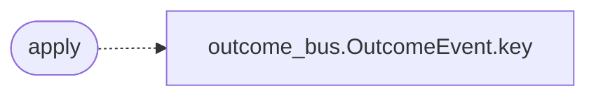

# `modules.sinks.objectives`

> Source: [modules/sinks/objectives.py:1](../../modules/sinks/objectives.py#L1) | language `py` | coverage 100.0% | [API index](../index.md)

Objectives sink: turn proven outcomes into follow-up work.

## Contents

- **Functions:** [`apply`](#apply)

## Call Graph

Solid arrows stay in this module, dashed arrows leave it.



## Functions

<a id="apply"></a>

### `apply`

`function` | [modules/sinks/objectives.py:16](../../modules/sinks/objectives.py#L16)

```python
def apply(event: OutcomeEvent) -> bool
```

Append one actionable objective when the outcome warrants it.

**Parameters**

| Name | Type | Default | Description |
|---|---|---|---|
| `event` | `OutcomeEvent` |  | Outcome to convert. |

**Returns:** `bool` - True when the objective was written.

*Calls:* [`OutcomeEvent.key`](modules.outcome_bus.py.md#outcomeevent-key)

---
