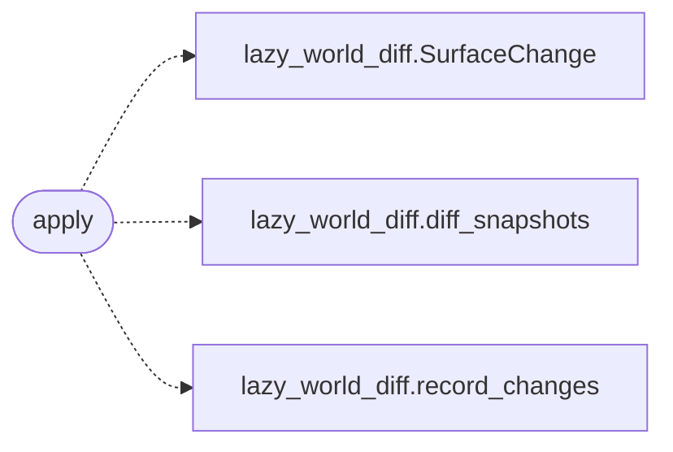

# `modules.sinks.world_diff`

> Source: [modules/sinks/world_diff.py:1](../../modules/sinks/world_diff.py#L1) | language `py` | coverage 100.0% | [API index](../index.md)

World-diff sink: snapshot hosts and record what changed per outcome.

## Contents

- **Functions:** [`apply`](#apply)

## Call Graph

Solid arrows stay in this module, dashed arrows leave it.



## Functions

<a id="apply"></a>

### `apply`

`function` | [modules/sinks/world_diff.py:14](../../modules/sinks/world_diff.py#L14)

```python
def apply(event: OutcomeEvent) -> bool
```

Diff one host's world snapshot and record the changes.

**Parameters**

| Name | Type | Default | Description |
|---|---|---|---|
| `event` | `OutcomeEvent` |  | Outcome that may have moved the world. |

**Returns:** `bool` - True when a snapshot was created or refreshed (changes recorded
or not); False when there was nothing to diff.

*Calls:* [`SurfaceChange`](modules.lazy_world_diff.py.md#surfacechange), [`diff_snapshots`](modules.lazy_world_diff.py.md#diff_snapshots), [`record_changes`](modules.lazy_world_diff.py.md#record_changes)

---
