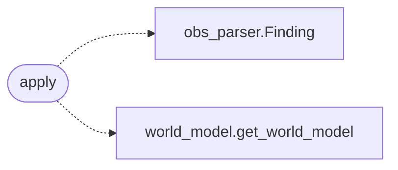

# `modules.sinks.world_model`

> Source: [modules/sinks/world_model.py:1](../../modules/sinks/world_model.py#L1) | language `py` | coverage 100.0% | [API index](../index.md)

World-model sink: hosts, services, vulnerabilities and credentials.

## Contents

- **Functions:** [`apply`](#apply)

## Call Graph

Solid arrows stay in this module, dashed arrows leave it.



## Functions

<a id="apply"></a>

### `apply`

`function` | [modules/sinks/world_model.py:12](../../modules/sinks/world_model.py#L12)

```python
def apply(event: OutcomeEvent) -> bool
```

Write one outcome into the world model.

**Parameters**

| Name | Type | Default | Description |
|---|---|---|---|
| `event` | `OutcomeEvent` |  | Outcome to persist. |

**Returns:** `bool` - True when the model accepted the write.

*Calls:* [`Finding`](modules.obs_parser.py.md#finding), [`get_world_model`](modules.world_model.py.md#get_world_model)

---
