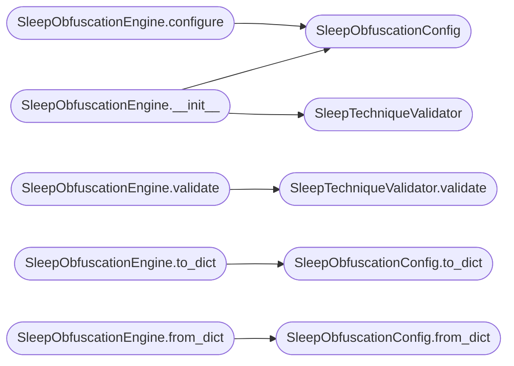

# `modules.sleep_obfuscation`

> Source: [modules/sleep_obfuscation.py:1](../../modules/sleep_obfuscation.py#L1) | language `py` | coverage 92.9% | [API index](../index.md)

Sleep obfuscation engine for beacon memory evasion.

Defines a catalog of sleep obfuscation techniques with configurable
parameters. Provides the `[`SleepObfuscationEngine`](#sleepobfuscationengine)` which selects
and validates techniques based on platform compatibility and
operational parameters.

Techniques catalogued:
    - Sleep Mask (RW -> RX/RW cycle via VirtualProtect/mprotect)
    - Ekko-style threadless sleep (timer queue + ROP gadgets)
    - Stack Spoofing (call stack overwrite before sleep)
    - Module Stomping (overwrite loaded module .text section)
    - APC Injection Chain (queued APC during sleep)
    - Hardware Breakpoint (VEH + HWBP on sleep/resume)
    - Fiber-based sleep (convert thread to fiber, swap, convert back)
    - Thread Pool (queue work item to pool thread before sleep)

Each technique is defined with its platform support, minimum beacon
version, detection resistance score, and configurable parameters.

Contracts:
    - SleepTechnique: immutable dataclass for a technique definition
    - SleepTechniqueCatalog: curated catalog of known techniques
    - SleepObfuscationConfig: runtime configuration for the active technique
    - SleepObfuscationEngine: selects, validates, and configures techniques
    - SleepTechniqueValidator: validates config against technique constraints

Design (SOLID):
    - Single Responsibility: catalog, config, engine, validator are separate
    - Open/Closed: new techniques added via catalog registration
    - Liskov: all techniques share the same dataclass contract
    - Interface Segregation: engine exposes only select/configure/validate
    - Dependency Inversion: depends on catalog abstraction, not on OS APIs

Usage:
    from modules.sleep_obfuscation import (
        SleepObfuscationEngine,
        SleepTechniqueCatalog,
    )

    engine = SleepObfuscationEngine()
    tech = engine.select("ekko")
    config = engine.configure(tech, {"encrypt_heap": True})
    errors = engine.validate(config)

## Contents

- **Classes:** [`SleepTechnique`](#sleeptechnique), [`SleepObfuscationConfig`](#sleepobfuscationconfig), [`SleepTechniqueCatalog`](#sleeptechniquecatalog), [`SleepTechniqueValidator`](#sleeptechniquevalidator), [`SleepObfuscationEngine`](#sleepobfuscationengine)
- **Enums:** [`OsPlatform`](#osplatform), [`TechniqueRisk`](#techniquerisk)

## Type Diagram

```mermaid
classDiagram
    direction LR
    class OsPlatform
    <<enum>> OsPlatform
    OsPlatform : WINDOWS
    OsPlatform : LINUX
    class TechniqueRisk
    <<enum>> TechniqueRisk
    TechniqueRisk : LOW
    TechniqueRisk : MEDIUM
    TechniqueRisk : HIGH
    class SleepTechnique
    SleepTechnique : str name
    SleepTechnique : str description
    SleepTechnique : list[OsPlatform] platforms
    SleepTechnique : int detection_resistance
    SleepTechnique : TechniqueRisk risk
    SleepTechnique : str min_beacon_version
    SleepTechnique : dict[str, Any] params
    SleepTechnique : bool requires_rop_gadgets
    SleepTechnique : str stability_note
    class SleepObfuscationConfig
    SleepObfuscationConfig : str technique_name
    SleepObfuscationConfig : bool enabled
    SleepObfuscationConfig : bool encrypt_heap
    SleepObfuscationConfig : bool encrypt_stack
    SleepObfuscationConfig : bool encrypt_peb
    SleepObfuscationConfig : bool rwx_to_rw_cycle
    SleepObfuscationConfig : bool indirect_syscalls
    SleepObfuscationConfig : str module_stomp_target
    SleepObfuscationConfig : int rop_gadget_count
    SleepObfuscationConfig : int sleep_delay_ms
    SleepObfuscationConfig : dict[str, Any] custom_params
    SleepObfuscationConfig : to_dict()
    SleepObfuscationConfig : from_dict()
    class SleepTechniqueCatalog
    SleepTechniqueCatalog : __init__()
    SleepTechniqueCatalog : register()
    SleepTechniqueCatalog : get()
    SleepTechniqueCatalog : list_all()
    SleepTechniqueCatalog : list_by_platform()
    SleepTechniqueCatalog : list_names()
    class SleepTechniqueValidator
    SleepTechniqueValidator : validate()
    SleepTechniqueValidator : validate_config()
    class SleepObfuscationEngine
    SleepObfuscationEngine : __init__()
    SleepObfuscationEngine : catalog()
    SleepObfuscationEngine : config()
    SleepObfuscationEngine : detection_resistance()
    SleepObfuscationEngine : select()
    SleepObfuscationEngine : configure()
    SleepObfuscationEngine : validate()
    SleepObfuscationEngine : recommend()
    SleepObfuscationEngine : to_dict()
    SleepObfuscationEngine : from_dict()
```



## Call Graph

Solid arrows stay in this module, dashed arrows leave it.



## Classes

<a id="sleeptechnique"></a>

### `SleepTechnique`

`class` `dataclass` | [modules/sleep_obfuscation.py:73](../../modules/sleep_obfuscation.py#L73)

Decorators: `@dataclass(frozen=True)`

```python
class SleepTechnique
```

Definition of a single sleep obfuscation technique.

**Attributes**

| Name | Type | Default | Description |
|---|---|---|---|
| [`name`](#sleeptechnique-name) | `str` |  | Unique technique identifier. |
| [`description`](#sleeptechnique-description) | `str` |  | Human-readable description. |
| [`platforms`](#sleeptechnique-platforms) | `list[OsPlatform]` |  | Supported OS platforms. |
| [`detection_resistance`](#sleeptechnique-detection_resistance) | `int` |  | Score 0-100 indicating EDR evasion strength. |
| [`risk`](#sleeptechnique-risk) | `TechniqueRisk` | `TechniqueRisk.MEDIUM` | Operational risk level (low/medium/high). |
| [`min_beacon_version`](#sleeptechnique-min_beacon_version) | `str` | `'1.0'` | Minimum beacon engine version required. |
| [`params`](#sleeptechnique-params) | `dict[str, Any]` | `field(default_factory=dict)` | Parameter schema as dict of name -> (type, default, description). |
| [`requires_rop_gadgets`](#sleeptechnique-requires_rop_gadgets) | `bool` | `False` | Whether the technique needs ROP gadget scanning. |
| [`stability_note`](#sleeptechnique-stability_note) | `str` | `''` | Operator-visible note about known issues. |

---

<a id="sleepobfuscationconfig"></a>

### `SleepObfuscationConfig`

`class` `dataclass` | [modules/sleep_obfuscation.py:100](../../modules/sleep_obfuscation.py#L100)

Decorators: `@dataclass`

```python
class SleepObfuscationConfig
```

Runtime configuration for the active sleep obfuscation technique.

**Attributes**

| Name | Type | Default | Description |
|---|---|---|---|
| [`technique_name`](#sleepobfuscationconfig-technique_name) | `str` | `'sleep_mask'` | Name of the selected technique. |
| [`enabled`](#sleepobfuscationconfig-enabled) | `bool` | `False` | Whether sleep obfuscation is active. |
| [`encrypt_heap`](#sleepobfuscationconfig-encrypt_heap) | `bool` | `True` | Encrypt beacon heap memory during sleep. |
| [`encrypt_stack`](#sleepobfuscationconfig-encrypt_stack) | `bool` | `True` | Encrypt thread stack during sleep. |
| [`encrypt_peb`](#sleepobfuscationconfig-encrypt_peb) | `bool` | `False` | Hide/Patch Process Environment Block. |
| [`rwx_to_rw_cycle`](#sleepobfuscationconfig-rwx_to_rw_cycle) | `bool` | `True` | Temporarily change memory protections. |
| [`indirect_syscalls`](#sleepobfuscationconfig-indirect_syscalls) | `bool` | `True` | Use indirect syscalls for protection changes. |
| [`module_stomp_target`](#sleepobfuscationconfig-module_stomp_target) | `str` | `''` | DLL name for module stomping (if applicable). |
| [`rop_gadget_count`](#sleepobfuscationconfig-rop_gadget_count) | `int` | `3` | Number of ROP gadgets to use (Ekko-style). |
| [`sleep_delay_ms`](#sleepobfuscationconfig-sleep_delay_ms) | `int` | `100` | Artificial delay in ms to pace operations. |
| [`custom_params`](#sleepobfuscationconfig-custom_params) | `dict[str, Any]` | `field(default_factory=dict)` | Free-form dict for technique-specific parameters. |

**Members**

| Member | Kind | Summary |
|---|---|---|
| [`to_dict`](#sleepobfuscationconfig-to_dict) | method | Serialize to dictionary. |
| [`from_dict`](#sleepobfuscationconfig-from_dict) | classmethod | Build from dictionary. |

<a id="sleepobfuscationconfig-to_dict"></a>

#### `SleepObfuscationConfig.to_dict`

`method` | [modules/sleep_obfuscation.py:129](../../modules/sleep_obfuscation.py#L129)

```python
def to_dict(self) -> dict[str, Any]
```

Serialize to dictionary.

**Returns:** `dict[str, Any]`

*Called by:* [`SleepObfuscationEngine.to_dict`](#sleepobfuscationengine-to_dict)

<a id="sleepobfuscationconfig-from_dict"></a>

#### `SleepObfuscationConfig.from_dict`

`classmethod` | [modules/sleep_obfuscation.py:146](../../modules/sleep_obfuscation.py#L146)

Decorators: `@classmethod`

```python
def from_dict(cls, raw: dict[str, Any]) -> SleepObfuscationConfig
```

Build from dictionary.

**Parameters**

| Name | Type | Default | Description |
|---|---|---|---|
| `raw` | `dict[str, Any]` |  |  |

**Returns:** `SleepObfuscationConfig`

*Called by:* [`SleepObfuscationEngine.from_dict`](#sleepobfuscationengine-from_dict)

---

<a id="sleeptechniquecatalog"></a>

### `SleepTechniqueCatalog`

`class` | [modules/sleep_obfuscation.py:163](../../modules/sleep_obfuscation.py#L163)

```python
class SleepTechniqueCatalog
```

Curated catalog of sleep obfuscation techniques.

New techniques are registered via ``register()``. The catalog
is immutable at runtime after initial population.

**Members**

| Member | Kind | Summary |
|---|---|---|
| [`__init__`](#sleeptechniquecatalog-__init__) | constructor |  |
| [`register`](#sleeptechniquecatalog-register) | method | Register a technique in the catalog. |
| [`get`](#sleeptechniquecatalog-get) | method | Retrieve a technique by name. |
| [`list_all`](#sleeptechniquecatalog-list_all) | method | Return all registered techniques sorted by detection resistance. |
| [`list_by_platform`](#sleeptechniquecatalog-list_by_platform) | method | Return techniques supported on a given platform. |
| [`list_names`](#sleeptechniquecatalog-list_names) | method | Return sorted list of technique names. |

<a id="sleeptechniquecatalog-__init__"></a>

#### `SleepTechniqueCatalog.__init__`

`constructor` | [modules/sleep_obfuscation.py:170](../../modules/sleep_obfuscation.py#L170)

```python
def __init__(self) -> None
```

<a id="sleeptechniquecatalog-register"></a>

#### `SleepTechniqueCatalog.register`

`method` | [modules/sleep_obfuscation.py:173](../../modules/sleep_obfuscation.py#L173)

```python
def register(self, technique: SleepTechnique) -> None
```

Register a technique in the catalog.

**Parameters**

| Name | Type | Default | Description |
|---|---|---|---|
| `technique` | `SleepTechnique` |  |  |

<a id="sleeptechniquecatalog-get"></a>

#### `SleepTechniqueCatalog.get`

`method` | [modules/sleep_obfuscation.py:177](../../modules/sleep_obfuscation.py#L177)

```python
def get(self, name: str) -> SleepTechnique
```

Retrieve a technique by name.

Raises KeyError if missing.

**Parameters**

| Name | Type | Default | Description |
|---|---|---|---|
| `name` | `str` |  |  |

**Returns:** `SleepTechnique`

**Raises**

- `KeyError`: (raised in the body, not documented)

<a id="sleeptechniquecatalog-list_all"></a>

#### `SleepTechniqueCatalog.list_all`

`method` | [modules/sleep_obfuscation.py:184](../../modules/sleep_obfuscation.py#L184)

```python
def list_all(self) -> list[SleepTechnique]
```

Return all registered techniques sorted by detection resistance.

**Returns:** `list[SleepTechnique]`

<a id="sleeptechniquecatalog-list_by_platform"></a>

#### `SleepTechniqueCatalog.list_by_platform`

`method` | [modules/sleep_obfuscation.py:192](../../modules/sleep_obfuscation.py#L192)

```python
def list_by_platform(self, platform: OsPlatform) -> list[SleepTechnique]
```

Return techniques supported on a given platform.

**Parameters**

| Name | Type | Default | Description |
|---|---|---|---|
| `platform` | `OsPlatform` |  |  |

**Returns:** `list[SleepTechnique]`

<a id="sleeptechniquecatalog-list_names"></a>

#### `SleepTechniqueCatalog.list_names`

`method` | [modules/sleep_obfuscation.py:196](../../modules/sleep_obfuscation.py#L196)

```python
def list_names(self) -> list[str]
```

Return sorted list of technique names.

**Returns:** `list[str]`

---

<a id="sleeptechniquevalidator"></a>

### `SleepTechniqueValidator`

`class` | [modules/sleep_obfuscation.py:365](../../modules/sleep_obfuscation.py#L365)

```python
class SleepTechniqueValidator
```

Validates a SleepObfuscationConfig against technique constraints.

**Members**

| Member | Kind | Summary |
|---|---|---|
| [`validate`](#sleeptechniquevalidator-validate) | staticmethod | Validate config against a technique definition. |
| [`validate_config`](#sleeptechniquevalidator-validate_config) | staticmethod | Validate the config itself for internal consistency. |

<a id="sleeptechniquevalidator-validate"></a>

#### `SleepTechniqueValidator.validate`

`staticmethod` | [modules/sleep_obfuscation.py:369](../../modules/sleep_obfuscation.py#L369)

Decorators: `@staticmethod`

```python
def validate(config: SleepObfuscationConfig, technique: SleepTechnique) -> list[str]
```

Validate config against a technique definition.

Returns a list of error strings (empty = valid).

**Parameters**

| Name | Type | Default | Description |
|---|---|---|---|
| `config` | `SleepObfuscationConfig` |  |  |
| `technique` | `SleepTechnique` |  |  |

**Returns:** `list[str]`

*Called by:* [`SleepObfuscationEngine.validate`](#sleepobfuscationengine-validate)

<a id="sleeptechniquevalidator-validate_config"></a>

#### `SleepTechniqueValidator.validate_config`

`staticmethod` | [modules/sleep_obfuscation.py:386](../../modules/sleep_obfuscation.py#L386)

Decorators: `@staticmethod`

```python
def validate_config(config: SleepObfuscationConfig) -> list[str]
```

Validate the config itself for internal consistency.

**Parameters**

| Name | Type | Default | Description |
|---|---|---|---|
| `config` | `SleepObfuscationConfig` |  |  |

**Returns:** `list[str]`

---

<a id="sleepobfuscationengine"></a>

### `SleepObfuscationEngine`

`class` | [modules/sleep_obfuscation.py:394](../../modules/sleep_obfuscation.py#L394)

```python
class SleepObfuscationEngine
```

Engine for selecting, configuring, and validating sleep obfuscation.

Composes a technique catalog, a validator, and runtime configuration.
Provides the primary interface for beacon compile-time and run-time
sleep obfuscation decisions.

**Members**

| Member | Kind | Summary |
|---|---|---|
| [`__init__`](#sleepobfuscationengine-__init__) | constructor |  |
| [`catalog`](#sleepobfuscationengine-catalog) | property | Return the technique catalog. |
| [`config`](#sleepobfuscationengine-config) | property | Return the active runtime configuration. |
| [`detection_resistance`](#sleepobfuscationengine-detection_resistance) | property | Return the detection resistance score of the active technique. |
| [`select`](#sleepobfuscationengine-select) | method | Select a technique from the catalog. |
| [`configure`](#sleepobfuscationengine-configure) | method | Build a validated SleepObfuscationConfig for a technique. |
| [`validate`](#sleepobfuscationengine-validate) | method | Validate configuration against the active technique. |
| [`recommend`](#sleepobfuscationengine-recommend) | method | Recommend techniques for a platform sorted by detection resistance. |
| [`to_dict`](#sleepobfuscationengine-to_dict) | method | Serialize the entire engine state to a dictionary. |
| [`from_dict`](#sleepobfuscationengine-from_dict) | classmethod | Build an engine from a serialized state dictionary. |

<a id="sleepobfuscationengine-__init__"></a>

#### `SleepObfuscationEngine.__init__`

`constructor` | [modules/sleep_obfuscation.py:407](../../modules/sleep_obfuscation.py#L407)

```python
def __init__(self, catalog: SleepTechniqueCatalog | None = None) -> None
```

**Parameters**

| Name | Type | Default | Description |
|---|---|---|---|
| `catalog` | `SleepTechniqueCatalog \| None` | `None` |  |

*Calls:* [`SleepObfuscationConfig`](#sleepobfuscationconfig), [`SleepTechniqueValidator`](#sleeptechniquevalidator)

*Called by:* [`SleepObfuscationCommandSet.do_sleep_configure`](cli.commands.sleep_obfuscation.py.md#sleepobfuscationcommandset-do_sleep_configure), [`SleepObfuscationCommandSet.do_sleep_info`](cli.commands.sleep_obfuscation.py.md#sleepobfuscationcommandset-do_sleep_info), [`SleepObfuscationCommandSet.do_sleep_list`](cli.commands.sleep_obfuscation.py.md#sleepobfuscationcommandset-do_sleep_list)

<a id="sleepobfuscationengine-catalog"></a>

#### `SleepObfuscationEngine.catalog`

`property` | [modules/sleep_obfuscation.py:416](../../modules/sleep_obfuscation.py#L416)

Decorators: `@property`

```python
def catalog(self) -> SleepTechniqueCatalog
```

Return the technique catalog.

**Returns:** `SleepTechniqueCatalog`

<a id="sleepobfuscationengine-config"></a>

#### `SleepObfuscationEngine.config`

`property` | [modules/sleep_obfuscation.py:421](../../modules/sleep_obfuscation.py#L421)

Decorators: `@property`

```python
def config(self) -> SleepObfuscationConfig
```

Return the active runtime configuration.

**Returns:** `SleepObfuscationConfig`

<a id="sleepobfuscationengine-detection_resistance"></a>

#### `SleepObfuscationEngine.detection_resistance`

`property` | [modules/sleep_obfuscation.py:426](../../modules/sleep_obfuscation.py#L426)

Decorators: `@property`

```python
def detection_resistance(self) -> int
```

Return the detection resistance score of the active technique.

If the active technique is not found in the catalog (e.g., custom
catalog was provided but config still references a built-in name),
fall back to the highest available technique in the catalog.

**Returns:** `int`

<a id="sleepobfuscationengine-select"></a>

#### `SleepObfuscationEngine.select`

`method` | [modules/sleep_obfuscation.py:442](../../modules/sleep_obfuscation.py#L442)

```python
def select(self, technique_name: str) -> SleepTechnique
```

Select a technique from the catalog.

Returns the SleepTechnique. Raises KeyError if not found.

**Parameters**

| Name | Type | Default | Description |
|---|---|---|---|
| `technique_name` | `str` |  |  |

**Returns:** `SleepTechnique`

*Called by:* [`SleepObfuscationCommandSet.do_sleep_configure`](cli.commands.sleep_obfuscation.py.md#sleepobfuscationcommandset-do_sleep_configure), [`SleepObfuscationCommandSet.do_sleep_info`](cli.commands.sleep_obfuscation.py.md#sleepobfuscationcommandset-do_sleep_info)

<a id="sleepobfuscationengine-configure"></a>

#### `SleepObfuscationEngine.configure`

`method` | [modules/sleep_obfuscation.py:449](../../modules/sleep_obfuscation.py#L449)

```python
def configure(self, technique: SleepTechnique, overrides: dict[str, Any] | None = None) -> SleepObfuscationConfig
```

Build a validated SleepObfuscationConfig for a technique.

**Parameters**

| Name | Type | Default | Description |
|---|---|---|---|
| `technique` | `SleepTechnique` |  | The SleepTechnique to configure. |
| `overrides` | `dict[str, Any] \| None` | `None` | Optional dict to override default config values. |

**Returns:** `SleepObfuscationConfig` - A validated SleepObfuscationConfig ready for beacon embedding.

*Calls:* [`SleepObfuscationConfig`](#sleepobfuscationconfig)

*Called by:* [`SleepObfuscationCommandSet.do_sleep_configure`](cli.commands.sleep_obfuscation.py.md#sleepobfuscationcommandset-do_sleep_configure)

<a id="sleepobfuscationengine-validate"></a>

#### `SleepObfuscationEngine.validate`

`method` | [modules/sleep_obfuscation.py:484](../../modules/sleep_obfuscation.py#L484)

```python
def validate(self, config: SleepObfuscationConfig | None = None) -> list[str]
```

Validate configuration against the active technique.

**Parameters**

| Name | Type | Default | Description |
|---|---|---|---|
| `config` | `SleepObfuscationConfig \| None` | `None` | Optional config to validate. Uses self.config if None. |

**Returns:** `list[str]` - List of error strings (empty = valid).

*Calls:* [`SleepTechniqueValidator.validate`](#sleeptechniquevalidator-validate)

*Called by:* [`SleepObfuscationCommandSet.do_sleep_configure`](cli.commands.sleep_obfuscation.py.md#sleepobfuscationcommandset-do_sleep_configure)

<a id="sleepobfuscationengine-recommend"></a>

#### `SleepObfuscationEngine.recommend`

`method` | [modules/sleep_obfuscation.py:500](../../modules/sleep_obfuscation.py#L500)

```python
def recommend(self, platform: OsPlatform) -> list[SleepTechnique]
```

Recommend techniques for a platform sorted by detection resistance.

Returns techniques supported on the given platform, sorted with the
highest detection resistance first.

**Parameters**

| Name | Type | Default | Description |
|---|---|---|---|
| `platform` | `OsPlatform` |  |  |

**Returns:** `list[SleepTechnique]`

*Called by:* [`SleepObfuscationCommandSet.do_sleep_list`](cli.commands.sleep_obfuscation.py.md#sleepobfuscationcommandset-do_sleep_list)

<a id="sleepobfuscationengine-to_dict"></a>

#### `SleepObfuscationEngine.to_dict`

`method` | [modules/sleep_obfuscation.py:513](../../modules/sleep_obfuscation.py#L513)

```python
def to_dict(self) -> dict[str, Any]
```

Serialize the entire engine state to a dictionary.

**Returns:** `dict[str, Any]`

*Calls:* [`SleepObfuscationConfig.to_dict`](#sleepobfuscationconfig-to_dict)

<a id="sleepobfuscationengine-from_dict"></a>

#### `SleepObfuscationEngine.from_dict`

`classmethod` | [modules/sleep_obfuscation.py:522](../../modules/sleep_obfuscation.py#L522)

Decorators: `@classmethod`

```python
def from_dict(cls, raw: dict[str, Any]) -> SleepObfuscationEngine
```

Build an engine from a serialized state dictionary.

**Parameters**

| Name | Type | Default | Description |
|---|---|---|---|
| `raw` | `dict[str, Any]` |  |  |

**Returns:** `SleepObfuscationEngine`

*Calls:* [`SleepObfuscationConfig.from_dict`](#sleepobfuscationconfig-from_dict)

---

## Enums

<a id="osplatform"></a>

### `OsPlatform`

`enum` | [modules/sleep_obfuscation.py:57](../../modules/sleep_obfuscation.py#L57)

```python
class OsPlatform(str, Enum)
```

Bases: `str`, `Enum`

Operating system platform.

**Attributes**

| Name | Type | Default | Description |
|---|---|---|---|
| [`WINDOWS`](#osplatform-windows) |  | `'windows'` |  |
| [`LINUX`](#osplatform-linux) |  | `'linux'` |  |

---

<a id="techniquerisk"></a>

### `TechniqueRisk`

`enum` | [modules/sleep_obfuscation.py:64](../../modules/sleep_obfuscation.py#L64)

```python
class TechniqueRisk(str, Enum)
```

Bases: `str`, `Enum`

Risk classification for a sleep obfuscation technique.

**Attributes**

| Name | Type | Default | Description |
|---|---|---|---|
| [`LOW`](#techniquerisk-low) |  | `'low'` |  |
| [`MEDIUM`](#techniquerisk-medium) |  | `'medium'` |  |
| [`HIGH`](#techniquerisk-high) |  | `'high'` |  |

---
