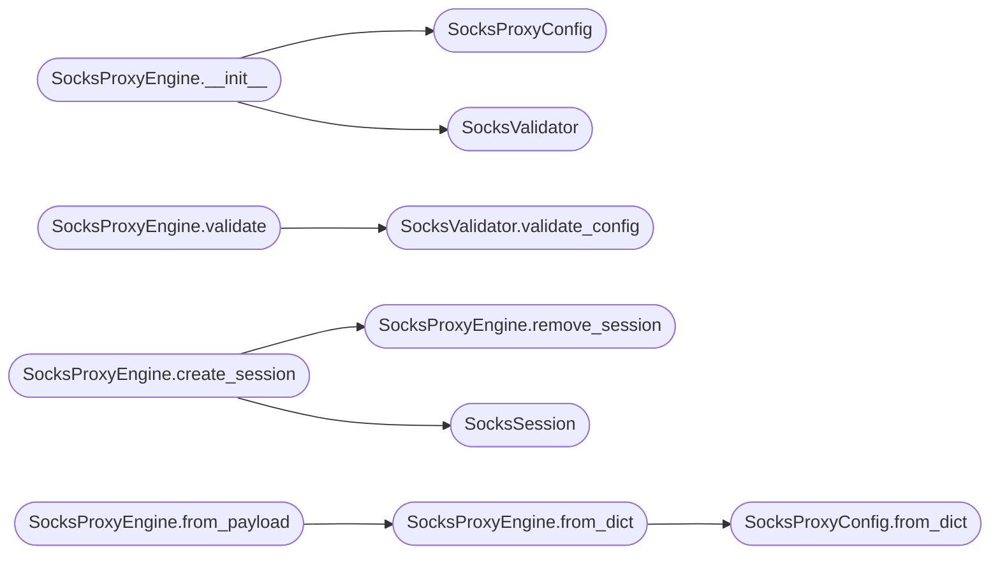

# `modules.socks_proxy`

> Source: [modules/socks_proxy.py:1](../../modules/socks_proxy.py#L1) | language `py` | coverage 96.7% | [API index](../index.md)

SOCKS5 proxy engine for tunneling traffic through LazyOwn beacons.

Provides a configuration-driven SOCKS5 proxy that allows operators to
route external tools through a compromised beacon's network. Supports
authentication, activity logging, connection limits, and bandwidth
throttling.

The engine is designed as a specification-only module: it defines the
protocol, configuration, and validation contracts without coupling to
any specific transport implementation. Concrete transport adapters
(e.g., WebSocket, HTTP long-poll) inject their own I/O layer.

Contracts:
    - SocksProxyConfig: immutable configuration for a SOCKS proxy instance
    - SocksAuthMethod: enumeration of supported authentication methods
    - SocksCommand: SOCKS5 command types (CONNECT, BIND, UDP)
    - SocksProxyEngine: validates config, builds proxy specs, tracks sessions
    - SocksSession: represents an active proxied connection
    - SocksValidator: validates config, client requests, and protocol states

Design (SOLID):
    - Single Responsibility: config, session, engine, validator are separate
    - Open/Closed: new auth methods added via enum without modifying engine
    - Liskov: session and config are safely substitutable dataclasses
    - Interface Segregation: engine exposes only spec/validation, not I/O
    - Dependency Inversion: depends on abstract config dict, not on sockets

Usage:
    from modules.socks_proxy import SocksProxyEngine

    engine = SocksProxyEngine(
        SocksProxyConfig(
            bind_address="127.0.0.1",
            bind_port=1080,
            auth_methods=[SocksAuthMethod.NO_AUTH],
        )
    )
    spec = engine.build_spec()
    errors = engine.validate()

## Contents

- **Classes:** [`SocksSession`](#sockssession), [`SocksProxyConfig`](#socksproxyconfig), [`SocksValidator`](#socksvalidator), [`SocksProxyEngine`](#socksproxyengine)
- **Enums:** [`SocksAuthMethod`](#socksauthmethod), [`SocksCommand`](#sockscommand), [`SocksAddressType`](#socksaddresstype), [`SocksReply`](#socksreply)
- **Constants:** [`SOCKS_VERSION`](#socks_version)

## Type Diagram

```mermaid
classDiagram
    direction LR
    class SocksAuthMethod
    <<enum>> SocksAuthMethod
    SocksAuthMethod : NO_AUTH
    SocksAuthMethod : GSSAPI
    SocksAuthMethod : USERNAME_PASSWORD
    SocksAuthMethod : NO_ACCEPTABLE
    class SocksCommand
    <<enum>> SocksCommand
    SocksCommand : CONNECT
    SocksCommand : BIND
    SocksCommand : UDP_ASSOCIATE
    class SocksAddressType
    <<enum>> SocksAddressType
    SocksAddressType : IPV4
    SocksAddressType : DOMAIN
    SocksAddressType : IPV6
    class SocksReply
    <<enum>> SocksReply
    SocksReply : SUCCEEDED
    SocksReply : GENERAL_FAILURE
    SocksReply : CONNECTION_NOT_ALLOWED
    SocksReply : NETWORK_UNREACHABLE
    SocksReply : HOST_UNREACHABLE
    SocksReply : CONNECTION_REFUSED
    SocksReply : TTL_EXPIRED
    SocksReply : COMMAND_NOT_SUPPORTED
    SocksReply : ADDRESS_TYPE_NOT_SUPPORTED
    SocksReply : message()
    class SocksSession
    SocksSession : str session_id
    SocksSession : str target_host
    SocksSession : int target_port
    SocksSession : str beacon_client_id
    SocksSession : int bytes_sent
    SocksSession : int bytes_received
    SocksSession : float created_at
    SocksSession : float last_activity
    SocksSession : elapsed_seconds()
    SocksSession : to_dict()
    class SocksProxyConfig
    SocksProxyConfig : str bind_address
    SocksProxyConfig : int bind_port
    SocksProxyConfig : list[SocksAuthMethod] auth_methods
    SocksProxyConfig : str username
    SocksProxyConfig : str password
    SocksProxyConfig : int max_connections
    SocksProxyConfig : int session_timeout_seconds
    SocksProxyConfig : int bandwidth_limit_bps
    SocksProxyConfig : bool allow_localhost
    SocksProxyConfig : bool allow_private_ranges
    SocksProxyConfig : list[int] allowed_ports
    SocksProxyConfig : list[int] denied_ports
    SocksProxyConfig : bool log_connections
    SocksProxyConfig : to_dict()
    SocksProxyConfig : from_dict()
    class SocksValidator
    SocksValidator : validate_config()
    SocksValidator : validate_request()
    class SocksProxyEngine
    SocksProxyEngine : __init__()
    SocksProxyEngine : config()
    SocksProxyEngine : sessions()
    SocksProxyEngine : session_count()
    SocksProxyEngine : validate()
    SocksProxyEngine : build_spec()
    SocksProxyEngine : create_session()
    SocksProxyEngine : remove_session()
    SocksProxyEngine : get_session()
    SocksProxyEngine : add_bytes()
    SocksProxyEngine : cleanup_expired()
    SocksProxyEngine : list_sessions()
    SocksProxyEngine : from_dict()
    SocksProxyEngine : from_payload()
```



## Call Graph

Solid arrows stay in this module, dashed arrows leave it.



## Classes

<a id="sockssession"></a>

### `SocksSession`

`class` `dataclass` | [modules/socks_proxy.py:120](../../modules/socks_proxy.py#L120)

Decorators: `@dataclass`

```python
class SocksSession
```

Represents a single active proxied connection.

**Attributes**

| Name | Type | Default | Description |
|---|---|---|---|
| [`session_id`](#sockssession-session_id) | `str` |  | Unique identifier for this session. |
| [`target_host`](#sockssession-target_host) | `str` |  | Destination hostname or IP address. |
| [`target_port`](#sockssession-target_port) | `int` |  | Destination TCP port. |
| [`beacon_client_id`](#sockssession-beacon_client_id) | `str` |  | Client ID of the beacon handling this session. |
| [`bytes_sent`](#sockssession-bytes_sent) | `int` | `0` | Total bytes sent to target. |
| [`bytes_received`](#sockssession-bytes_received) | `int` | `0` | Total bytes received from target. |
| [`created_at`](#sockssession-created_at) | `float` | `0.0` | Unix timestamp of session creation. |
| [`last_activity`](#sockssession-last_activity) | `float` | `0.0` | Unix timestamp of last data transfer. |

**Members**

| Member | Kind | Summary |
|---|---|---|
| [`elapsed_seconds`](#sockssession-elapsed_seconds) | property | Return seconds since session creation. |
| [`to_dict`](#sockssession-to_dict) | method | Serialize session to dictionary. |

<a id="sockssession-elapsed_seconds"></a>

#### `SocksSession.elapsed_seconds`

`property` | [modules/socks_proxy.py:144](../../modules/socks_proxy.py#L144)

Decorators: `@property`

```python
def elapsed_seconds(self) -> float
```

Return seconds since session creation.

**Returns:** `float`

<a id="sockssession-to_dict"></a>

#### `SocksSession.to_dict`

`method` | [modules/socks_proxy.py:150](../../modules/socks_proxy.py#L150)

```python
def to_dict(self) -> dict[str, Any]
```

Serialize session to dictionary.

**Returns:** `dict[str, Any]`

---

<a id="socksproxyconfig"></a>

### `SocksProxyConfig`

`class` `dataclass` | [modules/socks_proxy.py:166](../../modules/socks_proxy.py#L166)

Decorators: `@dataclass`

```python
class SocksProxyConfig
```

Configuration for a SOCKS5 proxy instance.

**Attributes**

| Name | Type | Default | Description |
|---|---|---|---|
| [`bind_address`](#socksproxyconfig-bind_address) | `str` | `SOCKS_DEFAULT_BIND_ADDRESS` | IP address to bind the proxy listener. |
| [`bind_port`](#socksproxyconfig-bind_port) | `int` | `SOCKS_DEFAULT_BIND_PORT` | TCP port to bind. |
| [`auth_methods`](#socksproxyconfig-auth_methods) | `list[SocksAuthMethod]` | `field(default_factory=lambda: [SocksAuthMethod.NO_AUTH])` | Ordered list of supported authentication methods. |
| [`username`](#socksproxyconfig-username) | `str` | `''` | Username for USERNAME_PASSWORD auth. |
| [`password`](#socksproxyconfig-password) | `str` | `''` | Password for USERNAME_PASSWORD auth. |
| [`max_connections`](#socksproxyconfig-max_connections) | `int` | `SOCKS_DEFAULT_MAX_CONNECTIONS` | Maximum concurrent proxied connections. |
| [`session_timeout_seconds`](#socksproxyconfig-session_timeout_seconds) | `int` | `SOCKS_DEFAULT_SESSION_TIMEOUT_S` | Idle session timeout in seconds. |
| [`bandwidth_limit_bps`](#socksproxyconfig-bandwidth_limit_bps) | `int` | `SOCKS_DEFAULT_BANDWIDTH_LIMIT_BPS` | Maximum bandwidth in bytes per second (0 = unlimited). |
| [`allow_localhost`](#socksproxyconfig-allow_localhost) | `bool` | `False` | Allow connections to loopback addresses. |
| [`allow_private_ranges`](#socksproxyconfig-allow_private_ranges) | `bool` | `True` | Allow connections to RFC 1918 addresses. |
| [`allowed_ports`](#socksproxyconfig-allowed_ports) | `list[int]` | `field(default_factory=list)` | List of allowed destination ports (empty = all allowed). |
| [`denied_ports`](#socksproxyconfig-denied_ports) | `list[int]` | `field(default_factory=lambda: [22, 3389])` | List of denied destination ports. |
| [`log_connections`](#socksproxyconfig-log_connections) | `bool` | `True` | Enable connection logging. |

**Members**

| Member | Kind | Summary |
|---|---|---|
| [`to_dict`](#socksproxyconfig-to_dict) | method | Serialize config to dictionary. |
| [`from_dict`](#socksproxyconfig-from_dict) | classmethod | Build config from dictionary. |

<a id="socksproxyconfig-to_dict"></a>

#### `SocksProxyConfig.to_dict`

`method` | [modules/socks_proxy.py:199](../../modules/socks_proxy.py#L199)

```python
def to_dict(self) -> dict[str, Any]
```

Serialize config to dictionary.

**Returns:** `dict[str, Any]`

<a id="socksproxyconfig-from_dict"></a>

#### `SocksProxyConfig.from_dict`

`classmethod` | [modules/socks_proxy.py:218](../../modules/socks_proxy.py#L218)

Decorators: `@classmethod`

```python
def from_dict(cls, raw: dict[str, Any]) -> SocksProxyConfig
```

Build config from dictionary.

**Parameters**

| Name | Type | Default | Description |
|---|---|---|---|
| `raw` | `dict[str, Any]` |  |  |

**Returns:** `SocksProxyConfig`

*Called by:* [`SocksProxyEngine.from_dict`](#socksproxyengine-from_dict)

---

<a id="socksvalidator"></a>

### `SocksValidator`

`class` | [modules/socks_proxy.py:244](../../modules/socks_proxy.py#L244)

```python
class SocksValidator
```

Validates SOCKS5 proxy configuration and request parameters.

Ensures bind addresses are valid IPs, ports are in range,
authentication settings are consistent, and access control
rules are well-formed.

**Members**

| Member | Kind | Summary |
|---|---|---|
| [`validate_config`](#socksvalidator-validate_config) | staticmethod | Validate a SocksProxyConfig and return error messages. |
| [`validate_request`](#socksvalidator-validate_request) | staticmethod | Validate a SOCKS5 request against the proxy configuration. |

<a id="socksvalidator-validate_config"></a>

#### `SocksValidator.validate_config`

`staticmethod` | [modules/socks_proxy.py:253](../../modules/socks_proxy.py#L253)

Decorators: `@staticmethod`

```python
def validate_config(config: SocksProxyConfig) -> list[str]
```

Validate a SocksProxyConfig and return error messages.

Returns an empty list if the config is valid.

**Parameters**

| Name | Type | Default | Description |
|---|---|---|---|
| `config` | `SocksProxyConfig` |  |  |

**Returns:** `list[str]`

*Called by:* [`SocksProxyEngine.validate`](#socksproxyengine-validate)

<a id="socksvalidator-validate_request"></a>

#### `SocksValidator.validate_request`

`staticmethod` | [modules/socks_proxy.py:300](../../modules/socks_proxy.py#L300)

Decorators: `@staticmethod`

```python
def validate_request(command: int, address_type: int, host: str, port: int, config: SocksProxyConfig | None = None) -> tuple[bool, int, str]
```

Validate a SOCKS5 request against the proxy configuration.

**Parameters**

| Name | Type | Default | Description |
|---|---|---|---|
| `command` | `int` |  | SOCKS command byte (CONNECT, BIND, UDP_ASSOCIATE). |
| `address_type` | `int` |  | Address type byte (IPV4, DOMAIN, IPV6). |
| `host` | `str` |  | Target hostname or IP address. |
| `port` | `int` |  | Target port. |
| `config` | `SocksProxyConfig \| None` | `None` | Optional proxy config for access control checks. |

**Returns:** `tuple[bool, int, str]` - Tuple of (is_valid, reply_code, message).

---

<a id="socksproxyengine"></a>

### `SocksProxyEngine`

`class` | [modules/socks_proxy.py:368](../../modules/socks_proxy.py#L368)

```python
class SocksProxyEngine
```

SOCKS5 proxy specification engine.

Provides configuration, validation, and session management
for a SOCKS5 proxy tunneled through a LazyOwn beacon. Does
not handle I/O; concrete adapters inject their transport.

**Members**

| Member | Kind | Summary |
|---|---|---|
| [`__init__`](#socksproxyengine-__init__) | constructor |  |
| [`config`](#socksproxyengine-config) | property | Return the current proxy configuration. |
| [`sessions`](#socksproxyengine-sessions) | property | Return active proxied sessions. |
| [`session_count`](#socksproxyengine-session_count) | property | Return the number of active sessions. |
| [`validate`](#socksproxyengine-validate) | method | Validate the configuration. |
| [`build_spec`](#socksproxyengine-build_spec) | method | Build a JSON-serializable proxy specification for beacon delivery. |
| [`create_session`](#socksproxyengine-create_session) | method | Create and track a new proxied session. |
| [`remove_session`](#socksproxyengine-remove_session) | method | Remove a session by ID. |
| [`get_session`](#socksproxyengine-get_session) | method | Return a session by ID, or None. |
| [`add_bytes`](#socksproxyengine-add_bytes) | method | Update byte counters for a session. |
| [`cleanup_expired`](#socksproxyengine-cleanup_expired) | method | Remove sessions that have exceeded the timeout. |
| [`list_sessions`](#socksproxyengine-list_sessions) | method | Return a list of all active sessions as dictionaries. |
| [`from_dict`](#socksproxyengine-from_dict) | classmethod | Build a SocksProxyEngine from a configuration dictionary. |
| [`from_payload`](#socksproxyengine-from_payload) | classmethod | Build a SocksProxyEngine from a LazyOwn payload configuration. |

<a id="socksproxyengine-__init__"></a>

#### `SocksProxyEngine.__init__`

`constructor` | [modules/socks_proxy.py:381](../../modules/socks_proxy.py#L381)

```python
def __init__(self, config: SocksProxyConfig | None = None) -> None
```

**Parameters**

| Name | Type | Default | Description |
|---|---|---|---|
| `config` | `SocksProxyConfig \| None` | `None` |  |

*Calls:* [`SocksProxyConfig`](#socksproxyconfig), [`SocksValidator`](#socksvalidator)

*Called by:* [`SocksProxyCommandSet.do_socks_config`](cli.commands.socks_proxy.py.md#socksproxycommandset-do_socks_config), [`SocksProxyCommandSet.do_socks_export`](cli.commands.socks_proxy.py.md#socksproxycommandset-do_socks_export), [`SocksProxyCommandSet.do_socks_sessions`](cli.commands.socks_proxy.py.md#socksproxycommandset-do_socks_sessions)

<a id="socksproxyengine-config"></a>

#### `SocksProxyEngine.config`

`property` | [modules/socks_proxy.py:387](../../modules/socks_proxy.py#L387)

Decorators: `@property`

```python
def config(self) -> SocksProxyConfig
```

Return the current proxy configuration.

**Returns:** `SocksProxyConfig`

<a id="socksproxyengine-sessions"></a>

#### `SocksProxyEngine.sessions`

`property` | [modules/socks_proxy.py:392](../../modules/socks_proxy.py#L392)

Decorators: `@property`

```python
def sessions(self) -> dict[str, SocksSession]
```

Return active proxied sessions.

**Returns:** `dict[str, SocksSession]`

<a id="socksproxyengine-session_count"></a>

#### `SocksProxyEngine.session_count`

`property` | [modules/socks_proxy.py:397](../../modules/socks_proxy.py#L397)

Decorators: `@property`

```python
def session_count(self) -> int
```

Return the number of active sessions.

**Returns:** `int`

<a id="socksproxyengine-validate"></a>

#### `SocksProxyEngine.validate`

`method` | [modules/socks_proxy.py:401](../../modules/socks_proxy.py#L401)

```python
def validate(self, config: SocksProxyConfig | None = None) -> list[str]
```

Validate the configuration.

**Parameters**

| Name | Type | Default | Description |
|---|---|---|---|
| `config` | `SocksProxyConfig \| None` | `None` | Optional config to validate. Uses self.config if None. |

**Returns:** `list[str]` - List of error strings (empty = valid).

*Calls:* [`SocksValidator.validate_config`](#socksvalidator-validate_config)

*Called by:* [`SocksProxyCommandSet.do_socks_config`](cli.commands.socks_proxy.py.md#socksproxycommandset-do_socks_config)

<a id="socksproxyengine-build_spec"></a>

#### `SocksProxyEngine.build_spec`

`method` | [modules/socks_proxy.py:413](../../modules/socks_proxy.py#L413)

```python
def build_spec(self) -> dict[str, Any]
```

Build a JSON-serializable proxy specification for beacon delivery.

The spec contains everything a beacon needs to set up a
SOCKS5 proxy listener and relay traffic through its C2.

**Returns:** `dict[str, Any]`

*Called by:* [`SocksProxyCommandSet.do_socks_config`](cli.commands.socks_proxy.py.md#socksproxycommandset-do_socks_config), [`SocksProxyCommandSet.do_socks_export`](cli.commands.socks_proxy.py.md#socksproxycommandset-do_socks_export)

<a id="socksproxyengine-create_session"></a>

#### `SocksProxyEngine.create_session`

`method` | [modules/socks_proxy.py:436](../../modules/socks_proxy.py#L436)

```python
def create_session(self, session_id: str, target_host: str, target_port: int, beacon_client_id: str) -> SocksSession | None
```

Create and track a new proxied session.

Returns None if max_connections is reached.

**Parameters**

| Name | Type | Default | Description |
|---|---|---|---|
| `session_id` | `str` |  |  |
| `target_host` | `str` |  |  |
| `target_port` | `int` |  |  |
| `beacon_client_id` | `str` |  |  |

**Returns:** `SocksSession | None`

*Calls:* [`SocksProxyEngine.remove_session`](#socksproxyengine-remove_session), [`SocksSession`](#sockssession)

<a id="socksproxyengine-remove_session"></a>

#### `SocksProxyEngine.remove_session`

`method` | [modules/socks_proxy.py:475](../../modules/socks_proxy.py#L475)

```python
def remove_session(self, session_id: str) -> bool
```

Remove a session by ID.

Returns True if it existed.

**Parameters**

| Name | Type | Default | Description |
|---|---|---|---|
| `session_id` | `str` |  |  |

**Returns:** `bool`

*Called by:* [`SocksProxyEngine.create_session`](#socksproxyengine-create_session)

<a id="socksproxyengine-get_session"></a>

#### `SocksProxyEngine.get_session`

`method` | [modules/socks_proxy.py:482](../../modules/socks_proxy.py#L482)

```python
def get_session(self, session_id: str) -> SocksSession | None
```

Return a session by ID, or None.

**Parameters**

| Name | Type | Default | Description |
|---|---|---|---|
| `session_id` | `str` |  |  |

**Returns:** `SocksSession | None`

<a id="socksproxyengine-add_bytes"></a>

#### `SocksProxyEngine.add_bytes`

`method` | [modules/socks_proxy.py:486](../../modules/socks_proxy.py#L486)

```python
def add_bytes(self, session_id: str, sent: int = 0, received: int = 0) -> None
```

Update byte counters for a session.

**Parameters**

| Name | Type | Default | Description |
|---|---|---|---|
| `session_id` | `str` |  |  |
| `sent` | `int` | `0` |  |
| `received` | `int` | `0` |  |

<a id="socksproxyengine-cleanup_expired"></a>

#### `SocksProxyEngine.cleanup_expired`

`method` | [modules/socks_proxy.py:497](../../modules/socks_proxy.py#L497)

```python
def cleanup_expired(self) -> int
```

Remove sessions that have exceeded the timeout.

Returns count removed.

**Returns:** `int`

<a id="socksproxyengine-list_sessions"></a>

#### `SocksProxyEngine.list_sessions`

`method` | [modules/socks_proxy.py:511](../../modules/socks_proxy.py#L511)

```python
def list_sessions(self) -> list[dict[str, Any]]
```

Return a list of all active sessions as dictionaries.

**Returns:** `list[dict[str, Any]]`

*Called by:* [`SocksProxyCommandSet.do_socks_sessions`](cli.commands.socks_proxy.py.md#socksproxycommandset-do_socks_sessions)

<a id="socksproxyengine-from_dict"></a>

#### `SocksProxyEngine.from_dict`

`classmethod` | [modules/socks_proxy.py:522](../../modules/socks_proxy.py#L522)

Decorators: `@classmethod`

```python
def from_dict(cls, raw: dict[str, Any]) -> SocksProxyEngine
```

Build a SocksProxyEngine from a configuration dictionary.

**Parameters**

| Name | Type | Default | Description |
|---|---|---|---|
| `raw` | `dict[str, Any]` |  |  |

**Returns:** `SocksProxyEngine`

*Calls:* [`SocksProxyConfig.from_dict`](#socksproxyconfig-from_dict)

*Called by:* [`SocksProxyEngine.from_payload`](#socksproxyengine-from_payload)

<a id="socksproxyengine-from_payload"></a>

#### `SocksProxyEngine.from_payload`

`classmethod` | [modules/socks_proxy.py:528](../../modules/socks_proxy.py#L528)

Decorators: `@classmethod`

```python
def from_payload(cls, payload: dict[str, Any]) -> SocksProxyEngine
```

Build a SocksProxyEngine from a LazyOwn payload configuration.

**Parameters**

| Name | Type | Default | Description |
|---|---|---|---|
| `payload` | `dict[str, Any]` |  |  |

**Returns:** `SocksProxyEngine`

*Calls:* [`SocksProxyEngine.from_dict`](#socksproxyengine-from_dict)

---

## Enums

<a id="socksauthmethod"></a>

### `SocksAuthMethod`

`enum` | [modules/socks_proxy.py:65](../../modules/socks_proxy.py#L65)

```python
class SocksAuthMethod(IntEnum)
```

Bases: `IntEnum`

SOCKS5 authentication methods per RFC 1928.

**Attributes**

| Name | Type | Default | Description |
|---|---|---|---|
| [`NO_AUTH`](#socksauthmethod-no_auth) |  | `0` |  |
| [`GSSAPI`](#socksauthmethod-gssapi) |  | `1` |  |
| [`USERNAME_PASSWORD`](#socksauthmethod-username_password) |  | `2` |  |
| [`NO_ACCEPTABLE`](#socksauthmethod-no_acceptable) |  | `255` |  |

---

<a id="sockscommand"></a>

### `SocksCommand`

`enum` | [modules/socks_proxy.py:74](../../modules/socks_proxy.py#L74)

```python
class SocksCommand(IntEnum)
```

Bases: `IntEnum`

SOCKS5 command types per RFC 1928.

**Attributes**

| Name | Type | Default | Description |
|---|---|---|---|
| [`CONNECT`](#sockscommand-connect) |  | `1` |  |
| [`BIND`](#sockscommand-bind) |  | `2` |  |
| [`UDP_ASSOCIATE`](#sockscommand-udp_associate) |  | `3` |  |

---

<a id="socksaddresstype"></a>

### `SocksAddressType`

`enum` | [modules/socks_proxy.py:82](../../modules/socks_proxy.py#L82)

```python
class SocksAddressType(IntEnum)
```

Bases: `IntEnum`

SOCKS5 address types per RFC 1928.

**Attributes**

| Name | Type | Default | Description |
|---|---|---|---|
| [`IPV4`](#socksaddresstype-ipv4) |  | `1` |  |
| [`DOMAIN`](#socksaddresstype-domain) |  | `3` |  |
| [`IPV6`](#socksaddresstype-ipv6) |  | `4` |  |

---

<a id="socksreply"></a>

### `SocksReply`

`enum` | [modules/socks_proxy.py:90](../../modules/socks_proxy.py#L90)

```python
class SocksReply(IntEnum)
```

Bases: `IntEnum`

SOCKS5 reply codes per RFC 1928.

**Attributes**

| Name | Type | Default | Description |
|---|---|---|---|
| [`SUCCEEDED`](#socksreply-succeeded) |  | `0` |  |
| [`GENERAL_FAILURE`](#socksreply-general_failure) |  | `1` |  |
| [`CONNECTION_NOT_ALLOWED`](#socksreply-connection_not_allowed) |  | `2` |  |
| [`NETWORK_UNREACHABLE`](#socksreply-network_unreachable) |  | `3` |  |
| [`HOST_UNREACHABLE`](#socksreply-host_unreachable) |  | `4` |  |
| [`CONNECTION_REFUSED`](#socksreply-connection_refused) |  | `5` |  |
| [`TTL_EXPIRED`](#socksreply-ttl_expired) |  | `6` |  |
| [`COMMAND_NOT_SUPPORTED`](#socksreply-command_not_supported) |  | `7` |  |
| [`ADDRESS_TYPE_NOT_SUPPORTED`](#socksreply-address_type_not_supported) |  | `8` |  |

**Members**

| Member | Kind | Summary |
|---|---|---|
| [`message`](#socksreply-message) | method | Return a human-readable message for this reply code. |

<a id="socksreply-message"></a>

#### `SocksReply.message`

`method` | [modules/socks_proxy.py:103](../../modules/socks_proxy.py#L103)

```python
def message(self) -> str
```

Return a human-readable message for this reply code.

**Returns:** `str`

---

## Constants

<a id="socks_version"></a>

### `SOCKS_VERSION`

`constant` | [modules/socks_proxy.py:53](../../modules/socks_proxy.py#L53)

```python
SOCKS_VERSION = 5
```

---
