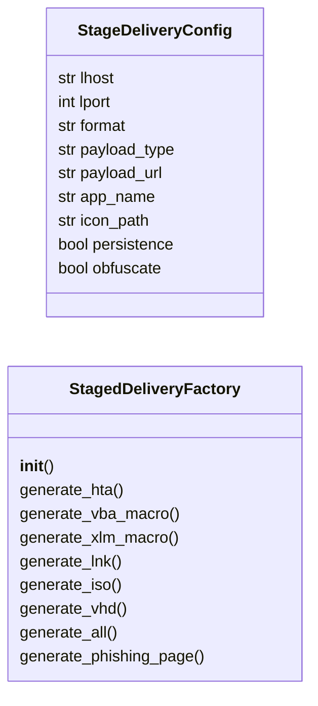
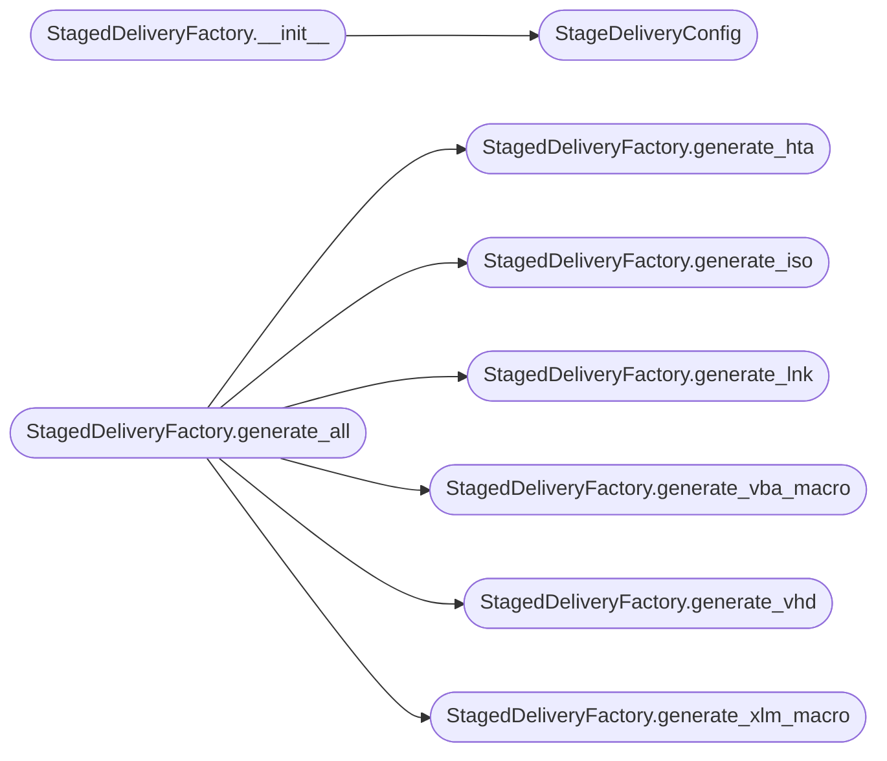

# `modules.staged_delivery`

> Source: [modules/staged_delivery.py:1](../../modules/staged_delivery.py#L1) | language `py` | coverage 91.7% | [API index](../index.md)

Staged payload delivery — HTA, Office macros, LNK files, ISO/VHD packaging.

Generates droppers and delivery mechanisms for initial access. Covers five
delivery vectors: HTA applications, Office VBA macros with XML 4.0 support,
Windows LNK shortcut files (.lnk), ISO image packaging, and VHD disk packaging.

All payloads embed connection parameters from payload.json and support
multiple payload formats (PowerShell, VBScript, JavaScript, binary droppers).

## Contents

- **Classes:** [`StageDeliveryConfig`](#stagedeliveryconfig), [`StagedDeliveryFactory`](#stageddeliveryfactory)
- **Constants:** [`SESSIONS_DIR`](#sessions_dir), [`ISO_BLOCK_SIZE`](#iso_block_size)

## Type Diagram



## Call Graph

Solid arrows stay in this module, dashed arrows leave it.



## Classes

<a id="stagedeliveryconfig"></a>

### `StageDeliveryConfig`

`class` `dataclass` | [modules/staged_delivery.py:25](../../modules/staged_delivery.py#L25)

Decorators: `@dataclass`

```python
class StageDeliveryConfig
```

Configuration for staged payload delivery.

**Attributes**

| Name | Type | Default | Description |
|---|---|---|---|
| [`lhost`](#stagedeliveryconfig-lhost) | `str` | `''` | Attacker IP or hostname. |
| [`lport`](#stagedeliveryconfig-lport) | `int` | `443` | Listener port. |
| [`format`](#stagedeliveryconfig-format) | `str` | `'hta'` | Delivery format (hta, vba, xlm, lnk, iso, vhd). |
| [`payload_type`](#stagedeliveryconfig-payload_type) | `str` | `'powershell'` | Embedded payload type (powershell, vbscript, js, exe, dll). |
| [`payload_url`](#stagedeliveryconfig-payload_url) | `str` | `''` | Optional URL to host the stage (overrides inline embedding). |
| [`app_name`](#stagedeliveryconfig-app_name) | `str` | `'QuarterlyReport'` | Display name for Office macro documents. |
| [`icon_path`](#stagedeliveryconfig-icon_path) | `str` | `''` | Icon file path for .lnk generation. |
| [`persistence`](#stagedeliveryconfig-persistence) | `bool` | `False` | Add persistence after delivery (registry, scheduled task). |
| [`obfuscate`](#stagedeliveryconfig-obfuscate) | `bool` | `True` | Apply obfuscation to embedded scripts. |

---

<a id="stageddeliveryfactory"></a>

### `StagedDeliveryFactory`

`class` | [modules/staged_delivery.py:51](../../modules/staged_delivery.py#L51)

```python
class StagedDeliveryFactory
```

Generate staged payloads across multiple delivery vectors.

Supports HTA, VBA/XLM macros, LNK shortcuts, ISO images, and VHD disks.
All payloads embed a reverse shell or C2 beacon stage.

**Members**

| Member | Kind | Summary |
|---|---|---|
| [`__init__`](#stageddeliveryfactory-__init__) | constructor |  |
| [`generate_hta`](#stageddeliveryfactory-generate_hta) | method | Generate an HTA (HTML Application) dropper. |
| [`generate_vba_macro`](#stageddeliveryfactory-generate_vba_macro) | method | Generate a VBA macro for Office documents (Word/Excel). |
| [`generate_xlm_macro`](#stageddeliveryfactory-generate_xlm_macro) | method | Generate an Excel 4.0 (XLM) macro for legacy macro execution. |
| [`generate_lnk`](#stageddeliveryfactory-generate_lnk) | method | Generate a Windows .lnk shortcut file with embedded command execution. |
| [`generate_iso`](#stageddeliveryfactory-generate_iso) | method | Generate an ISO 9660 image with an embedded payload autorun. |
| [`generate_vhd`](#stageddeliveryfactory-generate_vhd) | method | Generate a VHD (Virtual Hard Disk) image with embedded payloads. |
| [`generate_all`](#stageddeliveryfactory-generate_all) | method | Generate all delivery formats for the current configuration. |
| [`generate_phishing_page`](#stageddeliveryfactory-generate_phishing_page) | method | Generate a credential harvesting HTML page. |

<a id="stageddeliveryfactory-__init__"></a>

#### `StagedDeliveryFactory.__init__`

`constructor` | [modules/staged_delivery.py:83](../../modules/staged_delivery.py#L83)

```python
def __init__(self, config: StageDeliveryConfig | None = None, output_dir: Path | None = None)
```

**Parameters**

| Name | Type | Default | Description |
|---|---|---|---|
| `config` | `StageDeliveryConfig \| None` | `None` |  |
| `output_dir` | `Path \| None` | `None` |  |

*Calls:* [`StageDeliveryConfig`](#stagedeliveryconfig)

*Called by:* [`PayloadArsenalCommandSet.do_staged_delivery`](cli.commands.payload_arsenal.py.md#payloadarsenalcommandset-do_staged_delivery)

<a id="stageddeliveryfactory-generate_hta"></a>

#### `StagedDeliveryFactory.generate_hta`

`method` | [modules/staged_delivery.py:134](../../modules/staged_delivery.py#L134)

```python
def generate_hta(self) -> str
```

Generate an HTA (HTML Application) dropper.

HTAs execute with mshta.exe and have full trust — no security warnings.

**Returns:** `str` - HTA file content as string with embedded payload.

*Called by:* [`PayloadArsenalCommandSet.do_staged_delivery`](cli.commands.payload_arsenal.py.md#payloadarsenalcommandset-do_staged_delivery), [`StagedDeliveryFactory.generate_all`](#stageddeliveryfactory-generate_all)

<a id="stageddeliveryfactory-generate_vba_macro"></a>

#### `StagedDeliveryFactory.generate_vba_macro`

`method` | [modules/staged_delivery.py:171](../../modules/staged_delivery.py#L171)

```python
def generate_vba_macro(self) -> str
```

Generate a VBA macro for Office documents (Word/Excel).

**Returns:** `str` - VBA macro source ready for Document_Open or Auto_Open.

*Called by:* [`PayloadArsenalCommandSet.do_staged_delivery`](cli.commands.payload_arsenal.py.md#payloadarsenalcommandset-do_staged_delivery), [`StagedDeliveryFactory.generate_all`](#stageddeliveryfactory-generate_all)

<a id="stageddeliveryfactory-generate_xlm_macro"></a>

#### `StagedDeliveryFactory.generate_xlm_macro`

`method` | [modules/staged_delivery.py:219](../../modules/staged_delivery.py#L219)

```python
def generate_xlm_macro(self) -> str
```

Generate an Excel 4.0 (XLM) macro for legacy macro execution.

XLM macros evade many modern macro analysis tools and still execute
in current Excel versions with VBA macro settings enabled.

**Returns:** `str` - XLM macro formula sheet content.

*Called by:* [`PayloadArsenalCommandSet.do_staged_delivery`](cli.commands.payload_arsenal.py.md#payloadarsenalcommandset-do_staged_delivery), [`StagedDeliveryFactory.generate_all`](#stageddeliveryfactory-generate_all)

<a id="stageddeliveryfactory-generate_lnk"></a>

#### `StagedDeliveryFactory.generate_lnk`

`method` | [modules/staged_delivery.py:237](../../modules/staged_delivery.py#L237)

```python
def generate_lnk(self) -> bytes
```

Generate a Windows .lnk shortcut file with embedded command execution.

**Returns:** `bytes` - Raw .lnk file bytes.

*Called by:* [`PayloadArsenalCommandSet.do_staged_delivery`](cli.commands.payload_arsenal.py.md#payloadarsenalcommandset-do_staged_delivery), [`StagedDeliveryFactory.generate_all`](#stageddeliveryfactory-generate_all)

<a id="stageddeliveryfactory-generate_iso"></a>

#### `StagedDeliveryFactory.generate_iso`

`method` | [modules/staged_delivery.py:301](../../modules/staged_delivery.py#L301)

```python
def generate_iso(self, inner_files: dict[str, bytes] | None = None) -> bytes
```

Generate an ISO 9660 image with an embedded payload autorun.

**Parameters**

| Name | Type | Default | Description |
|---|---|---|---|
| `inner_files` | `dict[str, bytes] \| None` | `None` | Dict mapping filenames to byte contents for the ISO. |

**Returns:** `bytes` - Raw ISO 9660 image bytes.

*Called by:* [`PayloadArsenalCommandSet.do_staged_delivery`](cli.commands.payload_arsenal.py.md#payloadarsenalcommandset-do_staged_delivery), [`StagedDeliveryFactory.generate_all`](#stageddeliveryfactory-generate_all)

<a id="stageddeliveryfactory-generate_vhd"></a>

#### `StagedDeliveryFactory.generate_vhd`

`method` | [modules/staged_delivery.py:370](../../modules/staged_delivery.py#L370)

```python
def generate_vhd(self, inner_files: dict[str, bytes] | None = None) -> bytes
```

Generate a VHD (Virtual Hard Disk) image with embedded payloads.

VHD files auto-mount on Windows 10+ when double-clicked, providing
an alternative delivery vector that bypasses mark-of-the-web.

**Parameters**

| Name | Type | Default | Description |
|---|---|---|---|
| `inner_files` | `dict[str, bytes] \| None` | `None` | Dict of filenames to byte contents. |

**Returns:** `bytes` - Raw VHD file bytes.

*Called by:* [`PayloadArsenalCommandSet.do_staged_delivery`](cli.commands.payload_arsenal.py.md#payloadarsenalcommandset-do_staged_delivery), [`StagedDeliveryFactory.generate_all`](#stageddeliveryfactory-generate_all)

<a id="stageddeliveryfactory-generate_all"></a>

#### `StagedDeliveryFactory.generate_all`

`method` | [modules/staged_delivery.py:420](../../modules/staged_delivery.py#L420)

```python
def generate_all(self) -> dict[str, Any]
```

Generate all delivery formats for the current configuration.

**Returns:** `dict[str, Any]` - Dict mapping format name to artifact content or file path.

*Calls:* [`StagedDeliveryFactory.generate_hta`](#stageddeliveryfactory-generate_hta), [`StagedDeliveryFactory.generate_iso`](#stageddeliveryfactory-generate_iso), [`StagedDeliveryFactory.generate_lnk`](#stageddeliveryfactory-generate_lnk), [`StagedDeliveryFactory.generate_vba_macro`](#stageddeliveryfactory-generate_vba_macro), [`StagedDeliveryFactory.generate_vhd`](#stageddeliveryfactory-generate_vhd), [`StagedDeliveryFactory.generate_xlm_macro`](#stageddeliveryfactory-generate_xlm_macro)

*Called by:* [`PayloadArsenalCommandSet.do_staged_delivery`](cli.commands.payload_arsenal.py.md#payloadarsenalcommandset-do_staged_delivery)

<a id="stageddeliveryfactory-generate_phishing_page"></a>

#### `StagedDeliveryFactory.generate_phishing_page`

`method` | [modules/staged_delivery.py:460](../../modules/staged_delivery.py#L460)

```python
def generate_phishing_page(self, template: str = 'office365') -> str
```

Generate a credential harvesting HTML page.

**Parameters**

| Name | Type | Default | Description |
|---|---|---|---|
| `template` | `str` | `'office365'` | Phishing template name (office365, gmail, outlook, custom). |

**Returns:** `str` - HTML content for a credential harvesting page.

*Called by:* [`PayloadArsenalCommandSet.do_staged_delivery`](cli.commands.payload_arsenal.py.md#payloadarsenalcommandset-do_staged_delivery)

---

## Constants

<a id="sessions_dir"></a>

### `SESSIONS_DIR`

`constant` | [modules/staged_delivery.py:20](../../modules/staged_delivery.py#L20)

```python
SESSIONS_DIR = Path(__file__).resolve().parent.parent / 'sessions'
```

---

<a id="iso_block_size"></a>

### `ISO_BLOCK_SIZE`

`constant` | [modules/staged_delivery.py:21](../../modules/staged_delivery.py#L21)

```python
ISO_BLOCK_SIZE = 2048
```

---
