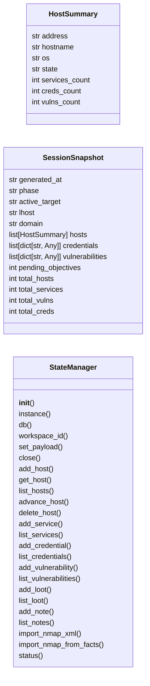
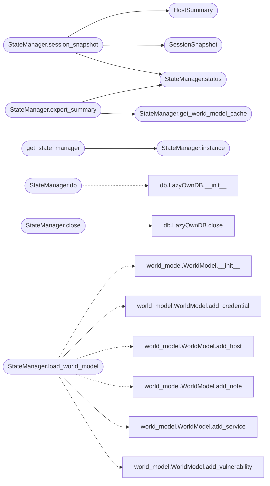

# `modules.state_manager`

> Source: [modules/state_manager.py:1](../../modules/state_manager.py#L1) | language `py` | coverage 11.8% | [API index](../index.md)

UnifiedStateManager — single source of truth for all LazyOwn campaign state.

Replaces the fragmented state systems (LazyOwnDB SQLite, WorldModel JSON,
FactStore JSON, SessionState JSON, ObjectiveStore JSONL) with one API that:
- Uses SQLite (LazyOwnDB) as the persistent backend
- Maintains JSON caches for backward compatibility and fast reads
- Publishes events via UnifiedEventBus on every state mutation
- Syncs WorldModel in-memory graph from DB on demand

Design (SOLID)
--------------
- Single Responsibility : owns all campaign state CRUD as one coherent API.
- Open/Closed           : new entity types added via the same add/get/list pattern.
- Liskov                : all state operations return typed dicts or dataclasses.
- Interface Segregation : each domain (hosts, services, creds, etc.) is a logical
                          group, not a separate interface.
- Dependency Inversion  : consumers depend on StateManager, not on DB or files.

## Contents

- **Classes:** [`HostSummary`](#hostsummary), [`SessionSnapshot`](#sessionsnapshot), [`StateManager`](#statemanager)
- **Functions:** [`get_state_manager`](#get_state_manager)
- **Constants:** [`WORLD_MODEL_FILE`](#world_model_file), [`FACTS_FILE`](#facts_file), [`SESSION_STATE_FILE`](#session_state_file), [`OBJECTIVES_FILE`](#objectives_file)

## Type Diagram



## Call Graph

Solid arrows stay in this module, dashed arrows leave it.



## Classes

<a id="hostsummary"></a>

### `HostSummary`

`class` `dataclass` | [modules/state_manager.py:65](../../modules/state_manager.py#L65)

Decorators: `@dataclass`

```python
class HostSummary
```

**Attributes**

| Name | Type | Default | Description |
|---|---|---|---|
| [`address`](#hostsummary-address) | `str` |  |  |
| [`hostname`](#hostsummary-hostname) | `str` | `''` |  |
| [`os`](#hostsummary-os) | `str` | `''` |  |
| [`state`](#hostsummary-state) | `str` | `'unknown'` |  |
| [`services_count`](#hostsummary-services_count) | `int` | `0` |  |
| [`creds_count`](#hostsummary-creds_count) | `int` | `0` |  |
| [`vulns_count`](#hostsummary-vulns_count) | `int` | `0` |  |

---

<a id="sessionsnapshot"></a>

### `SessionSnapshot`

`class` `dataclass` | [modules/state_manager.py:76](../../modules/state_manager.py#L76)

Decorators: `@dataclass`

```python
class SessionSnapshot
```

**Attributes**

| Name | Type | Default | Description |
|---|---|---|---|
| [`generated_at`](#sessionsnapshot-generated_at) | `str` | `field(default_factory=lambda: time.strftime('%Y-%m-%dT%H:%M:%S'))` |  |
| [`phase`](#sessionsnapshot-phase) | `str` | `'recon'` |  |
| [`active_target`](#sessionsnapshot-active_target) | `str` | `''` |  |
| [`lhost`](#sessionsnapshot-lhost) | `str` | `''` |  |
| [`domain`](#sessionsnapshot-domain) | `str` | `''` |  |
| [`hosts`](#sessionsnapshot-hosts) | `list[HostSummary]` | `field(default_factory=list)` |  |
| [`credentials`](#sessionsnapshot-credentials) | `list[dict[str, Any]]` | `field(default_factory=list)` |  |
| [`vulnerabilities`](#sessionsnapshot-vulnerabilities) | `list[dict[str, Any]]` | `field(default_factory=list)` |  |
| [`pending_objectives`](#sessionsnapshot-pending_objectives) | `int` | `0` |  |
| [`total_hosts`](#sessionsnapshot-total_hosts) | `int` | `0` |  |
| [`total_services`](#sessionsnapshot-total_services) | `int` | `0` |  |
| [`total_vulns`](#sessionsnapshot-total_vulns) | `int` | `0` |  |
| [`total_creds`](#sessionsnapshot-total_creds) | `int` | `0` |  |

---

<a id="statemanager"></a>

### `StateManager`

`class` | [modules/state_manager.py:92](../../modules/state_manager.py#L92)

```python
class StateManager
```

Unified campaign state API backed by SQLite with JSON caches.

Usage::

    sm = StateManager()
    sm.add_host("10.0.0.1", hostname="dc01", os="Windows Server 2019")
    sm.add_service("10.0.0.1", 445, "tcp", "microsoft-ds", "SMB")
    sm.add_credential("10.0.0.1", "admin", "P@ssw0rd", origin="crackmapexec")
    snapshot = sm.session_snapshot()

**Members**

| Member | Kind | Summary |
|---|---|---|
| [`__init__`](#statemanager-__init__) | constructor |  |
| [`instance`](#statemanager-instance) | classmethod |  |
| [`db`](#statemanager-db) | property |  |
| [`workspace_id`](#statemanager-workspace_id) | property |  |
| [`set_payload`](#statemanager-set_payload) | method |  |
| [`close`](#statemanager-close) | method |  |
| [`add_host`](#statemanager-add_host) | method |  |
| [`get_host`](#statemanager-get_host) | method |  |
| [`list_hosts`](#statemanager-list_hosts) | method |  |
| [`advance_host`](#statemanager-advance_host) | method |  |
| [`delete_host`](#statemanager-delete_host) | method |  |
| [`add_service`](#statemanager-add_service) | method |  |
| [`list_services`](#statemanager-list_services) | method |  |
| [`add_credential`](#statemanager-add_credential) | method |  |
| [`list_credentials`](#statemanager-list_credentials) | method |  |
| [`add_vulnerability`](#statemanager-add_vulnerability) | method |  |
| [`list_vulnerabilities`](#statemanager-list_vulnerabilities) | method |  |
| [`add_loot`](#statemanager-add_loot) | method |  |
| [`list_loot`](#statemanager-list_loot) | method |  |
| [`add_note`](#statemanager-add_note) | method |  |
| [`list_notes`](#statemanager-list_notes) | method |  |
| [`import_nmap_xml`](#statemanager-import_nmap_xml) | method |  |
| [`import_nmap_from_facts`](#statemanager-import_nmap_from_facts) | method | Import hosts and services from a FactStore-style facts dict into DB. |
| [`status`](#statemanager-status) | method |  |
| [`get_world_model_cache`](#statemanager-get_world_model_cache) | method |  |
| [`load_world_model`](#statemanager-load_world_model) | method | Return a WorldModel instance populated from DB state. |
| [`session_snapshot`](#statemanager-session_snapshot) | method |  |
| [`export_csv`](#statemanager-export_csv) | method |  |
| [`export_summary`](#statemanager-export_summary) | method |  |

<a id="statemanager-__init__"></a>

#### `StateManager.__init__`

`constructor` | [modules/state_manager.py:107](../../modules/state_manager.py#L107)

```python
def __init__(self, db_path: Path | None = None, sessions_dir: Path | None = None, world_model_path: Path | None = None, facts_path: Path | None = None) -> None
```

**Parameters**

| Name | Type | Default | Description |
|---|---|---|---|
| `db_path` | `Path \| None` | `None` |  |
| `sessions_dir` | `Path \| None` | `None` |  |
| `world_model_path` | `Path \| None` | `None` |  |
| `facts_path` | `Path \| None` | `None` |  |

*Called by:* [`AutomationCommandSet.do_cred_reuse`](cli.commands.automation.py.md#automationcommandset-do_cred_reuse)

<a id="statemanager-instance"></a>

#### `StateManager.instance`

`classmethod` | [modules/state_manager.py:129](../../modules/state_manager.py#L129)

Decorators: `@classmethod`

```python
def instance(cls) -> StateManager
```

**Returns:** `StateManager`

*Called by:* [`get_state_manager`](#get_state_manager)

<a id="statemanager-db"></a>

#### `StateManager.db`

`property` | [modules/state_manager.py:137](../../modules/state_manager.py#L137)

Decorators: `@property`

```python
def db(self) -> Any
```

**Returns:** `Any`

*Calls:* [`LazyOwnDB.__init__`](modules.db.py.md#lazyowndb-__init__)

<a id="statemanager-workspace_id"></a>

#### `StateManager.workspace_id`

`property` | [modules/state_manager.py:146](../../modules/state_manager.py#L146)

Decorators: `@property`

```python
def workspace_id(self) -> int
```

**Returns:** `int`

<a id="statemanager-set_payload"></a>

#### `StateManager.set_payload`

`method` | [modules/state_manager.py:165](../../modules/state_manager.py#L165)

```python
def set_payload(self, payload: dict[str, Any]) -> None
```

**Parameters**

| Name | Type | Default | Description |
|---|---|---|---|
| `payload` | `dict[str, Any]` |  |  |

<a id="statemanager-close"></a>

#### `StateManager.close`

`method` | [modules/state_manager.py:202](../../modules/state_manager.py#L202)

```python
def close(self) -> None
```

*Calls:* [`LazyOwnDB.close`](modules.db.py.md#lazyowndb-close)

<a id="statemanager-add_host"></a>

#### `StateManager.add_host`

`method` | [modules/state_manager.py:213](../../modules/state_manager.py#L213)

```python
def add_host(self, address: str, mac: str = '', hostname: str = '', os: str = '', state: str = 'unknown') -> int
```

**Parameters**

| Name | Type | Default | Description |
|---|---|---|---|
| `address` | `str` |  |  |
| `mac` | `str` | `''` |  |
| `hostname` | `str` | `''` |  |
| `os` | `str` | `''` |  |
| `state` | `str` | `'unknown'` |  |

**Returns:** `int`

<a id="statemanager-get_host"></a>

#### `StateManager.get_host`

`method` | [modules/state_manager.py:236](../../modules/state_manager.py#L236)

```python
def get_host(self, address: str) -> dict[str, Any] | None
```

**Parameters**

| Name | Type | Default | Description |
|---|---|---|---|
| `address` | `str` |  |  |

**Returns:** `dict[str, Any] | None`

<a id="statemanager-list_hosts"></a>

#### `StateManager.list_hosts`

`method` | [modules/state_manager.py:245](../../modules/state_manager.py#L245)

```python
def list_hosts(self) -> list[dict[str, Any]]
```

**Returns:** `list[dict[str, Any]]`

<a id="statemanager-advance_host"></a>

#### `StateManager.advance_host`

`method` | [modules/state_manager.py:249](../../modules/state_manager.py#L249)

```python
def advance_host(self, address: str, new_state: str) -> bool
```

**Parameters**

| Name | Type | Default | Description |
|---|---|---|---|
| `address` | `str` |  |  |
| `new_state` | `str` |  |  |

**Returns:** `bool`

<a id="statemanager-delete_host"></a>

#### `StateManager.delete_host`

`method` | [modules/state_manager.py:275](../../modules/state_manager.py#L275)

```python
def delete_host(self, address: str) -> bool
```

**Parameters**

| Name | Type | Default | Description |
|---|---|---|---|
| `address` | `str` |  |  |

**Returns:** `bool`

<a id="statemanager-add_service"></a>

#### `StateManager.add_service`

`method` | [modules/state_manager.py:287](../../modules/state_manager.py#L287)

```python
def add_service(self, host_address: str, port: int, protocol: str = 'tcp', name: str = '', product: str = '', version: str = '', state: str = 'open') -> int | None
```

**Parameters**

| Name | Type | Default | Description |
|---|---|---|---|
| `host_address` | `str` |  |  |
| `port` | `int` |  |  |
| `protocol` | `str` | `'tcp'` |  |
| `name` | `str` | `''` |  |
| `product` | `str` | `''` |  |
| `version` | `str` | `''` |  |
| `state` | `str` | `'open'` |  |

**Returns:** `int | None`

<a id="statemanager-list_services"></a>

#### `StateManager.list_services`

`method` | [modules/state_manager.py:319](../../modules/state_manager.py#L319)

```python
def list_services(self, host_address: str) -> list[dict[str, Any]]
```

**Parameters**

| Name | Type | Default | Description |
|---|---|---|---|
| `host_address` | `str` |  |  |

**Returns:** `list[dict[str, Any]]`

<a id="statemanager-add_credential"></a>

#### `StateManager.add_credential`

`method` | [modules/state_manager.py:328](../../modules/state_manager.py#L328)

```python
def add_credential(self, host_address: str, username: str, password: str = '', realm: str = '', cred_type: str = 'password', origin: str = '') -> int | None
```

**Parameters**

| Name | Type | Default | Description |
|---|---|---|---|
| `host_address` | `str` |  |  |
| `username` | `str` |  |  |
| `password` | `str` | `''` |  |
| `realm` | `str` | `''` |  |
| `cred_type` | `str` | `'password'` |  |
| `origin` | `str` | `''` |  |

**Returns:** `int | None`

<a id="statemanager-list_credentials"></a>

#### `StateManager.list_credentials`

`method` | [modules/state_manager.py:362](../../modules/state_manager.py#L362)

```python
def list_credentials(self, host_address: str | None = None) -> list[dict[str, Any]]
```

**Parameters**

| Name | Type | Default | Description |
|---|---|---|---|
| `host_address` | `str \| None` | `None` |  |

**Returns:** `list[dict[str, Any]]`

<a id="statemanager-add_vulnerability"></a>

#### `StateManager.add_vulnerability`

`method` | [modules/state_manager.py:373](../../modules/state_manager.py#L373)

```python
def add_vulnerability(self, host_address: str, name: str, severity: str = 'unknown', description: str = '', refs: str = '') -> int | None
```

**Parameters**

| Name | Type | Default | Description |
|---|---|---|---|
| `host_address` | `str` |  |  |
| `name` | `str` |  |  |
| `severity` | `str` | `'unknown'` |  |
| `description` | `str` | `''` |  |
| `refs` | `str` | `''` |  |

**Returns:** `int | None`

<a id="statemanager-list_vulnerabilities"></a>

#### `StateManager.list_vulnerabilities`

`method` | [modules/state_manager.py:398](../../modules/state_manager.py#L398)

```python
def list_vulnerabilities(self, host_address: str | None = None, severity: str | None = None) -> list[dict[str, Any]]
```

**Parameters**

| Name | Type | Default | Description |
|---|---|---|---|
| `host_address` | `str \| None` | `None` |  |
| `severity` | `str \| None` | `None` |  |

**Returns:** `list[dict[str, Any]]`

<a id="statemanager-add_loot"></a>

#### `StateManager.add_loot`

`method` | [modules/state_manager.py:411](../../modules/state_manager.py#L411)

```python
def add_loot(self, name: str, loot_type: str = 'file', path: str = '', notes: str = '', host_address: str = '') -> int | None
```

**Parameters**

| Name | Type | Default | Description |
|---|---|---|---|
| `name` | `str` |  |  |
| `loot_type` | `str` | `'file'` |  |
| `path` | `str` | `''` |  |
| `notes` | `str` | `''` |  |
| `host_address` | `str` | `''` |  |

**Returns:** `int | None`

<a id="statemanager-list_loot"></a>

#### `StateManager.list_loot`

`method` | [modules/state_manager.py:444](../../modules/state_manager.py#L444)

```python
def list_loot(self) -> list[dict[str, Any]]
```

**Returns:** `list[dict[str, Any]]`

<a id="statemanager-add_note"></a>

#### `StateManager.add_note`

`method` | [modules/state_manager.py:450](../../modules/state_manager.py#L450)

```python
def add_note(self, data: str, note_type: str = 'general', host_address: str = '') -> int | None
```

**Parameters**

| Name | Type | Default | Description |
|---|---|---|---|
| `data` | `str` |  |  |
| `note_type` | `str` | `'general'` |  |
| `host_address` | `str` | `''` |  |

**Returns:** `int | None`

<a id="statemanager-list_notes"></a>

#### `StateManager.list_notes`

`method` | [modules/state_manager.py:473](../../modules/state_manager.py#L473)

```python
def list_notes(self) -> list[dict[str, Any]]
```

**Returns:** `list[dict[str, Any]]`

<a id="statemanager-import_nmap_xml"></a>

#### `StateManager.import_nmap_xml`

`method` | [modules/state_manager.py:479](../../modules/state_manager.py#L479)

```python
def import_nmap_xml(self, xml_path: str) -> dict[str, int]
```

**Parameters**

| Name | Type | Default | Description |
|---|---|---|---|
| `xml_path` | `str` |  |  |

**Returns:** `dict[str, int]`

<a id="statemanager-import_nmap_from_facts"></a>

#### `StateManager.import_nmap_from_facts`

`method` | [modules/state_manager.py:495](../../modules/state_manager.py#L495)

```python
def import_nmap_from_facts(self, facts: dict[str, Any]) -> dict[str, int]
```

Import hosts and services from a FactStore-style facts dict into DB.

**Parameters**

| Name | Type | Default | Description |
|---|---|---|---|
| `facts` | `dict[str, Any]` |  |  |

**Returns:** `dict[str, int]`

<a id="statemanager-status"></a>

#### `StateManager.status`

`method` | [modules/state_manager.py:550](../../modules/state_manager.py#L550)

```python
def status(self) -> dict[str, int]
```

**Returns:** `dict[str, int]`

*Called by:* [`StateManager.export_summary`](#statemanager-export_summary), [`StateManager.session_snapshot`](#statemanager-session_snapshot)

<a id="statemanager-get_world_model_cache"></a>

#### `StateManager.get_world_model_cache`

`method` | [modules/state_manager.py:606](../../modules/state_manager.py#L606)

```python
def get_world_model_cache(self) -> dict[str, Any]
```

**Returns:** `dict[str, Any]`

*Called by:* [`StateManager.export_summary`](#statemanager-export_summary)

<a id="statemanager-load_world_model"></a>

#### `StateManager.load_world_model`

`method` | [modules/state_manager.py:612](../../modules/state_manager.py#L612)

```python
def load_world_model(self) -> Any
```

Return a WorldModel instance populated from DB state.

**Returns:** `Any`

*Calls:* [`WorldModel.__init__`](modules.world_model.py.md#worldmodel-__init__), [`WorldModel.add_credential`](modules.world_model.py.md#worldmodel-add_credential), [`WorldModel.add_host`](modules.world_model.py.md#worldmodel-add_host), [`WorldModel.add_note`](modules.world_model.py.md#worldmodel-add_note), [`WorldModel.add_service`](modules.world_model.py.md#worldmodel-add_service), [`WorldModel.add_vulnerability`](modules.world_model.py.md#worldmodel-add_vulnerability)

<a id="statemanager-session_snapshot"></a>

#### `StateManager.session_snapshot`

`method` | [modules/state_manager.py:653](../../modules/state_manager.py#L653)

```python
def session_snapshot(self) -> SessionSnapshot
```

**Returns:** `SessionSnapshot`

*Calls:* [`HostSummary`](#hostsummary), [`SessionSnapshot`](#sessionsnapshot), [`StateManager.status`](#statemanager-status)

<a id="statemanager-export_csv"></a>

#### `StateManager.export_csv`

`method` | [modules/state_manager.py:757](../../modules/state_manager.py#L757)

```python
def export_csv(self, table: str) -> str
```

**Parameters**

| Name | Type | Default | Description |
|---|---|---|---|
| `table` | `str` |  |  |

**Returns:** `str`

<a id="statemanager-export_summary"></a>

#### `StateManager.export_summary`

`method` | [modules/state_manager.py:761](../../modules/state_manager.py#L761)

```python
def export_summary(self) -> dict[str, Any]
```

**Returns:** `dict[str, Any]`

*Calls:* [`StateManager.get_world_model_cache`](#statemanager-get_world_model_cache), [`StateManager.status`](#statemanager-status)

---

## Functions

<a id="get_state_manager"></a>

### `get_state_manager`

`function` | [modules/state_manager.py:776](../../modules/state_manager.py#L776)

```python
def get_state_manager() -> StateManager
```

**Returns:** `StateManager`

*Calls:* [`StateManager.instance`](#statemanager-instance)

*Called by:* [`LazyOwnShell.do_state_snapshot`](lazyown.py.md#lazyownshell-do_state_snapshot), [`CredentialReactor.__call__`](modules.event_consumers.py.md#credentialreactor-__call__), [`DashboardPusher.__call__`](modules.event_consumers.py.md#dashboardpusher-__call__)

---

## Constants

<a id="world_model_file"></a>

### `WORLD_MODEL_FILE`

`constant` | [modules/state_manager.py:37](../../modules/state_manager.py#L37)

```python
WORLD_MODEL_FILE = _SESSIONS_DIR / 'world_model.json'
```

---

<a id="facts_file"></a>

### `FACTS_FILE`

`constant` | [modules/state_manager.py:38](../../modules/state_manager.py#L38)

```python
FACTS_FILE = _SESSIONS_DIR / 'policy_facts.json'
```

---

<a id="session_state_file"></a>

### `SESSION_STATE_FILE`

`constant` | [modules/state_manager.py:39](../../modules/state_manager.py#L39)

```python
SESSION_STATE_FILE = _SESSIONS_DIR / 'session_state.json'
```

---

<a id="objectives_file"></a>

### `OBJECTIVES_FILE`

`constant` | [modules/state_manager.py:40](../../modules/state_manager.py#L40)

```python
OBJECTIVES_FILE = _SESSIONS_DIR / 'objectives.jsonl'
```

---
