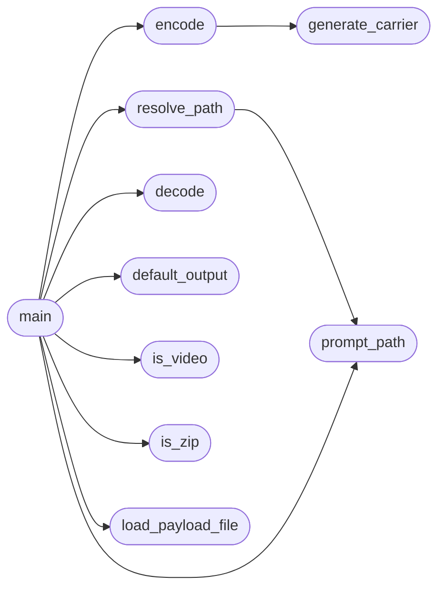

# `modules.stego_video`

> Source: [modules/stego_video.py:1](../../modules/stego_video.py#L1) | language `py` | coverage 54.5% | [API index](../index.md)

Video steganography addon for LazyOwn.

Hides a ZIP archive inside a video file (encode) and extracts it back (decode).

A silent carrier video is generated with ffmpeg. The ZIP is appended after the
video payload, followed by an 8-byte little-endian size trailer so the decoder
locates the hidden archive without parsing the video container.

## Contents

- **Functions:** [`load_payload_file`](#load_payload_file), [`is_zip`](#is_zip), [`is_video`](#is_video), [`prompt_path`](#prompt_path), [`resolve_path`](#resolve_path), [`generate_carrier`](#generate_carrier), [`encode`](#encode), [`decode`](#decode), [`default_output`](#default_output), [`main`](#main)
- **Constants:** [`PAYLOAD_PATH`](#payload_path), [`VIDEO_EXTENSIONS`](#video_extensions), [`CARRIER_DURATION`](#carrier_duration), [`CARRIER_SIZE`](#carrier_size), [`CARRIER_RATE`](#carrier_rate), [`AUDIO_FREQUENCY`](#audio_frequency), [`TRAILER_SIZE`](#trailer_size)

## Call Graph

Solid arrows stay in this module, dashed arrows leave it.



## Functions

<a id="load_payload_file"></a>

### `load_payload_file`

`function` | [modules/stego_video.py:26](../../modules/stego_video.py#L26)

```python
def load_payload_file()
```

Return the `[`file`](modules.playbook_admin.py.md#playbookentry-file)` value from payload.json, or None.

*Called by:* [`main`](#main)

---

<a id="is_zip"></a>

### `is_zip`

`function` | [modules/stego_video.py:36](../../modules/stego_video.py#L36)

```python
def is_zip(path)
```

**Parameters**

| Name | Type | Default | Description |
|---|---|---|---|
| `path` |  |  |  |

*Called by:* [`main`](#main)

---

<a id="is_video"></a>

### `is_video`

`function` | [modules/stego_video.py:40](../../modules/stego_video.py#L40)

```python
def is_video(path)
```

**Parameters**

| Name | Type | Default | Description |
|---|---|---|---|
| `path` |  |  |  |

*Called by:* [`main`](#main)

---

<a id="prompt_path"></a>

### `prompt_path`

`function` | [modules/stego_video.py:44](../../modules/stego_video.py#L44)

```python
def prompt_path(message)
```

**Parameters**

| Name | Type | Default | Description |
|---|---|---|---|
| `message` |  |  |  |

*Called by:* [`main`](#main), [`resolve_path`](#resolve_path)

---

<a id="resolve_path"></a>

### `resolve_path`

`function` | [modules/stego_video.py:52](../../modules/stego_video.py#L52)

```python
def resolve_path(arg_path, payload_file, validator, kind)
```

Resolve the target path using argument -> payload.json -> interactive prompt.

**Parameters**

| Name | Type | Default | Description |
|---|---|---|---|
| `arg_path` |  |  |  |
| `payload_file` |  |  |  |
| `validator` |  |  |  |
| `kind` |  |  |  |

*Calls:* [`prompt_path`](#prompt_path)

*Called by:* [`main`](#main)

---

<a id="generate_carrier"></a>

### `generate_carrier`

`function` | [modules/stego_video.py:61](../../modules/stego_video.py#L61)

```python
def generate_carrier(output)
```

Generate a silent carrier video with ffmpeg.

**Parameters**

| Name | Type | Default | Description |
|---|---|---|---|
| `output` |  |  |  |

*Called by:* [`encode`](#encode)

---

<a id="encode"></a>

### `encode`

`function` | [modules/stego_video.py:75](../../modules/stego_video.py#L75)

```python
def encode(zip_path, output_video)
```

Hide zip_path inside output_video.

**Parameters**

| Name | Type | Default | Description |
|---|---|---|---|
| `zip_path` |  |  |  |
| `output_video` |  |  |  |

*Calls:* [`generate_carrier`](#generate_carrier)

*Called by:* [`main`](#main)

---

<a id="decode"></a>

### `decode`

`function` | [modules/stego_video.py:93](../../modules/stego_video.py#L93)

```python
def decode(stego_video, output_zip)
```

Extract the hidden zip from stego_video into output_zip.

**Parameters**

| Name | Type | Default | Description |
|---|---|---|---|
| `stego_video` |  |  |  |
| `output_zip` |  |  |  |

**Raises**

- `ValueError`: (raised in the body, not documented)

*Called by:* [`main`](#main)

---

<a id="default_output"></a>

### `default_output`

`function` | [modules/stego_video.py:113](../../modules/stego_video.py#L113)

```python
def default_output(zip_path)
```

**Parameters**

| Name | Type | Default | Description |
|---|---|---|---|
| `zip_path` |  |  |  |

*Called by:* [`main`](#main)

---

<a id="main"></a>

### `main`

`function` | [modules/stego_video.py:118](../../modules/stego_video.py#L118)

```python
def main(argv)
```

**Parameters**

| Name | Type | Default | Description |
|---|---|---|---|
| `argv` |  |  |  |

*Calls:* [`decode`](#decode), [`default_output`](#default_output), [`encode`](#encode), [`is_video`](#is_video), [`is_zip`](#is_zip), [`load_payload_file`](#load_payload_file), [`prompt_path`](#prompt_path), [`resolve_path`](#resolve_path)

---

## Constants

<a id="payload_path"></a>

### `PAYLOAD_PATH`

`constant` | [modules/stego_video.py:17](../../modules/stego_video.py#L17)

```python
PAYLOAD_PATH = 'payload.json'
```

---

<a id="video_extensions"></a>

### `VIDEO_EXTENSIONS`

`constant` | [modules/stego_video.py:18](../../modules/stego_video.py#L18)

```python
VIDEO_EXTENSIONS = ('.mp4', '.avi', '.mkv', '.mov')
```

---

<a id="carrier_duration"></a>

### `CARRIER_DURATION`

`constant` | [modules/stego_video.py:19](../../modules/stego_video.py#L19)

```python
CARRIER_DURATION = 5
```

---

<a id="carrier_size"></a>

### `CARRIER_SIZE`

`constant` | [modules/stego_video.py:20](../../modules/stego_video.py#L20)

```python
CARRIER_SIZE = '640x480'
```

---

<a id="carrier_rate"></a>

### `CARRIER_RATE`

`constant` | [modules/stego_video.py:21](../../modules/stego_video.py#L21)

```python
CARRIER_RATE = 30
```

---

<a id="audio_frequency"></a>

### `AUDIO_FREQUENCY`

`constant` | [modules/stego_video.py:22](../../modules/stego_video.py#L22)

```python
AUDIO_FREQUENCY = 440
```

---

<a id="trailer_size"></a>

### `TRAILER_SIZE`

`constant` | [modules/stego_video.py:23](../../modules/stego_video.py#L23)

```python
TRAILER_SIZE = 8
```

---
