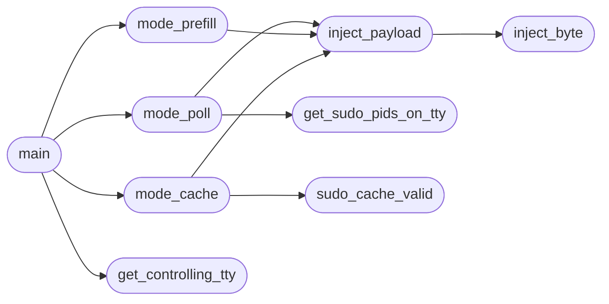

# `modules.sudo_tiocsti`

> Source: [modules/sudo_tiocsti.py:1](../../modules/sudo_tiocsti.py#L1) | language `py` | coverage 90.0% | [API index](../index.md)

tiocsti_advanced.py – Production‑grade TIOCSTI injection with multiple attack modes.

Usage: python3 tiocsti_advanced.py --mode poll|prefill|cache --payload "command" Run in background: nohup python3 tiocsti_advanced.py --mode poll &

## Contents

- **Functions:** [`get_controlling_tty`](#get_controlling_tty), [`inject_byte`](#inject_byte), [`inject_payload`](#inject_payload), [`get_sudo_pids_on_tty`](#get_sudo_pids_on_tty), [`sudo_cache_valid`](#sudo_cache_valid), [`mode_poll`](#mode_poll), [`mode_prefill`](#mode_prefill), [`mode_cache`](#mode_cache), [`main`](#main)
- **Constants:** [`TIOCSTI`](#tiocsti), [`LOG_FILE`](#log_file), [`DEV_NULL`](#dev_null)

## Call Graph

Solid arrows stay in this module, dashed arrows leave it.



## Functions

<a id="get_controlling_tty"></a>

### `get_controlling_tty`

`function` | [modules/sudo_tiocsti.py:52](../../modules/sudo_tiocsti.py#L52)

```python
def get_controlling_tty() -> tuple
```

Return (file_descriptor, tty_path) for the controlling terminal.

**Returns:** `tuple`

*Called by:* [`main`](#main)

---

<a id="inject_byte"></a>

### `inject_byte`

`function` | [modules/sudo_tiocsti.py:64](../../modules/sudo_tiocsti.py#L64)

```python
def inject_byte(fd: int, byte_char: bytes) -> bool
```

Inject a single byte via TIOCSTI; return success status.

**Parameters**

| Name | Type | Default | Description |
|---|---|---|---|
| `fd` | `int` |  |  |
| `byte_char` | `bytes` |  |  |

**Returns:** `bool`

**Raises**

- `ValueError`: (raised in the body, not documented)

*Called by:* [`inject_payload`](#inject_payload)

---

<a id="inject_payload"></a>

### `inject_payload`

`function` | [modules/sudo_tiocsti.py:79](../../modules/sudo_tiocsti.py#L79)

```python
def inject_payload(fd: int, payload: str, char_delay: float = 0.005) -> bool
```

Inject a multi‑character payload.

Returns True if all characters were successfully injected (with retries). char_delay simulates typing speed.

**Parameters**

| Name | Type | Default | Description |
|---|---|---|---|
| `fd` | `int` |  |  |
| `payload` | `str` |  |  |
| `char_delay` | `float` | `0.005` |  |

**Returns:** `bool`

*Calls:* [`inject_byte`](#inject_byte)

*Called by:* [`mode_cache`](#mode_cache), [`mode_poll`](#mode_poll), [`mode_prefill`](#mode_prefill)

---

<a id="get_sudo_pids_on_tty"></a>

### `get_sudo_pids_on_tty`

`function` | [modules/sudo_tiocsti.py:102](../../modules/sudo_tiocsti.py#L102)

```python
def get_sudo_pids_on_tty(tty_path: str) -> list[int]
```

Return a list of PIDs that are running 'sudo' and have the same controlling terminal as the given tty_path.

**Parameters**

| Name | Type | Default | Description |
|---|---|---|---|
| `tty_path` | `str` |  |  |

**Returns:** `list[int]`

*Called by:* [`mode_poll`](#mode_poll)

---

<a id="sudo_cache_valid"></a>

### `sudo_cache_valid`

`function` | [modules/sudo_tiocsti.py:139](../../modules/sudo_tiocsti.py#L139)

```python
def sudo_cache_valid() -> bool
```

Return True if sudo credentials are cached (i.e., sudo -n succeeds).

**Returns:** `bool`

*Called by:* [`mode_cache`](#mode_cache)

---

<a id="mode_poll"></a>

### `mode_poll`

`function` | [modules/sudo_tiocsti.py:149](../../modules/sudo_tiocsti.py#L149)

```python
def mode_poll(fd: int, tty_path: str)
```

Poll for sudo processes; inject payload when sudo exits.

**Parameters**

| Name | Type | Default | Description |
|---|---|---|---|
| `fd` | `int` |  |  |
| `tty_path` | `str` |  |  |

*Calls:* [`get_sudo_pids_on_tty`](#get_sudo_pids_on_tty), [`inject_payload`](#inject_payload)

*Called by:* [`main`](#main)

---

<a id="mode_prefill"></a>

### `mode_prefill`

`function` | [modules/sudo_tiocsti.py:175](../../modules/sudo_tiocsti.py#L175)

```python
def mode_prefill(fd: int)
```

Inject payload repeatedly, regardless of sudo state.

**Parameters**

| Name | Type | Default | Description |
|---|---|---|---|
| `fd` | `int` |  |  |

*Calls:* [`inject_payload`](#inject_payload)

*Called by:* [`main`](#main)

---

<a id="mode_cache"></a>

### `mode_cache`

`function` | [modules/sudo_tiocsti.py:185](../../modules/sudo_tiocsti.py#L185)

```python
def mode_cache(fd: int)
```

Check sudo cache; if valid, inject sudo -i once.

**Parameters**

| Name | Type | Default | Description |
|---|---|---|---|
| `fd` | `int` |  |  |

*Calls:* [`inject_payload`](#inject_payload), [`sudo_cache_valid`](#sudo_cache_valid)

*Called by:* [`main`](#main)

---

<a id="main"></a>

### `main`

`function` | [modules/sudo_tiocsti.py:198](../../modules/sudo_tiocsti.py#L198)

```python
def main()
```

*Calls:* [`get_controlling_tty`](#get_controlling_tty), [`mode_cache`](#mode_cache), [`mode_poll`](#mode_poll), [`mode_prefill`](#mode_prefill)

---

## Constants

<a id="tiocsti"></a>

### `TIOCSTI`

`constant` | [modules/sudo_tiocsti.py:16](../../modules/sudo_tiocsti.py#L16)

```python
TIOCSTI = 21522
```

---

<a id="log_file"></a>

### `LOG_FILE`

`constant` | [modules/sudo_tiocsti.py:17](../../modules/sudo_tiocsti.py#L17)

```python
LOG_FILE = '/tmp/tiocsti_advanced.log'
```

---

<a id="dev_null"></a>

### `DEV_NULL`

`constant` | [modules/sudo_tiocsti.py:18](../../modules/sudo_tiocsti.py#L18)

```python
DEV_NULL = open(os.devnull, 'wb')
```

---
