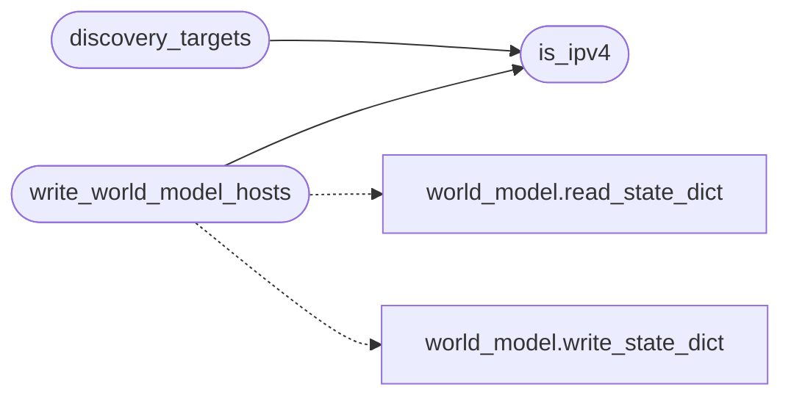

# `modules.surface_ops`

> Source: [modules/surface_ops.py:1](../../modules/surface_ops.py#L1) | language `py` | coverage 100.0% | [API index](../index.md)

Pure attack-surface helpers (no cmd2): discovery targets, confirm parsing.

Used by the `[`surface`](lazyc2.py.md#surface)` CommandSet and unit-tested without the shell.

## Contents

- **Functions:** [`is_ipv4`](#is_ipv4), [`parse_confirm`](#parse_confirm), [`discovery_targets`](#discovery_targets), [`write_world_model_hosts`](#write_world_model_hosts)

## Call Graph

Solid arrows stay in this module, dashed arrows leave it.



## Functions

<a id="is_ipv4"></a>

### `is_ipv4`

`function` | [modules/surface_ops.py:18](../../modules/surface_ops.py#L18)

```python
def is_ipv4(value: str) -> bool
```

Return True for dotted-quad IPv4 literals with 0-255 octets.

**Parameters**

| Name | Type | Default | Description |
|---|---|---|---|
| `value` | `str` |  |  |

**Returns:** `bool`

*Called by:* [`discovery_targets`](#discovery_targets), [`write_world_model_hosts`](#write_world_model_hosts)

---

<a id="parse_confirm"></a>

### `parse_confirm`

`function` | [modules/surface_ops.py:26](../../modules/surface_ops.py#L26)

```python
def parse_confirm(answer: str) -> bool
```

Return True for an affirmative scan confirmation answer.

**Parameters**

| Name | Type | Default | Description |
|---|---|---|---|
| `answer` | `str` |  |  |

**Returns:** `bool`

*Called by:* [`SurfaceCommandSet.do_scandiscovery`](cli.commands.surface.py.md#surfacecommandset-do_scandiscovery)

---

<a id="discovery_targets"></a>

### `discovery_targets`

`function` | [modules/surface_ops.py:31](../../modules/surface_ops.py#L31)

```python
def discovery_targets(sessions_dir: str | Path = SESSIONS_DIR) -> list[str]
```

List every discovery IP across the sessions discovery files.

**Parameters**

| Name | Type | Default | Description |
|---|---|---|---|
| `sessions_dir` | `str \| Path` | `SESSIONS_DIR` |  |

**Returns:** `list[str]`

*Calls:* [`is_ipv4`](#is_ipv4)

*Called by:* [`SurfaceCommandSet.do_scandiscovery`](cli.commands.surface.py.md#surfacecommandset-do_scandiscovery)

---

<a id="write_world_model_hosts"></a>

### `write_world_model_hosts`

`function` | [modules/surface_ops.py:50](../../modules/surface_ops.py#L50)

```python
def write_world_model_hosts(document: dict, sessions: str | Path) -> int
```

Append unknown estorides host IPs to world_model.json hosts.

**Parameters**

| Name | Type | Default | Description |
|---|---|---|---|
| `document` | `dict` |  |  |
| `sessions` | `str \| Path` |  |  |

**Returns:** `int`

*Calls:* [`is_ipv4`](#is_ipv4), [`read_state_dict`](modules.world_model.py.md#read_state_dict), [`write_state_dict`](modules.world_model.py.md#write_state_dict)

*Called by:* [`SurfaceCommandSet.do_estorides_intel`](cli.commands.surface.py.md#surfacecommandset-do_estorides_intel)

---
