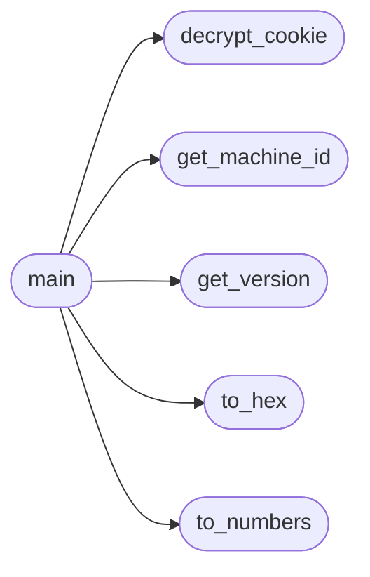

# `modules.tel`

> Source: [modules/tel.py:1](../../modules/tel.py#L1) | language `py` | coverage 57.1% | [API index](../index.md)

## Contents

- **Functions:** [`get_machine_id`](#get_machine_id), [`get_version`](#get_version), [`to_numbers`](#to_numbers), [`to_hex`](#to_hex), [`decrypt_cookie`](#decrypt_cookie), [`main`](#main)

## Call Graph

Solid arrows stay in this module, dashed arrows leave it.



## Functions

<a id="get_machine_id"></a>

### `get_machine_id`

`function` | [modules/tel.py:10](../../modules/tel.py#L10)

```python
def get_machine_id()
```

*Called by:* [`main`](#main)

---

<a id="get_version"></a>

### `get_version`

`function` | [modules/tel.py:24](../../modules/tel.py#L24)

```python
def get_version()
```

*Called by:* [`main`](#main)

---

<a id="to_numbers"></a>

### `to_numbers`

`function` | [modules/tel.py:36](../../modules/tel.py#L36)

```python
def to_numbers(hex_str)
```

Simula la función toNumbers de JavaScript

**Parameters**

| Name | Type | Default | Description |
|---|---|---|---|
| `hex_str` |  |  |  |

*Called by:* [`main`](#main)

---

<a id="to_hex"></a>

### `to_hex`

`function` | [modules/tel.py:41](../../modules/tel.py#L41)

```python
def to_hex(byte_list)
```

Simula la función toHex de JavaScript

**Parameters**

| Name | Type | Default | Description |
|---|---|---|---|
| `byte_list` |  |  |  |

*Called by:* [`main`](#main)

---

<a id="decrypt_cookie"></a>

### `decrypt_cookie`

`function` | [modules/tel.py:46](../../modules/tel.py#L46)

```python
def decrypt_cookie(encrypted, key, iv)
```

Descifra usando AES en modo CBC (como slowAES.decrypt(c,2,a,b))

**Parameters**

| Name | Type | Default | Description |
|---|---|---|---|
| `encrypted` |  |  |  |
| `key` |  |  |  |
| `iv` |  |  |  |

*Called by:* [`main`](#main)

---

<a id="main"></a>

### `main`

`function` | [modules/tel.py:53](../../modules/tel.py#L53)

```python
def main()
```

Sistema de telemetría de uso por instalación no invasiva.

*Calls:* [`decrypt_cookie`](#decrypt_cookie), [`get_machine_id`](#get_machine_id), [`get_version`](#get_version), [`to_hex`](#to_hex), [`to_numbers`](#to_numbers)

---
