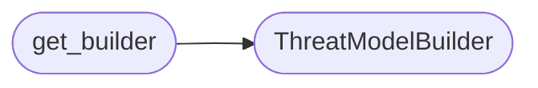

# `modules.threat_model`

> Source: [modules/threat_model.py:1](../../modules/threat_model.py#L1) | language `py` | coverage 40.0% | [API index](../index.md)

threat_model.py — Blue team threat model builder for LazyOwn.

Reads LazyOwn_session_report.csv + sessions/ artefacts, maps commands to
MITRE ATT&CK tactics/techniques, and produces a structured JSON threat model
consumable by a blue team application.

Outputs: sessions/reports/threat_model.json

Schema (threat_model.json)
--------------------------
{
  "generated_at": "ISO-8601",
  "assets": [
    {
      "ip": str, "domain": str, "ports": [int, ...],
      "risk_score": 0-100,
      "compromise_indicators": [str, ...]
    }
  ],
  "ttps": [
    {
      "technique_id": str,        # T1234.001
      "tactic": str,              # Initial Access
      "technique_name": str,
      "commands": [str, ...],     # LazyOwn commands that map here
      "occurrences": int,
      "first_seen": ISO-8601,
      "last_seen":  ISO-8601,
      "severity": "low|medium|high|critical",
      "description": str
    }
  ],
  "ioc_registry": [
    {
      "type": "ip|domain|hash|credential|url|path",
      "value": str,
      "context": str,
      "first_seen": ISO-8601
    }
  ],
  "detection_rules": [
    {
      "rule_id": str,             # LO-001
      "name": str,
      "tactic": str,
      "technique_id": str,
      "condition": str,           # Sigma-lite condition expression
      "log_source": str,          # e.g. "process_creation"
      "fields": {str: str},       # field: pattern
      "severity": str,
      "response": str             # recommended blue team action
    }
  ],
  "summary": {
    "total_events": int,
    "unique_targets": int,
    "unique_commands": int,
    "highest_risk_asset": str,
    "dominant_tactic": str
  }
}

Public API
----------
get_builder()                   singleton
ThreatModelBuilder.build()      build + save + return dict
ThreatModelBuilder.load()       load last saved model

## Contents

- **Classes:** [`ThreatModelBuilder`](#threatmodelbuilder)
- **Functions:** [`get_builder`](#get_builder)
- **Constants:** [`SESSIONS_DIR`](#sessions_dir), [`REPORT_CSV`](#report_csv), [`REPORTS_DIR`](#reports_dir), [`OUTPUT_FILE`](#output_file), [`COMMAND_TTP_MAP`](#command_ttp_map), [`SEVERITY_TACTIC`](#severity_tactic), [`DETECTION_TEMPLATES`](#detection_templates)

## Call Graph

Solid arrows stay in this module, dashed arrows leave it.



## Classes

<a id="threatmodelbuilder"></a>

### `ThreatModelBuilder`

`class` | [modules/threat_model.py:267](../../modules/threat_model.py#L267)

```python
class ThreatModelBuilder
```

Builds and serialises the blue team threat model.

**Members**

| Member | Kind | Summary |
|---|---|---|
| [`build`](#threatmodelbuilder-build) | method |  |
| [`load`](#threatmodelbuilder-load) | method |  |

<a id="threatmodelbuilder-build"></a>

#### `ThreatModelBuilder.build`

`method` | [modules/threat_model.py:270](../../modules/threat_model.py#L270)

```python
def build(self) -> dict[str, Any]
```

**Returns:** `dict[str, Any]`

<a id="threatmodelbuilder-load"></a>

#### `ThreatModelBuilder.load`

`method` | [modules/threat_model.py:293](../../modules/threat_model.py#L293)

```python
def load(self) -> dict[str, Any] | None
```

**Returns:** `dict[str, Any] | None`

---

## Functions

<a id="get_builder"></a>

### `get_builder`

`function` | [modules/threat_model.py:592](../../modules/threat_model.py#L592)

```python
def get_builder() -> ThreatModelBuilder
```

**Returns:** `ThreatModelBuilder`

*Calls:* [`ThreatModelBuilder`](#threatmodelbuilder)

*Called by:* [`McpBridgeCommandSet.do_threat_model`](cli.commands.mcp_bridge.py.md#mcpbridgecommandset-do_threat_model)

---

## Constants

<a id="sessions_dir"></a>

### `SESSIONS_DIR`

`constant` | [modules/threat_model.py:87](../../modules/threat_model.py#L87)

```python
SESSIONS_DIR = Path(__file__).parent.parent / 'sessions'
```

---

<a id="report_csv"></a>

### `REPORT_CSV`

`constant` | [modules/threat_model.py:88](../../modules/threat_model.py#L88)

```python
REPORT_CSV = SESSIONS_DIR / 'LazyOwn_session_report.csv'
```

---

<a id="reports_dir"></a>

### `REPORTS_DIR`

`constant` | [modules/threat_model.py:89](../../modules/threat_model.py#L89)

```python
REPORTS_DIR = SESSIONS_DIR / 'reports'
```

---

<a id="output_file"></a>

### `OUTPUT_FILE`

`constant` | [modules/threat_model.py:90](../../modules/threat_model.py#L90)

```python
OUTPUT_FILE = REPORTS_DIR / 'threat_model.json'
```

---

<a id="command_ttp_map"></a>

### `COMMAND_TTP_MAP`

`constant` | [modules/threat_model.py:96](../../modules/threat_model.py#L96)

```python
COMMAND_TTP_MAP: dict[str, tuple[str, str, str]]
```

---

<a id="severity_tactic"></a>

### `SEVERITY_TACTIC`

`constant` | [modules/threat_model.py:155](../../modules/threat_model.py#L155)

```python
SEVERITY_TACTIC: dict[str, str]
```

---

<a id="detection_templates"></a>

### `DETECTION_TEMPLATES`

`constant` | [modules/threat_model.py:171](../../modules/threat_model.py#L171)

```python
DETECTION_TEMPLATES: dict[str, dict[str, Any]]
```

---
