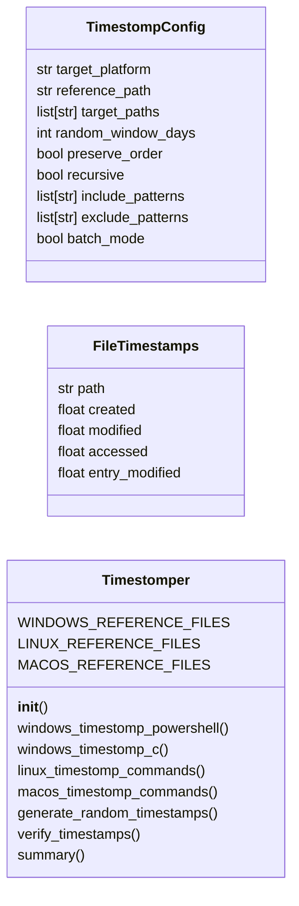

# `modules.timestomper`

> Source: [modules/timestomper.py:1](../../modules/timestomper.py#L1) | language `py` | coverage 91.7% | [API index](../index.md)

Filesystem timestomping — MACB timestamp manipulation for stealth.

Modifies file MACB (Modified, Accessed, Created, Birth) timestamps to
evade forensic timeline analysis. Supports Windows (SetFileTime via
PowerShell/C), Linux (touch + debugfs + utimes), and macOS (touch + xattr).

Integrates with the forensic cleaner to ensure cleaned artifacts blend
with legitimate system files. Includes batch timestomping, reference
file cloning, and randomized timestamp selection within time windows.

## Contents

- **Classes:** [`TimestompConfig`](#timestompconfig), [`FileTimestamps`](#filetimestamps), [`Timestomper`](#timestomper)
- **Constants:** [`SESSIONS_DIR`](#sessions_dir)

## Type Diagram



## Call Graph

Solid arrows stay in this module, dashed arrows leave it.


## Classes

<a id="timestompconfig"></a>

### `TimestompConfig`

`class` `dataclass` | [modules/timestomper.py:24](../../modules/timestomper.py#L24)

Decorators: `@dataclass`

```python
class TimestompConfig
```

Configuration for filesystem timestomping operations.

**Attributes**

| Name | Type | Default | Description |
|---|---|---|---|
| [`target_platform`](#timestompconfig-target_platform) | `str` | `'windows'` | windows, linux, or macos. |
| [`reference_path`](#timestompconfig-reference_path) | `str` | `''` | Clone timestamps from this file (legitimate system file). |
| [`target_paths`](#timestompconfig-target_paths) | `list[str]` | `field(default_factory=list)` | List of files to modify timestamps on. |
| [`random_window_days`](#timestompconfig-random_window_days) | `int` | `7` | Randomize timestamps within this many days of reference. |
| [`preserve_order`](#timestompconfig-preserve_order) | `bool` | `True` | Maintain relative timestamp ordering between files. |
| [`recursive`](#timestompconfig-recursive) | `bool` | `False` | Apply to all files in target directories. |
| [`include_patterns`](#timestompconfig-include_patterns) | `list[str]` | `field(default_factory=list)` | Only timestomp files matching these patterns. |
| [`exclude_patterns`](#timestompconfig-exclude_patterns) | `list[str]` | `field(default_factory=list)` | Skip files matching these patterns. |
| [`batch_mode`](#timestompconfig-batch_mode) | `bool` | `False` | Stomp all files in a directory in a single pass. |

---

<a id="filetimestamps"></a>

### `FileTimestamps`

`class` `dataclass` | [modules/timestomper.py:51](../../modules/timestomper.py#L51)

Decorators: `@dataclass`

```python
class FileTimestamps
```

MACB timestamps for a single file.

**Attributes**

| Name | Type | Default | Description |
|---|---|---|---|
| [`path`](#filetimestamps-path) | `str` | `''` | Absolute file path. |
| [`created`](#filetimestamps-created) | `float` | `0.0` | Creation/birth time (Unix epoch). |
| [`modified`](#filetimestamps-modified) | `float` | `0.0` | Last write time. |
| [`accessed`](#filetimestamps-accessed) | `float` | `0.0` | Last access time. |
| [`entry_modified`](#filetimestamps-entry_modified) | `float` | `0.0` | Metadata change time (linux only). |

---

<a id="timestomper"></a>

### `Timestomper`

`class` | [modules/timestomper.py:69](../../modules/timestomper.py#L69)

```python
class Timestomper
```

Cross-platform filesystem timestamp manipulation.

Generates platform-specific commands for modifying file MACB timestamps
to blend with legitimate system files and evade forensic timeline analysis.

**Attributes**

| Name | Type | Default | Description |
|---|---|---|---|
| [`WINDOWS_REFERENCE_FILES`](#timestomper-windows_reference_files) |  | `['C:\\Windows\\System32\\kernel32.dll', 'C:\\Windows\\System32\\ntdll.dll', 'C:\\Windows\\System32\\cmd.exe', 'C:\\Windows\\System32\\calc.exe', 'C:\\Windows\\System32\\notepad.exe', 'C:\\Windows\\explorer.exe', 'C:\\Windows\\System32\\drivers\\etc\\hosts']` |  |
| [`LINUX_REFERENCE_FILES`](#timestomper-linux_reference_files) |  | `['/etc/passwd', '/etc/hostname', '/etc/resolv.conf', '/bin/ls', '/usr/bin/ssh', '/lib/systemd/systemd', '/var/log/bootstrap.log']` |  |
| [`MACOS_REFERENCE_FILES`](#timestomper-macos_reference_files) |  | `['/etc/hosts', '/System/Library/CoreServices/SystemVersion.plist', '/usr/bin/ssh', '/bin/bash']` |  |

**Members**

| Member | Kind | Summary |
|---|---|---|
| [`__init__`](#timestomper-__init__) | constructor |  |
| [`windows_timestomp_powershell`](#timestomper-windows_timestomp_powershell) | method | Generate PowerShell commands for Windows file timestomping. |
| [`windows_timestomp_c`](#timestomper-windows_timestomp_c) | method | Generate C code for Windows timestomping via SetFileTime API. |
| [`linux_timestomp_commands`](#timestomper-linux_timestomp_commands) | method | Generate Linux commands for file timestomping. |
| [`macos_timestomp_commands`](#timestomper-macos_timestomp_commands) | method | Generate macOS commands for file timestomping. |
| [`generate_random_timestamps`](#timestomper-generate_random_timestamps) | method | Generate randomized timestamps within a window around the reference. |
| [`verify_timestamps`](#timestomper-verify_timestamps) | method | Verify timestamps on target files after modification. |
| [`summary`](#timestomper-summary) | method | Return a summary of available timestomping capabilities. |

<a id="timestomper-__init__"></a>

#### `Timestomper.__init__`

`constructor` | [modules/timestomper.py:106](../../modules/timestomper.py#L106)

```python
def __init__(self, config: TimestompConfig | None = None)
```

**Parameters**

| Name | Type | Default | Description |
|---|---|---|---|
| `config` | `TimestompConfig \| None` | `None` |  |

*Calls:* [`TimestompConfig`](#timestompconfig)

*Called by:* [`OpsecCleanupCommandSet.do_timestomp`](cli.commands.opsec_cleanup.py.md#opseccleanupcommandset-do_timestomp)

<a id="timestomper-windows_timestomp_powershell"></a>

#### `Timestomper.windows_timestomp_powershell`

`method` | [modules/timestomper.py:110](../../modules/timestomper.py#L110)

```python
def windows_timestomp_powershell(self) -> dict[str, Any]
```

Generate PowerShell commands for Windows file timestomping.

Uses .NET System.IO.File to modify Created, LastWriteTime,
and LastAccessTime for target files.

**Returns:** `dict[str, Any]` - Dict with PowerShell commands and verification steps.

*Called by:* [`OpsecCleanupCommandSet.do_timestomp`](cli.commands.opsec_cleanup.py.md#opseccleanupcommandset-do_timestomp)

<a id="timestomper-windows_timestomp_c"></a>

#### `Timestomper.windows_timestomp_c`

`method` | [modules/timestomper.py:152](../../modules/timestomper.py#L152)

```python
def windows_timestomp_c(self) -> str
```

Generate C code for Windows timestomping via SetFileTime API.

Using C directly allows more control and avoids PowerShell logging.

**Returns:** `str` - C source code string.

<a id="timestomper-linux_timestomp_commands"></a>

#### `Timestomper.linux_timestomp_commands`

`method` | [modules/timestomper.py:200](../../modules/timestomper.py#L200)

```python
def linux_timestomp_commands(self) -> dict[str, Any]
```

Generate Linux commands for file timestomping.

Uses touch, debugfs, and utimes syscall wrappers to modify
file timestamps at the filesystem level.

**Returns:** `dict[str, Any]` - Dict with bash commands for MACB manipulation.

*Called by:* [`OpsecCleanupCommandSet.do_timestomp`](cli.commands.opsec_cleanup.py.md#opseccleanupcommandset-do_timestomp)

<a id="timestomper-macos_timestomp_commands"></a>

#### `Timestomper.macos_timestomp_commands`

`method` | [modules/timestomper.py:241](../../modules/timestomper.py#L241)

```python
def macos_timestomp_commands(self) -> dict[str, Any]
```

Generate macOS commands for file timestomping.

Uses touch, SetFile (Xcode CLT), and xattr for extended attributes.

**Returns:** `dict[str, Any]` - Dict with zsh commands for macOS timestamp manipulation.

*Called by:* [`OpsecCleanupCommandSet.do_timestomp`](cli.commands.opsec_cleanup.py.md#opseccleanupcommandset-do_timestomp)

<a id="timestomper-generate_random_timestamps"></a>

#### `Timestomper.generate_random_timestamps`

`method` | [modules/timestomper.py:280](../../modules/timestomper.py#L280)

```python
def generate_random_timestamps(self, reference_ts: float, window_days: int = 7) -> dict[str, float]
```

Generate randomized timestamps within a window around the reference.

Useful for batch timestomping where every file gets slightly different
(but plausible) timestamps instead of identical copies.

**Parameters**

| Name | Type | Default | Description |
|---|---|---|---|
| `reference_ts` | `float` |  | Reference Unix timestamp. |
| `window_days` | `int` | `7` | Days before/after reference to scatter. |

**Returns:** `dict[str, float]` - Dict with created, modified, accessed timestamps as Unix epoch floats.

*Called by:* [`OpsecCleanupCommandSet.do_timestomp`](cli.commands.opsec_cleanup.py.md#opseccleanupcommandset-do_timestomp)

<a id="timestomper-verify_timestamps"></a>

#### `Timestomper.verify_timestamps`

`method` | [modules/timestomper.py:300](../../modules/timestomper.py#L300)

```python
def verify_timestamps(self, target_paths: list[str]) -> list[dict[str, Any]]
```

Verify timestamps on target files after modification.

**Parameters**

| Name | Type | Default | Description |
|---|---|---|---|
| `target_paths` | `list[str]` |  | List of file paths to check. |

**Returns:** `list[dict[str, Any]]` - List of file timestamp dicts.

<a id="timestomper-summary"></a>

#### `Timestomper.summary`

`method` | [modules/timestomper.py:326](../../modules/timestomper.py#L326)

```python
def summary(self) -> dict[str, Any]
```

Return a summary of available timestomping capabilities.

**Returns:** `dict[str, Any]` - Dict with platform coverage and command availability.

---

## Constants

<a id="sessions_dir"></a>

### `SESSIONS_DIR`

`constant` | [modules/timestomper.py:20](../../modules/timestomper.py#L20)

```python
SESSIONS_DIR = Path(__file__).resolve().parent.parent / 'sessions'
```

---
