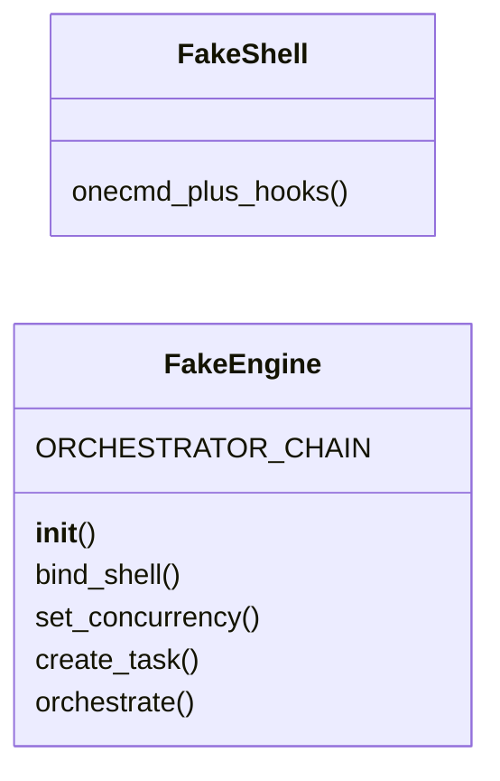
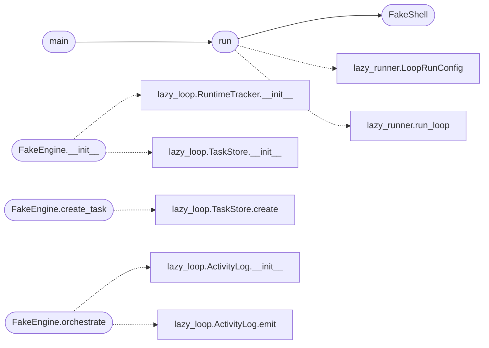

# `modules.tools.loop_smoke`

> Source: [modules/tools/loop_smoke.py:1](../../modules/tools/loop_smoke.py#L1) | language `py` | coverage 100.0% | [API index](../index.md)

End-to-end smoke of the shared loop runner (no LLM, no network).

Fakes the engine and shell, sandboxes the store, then exercises the
real `[`modules.lazy_runner.run_loop`](modules.lazy_runner.py.md#run_loop)` path with the milestone panel:
bootstrap streaming, verb output visibility, result reporting and the
observer/redirect recursion guard. Reusable across dev sessions via
``python -m modules.tools.loop_smoke`` or `[`run`](#run)` from tests.

## Contents

- **Classes:** [`FakeShell`](#fakeshell), [`FakeEngine`](#fakeengine)
- **Functions:** [`run`](#run), [`main`](#main)
- **Constants:** [`PROBE_TARGET`](#probe_target), [`ORCHESTRATE_DELAY_SEC`](#orchestrate_delay_sec)

## Type Diagram



## Call Graph

Solid arrows stay in this module, dashed arrows leave it.



## Classes

<a id="fakeshell"></a>

### `FakeShell`

`class` | [modules/tools/loop_smoke.py:22](../../modules/tools/loop_smoke.py#L22)

```python
class FakeShell
```

Shell stand-in whose verb prints like a real tool would.

**Members**

| Member | Kind | Summary |
|---|---|---|
| [`onecmd_plus_hooks`](#fakeshell-onecmd_plus_hooks) | method | Emit recognizable output for every routed verb. |

<a id="fakeshell-onecmd_plus_hooks"></a>

#### `FakeShell.onecmd_plus_hooks`

`method` | [modules/tools/loop_smoke.py:25](../../modules/tools/loop_smoke.py#L25)

```python
def onecmd_plus_hooks(self, command: str) -> None
```

Emit recognizable output for every routed verb.

**Parameters**

| Name | Type | Default | Description |
|---|---|---|---|
| `command` | `str` |  |  |

---

<a id="fakeengine"></a>

### `FakeEngine`

`class` | [modules/tools/loop_smoke.py:31](../../modules/tools/loop_smoke.py#L31)

```python
class FakeEngine
```

Minimal engine surface used by the runner and progress poller.

**Attributes**

| Name | Type | Default | Description |
|---|---|---|---|
| [`ORCHESTRATOR_CHAIN`](#fakeengine-orchestrator_chain) |  | `('lazy_task', 'lazy_worker')` |  |

**Members**

| Member | Kind | Summary |
|---|---|---|
| [`__init__`](#fakeengine-__init__) | constructor | Bind a sandboxed task store and runtime tracker. |
| [`bind_shell`](#fakeengine-bind_shell) | method | Record the bound shell (runner contract). |
| [`set_concurrency`](#fakeengine-set_concurrency) | method | Accept the concurrency knob without scheduling anything. |
| [`create_task`](#fakeengine-create_task) | method | Create the task record and return its id. |
| [`orchestrate`](#fakeengine-orchestrate) | method | Run the injected executor once and report a done summary. |

<a id="fakeengine-__init__"></a>

#### `FakeEngine.__init__`

`constructor` | [modules/tools/loop_smoke.py:36](../../modules/tools/loop_smoke.py#L36)

```python
def __init__(self) -> None
```

Bind a sandboxed task store and runtime tracker.

*Calls:* [`RuntimeTracker.__init__`](modules.lazy_loop.py.md#runtimetracker-__init__), [`TaskStore.__init__`](modules.lazy_loop.py.md#taskstore-__init__)

<a id="fakeengine-bind_shell"></a>

#### `FakeEngine.bind_shell`

`method` | [modules/tools/loop_smoke.py:44](../../modules/tools/loop_smoke.py#L44)

```python
def bind_shell(self, shell) -> None
```

Record the bound shell (runner contract).

**Parameters**

| Name | Type | Default | Description |
|---|---|---|---|
| `shell` |  |  |  |

<a id="fakeengine-set_concurrency"></a>

#### `FakeEngine.set_concurrency`

`method` | [modules/tools/loop_smoke.py:48](../../modules/tools/loop_smoke.py#L48)

```python
def set_concurrency(self, value) -> None
```

Accept the concurrency knob without scheduling anything.

**Parameters**

| Name | Type | Default | Description |
|---|---|---|---|
| `value` |  |  |  |

<a id="fakeengine-create_task"></a>

#### `FakeEngine.create_task`

`method` | [modules/tools/loop_smoke.py:52](../../modules/tools/loop_smoke.py#L52)

```python
def create_task(self, goal: str, description: str = '') -> dict
```

Create the task record and return its id.

**Parameters**

| Name | Type | Default | Description |
|---|---|---|---|
| `goal` | `str` |  |  |
| `description` | `str` | `''` |  |

**Returns:** `dict`

*Calls:* [`TaskStore.create`](modules.lazy_loop.py.md#taskstore-create)

<a id="fakeengine-orchestrate"></a>

#### `FakeEngine.orchestrate`

`method` | [modules/tools/loop_smoke.py:56](../../modules/tools/loop_smoke.py#L56)

```python
def orchestrate(self, **kwargs) -> dict
```

Run the injected executor once and report a done summary.

The delay keeps the runner thread alive across several poll
ticks, which is exactly where the transcript feedback loop used
to hang without emitting anything.

**Parameters**

| Name | Type | Default | Description |
|---|---|---|---|
| `**kwargs` |  |  |  |

**Returns:** `dict`

*Calls:* [`ActivityLog.__init__`](modules.lazy_loop.py.md#activitylog-__init__), [`ActivityLog.emit`](modules.lazy_loop.py.md#activitylog-emit)

---

## Functions

<a id="run"></a>

### `run`

`function` | [modules/tools/loop_smoke.py:77](../../modules/tools/loop_smoke.py#L77)

```python
def run() -> dict
```

Run the smoke and return ``{"ok": bool, "checks": {...}, "result": {...}}``.

**Returns:** `dict`

*Calls:* [`LoopRunConfig`](modules.lazy_runner.py.md#looprunconfig), [`run_loop`](modules.lazy_runner.py.md#run_loop), [`FakeShell`](#fakeshell)

*Called by:* [`main`](#main)

---

<a id="main"></a>

### `main`

`function` | [modules/tools/loop_smoke.py:114](../../modules/tools/loop_smoke.py#L114)

```python
def main() -> int
```

CLI entry point: print the checks and exit 0/1.

**Returns:** `int`

*Calls:* [`run`](#run)

---

## Constants

<a id="probe_target"></a>

### `PROBE_TARGET`

`constant` | [modules/tools/loop_smoke.py:18](../../modules/tools/loop_smoke.py#L18)

```python
PROBE_TARGET = '127.0.0.1'
```

---

<a id="orchestrate_delay_sec"></a>

### `ORCHESTRATE_DELAY_SEC`

`constant` | [modules/tools/loop_smoke.py:19](../../modules/tools/loop_smoke.py#L19)

```python
ORCHESTRATE_DELAY_SEC = 0.4
```

---
