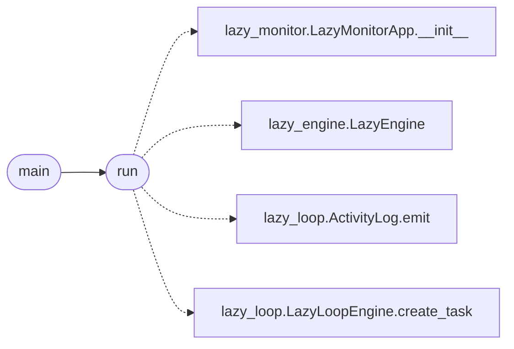

# `modules.tools.monitor_smoke`

> Source: [modules/tools/monitor_smoke.py:1](../../modules/tools/monitor_smoke.py#L1) | language `py` | coverage 100.0% | [API index](../index.md)

Headless smoke of the Textual worker monitor (``lazy_view``).

Sandboxes the store, seeds one task with activity and a guard audit
record, then drives the real [`cli.lazy_monitor.LazyMonitorApp`](cli.lazy_monitor.py.md#lazymonitorapp)
through Textual's ``run_test`` pilot (compose, poll, tab and control
keys). No tty, no network. Reusable via ``python -m
modules.tools.monitor_smoke`` or `[`run`](#run)` from tests.

## Contents

- **Functions:** [`run`](#run), [`main`](#main)
- **Constants:** [`PAUSE_SEC`](#pause_sec), [`KEYS`](#keys)

## Call Graph

Solid arrows stay in this module, dashed arrows leave it.



## Functions

<a id="run"></a>

### `run`

`function` | [modules/tools/monitor_smoke.py:20](../../modules/tools/monitor_smoke.py#L20)

```python
def run() -> dict
```

Run the monitor smoke and return ``{"ok": bool, "checks": {...}}``.

**Returns:** `dict`

*Calls:* [`LazyMonitorApp.__init__`](cli.lazy_monitor.py.md#lazymonitorapp-__init__), [`LazyEngine`](modules.lazy_engine.py.md#lazyengine), [`ActivityLog.emit`](modules.lazy_loop.py.md#activitylog-emit), [`LazyLoopEngine.create_task`](modules.lazy_loop.py.md#lazyloopengine-create_task)

*Called by:* [`main`](#main)

---

<a id="main"></a>

### `main`

`function` | [modules/tools/monitor_smoke.py:59](../../modules/tools/monitor_smoke.py#L59)

```python
def main() -> int
```

CLI entry point: print the checks and exit 0/1.

**Returns:** `int`

*Calls:* [`run`](#run)

---

## Constants

<a id="pause_sec"></a>

### `PAUSE_SEC`

`constant` | [modules/tools/monitor_smoke.py:16](../../modules/tools/monitor_smoke.py#L16)

```python
PAUSE_SEC = 0.8
```

---

<a id="keys"></a>

### `KEYS`

`constant` | [modules/tools/monitor_smoke.py:17](../../modules/tools/monitor_smoke.py#L17)

```python
KEYS = ('g', 't', 'p', 'r')
```

---
