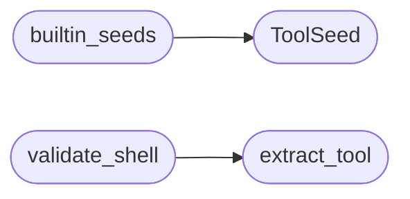

# `modules.toolset`

> Source: [modules/toolset.py:1](../../modules/toolset.py#L1) | language `py` | coverage 100.0% | [API index](../index.md)

Typed tool sets per agent role with shell allowlists.

Ports the LAZY ``agent/toolcatalog.go`` + ``agent/tools.go`` contract:
each agent role (planner / worker / main / goals) owns a fixed tool set.
Handlers always live in code; this catalog only decides visibility and
safe defaults. Shell commands from the LLM go through
[`extract_tool`](#extract_tool) (shlex, not naive split) and [`validate_shell`](#validate_shell).

## Contents

- **Classes:** [`ToolSeed`](#toolseed)
- **Functions:** [`builtin_seeds`](#builtin_seeds), [`resolve`](#resolve), [`extract_tool`](#extract_tool), [`validate_shell`](#validate_shell)
- **Constants:** [`PLANNER`](#planner), [`WORKER`](#worker), [`MAIN`](#main), [`GOALS`](#goals), [`VALID_ROLES`](#valid_roles), [`PLANNER_SHELL`](#planner_shell), [`WORKER_SHELL`](#worker_shell), [`MAIN_SHELL`](#main_shell)

## Call Graph

Solid arrows stay in this module, dashed arrows leave it.



## Classes

<a id="toolseed"></a>

### `ToolSeed`

`class` `dataclass` | [modules/toolset.py:27](../../modules/toolset.py#L27)

Decorators: `@dataclass(frozen=True, slots=True)`

```python
class ToolSeed
```

Catalog entry mirroring LAZY ToolSeed (key + desc + agents).

**Attributes**

| Name | Type | Default | Description |
|---|---|---|---|
| [`key`](#toolseed-key) | `str` |  |  |
| [`desc`](#toolseed-desc) | `str` |  |  |
| [`agents`](#toolseed-agents) | `tuple` | `()` |  |

---

## Functions

<a id="builtin_seeds"></a>

### `builtin_seeds`

`function` | [modules/toolset.py:35](../../modules/toolset.py#L35)

```python
def builtin_seeds() -> list[ToolSeed]
```

Return the default graph-tool catalog (handlers stay in code).

**Returns:** `list[ToolSeed]`

*Calls:* [`ToolSeed`](#toolseed)

---

<a id="resolve"></a>

### `resolve`

`function` | [modules/toolset.py:72](../../modules/toolset.py#L72)

```python
def resolve(agent: str, tool_key: str) -> ToolSeed | None
```

Return the seed when bound to agent, else None (LAZY ToolResolve).

**Parameters**

| Name | Type | Default | Description |
|---|---|---|---|
| `agent` | `str` |  |  |
| `tool_key` | `str` |  |  |

**Returns:** `ToolSeed | None`

---

<a id="extract_tool"></a>

### `extract_tool`

`function` | [modules/toolset.py:105](../../modules/toolset.py#L105)

```python
def extract_tool(command: str) -> tuple[str, bool]
```

Split tool name with shlex; flag shell metacharacters.

Returns (tool, has_shell_meta). Empty command yields ("", False).

**Parameters**

| Name | Type | Default | Description |
|---|---|---|---|
| `command` | `str` |  |  |

**Returns:** `tuple[str, bool]`

*Called by:* [`validate_shell`](#validate_shell)

---

<a id="validate_shell"></a>

### `validate_shell`

`function` | [modules/toolset.py:128](../../modules/toolset.py#L128)

```python
def validate_shell(role: str, command: str) -> tuple[bool, str]
```

Check a shell command against the role allowlist.

Returns (allowed, reason). Planner is recon-only; exploit verbs are
denied for planner and must run as worker intents (LAZY parity).
Shell metacharacters always require ask (returned as not-allowed
with reason shell_meta so the caller routes to approval).

**Parameters**

| Name | Type | Default | Description |
|---|---|---|---|
| `role` | `str` |  |  |
| `command` | `str` |  |  |

**Returns:** `tuple[bool, str]`

*Calls:* [`extract_tool`](#extract_tool)

---

## Constants

<a id="planner"></a>

### `PLANNER`

`constant` | [modules/toolset.py:16](../../modules/toolset.py#L16)

```python
PLANNER = 'planner'
```

---

<a id="worker"></a>

### `WORKER`

`constant` | [modules/toolset.py:17](../../modules/toolset.py#L17)

```python
WORKER = 'worker'
```

---

<a id="main"></a>

### `MAIN`

`constant` | [modules/toolset.py:18](../../modules/toolset.py#L18)

```python
MAIN = 'main'
```

---

<a id="goals"></a>

### `GOALS`

`constant` | [modules/toolset.py:19](../../modules/toolset.py#L19)

```python
GOALS = 'goals'
```

---

<a id="valid_roles"></a>

### `VALID_ROLES`

`constant` | [modules/toolset.py:21](../../modules/toolset.py#L21)

```python
VALID_ROLES = frozenset({PLANNER, WORKER, MAIN, GOALS})
```

---

<a id="planner_shell"></a>

### `PLANNER_SHELL`

`constant` | [modules/toolset.py:82](../../modules/toolset.py#L82)

```python
PLANNER_SHELL
```

---

<a id="worker_shell"></a>

### `WORKER_SHELL`

`constant` | [modules/toolset.py:89](../../modules/toolset.py#L89)

```python
WORKER_SHELL
```

---

<a id="main_shell"></a>

### `MAIN_SHELL`

`constant` | [modules/toolset.py:99](../../modules/toolset.py#L99)

```python
MAIN_SHELL
```

---
