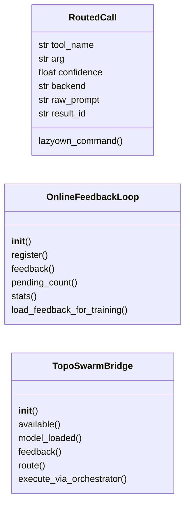
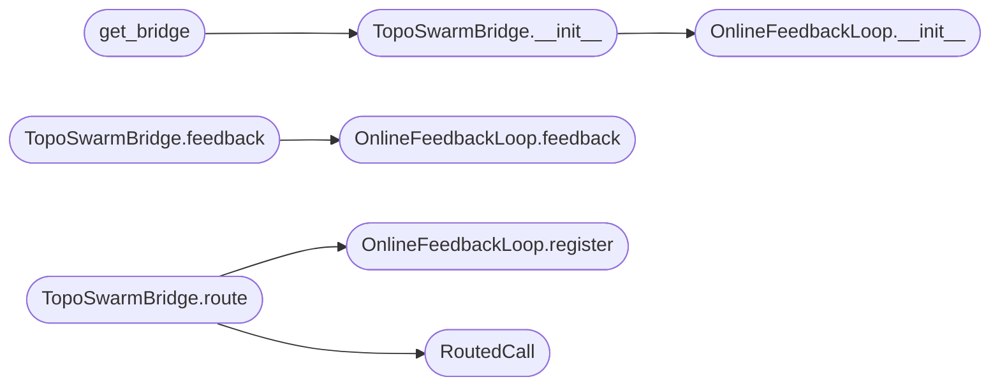

# `modules.toposwarm_bridge`

> Source: [modules/toposwarm_bridge.py:1](../../modules/toposwarm_bridge.py#L1) | language `py` | coverage 72.2% | [API index](../index.md)

modules/toposwarm_bridge.py ============================ Local brain bridge: connects LazyOwn to the TopoSwarm router when cloud LLMs (Groq / Ollama / Claude Code) are unavailable.

TopoSwarm is a 2M-parameter quaternionic toroidal model trained specifically
on LazyOwn tool traces.  It routes natural-language operator prompts to the
correct LazyOwn tool + argument without any external API call.

Fallback hierarchy this module implements
-----------------------------------------
  cloud LLMs available?  →  use them (not this module)
              ↓ no
  TopoSwarm model loaded? →  neural routing (16-40% acc, improving)
              ↓ no
  keyword routing only    →  regex/keyword matching (~80% acc on common phrases)

Public API
----------
  bridge = TopoSwarmBridge()
  result = bridge.route("scan open ports on 10.10.11.78")
  # result.tool_name  → "lazyown_run_command"
  # result.arg        → "set rhost 10.10.11.78\nlazynmap"
  # result.confidence → 0.92
  # result.backend    → "toposwarm_model" | "toposwarm_keyword"

  # For the hive autonomous loop: execute the routed tool via the bridge
  output = bridge.execute(result)

  # Check availability
  bridge.available      → True/False
  bridge.model_loaded   → True/False

## Contents

- **Classes:** [`RoutedCall`](#routedcall), [`OnlineFeedbackLoop`](#onlinefeedbackloop), [`TopoSwarmBridge`](#toposwarmbridge)
- **Functions:** [`get_bridge`](#get_bridge)

## Type Diagram



## Call Graph

Solid arrows stay in this module, dashed arrows leave it.



## Classes

<a id="routedcall"></a>

### `RoutedCall`

`class` `dataclass` | [modules/toposwarm_bridge.py:71](../../modules/toposwarm_bridge.py#L71)

Decorators: `@dataclass`

```python
class RoutedCall
```

Result of a routing decision.

**Attributes**

| Name | Type | Default | Description |
|---|---|---|---|
| [`tool_name`](#routedcall-tool_name) | `str` |  |  |
| [`arg`](#routedcall-arg) | `str` |  |  |
| [`confidence`](#routedcall-confidence) | `float` |  |  |
| [`backend`](#routedcall-backend) | `str` |  |  |
| [`raw_prompt`](#routedcall-raw_prompt) | `str` | `''` |  |
| [`result_id`](#routedcall-result_id) | `str` | `field(default_factory=lambda: uuid.uuid4().hex[:8])` |  |

**Members**

| Member | Kind | Summary |
|---|---|---|
| [`lazyown_command`](#routedcall-lazyown_command) | method | Return the LazyOwn shell command string to execute this tool call. |

<a id="routedcall-lazyown_command"></a>

#### `RoutedCall.lazyown_command`

`method` | [modules/toposwarm_bridge.py:81](../../modules/toposwarm_bridge.py#L81)

```python
def lazyown_command(self) -> str
```

Return the LazyOwn shell command string to execute this tool call.

**Returns:** `str`

---

<a id="onlinefeedbackloop"></a>

### `OnlineFeedbackLoop`

`class` | [modules/toposwarm_bridge.py:273](../../modules/toposwarm_bridge.py#L273)

```python
class OnlineFeedbackLoop
```

Collects user feedback on routing decisions and applies it immediately.

Positive feedback:
  → Hebbian update on routing_head.liquid.W_fast (instant, no backprop)
  → Stored as a positive example for the next --finetune run

Negative feedback:
  → Stored as a hard-negative for the next --finetune run
  → No model update (we don't want to reinforce the wrong decision)

Non-blocking: feedback() is fire-and-forget. If the user doesn't call it,
the flow continues unchanged. Feedback persists to disk so it survives
across sessions and is automatically picked up by --finetune.

Usage:
    result = bridge.route("scan 10.10.11.78")
    # ... execute tool ...
    bridge.feedback(result.result_id, good=True,  comment="correct tool")
    bridge.feedback(result.result_id, good=False, comment="wrong, should be hive_spawn")

**Members**

| Member | Kind | Summary |
|---|---|---|
| [`__init__`](#onlinefeedbackloop-__init__) | constructor |  |
| [`register`](#onlinefeedbackloop-register) | method | Register a routing result as pending feedback. |
| [`feedback`](#onlinefeedbackloop-feedback) | method | Apply feedback for a routing decision. |
| [`pending_count`](#onlinefeedbackloop-pending_count) | method |  |
| [`stats`](#onlinefeedbackloop-stats) | method |  |
| [`load_feedback_for_training`](#onlinefeedbackloop-load_feedback_for_training) | method | Load persisted feedback for --finetune. |

<a id="onlinefeedbackloop-__init__"></a>

#### `OnlineFeedbackLoop.__init__`

`constructor` | [modules/toposwarm_bridge.py:296](../../modules/toposwarm_bridge.py#L296)

```python
def __init__(self, maxsize: int = 1000) -> None
```

**Parameters**

| Name | Type | Default | Description |
|---|---|---|---|
| `maxsize` | `int` | `1000` |  |

*Called by:* [`TopoSwarmBridge.__init__`](#toposwarmbridge-__init__)

<a id="onlinefeedbackloop-register"></a>

#### `OnlineFeedbackLoop.register`

`method` | [modules/toposwarm_bridge.py:303](../../modules/toposwarm_bridge.py#L303)

```python
def register(self, result: RoutedCall, hidden: Any | None = None) -> None
```

Register a routing result as pending feedback.

**Parameters**

| Name | Type | Default | Description |
|---|---|---|---|
| `result` | `RoutedCall` |  |  |
| `hidden` | `Any \| None` | `None` |  |

*Called by:* [`TopoSwarmBridge.route`](#toposwarmbridge-route)

<a id="onlinefeedbackloop-feedback"></a>

#### `OnlineFeedbackLoop.feedback`

`method` | [modules/toposwarm_bridge.py:318](../../modules/toposwarm_bridge.py#L318)

```python
def feedback(self, result_id: str, good: bool, comment: str = '', routing_head: Any = None) -> bool
```

Apply feedback for a routing decision.

Returns True if the result_id was found, False otherwise.
Never raises — this is fire-and-forget.

**Parameters**

| Name | Type | Default | Description |
|---|---|---|---|
| `result_id` | `str` |  |  |
| `good` | `bool` |  |  |
| `comment` | `str` | `''` |  |
| `routing_head` | `Any` | `None` |  |

**Returns:** `bool`

*Called by:* [`TopoSwarmBridge.feedback`](#toposwarmbridge-feedback)

<a id="onlinefeedbackloop-pending_count"></a>

#### `OnlineFeedbackLoop.pending_count`

`method` | [modules/toposwarm_bridge.py:379](../../modules/toposwarm_bridge.py#L379)

```python
def pending_count(self) -> int
```

**Returns:** `int`

<a id="onlinefeedbackloop-stats"></a>

#### `OnlineFeedbackLoop.stats`

`method` | [modules/toposwarm_bridge.py:382](../../modules/toposwarm_bridge.py#L382)

```python
def stats(self) -> dict[str, int]
```

**Returns:** `dict[str, int]`

<a id="onlinefeedbackloop-load_feedback_for_training"></a>

#### `OnlineFeedbackLoop.load_feedback_for_training`

`method` | [modules/toposwarm_bridge.py:389](../../modules/toposwarm_bridge.py#L389)

```python
def load_feedback_for_training(self) -> tuple
```

Load persisted feedback for --finetune.

Returns (positive_records, negative_records) as ToolBench-format dicts.

**Returns:** `tuple`

---

<a id="toposwarmbridge"></a>

### `TopoSwarmBridge`

`class` | [modules/toposwarm_bridge.py:424](../../modules/toposwarm_bridge.py#L424)

```python
class TopoSwarmBridge
```

Stateful bridge to the TopoSwarm local router.

Lazy-loads the model on first use so import cost is zero when TopoSwarm
is not needed (Groq/Ollama available).

**Members**

| Member | Kind | Summary |
|---|---|---|
| [`__init__`](#toposwarmbridge-__init__) | constructor |  |
| [`available`](#toposwarmbridge-available) | property | True if TopoSwarm directory exists (even if model not loaded). |
| [`model_loaded`](#toposwarmbridge-model_loaded) | property |  |
| [`feedback`](#toposwarmbridge-feedback) | method | Optional user feedback on a routing decision. |
| [`route`](#toposwarmbridge-route) | method | Route an operator prompt to a LazyOwn tool call. |
| [`execute_via_orchestrator`](#toposwarmbridge-execute_via_orchestrator) | method | Execute a prompt through the full TopoSwarm orchestrator (subprocess). |

<a id="toposwarmbridge-__init__"></a>

#### `TopoSwarmBridge.__init__`

`constructor` | [modules/toposwarm_bridge.py:432](../../modules/toposwarm_bridge.py#L432)

```python
def __init__(self) -> None
```

*Calls:* [`OnlineFeedbackLoop.__init__`](#onlinefeedbackloop-__init__)

*Called by:* [`get_bridge`](#get_bridge), [`TopoSwarmBackend.available`](modules.unified_bridge.py.md#toposwarmbackend-available), [`TopoSwarmBackend.route`](modules.unified_bridge.py.md#toposwarmbackend-route)

<a id="toposwarmbridge-available"></a>

#### `TopoSwarmBridge.available`

`property` | [modules/toposwarm_bridge.py:444](../../modules/toposwarm_bridge.py#L444)

Decorators: `@property`

```python
def available(self) -> bool
```

True if TopoSwarm directory exists (even if model not loaded).

**Returns:** `bool`

<a id="toposwarmbridge-model_loaded"></a>

#### `TopoSwarmBridge.model_loaded`

`property` | [modules/toposwarm_bridge.py:449](../../modules/toposwarm_bridge.py#L449)

Decorators: `@property`

```python
def model_loaded(self) -> bool
```

**Returns:** `bool`

<a id="toposwarmbridge-feedback"></a>

#### `TopoSwarmBridge.feedback`

`method` | [modules/toposwarm_bridge.py:562](../../modules/toposwarm_bridge.py#L562)

```python
def feedback(self, result_id: str, good: bool, comment: str = '') -> bool
```

Optional user feedback on a routing decision.

Non-blocking — safe to call in a fire-and-forget fashion.
Positive feedback → immediate Hebbian update on routing head.
Negative feedback → stored as hard-negative for next --finetune.

Returns True if the result_id was found, False if expired/unknown.

**Parameters**

| Name | Type | Default | Description |
|---|---|---|---|
| `result_id` | `str` |  |  |
| `good` | `bool` |  |  |
| `comment` | `str` | `''` |  |

**Returns:** `bool`

**Example**

```python
result = bridge.route("scan 10.10.11.78")
# ... execute, check output ...
bridge.feedback(result.result_id, good=True)
bridge.feedback(result.result_id, good=False,
                comment="should have been hive_spawn")
```

*Calls:* [`OnlineFeedbackLoop.feedback`](#onlinefeedbackloop-feedback)

<a id="toposwarmbridge-route"></a>

#### `TopoSwarmBridge.route`

`method` | [modules/toposwarm_bridge.py:586](../../modules/toposwarm_bridge.py#L586)

```python
def route(self, prompt: str) -> RoutedCall
```

Route an operator prompt to a LazyOwn tool call.

Tries neural routing first (if model loaded), then keyword routing.
Always returns a RoutedCall — never raises.
Each result has a [`result_id`](#routedcall-result_id) you can pass to bridge.feedback().

**Parameters**

| Name | Type | Default | Description |
|---|---|---|---|
| `prompt` | `str` |  |  |

**Returns:** `RoutedCall`

*Calls:* [`OnlineFeedbackLoop.register`](#onlinefeedbackloop-register), [`RoutedCall`](#routedcall)

*Called by:* [`TopoSwarmBackend.route`](modules.unified_bridge.py.md#toposwarmbackend-route)

<a id="toposwarmbridge-execute_via_orchestrator"></a>

#### `TopoSwarmBridge.execute_via_orchestrator`

`method` | [modules/toposwarm_bridge.py:613](../../modules/toposwarm_bridge.py#L613)

```python
def execute_via_orchestrator(self, prompt: str, no_model: bool = False) -> str
```

Execute a prompt through the full TopoSwarm orchestrator (subprocess).

Returns the output string. Used by the autonomous loop.

**Parameters**

| Name | Type | Default | Description |
|---|---|---|---|
| `prompt` | `str` |  |  |
| `no_model` | `bool` | `False` |  |

**Returns:** `str`

---

## Functions

<a id="get_bridge"></a>

### `get_bridge`

`function` | [modules/toposwarm_bridge.py:645](../../modules/toposwarm_bridge.py#L645)

```python
def get_bridge() -> TopoSwarmBridge
```

Return the module-level TopoSwarmBridge singleton (lazy init).

**Returns:** `TopoSwarmBridge`

*Calls:* [`TopoSwarmBridge.__init__`](#toposwarmbridge-__init__)

*Called by:* [`AutonomousAgent.__init__`](skills.toposwarm_autonomous.py.md#autonomousagent-__init__)

---
