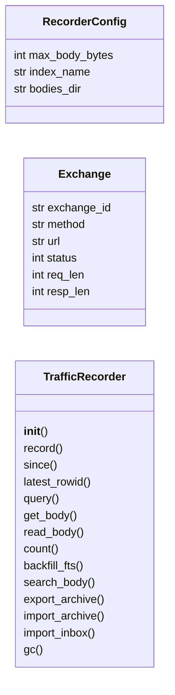
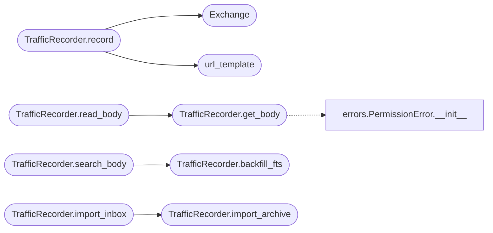

# `modules.traffic_recorder`

> Source: [modules/traffic_recorder.py:1](../../modules/traffic_recorder.py#L1) | language `py` | coverage 100.0% | [API index](../index.md)

HTTP traffic recorder with file-tree storage and SQLite index.

Ports the LAZY ``traffic`` subsystem: every agent-driven HTTP exchange
is persisted to a human-browsable directory with a sidecar SQLite index
for paged queries. No redaction is applied; scoping is enforced by the
caller before recording.

## Contents

- **Classes:** [`RecorderConfig`](#recorderconfig), [`Exchange`](#exchange), [`TrafficRecorder`](#trafficrecorder)
- **Functions:** [`url_template`](#url_template)
- **Constants:** [`CONFIG`](#config), [`INDEX_SCHEMA`](#index_schema), [`FTS_SCHEMA`](#fts_schema), [`FTS_TEXT_LIMIT`](#fts_text_limit), [`MAX_BODY_BYTES`](#max_body_bytes)

## Type Diagram



## Call Graph

Solid arrows stay in this module, dashed arrows leave it.



## Classes

<a id="recorderconfig"></a>

### `RecorderConfig`

`class` `dataclass` | [modules/traffic_recorder.py:24](../../modules/traffic_recorder.py#L24)

Decorators: `@dataclass(frozen=True, slots=True)`

```python
class RecorderConfig
```

Centralized constants for recorder behavior.

**Attributes**

| Name | Type | Default | Description |
|---|---|---|---|
| [`max_body_bytes`](#recorderconfig-max_body_bytes) | `int` | `2000000` |  |
| [`index_name`](#recorderconfig-index_name) | `str` | `'index.sqlite'` |  |
| [`bodies_dir`](#recorderconfig-bodies_dir) | `str` | `'bodies'` |  |

---

<a id="exchange"></a>

### `Exchange`

`class` `dataclass` | [modules/traffic_recorder.py:80](../../modules/traffic_recorder.py#L80)

Decorators: `@dataclass`

```python
class Exchange
```

Single recorded HTTP exchange.

**Attributes**

| Name | Type | Default | Description |
|---|---|---|---|
| [`exchange_id`](#exchange-exchange_id) | `str` |  |  |
| [`method`](#exchange-method) | `str` |  |  |
| [`url`](#exchange-url) | `str` |  |  |
| [`status`](#exchange-status) | `int` |  |  |
| [`req_len`](#exchange-req_len) | `int` |  |  |
| [`resp_len`](#exchange-resp_len) | `int` |  |  |

---

<a id="trafficrecorder"></a>

### `TrafficRecorder`

`class` | [modules/traffic_recorder.py:91](../../modules/traffic_recorder.py#L91)

```python
class TrafficRecorder
```

Append-only recorder backed by files plus SQLite index.

**Members**

| Member | Kind | Summary |
|---|---|---|
| [`__init__`](#trafficrecorder-__init__) | constructor | Create storage directories and initialize the index. |
| [`record`](#trafficrecorder-record) | method | Persist one exchange and return its descriptor. |
| [`since`](#trafficrecorder-since) | method | Page exchanges newer than a rowid watermark for loop ingestion. |
| [`latest_rowid`](#trafficrecorder-latest_rowid) | method | Return the current max rowid (0 when the index is empty). |
| [`query`](#trafficrecorder-query) | method | Page exchanges with optional host, status and task filters. |
| [`get_body`](#trafficrecorder-get_body) | method | Load the stored body document for one exchange. |
| [`read_body`](#trafficrecorder-read_body) | method | Read one body in ranges like a blob store. |
| [`count`](#trafficrecorder-count) | method | Return the total number of recorded exchanges. |
| [`backfill_fts`](#trafficrecorder-backfill_fts) | method | Index stored bodies missing from the FTS table. |
| [`search_body`](#trafficrecorder-search_body) | method | Full-text search request/response bodies. |
| [`export_archive`](#trafficrecorder-export_archive) | method | Export the index plus bodies into a portable zip archive. |
| [`import_archive`](#trafficrecorder-import_archive) | method | Merge an archive exported by [`export_archive`](#trafficrecorder-export_archive). |
| [`import_inbox`](#trafficrecorder-import_inbox) | method | Import every zip dropped in the inbox, moving handled files away. |
| [`gc`](#trafficrecorder-gc) | method | Delete exchanges older than a cut-off with their bodies and index rows. |

<a id="trafficrecorder-__init__"></a>

#### `TrafficRecorder.__init__`

`constructor` | [modules/traffic_recorder.py:94](../../modules/traffic_recorder.py#L94)

```python
def __init__(self, base_dir: str | Path) -> None
```

Create storage directories and initialize the index.

**Parameters**

| Name | Type | Default | Description |
|---|---|---|---|
| `base_dir` | `str \| Path` |  |  |

*Called by:* [`LazyCommandSet.do_lazy_traffic`](cli.commands.lazyops.py.md#lazycommandset-do_lazy_traffic), [`TrafficLog.recorder_blob`](modules.lazy_loop.py.md#trafficlog-recorder_blob), [`TrafficLog.recorder_body`](modules.lazy_loop.py.md#trafficlog-recorder_body), [`ProxyController.start`](modules.lazy_proxy.py.md#proxycontroller-start)

<a id="trafficrecorder-record"></a>

#### `TrafficRecorder.record`

`method` | [modules/traffic_recorder.py:138](../../modules/traffic_recorder.py#L138)

```python
def record(self, method: str, url: str, status: int = 0, req_body: bytes = b'', resp_body: bytes = b'', content_type: str = '', req_headers: dict | None = None, resp_headers: dict | None = None, host: str = '', port: int = 0, scheme: str = '', task: str = '', note: str = '') -> Exchange
```

Persist one exchange and return its descriptor.

**Parameters**

| Name | Type | Default | Description |
|---|---|---|---|
| `method` | `str` |  | HTTP method. |
| `url` | `str` |  | Full request URL. |
| `status` | `int` | `0` | Response status code (0 when the exchange failed). |
| `req_body` | `bytes` | `b''` | Request body bytes (truncated to the cap). |
| `resp_body` | `bytes` | `b''` | Response body bytes (truncated to the cap). |
| `content_type` | `str` | `''` | Response content type. |
| `req_headers` | `dict \| None` | `None` | Request header mapping. |
| `resp_headers` | `dict \| None` | `None` | Response header mapping. |
| `host` | `str` | `''` | Host override (MITM knows it before parsing the URL). |
| `port` | `int` | `0` | Port override. |
| `scheme` | `str` | `''` | Scheme override (https for MITM'd CONNECT tunnels). |
| `task` | `str` | `''` | Optional task tag for loop ingestion. |
| `note` | `str` | `''` | Optional failure note. |

**Returns:** `Exchange` - Exchange descriptor.

*Calls:* [`Exchange`](#exchange), [`url_template`](#url_template)

<a id="trafficrecorder-since"></a>

#### `TrafficRecorder.since`

`method` | [modules/traffic_recorder.py:230](../../modules/traffic_recorder.py#L230)

```python
def since(self, rowid: int = 0, limit: int = 200) -> list[dict]
```

Page exchanges newer than a rowid watermark for loop ingestion.

**Parameters**

| Name | Type | Default | Description |
|---|---|---|---|
| `rowid` | `int` | `0` | Last ingested SQLite rowid (0 starts from the beginning). |
| `limit` | `int` | `200` | Max rows per page. |

**Returns:** `list[dict]` - Row dicts including the ``rowid`` cursor.

<a id="trafficrecorder-latest_rowid"></a>

#### `TrafficRecorder.latest_rowid`

`method` | [modules/traffic_recorder.py:247](../../modules/traffic_recorder.py#L247)

```python
def latest_rowid(self) -> int
```

Return the current max rowid (0 when the index is empty).

**Returns:** `int`

<a id="trafficrecorder-query"></a>

#### `TrafficRecorder.query`

`method` | [modules/traffic_recorder.py:253](../../modules/traffic_recorder.py#L253)

```python
def query(self, host: str = '', status: int | None = None, limit: int = 50, offset: int = 0, task: str = '') -> list[dict]
```

Page exchanges with optional host, status and task filters.

**Parameters**

| Name | Type | Default | Description |
|---|---|---|---|
| `host` | `str` | `''` |  |
| `status` | `int \| None` | `None` |  |
| `limit` | `int` | `50` |  |
| `offset` | `int` | `0` |  |
| `task` | `str` | `''` |  |

**Returns:** `list[dict]`

<a id="trafficrecorder-get_body"></a>

#### `TrafficRecorder.get_body`

`method` | [modules/traffic_recorder.py:275](../../modules/traffic_recorder.py#L275)

```python
def get_body(self, exchange_id: str) -> dict
```

Load the stored body document for one exchange.

**Parameters**

| Name | Type | Default | Description |
|---|---|---|---|
| `exchange_id` | `str` |  |  |

**Returns:** `dict`

**Raises**

- [`PermissionError`](core.errors.py.md#permissionerror): (raised in the body, not documented)

*Calls:* [`PermissionError.__init__`](core.errors.py.md#permissionerror-__init__)

*Called by:* [`TrafficLog.recorder_body`](modules.lazy_loop.py.md#trafficlog-recorder_body), [`TrafficRecorder.read_body`](#trafficrecorder-read_body)

<a id="trafficrecorder-read_body"></a>

#### `TrafficRecorder.read_body`

`method` | [modules/traffic_recorder.py:284](../../modules/traffic_recorder.py#L284)

```python
def read_body(self, exchange_id: str, part: str = 'resp', offset: int = 0, length: int = 8192) -> dict
```

Read one body in ranges like a blob store.

**Parameters**

| Name | Type | Default | Description |
|---|---|---|---|
| `exchange_id` | `str` |  | Exchange whose body is read. |
| `part` | `str` | `'resp'` | ``resp`` (default) or ``req``. |
| `offset` | `int` | `0` | Byte offset. |
| `length` | `int` | `8192` | Max bytes (clamped to 1 MiB). |

**Returns:** `dict` - Dict with data, offset, length, total and eof.

**Raises**

- `ValueError`: Unknown part.
- `KeyError`: Unknown exchange body.

*Calls:* [`TrafficRecorder.get_body`](#trafficrecorder-get_body)

*Called by:* [`TrafficLog.recorder_blob`](modules.lazy_loop.py.md#trafficlog-recorder_blob)

<a id="trafficrecorder-count"></a>

#### `TrafficRecorder.count`

`method` | [modules/traffic_recorder.py:317](../../modules/traffic_recorder.py#L317)

```python
def count(self) -> int
```

Return the total number of recorded exchanges.

**Returns:** `int`

*Called by:* [`ProxyController.status`](modules.lazy_proxy.py.md#proxycontroller-status)

<a id="trafficrecorder-backfill_fts"></a>

#### `TrafficRecorder.backfill_fts`

`method` | [modules/traffic_recorder.py:343](../../modules/traffic_recorder.py#L343)

```python
def backfill_fts(self, batch: int = 500) -> int
```

Index stored bodies missing from the FTS table.

**Parameters**

| Name | Type | Default | Description |
|---|---|---|---|
| `batch` | `int` | `500` | Max bodies indexed per call. |

**Returns:** `int` - Number of newly indexed exchanges.

*Called by:* [`TrafficRecorder.search_body`](#trafficrecorder-search_body)

<a id="trafficrecorder-search_body"></a>

#### `TrafficRecorder.search_body`

`method` | [modules/traffic_recorder.py:382](../../modules/traffic_recorder.py#L382)

```python
def search_body(self, query: str, limit: int = 20) -> list[dict]
```

Full-text search request/response bodies.

Uses the FTS5 index when available and falls back to a bounded
LIKE scan over the most recent bodies otherwise.

**Parameters**

| Name | Type | Default | Description |
|---|---|---|---|
| `query` | `str` |  | Phrase to search for. |
| `limit` | `int` | `20` | Max hits. |

**Returns:** `list[dict]` - Hits with exchange_id, url, status, host and a snippet.

*Calls:* [`TrafficRecorder.backfill_fts`](#trafficrecorder-backfill_fts)

<a id="trafficrecorder-export_archive"></a>

#### `TrafficRecorder.export_archive`

`method` | [modules/traffic_recorder.py:451](../../modules/traffic_recorder.py#L451)

```python
def export_archive(self, path: str | Path, limit: int = 0, task: str = '') -> dict
```

Export the index plus bodies into a portable zip archive.

**Parameters**

| Name | Type | Default | Description |
|---|---|---|---|
| `path` | `str \| Path` |  | Destination zip path. |
| `limit` | `int` | `0` | Max exchanges (0 exports all). |
| `task` | `str` | `''` | Optional task filter for per-task archives. |

**Returns:** `dict` - Dict with exported/bodies counts and the archive path.

<a id="trafficrecorder-import_archive"></a>

#### `TrafficRecorder.import_archive`

`method` | [modules/traffic_recorder.py:493](../../modules/traffic_recorder.py#L493)

```python
def import_archive(self, path: str | Path) -> dict
```

Merge an archive exported by [`export_archive`](#trafficrecorder-export_archive).

**Parameters**

| Name | Type | Default | Description |
|---|---|---|---|
| `path` | `str \| Path` |  | Source zip path. |

**Returns:** `dict` - Dict with imported/bodies counts and the archive path.

**Raises**

- `FileNotFoundError`: Archive missing.

*Called by:* [`TrafficRecorder.import_inbox`](#trafficrecorder-import_inbox)

<a id="trafficrecorder-import_inbox"></a>

#### `TrafficRecorder.import_inbox`

`method` | [modules/traffic_recorder.py:554](../../modules/traffic_recorder.py#L554)

```python
def import_inbox(self, inbox_dir: str | Path | None = None) -> dict
```

Import every zip dropped in the inbox, moving handled files away.

**Parameters**

| Name | Type | Default | Description |
|---|---|---|---|
| `inbox_dir` | `str \| Path \| None` | `None` | Scan root (defaults to ``<base>/inbox``). |

**Returns:** `dict` - Dict with imported count and handled file names.

*Calls:* [`TrafficRecorder.import_archive`](#trafficrecorder-import_archive)

<a id="trafficrecorder-gc"></a>

#### `TrafficRecorder.gc`

`method` | [modules/traffic_recorder.py:587](../../modules/traffic_recorder.py#L587)

```python
def gc(self, older_than_sec: float = 0.0) -> dict
```

Delete exchanges older than a cut-off with their bodies and index rows.

**Parameters**

| Name | Type | Default | Description |
|---|---|---|---|
| `older_than_sec` | `float` | `0.0` | Age threshold; 0 disables the sweep. |

**Returns:** `dict` - Dict with removed count.

---

## Functions

<a id="url_template"></a>

### `url_template`

`function` | [modules/traffic_recorder.py:69](../../modules/traffic_recorder.py#L69)

```python
def url_template(url: str) -> str
```

Collapse numeric path segments so similar URLs group together.

**Parameters**

| Name | Type | Default | Description |
|---|---|---|---|
| `url` | `str` |  |  |

**Returns:** `str`

*Called by:* [`TrafficRecorder.record`](#trafficrecorder-record)

---

## Constants

<a id="config"></a>

### `CONFIG`

`constant` | [modules/traffic_recorder.py:32](../../modules/traffic_recorder.py#L32)

```python
CONFIG = RecorderConfig()
```

---

<a id="index_schema"></a>

### `INDEX_SCHEMA`

`constant` | [modules/traffic_recorder.py:34](../../modules/traffic_recorder.py#L34)

```python
INDEX_SCHEMA
```

---

<a id="fts_schema"></a>

### `FTS_SCHEMA`

`constant` | [modules/traffic_recorder.py:53](../../modules/traffic_recorder.py#L53)

```python
FTS_SCHEMA
```

Bodies index uses the trigram tokenizer so mid-token searches (API keys, hashes, split words) match like a substring scan with index speed.

Older databases are migrated in place by `TrafficRecorder._ensure_fts`.

---

<a id="fts_text_limit"></a>

### `FTS_TEXT_LIMIT`

`constant` | [modules/traffic_recorder.py:64](../../modules/traffic_recorder.py#L64)

```python
FTS_TEXT_LIMIT = 262144
```

---

<a id="max_body_bytes"></a>

### `MAX_BODY_BYTES`

`constant` | [modules/traffic_recorder.py:66](../../modules/traffic_recorder.py#L66)

```python
MAX_BODY_BYTES = CONFIG.max_body_bytes
```

---
