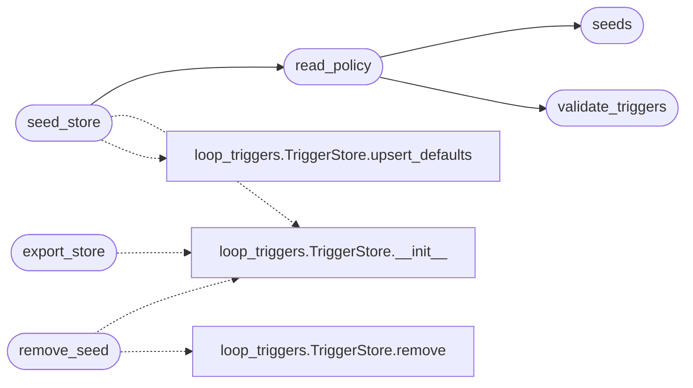

# `modules.trigger_policy`

> Source: [modules/trigger_policy.py:1](../../modules/trigger_policy.py#L1) | language `py` | coverage 100.0% | [API index](../index.md)

Declarative trigger policy: YAML seeds for the loop TriggerStore.

The scheduler triggers (`[`TriggerStore`](modules.loop_triggers.py.md#triggerstore)`) used to be runtime-only state:
every operator created them by hand after the loop started. This module
makes them configuration: the `[`triggers`](lazyc2.blueprints.orchestrator.py.md#triggers)` section of
``config/orchestrator.yaml`` declares the default trigger set, the loop
seeds it on every round start, and operators add runtime triggers on
top without ever losing the declarative layer.

Ownership split (SOLID):

- ``modules/loop_triggers.TriggerStore`` owns trigger storage and
  firing semantics;
- this module owns parsing, validation and seeding of the declarative
  policy;
- `[`modules.orchestrator_config`](modules.orchestrator_config.py.md)` owns YAML file resolution and
  validation for the document that carries the section.

## Contents

- **Functions:** [`validate_triggers`](#validate_triggers), [`seeds`](#seeds), [`read_policy`](#read_policy), [`seed_store`](#seed_store), [`export_store`](#export_store), [`remove_seed`](#remove_seed)

## Call Graph

Solid arrows stay in this module, dashed arrows leave it.



## Functions

<a id="validate_triggers"></a>

### `validate_triggers`

`function` | [modules/trigger_policy.py:40](../../modules/trigger_policy.py#L40)

```python
def validate_triggers(raw: object) -> list[str]
```

Validate the raw `[`triggers`](lazyc2.blueprints.orchestrator.py.md#triggers)` section of the orchestrator YAML.

**Parameters**

| Name | Type | Default | Description |
|---|---|---|---|
| `raw` | `object` |  | Entry from the YAML document (expected: list of mappings). |

**Returns:** `list[str]` - Human-readable errors; an empty list means the section is valid.

*Called by:* [`validate_config`](modules.orchestrator_config.py.md#validate_config), [`read_policy`](#read_policy)

---

<a id="seeds"></a>

### `seeds`

`function` | [modules/trigger_policy.py:87](../../modules/trigger_policy.py#L87)

```python
def seeds(raw: object) -> list[dict]
```

Coerce validated trigger rows into seed dicts for the store.

**Parameters**

| Name | Type | Default | Description |
|---|---|---|---|
| `raw` | `object` |  | The raw `[`triggers`](lazyc2.blueprints.orchestrator.py.md#triggers)` section (list of mappings). |

**Returns:** `list[dict]` - Normalised seeds ``{kind, arg, every_sec, enabled}``. Unknown or
invalid kinds are dropped with a warning so one bad row never
blocks the rest.

*Called by:* [`read_policy`](#read_policy)

---

<a id="read_policy"></a>

### `read_policy`

`function` | [modules/trigger_policy.py:120](../../modules/trigger_policy.py#L120)

```python
def read_policy(path: str | None = None) -> dict
```

Read the shipped orchestrator YAML triggers section.

**Parameters**

| Name | Type | Default | Description |
|---|---|---|---|
| `path` | `str \| None` | `None` | Optional explicit YAML path override. |

**Returns:** `dict` - ``{raw, seeds}`` where ``raw`` is the validated section value;
empty mappings when the file or section is unavailable.

*Calls:* [`seeds`](#seeds), [`validate_triggers`](#validate_triggers)

*Called by:* [`LazyCommandSet.do_lazy_trigger`](cli.commands.lazyops.py.md#lazycommandset-do_lazy_trigger), [`seed_store`](#seed_store)

---

<a id="seed_store"></a>

### `seed_store`

`function` | [modules/trigger_policy.py:146](../../modules/trigger_policy.py#L146)

```python
def seed_store(policy: list[dict] | None = None, store=None, task_id: str = '') -> dict
```

Merge declarative seeds into a persistent TriggerStore.

Without ``policy`` the shipped YAML is read; ``store=None`` builds a
fresh global store for ``task_id`` and seeds it. Runtime triggers
added later by the operator are never touched.

**Parameters**

| Name | Type | Default | Description |
|---|---|---|---|
| `policy` | `list[dict] \| None` | `None` | Seed rows, or ``None`` to read the YAML policy. |
| `store` |  | `None` | Existing TriggerStore to seed, or ``None`` to create one. |
| `task_id` | `str` | `''` | Task-scoped store name when creating the store. |

**Returns:** `dict` - ``{added, total}`` statistics for the brief and the API.

*Calls:* [`TriggerStore.__init__`](modules.loop_triggers.py.md#triggerstore-__init__), [`TriggerStore.upsert_defaults`](modules.loop_triggers.py.md#triggerstore-upsert_defaults), [`read_policy`](#read_policy)

*Called by:* [`LazyCommandSet.do_lazy_trigger`](cli.commands.lazyops.py.md#lazycommandset-do_lazy_trigger), [`triggers_seed`](lazyc2.blueprints.orchestrator.py.md#triggers_seed)

---

<a id="export_store"></a>

### `export_store`

`function` | [modules/trigger_policy.py:171](../../modules/trigger_policy.py#L171)

```python
def export_store(task_id: str = '') -> list[dict]
```

Return the current store rows for TUI and API surfaces.

**Parameters**

| Name | Type | Default | Description |
|---|---|---|---|
| `task_id` | `str` | `''` | Task-scoped table, or empty string for the global one. |

**Returns:** `list[dict]` - The trigger items as stored on disk.

*Calls:* [`TriggerStore.__init__`](modules.loop_triggers.py.md#triggerstore-__init__)

*Called by:* [`OrchestratorAssetsMixin.toggle_trigger`](cli.orchestrator_assets_tabs.py.md#orchestratorassetsmixin-toggle_trigger), [`panel`](lazyc2.blueprints.orchestrator.py.md#panel), [`panel_json`](lazyc2.blueprints.orchestrator.py.md#panel_json), [`triggers`](lazyc2.blueprints.orchestrator.py.md#triggers)

---

<a id="remove_seed"></a>

### `remove_seed`

`function` | [modules/trigger_policy.py:185](../../modules/trigger_policy.py#L185)

```python
def remove_seed(kind: str, arg: str = '', task_id: str = '') -> bool
```

Drop the first runtime trigger matching a declarative signature.

**Parameters**

| Name | Type | Default | Description |
|---|---|---|---|
| `kind` | `str` |  | Trigger kind from `[`TRIGGER_KINDS`](modules.loop_triggers.py.md#trigger_kinds)`. |
| `arg` | `str` | `''` | Matching `[`arg`](modules.toposwarm_bridge.py.md#routedcall-arg)` value (empty for kind-only matches). |
| `task_id` | `str` | `''` | Task-scoped table, or empty string for the global one. |

**Returns:** `bool` - ``True`` when a trigger was removed.

**Raises**

- `ValueError`: Unknown trigger kind.

*Calls:* [`TriggerStore.__init__`](modules.loop_triggers.py.md#triggerstore-__init__), [`TriggerStore.remove`](modules.loop_triggers.py.md#triggerstore-remove)

---
