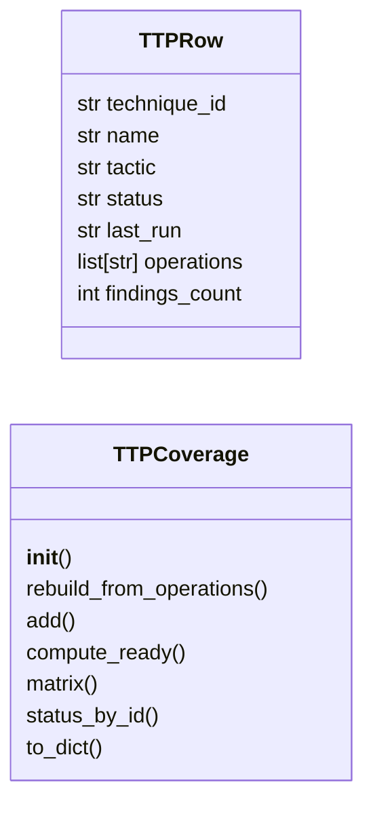
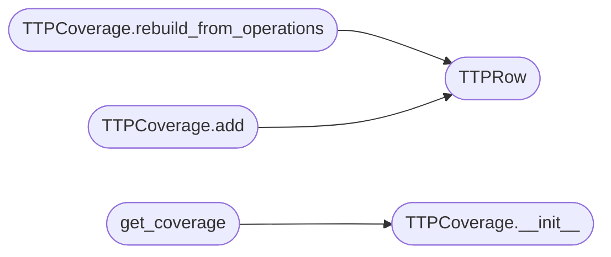

# `modules.ttp_coverage`

> Source: [modules/ttp_coverage.py:1](../../modules/ttp_coverage.py#L1) | language `py` | coverage 54.5% | [API index](../index.md)

TTP coverage matrix — real-time MITRE ATT&CK technique tracking.

Aggregates executed techniques from all operations, playbooks, and
atomic tests into a single matrix view.

Statuses:
    tested   — technique was executed and produced output
    failed   — technique was attempted but produced no useful output
    blocked  — technique is gated by unmet facts (planner couldn't run it)
    queued   — technique is scheduled but not yet executed
    ready    — all required facts are present, technique is runnable
    untested — technique is available but never attempted

## Contents

- **Classes:** [`TTPRow`](#ttprow), [`TTPCoverage`](#ttpcoverage)
- **Functions:** [`get_coverage`](#get_coverage)
- **Constants:** [`TACTIC_ORDER`](#tactic_order)

## Type Diagram



## Call Graph

Solid arrows stay in this module, dashed arrows leave it.



## Classes

<a id="ttprow"></a>

### `TTPRow`

`class` `dataclass` | [modules/ttp_coverage.py:55](../../modules/ttp_coverage.py#L55)

Decorators: `@dataclass`

```python
class TTPRow
```

**Attributes**

| Name | Type | Default | Description |
|---|---|---|---|
| [`technique_id`](#ttprow-technique_id) | `str` |  |  |
| [`name`](#ttprow-name) | `str` |  |  |
| [`tactic`](#ttprow-tactic) | `str` |  |  |
| [`status`](#ttprow-status) | `str` | `'untested'` |  |
| [`last_run`](#ttprow-last_run) | `str` | `''` |  |
| [`operations`](#ttprow-operations) | `list[str]` | `field(default_factory=list)` |  |
| [`findings_count`](#ttprow-findings_count) | `int` | `0` |  |

---

<a id="ttpcoverage"></a>

### `TTPCoverage`

`class` | [modules/ttp_coverage.py:65](../../modules/ttp_coverage.py#L65)

```python
class TTPCoverage
```

Aggregate TTP execution data across all operations.

**Members**

| Member | Kind | Summary |
|---|---|---|
| [`__init__`](#ttpcoverage-__init__) | constructor |  |
| [`rebuild_from_operations`](#ttpcoverage-rebuild_from_operations) | method | Re-walk every operation on disk and refresh the matrix. |
| [`add`](#ttpcoverage-add) | method |  |
| [`compute_ready`](#ttpcoverage-compute_ready) | method | Return the techniques that could run given available facts. |
| [`matrix`](#ttpcoverage-matrix) | method | Render a coloured-by-tactic table of all techniques. |
| [`status_by_id`](#ttpcoverage-status_by_id) | method |  |
| [`to_dict`](#ttpcoverage-to_dict) | method |  |

<a id="ttpcoverage-__init__"></a>

#### `TTPCoverage.__init__`

`constructor` | [modules/ttp_coverage.py:68](../../modules/ttp_coverage.py#L68)

```python
def __init__(self) -> None
```

*Called by:* [`get_coverage`](#get_coverage)

<a id="ttpcoverage-rebuild_from_operations"></a>

#### `TTPCoverage.rebuild_from_operations`

`method` | [modules/ttp_coverage.py:76](../../modules/ttp_coverage.py#L76)

```python
def rebuild_from_operations(self) -> int
```

Re-walk every operation on disk and refresh the matrix.

Returns the number of techniques covered.

**Returns:** `int`

*Calls:* [`TTPRow`](#ttprow)

<a id="ttpcoverage-add"></a>

#### `TTPCoverage.add`

`method` | [modules/ttp_coverage.py:125](../../modules/ttp_coverage.py#L125)

```python
def add(self, technique_id: str, name: str = '', tactic: str = '', status: str = 'tested', operation_id: str = '') -> None
```

**Parameters**

| Name | Type | Default | Description |
|---|---|---|---|
| `technique_id` | `str` |  |  |
| `name` | `str` | `''` |  |
| `tactic` | `str` | `''` |  |
| `status` | `str` | `'tested'` |  |
| `operation_id` | `str` | `''` |  |

*Calls:* [`TTPRow`](#ttprow)

<a id="ttpcoverage-compute_ready"></a>

#### `TTPCoverage.compute_ready`

`method` | [modules/ttp_coverage.py:149](../../modules/ttp_coverage.py#L149)

```python
def compute_ready(self, available_facts: list[str]) -> list[TTPRow]
```

Return the techniques that could run given available facts.

A technique is `[`ready`](core.command_bridge.py.md#commandbridge-ready)` if no blocking fact is missing. The
rule used here is conservative — the technique is considered
ready if it is `[`untested`](modules.lazy_loop.py.md#assetgraph-untested)` and at least one fact matches the
technique's tactic (e.g. ``service.found`` is enough for
``T1021.*``). Operators should refine this with their own
ability dependency data when available.

**Parameters**

| Name | Type | Default | Description |
|---|---|---|---|
| `available_facts` | `list[str]` |  |  |

**Returns:** `list[TTPRow]`

<a id="ttpcoverage-matrix"></a>

#### `TTPCoverage.matrix`

`method` | [modules/ttp_coverage.py:190](../../modules/ttp_coverage.py#L190)

```python
def matrix(self) -> str
```

Render a coloured-by-tactic table of all techniques.

**Returns:** `str`

<a id="ttpcoverage-status_by_id"></a>

#### `TTPCoverage.status_by_id`

`method` | [modules/ttp_coverage.py:231](../../modules/ttp_coverage.py#L231)

```python
def status_by_id(self, technique_id: str) -> TTPRow | None
```

**Parameters**

| Name | Type | Default | Description |
|---|---|---|---|
| `technique_id` | `str` |  |  |

**Returns:** `TTPRow | None`

<a id="ttpcoverage-to_dict"></a>

#### `TTPCoverage.to_dict`

`method` | [modules/ttp_coverage.py:234](../../modules/ttp_coverage.py#L234)

```python
def to_dict(self) -> dict
```

**Returns:** `dict`

---

## Functions

<a id="get_coverage"></a>

### `get_coverage`

`function` | [modules/ttp_coverage.py:260](../../modules/ttp_coverage.py#L260)

```python
def get_coverage() -> TTPCoverage
```

Return a fresh [`TTPCoverage`](#ttpcoverage).

**Returns:** `TTPCoverage`

*Calls:* [`TTPCoverage.__init__`](#ttpcoverage-__init__)

*Called by:* [`CalderaCommandSet.do_ttp_rebuild`](cli.commands.caldera.py.md#calderacommandset-do_ttp_rebuild)

---

## Constants

<a id="tactic_order"></a>

### `TACTIC_ORDER`

`constant` | [modules/ttp_coverage.py:36](../../modules/ttp_coverage.py#L36)

```python
TACTIC_ORDER
```

---
