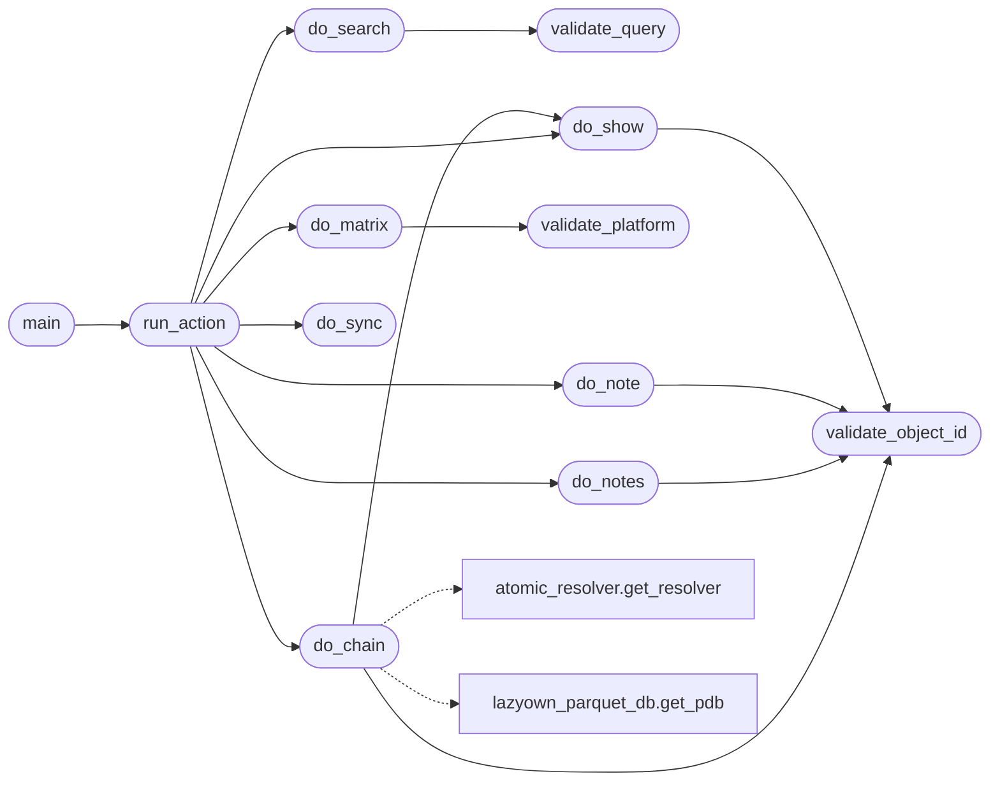

# `modules.ttpscope_bridge`

> Source: [modules/ttpscope_bridge.py:1](../../modules/ttpscope_bridge.py#L1) | language `py` | coverage 100.0% | [API index](../index.md)

Secure bridge for the TTPScope MITRE ATT&CK research client.

Wraps the ``ttpscope`` C binary (built from
https://github.com/bl4ckr0ss3/ttpscope) so CLI operators, MCP agents,
and the autonomous loop share one validated, non-interactive path.

Security invariants:
    1. No shell execution — argv list-form via safe_run_argv only.
    2. Technique/object IDs validated before reaching the binary.
    3. Free-text queries length-capped and passed as single argv element.
    4. Output truncated (200 KB) and always staged under sessions/.
    5. ``chain`` action joins ttpscope + atomic_resolver + parquet
       without executing anything on a target.

Fallback independence (no hard dependency on ttpscope):
    When the binary is missing or unusable, every read action degrades
    to an embedded backend: the cached STIX bundle
    (``~/.cache/ttpscope/enterprise-attack.json``, synced via stdlib
    urllib) is queried directly, and ``parquets/techniques*.parquet``
    covers Atomic technique lookups. Agents keep working with a
    ``backend: fallback-*`` marker in the result.

## Contents

- **Functions:** [`locate_binary`](#locate_binary), [`validate_object_id`](#validate_object_id), [`validate_query`](#validate_query), [`validate_platform`](#validate_platform), [`do_sync`](#do_sync), [`do_search`](#do_search), [`do_show`](#do_show), [`do_matrix`](#do_matrix), [`do_note`](#do_note), [`do_notes`](#do_notes), [`do_chain`](#do_chain), [`run_action`](#run_action), [`main`](#main)

## Call Graph

Solid arrows stay in this module, dashed arrows leave it.



## Functions

<a id="locate_binary"></a>

### `locate_binary`

`function` | [modules/ttpscope_bridge.py:82](../../modules/ttpscope_bridge.py#L82)

```python
def locate_binary() -> Path | None
```

Return the ttpscope binary path, preferring the vendored build.

**Returns:** `Path | None`

---

<a id="validate_object_id"></a>

### `validate_object_id`

`function` | [modules/ttpscope_bridge.py:92](../../modules/ttpscope_bridge.py#L92)

```python
def validate_object_id(raw: str) -> str
```

Validate an ATT&CK object ID (T1059.001, G0016, S0002, ...).

**Parameters**

| Name | Type | Default | Description |
|---|---|---|---|
| `raw` | `str` |  |  |

**Returns:** `str`

**Raises**

- `ValueError`: (raised in the body, not documented)

*Called by:* [`do_chain`](#do_chain), [`do_note`](#do_note), [`do_notes`](#do_notes), [`do_show`](#do_show)

---

<a id="validate_query"></a>

### `validate_query`

`function` | [modules/ttpscope_bridge.py:100](../../modules/ttpscope_bridge.py#L100)

```python
def validate_query(raw: str) -> str
```

Validate a free-text search query.

**Parameters**

| Name | Type | Default | Description |
|---|---|---|---|
| `raw` | `str` |  |  |

**Returns:** `str`

**Raises**

- `ValueError`: (raised in the body, not documented)

*Called by:* [`do_search`](#do_search)

---

<a id="validate_platform"></a>

### `validate_platform`

`function` | [modules/ttpscope_bridge.py:112](../../modules/ttpscope_bridge.py#L112)

```python
def validate_platform(raw: str) -> str
```

Validate a matrix platform filter (empty means all).

**Parameters**

| Name | Type | Default | Description |
|---|---|---|---|
| `raw` | `str` |  |  |

**Returns:** `str`

**Raises**

- `ValueError`: (raised in the body, not documented)

*Called by:* [`do_matrix`](#do_matrix)

---

<a id="do_sync"></a>

### `do_sync`

`function` | [modules/ttpscope_bridge.py:497](../../modules/ttpscope_bridge.py#L497)

```python
def do_sync() -> dict[str, Any]
```

Download the Enterprise ATT&CK bundle via ttpscope sync.

**Returns:** `dict[str, Any]`

*Called by:* [`run_action`](#run_action)

---

<a id="do_search"></a>

### `do_search`

`function` | [modules/ttpscope_bridge.py:508](../../modules/ttpscope_bridge.py#L508)

```python
def do_search(query: str) -> dict[str, Any]
```

Search IDs, names, aliases and descriptions.

**Parameters**

| Name | Type | Default | Description |
|---|---|---|---|
| `query` | `str` |  |  |

**Returns:** `dict[str, Any]`

*Calls:* [`validate_query`](#validate_query)

*Called by:* [`run_action`](#run_action)

---

<a id="do_show"></a>

### `do_show`

`function` | [modules/ttpscope_bridge.py:520](../../modules/ttpscope_bridge.py#L520)

```python
def do_show(object_id: str) -> dict[str, Any]
```

Show one ATT&CK object and its relationships.

**Parameters**

| Name | Type | Default | Description |
|---|---|---|---|
| `object_id` | `str` |  |  |

**Returns:** `dict[str, Any]`

*Calls:* [`validate_object_id`](#validate_object_id)

*Called by:* [`do_chain`](#do_chain), [`run_action`](#run_action)

---

<a id="do_matrix"></a>

### `do_matrix`

`function` | [modules/ttpscope_bridge.py:535](../../modules/ttpscope_bridge.py#L535)

```python
def do_matrix(platform: str = '') -> dict[str, Any]
```

Render the Enterprise matrix, optionally filtered by platform.

**Parameters**

| Name | Type | Default | Description |
|---|---|---|---|
| `platform` | `str` | `''` |  |

**Returns:** `dict[str, Any]`

*Calls:* [`validate_platform`](#validate_platform)

*Called by:* [`run_action`](#run_action)

---

<a id="do_note"></a>

### `do_note`

`function` | [modules/ttpscope_bridge.py:551](../../modules/ttpscope_bridge.py#L551)

```python
def do_note(object_id: str, text: str) -> dict[str, Any]
```

Append a timestamped research note.

**Parameters**

| Name | Type | Default | Description |
|---|---|---|---|
| `object_id` | `str` |  |  |
| `text` | `str` |  |  |

**Returns:** `dict[str, Any]`

**Raises**

- `ValueError`: (raised in the body, not documented)

*Calls:* [`validate_object_id`](#validate_object_id)

*Called by:* [`run_action`](#run_action)

---

<a id="do_notes"></a>

### `do_notes`

`function` | [modules/ttpscope_bridge.py:570](../../modules/ttpscope_bridge.py#L570)

```python
def do_notes(object_id: str) -> dict[str, Any]
```

Read research notes for an object.

**Parameters**

| Name | Type | Default | Description |
|---|---|---|---|
| `object_id` | `str` |  |  |

**Returns:** `dict[str, Any]`

*Calls:* [`validate_object_id`](#validate_object_id)

*Called by:* [`run_action`](#run_action)

---

<a id="do_chain"></a>

### `do_chain`

`function` | [modules/ttpscope_bridge.py:582](../../modules/ttpscope_bridge.py#L582)

```python
def do_chain(object_id: str, platform: str = 'linux', limit: int = 5) -> dict[str, Any]
```

Join ttpscope context with Atomic tests and parquet techniques.

Does not execute anything on a target. Returns a JSON-ready dict
for MCP agents and the autonomous loop to emulate the technique.

**Parameters**

| Name | Type | Default | Description |
|---|---|---|---|
| `object_id` | `str` |  |  |
| `platform` | `str` | `'linux'` |  |
| `limit` | `int` | `5` |  |

**Returns:** `dict[str, Any]`

**Raises**

- `ValueError`: (raised in the body, not documented)

*Calls:* [`get_resolver`](modules.atomic_resolver.py.md#get_resolver), [`do_show`](#do_show), [`validate_object_id`](#validate_object_id), [`get_pdb`](skills.lazyown_parquet_db.py.md#get_pdb)

*Called by:* [`run_action`](#run_action)

---

<a id="run_action"></a>

### `run_action`

`function` | [modules/ttpscope_bridge.py:652](../../modules/ttpscope_bridge.py#L652)

```python
def run_action(action: str, **kwargs: Any) -> dict[str, Any]
```

Dispatch a validated action (used by CLI addons and MCP).

**Parameters**

| Name | Type | Default | Description |
|---|---|---|---|
| `action` | `str` |  |  |
| `**kwargs` | `Any` |  |  |

**Returns:** `dict[str, Any]`

**Raises**

- `ValueError`: (raised in the body, not documented)

*Calls:* [`do_chain`](#do_chain), [`do_matrix`](#do_matrix), [`do_note`](#do_note), [`do_notes`](#do_notes), [`do_search`](#do_search), [`do_show`](#do_show), [`do_sync`](#do_sync)

*Called by:* [`main`](#main)

---

<a id="main"></a>

### `main`

`function` | [modules/ttpscope_bridge.py:679](../../modules/ttpscope_bridge.py#L679)

```python
def main() -> None
```

CLI entry point for the lazyaddon execute_command.

**Raises**

- `SystemExit`: (raised in the body, not documented)

*Calls:* [`run_action`](#run_action)

---
