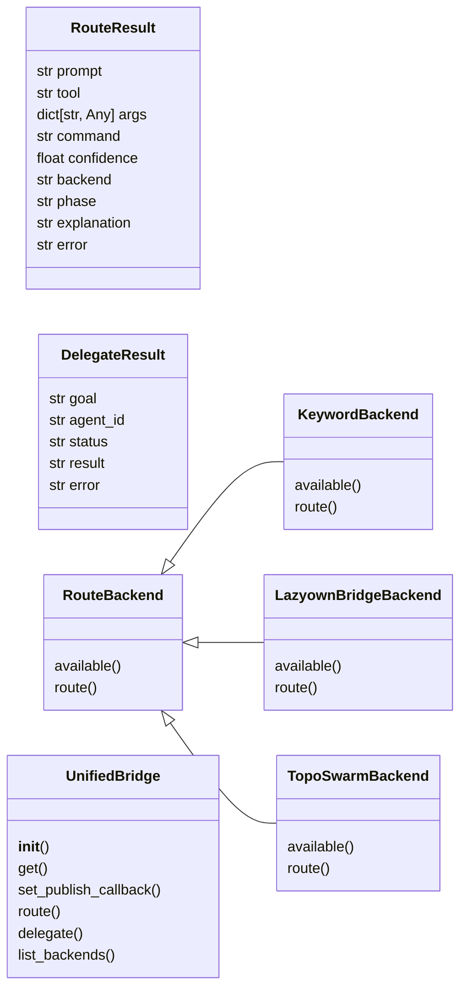
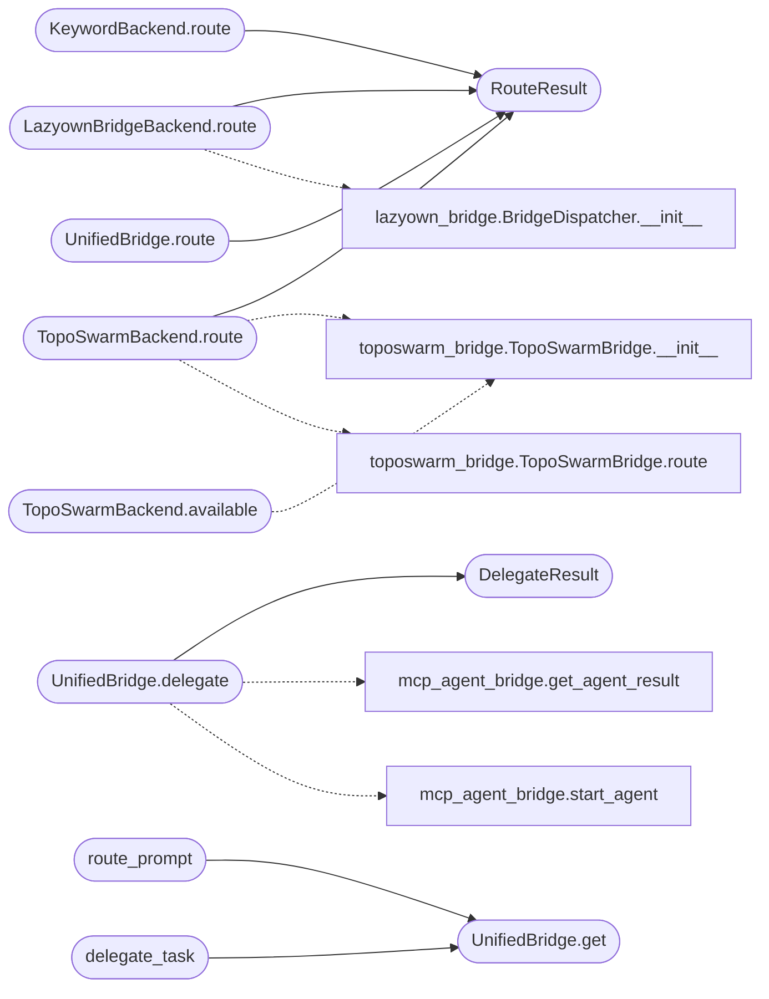

# `modules.unified_bridge`

> Source: [modules/unified_bridge.py:1](../../modules/unified_bridge.py#L1) | language `py` | coverage 37.5% | [API index](../index.md)

UnifiedBridge — single API over all LazyOwn bridges and routing engines.

Merges three previously isolated bridges into one cohesive interface:
- lazyown_bridge  : command catalog + phase/service-aware selection
- toposwarm_bridge: neural/keyword routing from natural language
- mcp_agent_bridge: AI agent delegation (Groq/Ollama)

Plus integration with EventBus (all routing decisions published) and
StateManager (context from current campaign state).

Design (SOLID)
--------------
- Single Responsibility : route prompts to tools; delegate to agents.
- Open/Closed           : add backends via register_route_backend().
- Liskov                : all backends return RouteResult with same shape.
- Interface Segregation : route() and delegate() are the only two operations.
- Dependency Inversion  : depends on RouteBackend abstraction, not concrete bridges.

## Contents

- **Classes:** [`RouteResult`](#routeresult), [`DelegateResult`](#delegateresult), [`RouteBackend`](#routebackend), [`KeywordBackend`](#keywordbackend), [`LazyownBridgeBackend`](#lazyownbridgebackend), [`TopoSwarmBackend`](#toposwarmbackend), [`UnifiedBridge`](#unifiedbridge)
- **Functions:** [`route_prompt`](#route_prompt), [`delegate_task`](#delegate_task)

## Type Diagram



## Call Graph

Solid arrows stay in this module, dashed arrows leave it.



## Classes

<a id="routeresult"></a>

### `RouteResult`

`class` `dataclass` | [modules/unified_bridge.py:46](../../modules/unified_bridge.py#L46)

Decorators: `@dataclass`

```python
class RouteResult
```

**Attributes**

| Name | Type | Default | Description |
|---|---|---|---|
| [`prompt`](#routeresult-prompt) | `str` |  |  |
| [`tool`](#routeresult-tool) | `str` | `''` |  |
| [`args`](#routeresult-args) | `dict[str, Any]` | `field(default_factory=dict)` |  |
| [`command`](#routeresult-command) | `str` | `''` |  |
| [`confidence`](#routeresult-confidence) | `float` | `0.0` |  |
| [`backend`](#routeresult-backend) | `str` | `'unknown'` |  |
| [`phase`](#routeresult-phase) | `str` | `''` |  |
| [`explanation`](#routeresult-explanation) | `str` | `''` |  |
| [`error`](#routeresult-error) | `str` | `''` |  |

---

<a id="delegateresult"></a>

### `DelegateResult`

`class` `dataclass` | [modules/unified_bridge.py:59](../../modules/unified_bridge.py#L59)

Decorators: `@dataclass`

```python
class DelegateResult
```

**Attributes**

| Name | Type | Default | Description |
|---|---|---|---|
| [`goal`](#delegateresult-goal) | `str` |  |  |
| [`agent_id`](#delegateresult-agent_id) | `str` | `''` |  |
| [`status`](#delegateresult-status) | `str` | `'pending'` |  |
| [`result`](#delegateresult-result) | `str` | `''` |  |
| [`error`](#delegateresult-error) | `str` | `''` |  |

---

<a id="routebackend"></a>

### `RouteBackend`

`class` `abstract` | [modules/unified_bridge.py:67](../../modules/unified_bridge.py#L67)

```python
class RouteBackend(ABC)
```

Bases: `ABC`

Subclasses: [`KeywordBackend`](#keywordbackend), [`LazyownBridgeBackend`](#lazyownbridgebackend), [`TopoSwarmBackend`](#toposwarmbackend)

**Members**

| Member | Kind | Summary |
|---|---|---|
| [`available`](#routebackend-available) | method |  |
| [`route`](#routebackend-route) | method |  |

<a id="routebackend-available"></a>

#### `RouteBackend.available`

`method` `abstract` | [modules/unified_bridge.py:69](../../modules/unified_bridge.py#L69)

Decorators: `@abstractmethod`

```python
def available(self) -> bool
```

**Returns:** `bool`

<a id="routebackend-route"></a>

#### `RouteBackend.route`

`method` `abstract` | [modules/unified_bridge.py:72](../../modules/unified_bridge.py#L72)

Decorators: `@abstractmethod`

```python
def route(self, prompt: str, context: dict[str, Any]) -> RouteResult
```

**Parameters**

| Name | Type | Default | Description |
|---|---|---|---|
| `prompt` | `str` |  |  |
| `context` | `dict[str, Any]` |  |  |

**Returns:** `RouteResult`

---

<a id="keywordbackend"></a>

### `KeywordBackend`

`class` | [modules/unified_bridge.py:75](../../modules/unified_bridge.py#L75)

```python
class KeywordBackend(RouteBackend)
```

Bases: [`RouteBackend`](#routebackend)

Regex/keyword-based routing (~80% accuracy on common pentesting phrases).

**Members**

| Member | Kind | Summary |
|---|---|---|
| [`available`](#keywordbackend-available) | method |  |
| [`route`](#keywordbackend-route) | method |  |

<a id="keywordbackend-available"></a>

#### `KeywordBackend.available`

`method` | [modules/unified_bridge.py:102](../../modules/unified_bridge.py#L102)

```python
def available(self) -> bool
```

**Returns:** `bool`

<a id="keywordbackend-route"></a>

#### `KeywordBackend.route`

`method` | [modules/unified_bridge.py:105](../../modules/unified_bridge.py#L105)

```python
def route(self, prompt: str, context: dict[str, Any]) -> RouteResult
```

**Parameters**

| Name | Type | Default | Description |
|---|---|---|---|
| `prompt` | `str` |  |  |
| `context` | `dict[str, Any]` |  |  |

**Returns:** `RouteResult`

*Calls:* [`RouteResult`](#routeresult)

---

<a id="lazyownbridgebackend"></a>

### `LazyownBridgeBackend`

`class` | [modules/unified_bridge.py:123](../../modules/unified_bridge.py#L123)

```python
class LazyownBridgeBackend(RouteBackend)
```

Bases: [`RouteBackend`](#routebackend)

Phase-aware command selection using the lazyown_bridge catalog.

**Members**

| Member | Kind | Summary |
|---|---|---|
| [`available`](#lazyownbridgebackend-available) | method |  |
| [`route`](#lazyownbridgebackend-route) | method |  |

<a id="lazyownbridgebackend-available"></a>

#### `LazyownBridgeBackend.available`

`method` | [modules/unified_bridge.py:126](../../modules/unified_bridge.py#L126)

```python
def available(self) -> bool
```

**Returns:** `bool`

<a id="lazyownbridgebackend-route"></a>

#### `LazyownBridgeBackend.route`

`method` | [modules/unified_bridge.py:134](../../modules/unified_bridge.py#L134)

```python
def route(self, prompt: str, context: dict[str, Any]) -> RouteResult
```

**Parameters**

| Name | Type | Default | Description |
|---|---|---|---|
| `prompt` | `str` |  |  |
| `context` | `dict[str, Any]` |  |  |

**Returns:** `RouteResult`

*Calls:* [`BridgeDispatcher.__init__`](modules.lazyown_bridge.py.md#bridgedispatcher-__init__), [`RouteResult`](#routeresult)

---

<a id="toposwarmbackend"></a>

### `TopoSwarmBackend`

`class` | [modules/unified_bridge.py:161](../../modules/unified_bridge.py#L161)

```python
class TopoSwarmBackend(RouteBackend)
```

Bases: [`RouteBackend`](#routebackend)

Neural routing via the TopoSwarm 2M-parameter model.

**Members**

| Member | Kind | Summary |
|---|---|---|
| [`available`](#toposwarmbackend-available) | method |  |
| [`route`](#toposwarmbackend-route) | method |  |

<a id="toposwarmbackend-available"></a>

#### `TopoSwarmBackend.available`

`method` | [modules/unified_bridge.py:164](../../modules/unified_bridge.py#L164)

```python
def available(self) -> bool
```

**Returns:** `bool`

*Calls:* [`TopoSwarmBridge.__init__`](modules.toposwarm_bridge.py.md#toposwarmbridge-__init__)

<a id="toposwarmbackend-route"></a>

#### `TopoSwarmBackend.route`

`method` | [modules/unified_bridge.py:173](../../modules/unified_bridge.py#L173)

```python
def route(self, prompt: str, context: dict[str, Any]) -> RouteResult
```

**Parameters**

| Name | Type | Default | Description |
|---|---|---|---|
| `prompt` | `str` |  |  |
| `context` | `dict[str, Any]` |  |  |

**Returns:** `RouteResult`

*Calls:* [`TopoSwarmBridge.__init__`](modules.toposwarm_bridge.py.md#toposwarmbridge-__init__), [`TopoSwarmBridge.route`](modules.toposwarm_bridge.py.md#toposwarmbridge-route), [`RouteResult`](#routeresult)

---

<a id="unifiedbridge"></a>

### `UnifiedBridge`

`class` | [modules/unified_bridge.py:195](../../modules/unified_bridge.py#L195)

```python
class UnifiedBridge
```

Single entry point for all LazyOwn routing and delegation.

Usage::

    bridge = UnifiedBridge.get()
    result = bridge.route("scan open ports on 10.0.0.1")
    if result.command:
        executor.run(f"{result.command} {result.args}")
    elif result.tool:
        # call MCP tool
        pass

    # Delegate to internal AI agents
    delegate = bridge.delegate("Analyze CVE-2023-1234", backend="groq")

**Members**

| Member | Kind | Summary |
|---|---|---|
| [`__init__`](#unifiedbridge-__init__) | constructor |  |
| [`get`](#unifiedbridge-get) | classmethod |  |
| [`set_publish_callback`](#unifiedbridge-set_publish_callback) | method |  |
| [`route`](#unifiedbridge-route) | method | Route a natural-language prompt to the best LazyOwn tool. |
| [`delegate`](#unifiedbridge-delegate) | method | Delegate a complex task to an internal AI agent. |
| [`list_backends`](#unifiedbridge-list_backends) | method |  |

<a id="unifiedbridge-__init__"></a>

#### `UnifiedBridge.__init__`

`constructor` | [modules/unified_bridge.py:214](../../modules/unified_bridge.py#L214)

```python
def __init__(self) -> None
```

<a id="unifiedbridge-get"></a>

#### `UnifiedBridge.get`

`classmethod` | [modules/unified_bridge.py:225](../../modules/unified_bridge.py#L225)

Decorators: `@classmethod`

```python
def get(cls) -> UnifiedBridge
```

**Returns:** `UnifiedBridge`

*Called by:* [`LazyOwnShell.do_route`](lazyown.py.md#lazyownshell-do_route), [`delegate_task`](#delegate_task), [`route_prompt`](#route_prompt)

<a id="unifiedbridge-set_publish_callback"></a>

#### `UnifiedBridge.set_publish_callback`

`method` | [modules/unified_bridge.py:230](../../modules/unified_bridge.py#L230)

```python
def set_publish_callback(self, cb: Callable[[str, str, dict], None]) -> None
```

**Parameters**

| Name | Type | Default | Description |
|---|---|---|---|
| `cb` | `Callable[[str, str, dict], None]` |  |  |

<a id="unifiedbridge-route"></a>

#### `UnifiedBridge.route`

`method` | [modules/unified_bridge.py:253](../../modules/unified_bridge.py#L253)

```python
def route(self, prompt: str, context: dict[str, Any] | None = None) -> RouteResult
```

Route a natural-language prompt to the best LazyOwn tool.

Tries backends in priority order: TopoSwarm → lazyown_bridge → keyword.
Returns the first successful (non-empty) route result.

**Parameters**

| Name | Type | Default | Description |
|---|---|---|---|
| `prompt` | `str` |  | Natural-language description of the desired action. |
| `context` | `dict[str, Any] \| None` | `None` | Optional dict with phase, services, target, etc. |

**Returns:** `RouteResult` - RouteResult with tool name, command, args, confidence, and backend.

*Calls:* [`RouteResult`](#routeresult)

<a id="unifiedbridge-delegate"></a>

#### `UnifiedBridge.delegate`

`method` | [modules/unified_bridge.py:300](../../modules/unified_bridge.py#L300)

```python
def delegate(self, goal: str, backend: str = 'groq', timeout: int = 120, max_iterations: int = 8) -> DelegateResult
```

Delegate a complex task to an internal AI agent.

Drives the public agent-bridge API: `[`start_agent`](modules.mcp_agent_bridge.py.md#start_agent)` spawns the
worker thread and this method polls `[`get_agent_status`](modules.mcp_agent_bridge.py.md#get_agent_status)` until a
terminal status or the timeout.

**Parameters**

| Name | Type | Default | Description |
|---|---|---|---|
| `goal` | `str` |  | Task description for the agent. |
| `backend` | `str` | `'groq'` | AI backend ("groq" or "ollama"). |
| `timeout` | `int` | `120` | Maximum seconds to wait for completion. |
| `max_iterations` | `int` | `8` | Tool-calling budget handed to the agent. |

**Returns:** `DelegateResult` - DelegateResult with agent_id, status, and result.

*Calls:* [`get_agent_result`](modules.mcp_agent_bridge.py.md#get_agent_result), [`start_agent`](modules.mcp_agent_bridge.py.md#start_agent), [`DelegateResult`](#delegateresult)

<a id="unifiedbridge-list_backends"></a>

#### `UnifiedBridge.list_backends`

`method` | [modules/unified_bridge.py:461](../../modules/unified_bridge.py#L461)

```python
def list_backends(self) -> list[dict[str, Any]]
```

**Returns:** `list[dict[str, Any]]`

---

## Functions

<a id="route_prompt"></a>

### `route_prompt`

`function` | [modules/unified_bridge.py:483](../../modules/unified_bridge.py#L483)

```python
def route_prompt(prompt: str, context: dict[str, Any] | None = None) -> RouteResult
```

Convenience: route a prompt without instantiating UnifiedBridge.

**Parameters**

| Name | Type | Default | Description |
|---|---|---|---|
| `prompt` | `str` |  |  |
| `context` | `dict[str, Any] \| None` | `None` |  |

**Returns:** `RouteResult`

*Calls:* [`UnifiedBridge.get`](#unifiedbridge-get)

---

<a id="delegate_task"></a>

### `delegate_task`

`function` | [modules/unified_bridge.py:488](../../modules/unified_bridge.py#L488)

```python
def delegate_task(goal: str, backend: str = 'groq') -> DelegateResult
```

Convenience: delegate a task to an AI agent.

**Parameters**

| Name | Type | Default | Description |
|---|---|---|---|
| `goal` | `str` |  |  |
| `backend` | `str` | `'groq'` |  |

**Returns:** `DelegateResult`

*Calls:* [`UnifiedBridge.get`](#unifiedbridge-get)

---
