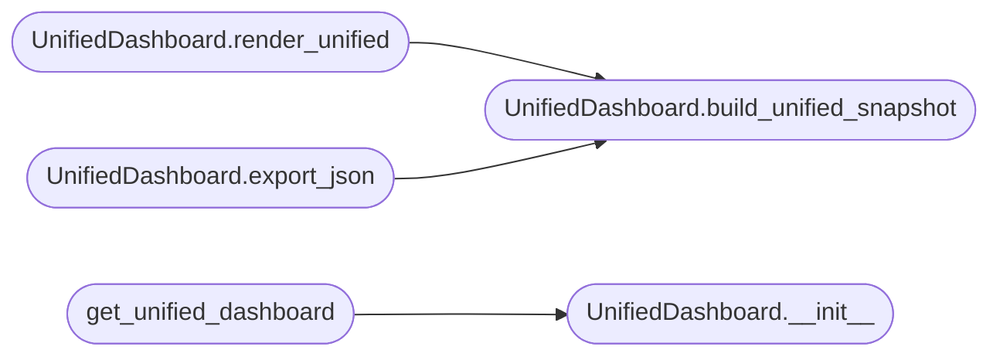

# `modules.unified_dashboard`

> Source: [modules/unified_dashboard.py:1](../../modules/unified_dashboard.py#L1) | language `py` | coverage 85.7% | [API index](../index.md)

Unified campaign dashboard — combines all state sources into one view.

The existing [`modules.dashboard_engine.DashboardEngine`](modules.dashboard_engine.py.md#dashboardengine) builds a
snapshot from the world model, exploit recommender, auto-pivot, and evasion
engine.  However, it does NOT include:

- Hive Mind status (active drones, memory vectors)
- Policy Engine status (active rules, last decision)
- Autonomous Daemon status (pending objectives, current phase)
- Live Surface graph (real-time network topology)
- GraphAdvisor pivot candidates

This module fills that gap by composing all data sources into a single
unified snapshot suitable for CLI rendering, JSON export, or TUI consumption.

Design (SOLID)
--------------
- Single Responsibility : aggregate + render campaign state only.
- Open/Closed           : new data sources added as ``_collect_*`` methods.
- Dependency Inversion  : depends on `[`DashboardEngine`](modules.dashboard_engine.py.md#dashboardengine)` interface, not
  concrete implementations of hive/policy/daemon.

## Contents

- **Classes:** [`UnifiedDashboard`](#unifieddashboard)
- **Functions:** [`get_unified_dashboard`](#get_unified_dashboard)

## Call Graph

Solid arrows stay in this module, dashed arrows leave it.



## Classes

<a id="unifieddashboard"></a>

### `UnifiedDashboard`

`class` | [modules/unified_dashboard.py:37](../../modules/unified_dashboard.py#L37)

```python
class UnifiedDashboard
```

Aggregates world model, hive, policy, daemon, and graph state.

**Members**

| Member | Kind | Summary |
|---|---|---|
| [`__init__`](#unifieddashboard-__init__) | constructor |  |
| [`build_unified_snapshot`](#unifieddashboard-build_unified_snapshot) | method | Build a complete dashboard snapshot from all data sources. |
| [`render_unified`](#unifieddashboard-render_unified) | method | Render the unified dashboard as a text string for CLI/TUI. |
| [`export_json`](#unifieddashboard-export_json) | method | Export the unified snapshot as a JSON string. |

<a id="unifieddashboard-__init__"></a>

#### `UnifiedDashboard.__init__`

`constructor` | [modules/unified_dashboard.py:44](../../modules/unified_dashboard.py#L44)

```python
def __init__(self, sessions_dir: Path | None = None) -> None
```

**Parameters**

| Name | Type | Default | Description |
|---|---|---|---|
| `sessions_dir` | `Path \| None` | `None` |  |

*Called by:* [`get_unified_dashboard`](#get_unified_dashboard)

<a id="unifieddashboard-build_unified_snapshot"></a>

#### `UnifiedDashboard.build_unified_snapshot`

`method` | [modules/unified_dashboard.py:76](../../modules/unified_dashboard.py#L76)

```python
def build_unified_snapshot(self) -> dict[str, Any]
```

Build a complete dashboard snapshot from all data sources.

**Returns:** `dict[str, Any]` - Dict with keys: world_model, hive_status, policy_status,
daemon_status, live_graph, graph_advice, dashboard, timestamp.

*Called by:* [`UnifiedDashboard.export_json`](#unifieddashboard-export_json), [`UnifiedDashboard.render_unified`](#unifieddashboard-render_unified)

<a id="unifieddashboard-render_unified"></a>

#### `UnifiedDashboard.render_unified`

`method` | [modules/unified_dashboard.py:170](../../modules/unified_dashboard.py#L170)

```python
def render_unified(self) -> str
```

Render the unified dashboard as a text string for CLI/TUI.

**Returns:** `str` - A multi-line ASCII dashboard string.

*Calls:* [`UnifiedDashboard.build_unified_snapshot`](#unifieddashboard-build_unified_snapshot)

<a id="unifieddashboard-export_json"></a>

#### `UnifiedDashboard.export_json`

`method` | [modules/unified_dashboard.py:251](../../modules/unified_dashboard.py#L251)

```python
def export_json(self) -> str
```

Export the unified snapshot as a JSON string.

**Returns:** `str`

*Calls:* [`UnifiedDashboard.build_unified_snapshot`](#unifieddashboard-build_unified_snapshot)

---

## Functions

<a id="get_unified_dashboard"></a>

### `get_unified_dashboard`

`function` | [modules/unified_dashboard.py:256](../../modules/unified_dashboard.py#L256)

```python
def get_unified_dashboard(sessions_dir: Path | None = None) -> UnifiedDashboard
```

Return a module-level [`UnifiedDashboard`](#unifieddashboard) singleton.

**Parameters**

| Name | Type | Default | Description |
|---|---|---|---|
| `sessions_dir` | `Path \| None` | `None` |  |

**Returns:** `UnifiedDashboard`

*Calls:* [`UnifiedDashboard.__init__`](#unifieddashboard-__init__)

---
