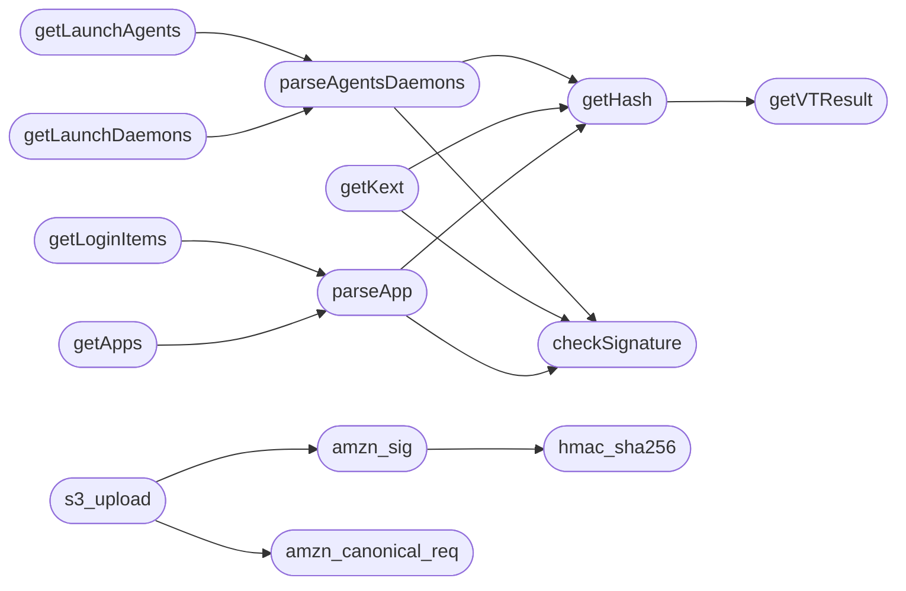

# `modules.venator`

> Source: [modules/venator.py:1](../../modules/venator.py#L1) | language `py` | coverage 0.0% | [API index](../index.md)

## Contents

- **Functions:** [`getUUID`](#getuuid), [`getSystemInfo`](#getsysteminfo), [`getVTResult`](#getvtresult), [`getHash`](#gethash), [`checkSignature`](#checksignature), [`datetime_handler`](#datetime_handler), [`parseAgentsDaemons`](#parseagentsdaemons), [`getLaunchAgents`](#getlaunchagents), [`getLaunchDaemons`](#getlaunchdaemons), [`getUsers`](#getusers), [`getSafariExtensions`](#getsafariextensions), [`getChromeExtensions`](#getchromeextensions), [`getChromeDownloads`](#getchromedownloads), [`getFirefoxExtensions`](#getfirefoxextensions), [`getInstallHistory`](#getinstallhistory), [`getCronJobs`](#getcronjobs), [`getEmond`](#getemond), [`getKext`](#getkext), [`getEnv`](#getenv), [`getPeriodicScripts`](#getperiodicscripts), [`getConnections`](#getconnections), [`SIPStatus`](#sipstatus), [`GatekeeperStatus`](#gatekeeperstatus), [`parseApp`](#parseapp), [`getLoginItems`](#getloginitems), [`getApps`](#getapps), [`getEventTaps`](#geteventtaps), [`getBashHistory`](#getbashhistory), [`getShellStartupScripts`](#getshellstartupscripts), [`hmac_sha256`](#hmac_sha256), [`amzn_sig`](#amzn_sig), [`amzn_canonical_req`](#amzn_canonical_req), [`s3_upload`](#s3_upload)
- **Constants:** [`UUID`](#uuid), [`AMZN_SIGNED_HEADERS`](#amzn_signed_headers), [`AMZN_CONTENT_SHA256`](#amzn_content_sha256)

## Call Graph

Solid arrows stay in this module, dashed arrows leave it.



## Functions

<a id="getuuid"></a>

### `getUUID`

`function` | [modules/venator.py:38](../../modules/venator.py#L38)

```python
def getUUID()
```

---

<a id="getsysteminfo"></a>

### `getSystemInfo`

`function` | [modules/venator.py:66](../../modules/venator.py#L66)

```python
def getSystemInfo(output_file)
```

**Parameters**

| Name | Type | Default | Description |
|---|---|---|---|
| `output_file` |  |  |  |

---

<a id="getvtresult"></a>

### `getVTResult`

`function` | [modules/venator.py:83](../../modules/venator.py#L83)

```python
def getVTResult(fileHash)
```

**Parameters**

| Name | Type | Default | Description |
|---|---|---|---|
| `fileHash` |  |  |  |

*Called by:* [`getHash`](#gethash)

---

<a id="gethash"></a>

### `getHash`

`function` | [modules/venator.py:112](../../modules/venator.py#L112)

```python
def getHash(file, ignoreVFlag)
```

**Parameters**

| Name | Type | Default | Description |
|---|---|---|---|
| `file` |  |  |  |
| `ignoreVFlag` |  |  |  |

*Calls:* [`getVTResult`](#getvtresult)

*Called by:* [`getKext`](#getkext), [`parseAgentsDaemons`](#parseagentsdaemons), [`parseApp`](#parseapp)

---

<a id="checksignature"></a>

### `checkSignature`

`function` | [modules/venator.py:132](../../modules/venator.py#L132)

```python
def checkSignature(file, bundle=None)
```

**Parameters**

| Name | Type | Default | Description |
|---|---|---|---|
| `file` |  |  |  |
| `bundle` |  | `None` |  |

*Called by:* [`getKext`](#getkext), [`parseAgentsDaemons`](#parseagentsdaemons), [`parseApp`](#parseapp)

---

<a id="datetime_handler"></a>

### `datetime_handler`

`function` | [modules/venator.py:210](../../modules/venator.py#L210)

```python
def datetime_handler(x)
```

**Parameters**

| Name | Type | Default | Description |
|---|---|---|---|
| `x` |  |  |  |

---

<a id="parseagentsdaemons"></a>

### `parseAgentsDaemons`

`function` | [modules/venator.py:215](../../modules/venator.py#L215)

```python
def parseAgentsDaemons(item, path)
```

**Parameters**

| Name | Type | Default | Description |
|---|---|---|---|
| `item` |  |  |  |
| `path` |  |  |  |

*Calls:* [`checkSignature`](#checksignature), [`getHash`](#gethash)

*Called by:* [`getLaunchAgents`](#getlaunchagents), [`getLaunchDaemons`](#getlaunchdaemons)

---

<a id="getlaunchagents"></a>

### `getLaunchAgents`

`function` | [modules/venator.py:287](../../modules/venator.py#L287)

```python
def getLaunchAgents(path, output_file, ignoreVFlag)
```

**Parameters**

| Name | Type | Default | Description |
|---|---|---|---|
| `path` |  |  |  |
| `output_file` |  |  |  |
| `ignoreVFlag` |  |  |  |

*Calls:* [`parseAgentsDaemons`](#parseagentsdaemons)

---

<a id="getlaunchdaemons"></a>

### `getLaunchDaemons`

`function` | [modules/venator.py:302](../../modules/venator.py#L302)

```python
def getLaunchDaemons(path, output_file, ignoreVFlag)
```

**Parameters**

| Name | Type | Default | Description |
|---|---|---|---|
| `path` |  |  |  |
| `output_file` |  |  |  |
| `ignoreVFlag` |  |  |  |

*Calls:* [`parseAgentsDaemons`](#parseagentsdaemons)

---

<a id="getusers"></a>

### `getUsers`

`function` | [modules/venator.py:317](../../modules/venator.py#L317)

```python
def getUsers(output_file)
```

**Parameters**

| Name | Type | Default | Description |
|---|---|---|---|
| `output_file` |  |  |  |

---

<a id="getsafariextensions"></a>

### `getSafariExtensions`

`function` | [modules/venator.py:338](../../modules/venator.py#L338)

```python
def getSafariExtensions(path, output_file)
```

**Parameters**

| Name | Type | Default | Description |
|---|---|---|---|
| `path` |  |  |  |
| `output_file` |  |  |  |

---

<a id="getchromeextensions"></a>

### `getChromeExtensions`

`function` | [modules/venator.py:357](../../modules/venator.py#L357)

```python
def getChromeExtensions(path, output_file)
```

**Parameters**

| Name | Type | Default | Description |
|---|---|---|---|
| `path` |  |  |  |
| `output_file` |  |  |  |

---

<a id="getchromedownloads"></a>

### `getChromeDownloads`

`function` | [modules/venator.py:388](../../modules/venator.py#L388)

```python
def getChromeDownloads(chromeHistoryDbPath, output_file)
```

**Parameters**

| Name | Type | Default | Description |
|---|---|---|---|
| `chromeHistoryDbPath` |  |  |  |
| `output_file` |  |  |  |

---

<a id="getfirefoxextensions"></a>

### `getFirefoxExtensions`

`function` | [modules/venator.py:442](../../modules/venator.py#L442)

```python
def getFirefoxExtensions(path, output_file)
```

**Parameters**

| Name | Type | Default | Description |
|---|---|---|---|
| `path` |  |  |  |
| `output_file` |  |  |  |

---

<a id="getinstallhistory"></a>

### `getInstallHistory`

`function` | [modules/venator.py:477](../../modules/venator.py#L477)

```python
def getInstallHistory(output_file)
```

**Parameters**

| Name | Type | Default | Description |
|---|---|---|---|
| `output_file` |  |  |  |

---

<a id="getcronjobs"></a>

### `getCronJobs`

`function` | [modules/venator.py:494](../../modules/venator.py#L494)

```python
def getCronJobs(users, output_file)
```

**Parameters**

| Name | Type | Default | Description |
|---|---|---|---|
| `users` |  |  |  |
| `output_file` |  |  |  |

---

<a id="getemond"></a>

### `getEmond`

`function` | [modules/venator.py:513](../../modules/venator.py#L513)

```python
def getEmond(output_file)
```

**Parameters**

| Name | Type | Default | Description |
|---|---|---|---|
| `output_file` |  |  |  |

---

<a id="getkext"></a>

### `getKext`

`function` | [modules/venator.py:530](../../modules/venator.py#L530)

```python
def getKext(sipStatus, kextPath, output_file, ignoreVFlag)
```

**Parameters**

| Name | Type | Default | Description |
|---|---|---|---|
| `sipStatus` |  |  |  |
| `kextPath` |  |  |  |
| `output_file` |  |  |  |
| `ignoreVFlag` |  |  |  |

*Calls:* [`checkSignature`](#checksignature), [`getHash`](#gethash)

---

<a id="getenv"></a>

### `getEnv`

`function` | [modules/venator.py:577](../../modules/venator.py#L577)

```python
def getEnv(output_file)
```

**Parameters**

| Name | Type | Default | Description |
|---|---|---|---|
| `output_file` |  |  |  |

---

<a id="getperiodicscripts"></a>

### `getPeriodicScripts`

`function` | [modules/venator.py:592](../../modules/venator.py#L592)

```python
def getPeriodicScripts(output_file)
```

**Parameters**

| Name | Type | Default | Description |
|---|---|---|---|
| `output_file` |  |  |  |

---

<a id="getconnections"></a>

### `getConnections`

`function` | [modules/venator.py:609](../../modules/venator.py#L609)

```python
def getConnections(output_file)
```

**Parameters**

| Name | Type | Default | Description |
|---|---|---|---|
| `output_file` |  |  |  |

---

<a id="sipstatus"></a>

### `SIPStatus`

`function` | [modules/venator.py:637](../../modules/venator.py#L637)

```python
def SIPStatus(output_file)
```

**Parameters**

| Name | Type | Default | Description |
|---|---|---|---|
| `output_file` |  |  |  |

---

<a id="gatekeeperstatus"></a>

### `GatekeeperStatus`

`function` | [modules/venator.py:651](../../modules/venator.py#L651)

```python
def GatekeeperStatus(output_file)
```

**Parameters**

| Name | Type | Default | Description |
|---|---|---|---|
| `output_file` |  |  |  |

---

<a id="parseapp"></a>

### `parseApp`

`function` | [modules/venator.py:663](../../modules/venator.py#L663)

```python
def parseApp(app, ignoreVFlag)
```

**Parameters**

| Name | Type | Default | Description |
|---|---|---|---|
| `app` |  |  |  |
| `ignoreVFlag` |  |  |  |

*Calls:* [`checkSignature`](#checksignature), [`getHash`](#gethash)

*Called by:* [`getApps`](#getapps), [`getLoginItems`](#getloginitems)

---

<a id="getloginitems"></a>

### `getLoginItems`

`function` | [modules/venator.py:706](../../modules/venator.py#L706)

```python
def getLoginItems(path, output_file, ignoreVFlag)
```

**Parameters**

| Name | Type | Default | Description |
|---|---|---|---|
| `path` |  |  |  |
| `output_file` |  |  |  |
| `ignoreVFlag` |  |  |  |

*Calls:* [`parseApp`](#parseapp)

---

<a id="getapps"></a>

### `getApps`

`function` | [modules/venator.py:741](../../modules/venator.py#L741)

```python
def getApps(path, output_file, ignoreVFlag)
```

**Parameters**

| Name | Type | Default | Description |
|---|---|---|---|
| `path` |  |  |  |
| `output_file` |  |  |  |
| `ignoreVFlag` |  |  |  |

*Calls:* [`parseApp`](#parseapp)

---

<a id="geteventtaps"></a>

### `getEventTaps`

`function` | [modules/venator.py:763](../../modules/venator.py#L763)

```python
def getEventTaps(output_file)
```

**Parameters**

| Name | Type | Default | Description |
|---|---|---|---|
| `output_file` |  |  |  |

---

<a id="getbashhistory"></a>

### `getBashHistory`

`function` | [modules/venator.py:786](../../modules/venator.py#L786)

```python
def getBashHistory(output_file, users)
```

**Parameters**

| Name | Type | Default | Description |
|---|---|---|---|
| `output_file` |  |  |  |
| `users` |  |  |  |

---

<a id="getshellstartupscripts"></a>

### `getShellStartupScripts`

`function` | [modules/venator.py:804](../../modules/venator.py#L804)

```python
def getShellStartupScripts(users, output_file)
```

**Parameters**

| Name | Type | Default | Description |
|---|---|---|---|
| `users` |  |  |  |
| `output_file` |  |  |  |

---

<a id="hmac_sha256"></a>

### `hmac_sha256`

`function` | [modules/venator.py:842](../../modules/venator.py#L842)

```python
def hmac_sha256(key, data)
```

**Parameters**

| Name | Type | Default | Description |
|---|---|---|---|
| `key` |  |  |  |
| `data` |  |  |  |

*Called by:* [`amzn_sig`](#amzn_sig)

---

<a id="amzn_sig"></a>

### `amzn_sig`

`function` | [modules/venator.py:846](../../modules/venator.py#L846)

```python
def amzn_sig(secret_access_key, data, aws_region, aws_service='s3')
```

**Parameters**

| Name | Type | Default | Description |
|---|---|---|---|
| `secret_access_key` |  |  |  |
| `data` |  |  |  |
| `aws_region` |  |  |  |
| `aws_service` |  | `'s3'` |  |

*Calls:* [`hmac_sha256`](#hmac_sha256)

*Called by:* [`s3_upload`](#s3_upload)

---

<a id="amzn_canonical_req"></a>

### `amzn_canonical_req`

`function` | [modules/venator.py:856](../../modules/venator.py#L856)

```python
def amzn_canonical_req(filename_path, headers_list)
```

**Parameters**

| Name | Type | Default | Description |
|---|---|---|---|
| `filename_path` |  |  |  |
| `headers_list` |  |  |  |

*Called by:* [`s3_upload`](#s3_upload)

---

<a id="s3_upload"></a>

### `s3_upload`

`function` | [modules/venator.py:866](../../modules/venator.py#L866)

```python
def s3_upload(data, content_type, filename_path, access_key_id, secret_access_key, s3_bucket, aws_region)
```

**Parameters**

| Name | Type | Default | Description |
|---|---|---|---|
| `data` |  |  |  |
| `content_type` |  |  |  |
| `filename_path` |  |  |  |
| `access_key_id` |  |  |  |
| `secret_access_key` |  |  |  |
| `s3_bucket` |  |  |  |
| `aws_region` |  |  |  |

*Calls:* [`amzn_canonical_req`](#amzn_canonical_req), [`amzn_sig`](#amzn_sig)

---

## Constants

<a id="uuid"></a>

### `UUID`

`constant` | [modules/venator.py:62](../../modules/venator.py#L62)

```python
UUID = getUUID()
```

---

<a id="amzn_signed_headers"></a>

### `AMZN_SIGNED_HEADERS`

`constant` | [modules/venator.py:838](../../modules/venator.py#L838)

```python
AMZN_SIGNED_HEADERS = ['content-md5', 'content-type', 'host', 'x-amz-content-sha256', 'x-amz-date']
```

---

<a id="amzn_content_sha256"></a>

### `AMZN_CONTENT_SHA256`

`constant` | [modules/venator.py:839](../../modules/venator.py#L839)

```python
AMZN_CONTENT_SHA256 = 'UNSIGNED-PAYLOAD'
```

---
