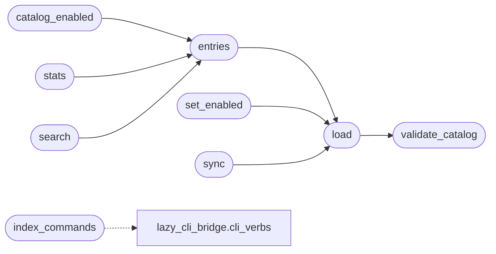

# `modules.verb_catalog`

> Source: [modules/verb_catalog.py:1](../../modules/verb_catalog.py#L1) | language `py` | coverage 100.0% | [API index](../index.md)

Operator-owned YAML catalog of every routable shell verb.

The autonomous loop historically routed only the built-in ``auto_*``
verbs; every other cmd2 command was reachable only when the text of an
intent literally named it. This module flips the model: the shell
catalogue is discovered once (``cli/command_index.json`` plus the same
``do_*`` scan the CLI bridge uses), materialised as ``config/verbs.yaml``
and every entry starts disabled unless it is enabled today.

Ownership split (SOLID):

- this module owns discovery, YAML persistence and catalog queries;
- ``modules/orchestrator_config`` keeps owning the merged view the loop
  reads, so the TUI, the API and the planner see one truth;
- operator toggles live in ``config/verbs.yaml`` (versioned, diffable),
  payload overrides keep working for advanced verb fields.

A missing, invalid or oversized YAML never raises into the loop: the
catalog degrades to "no catalog entries" and routing falls back to the
built-in verb set only.

## Contents

- **Classes:** [`VerbCatalogConfig`](#verbcatalogconfig)
- **Functions:** [`index_commands`](#index_commands), [`validate_catalog`](#validate_catalog), [`load`](#load), [`entries`](#entries), [`catalog_enabled`](#catalog_enabled), [`set_enabled`](#set_enabled), [`sync`](#sync), [`stats`](#stats), [`search`](#search)
- **Constants:** [`DEFAULT_CATALOG_PATH`](#default_catalog_path), [`DEFAULT_INDEX_PATH`](#default_index_path), [`BUILTIN_ENABLED_VERBS`](#builtin_enabled_verbs)

## Call Graph

Solid arrows stay in this module, dashed arrows leave it.



## Classes

<a id="verbcatalogconfig"></a>

### `VerbCatalogConfig`

`class` `dataclass` | [modules/verb_catalog.py:76](../../modules/verb_catalog.py#L76)

Decorators: `@dataclass(frozen=True)`

```python
class VerbCatalogConfig
```

Centralised paths and limits for the catalog subsystem.

**Parameters**

| Name | Type | Default | Description |
|---|---|---|---|
| `catalog_path` | `Path` | `field(default=DEFAULT_CATALOG_PATH)` | YAML file holding the operator catalog. |
| `index_path` | `Path` | `field(default=DEFAULT_INDEX_PATH)` | Pre-built command index JSON. |
| `addons_dir` | `Path \| None` | `None` | Directory of lazyaddon YAML manifests; ``None`` keeps the sweep off so unit sandboxes stay single-surface tests. |
| `version` | `int` | `1` | Schema version this module reads and writes. |
| `default_enabled` | `bool` | `False` | Enabled flag for newly discovered commands. |
| `max_yaml_bytes` | `int` | `1000000` | Safety cap so a corrupt file cannot stall reads. |
| `search_limit` | `int` | `60` | Default row cap for [`search`](#search). |

**Attributes**

| Name | Type | Default | Description |
|---|---|---|---|
| [`catalog_path`](#verbcatalogconfig-catalog_path) | `Path` | `field(default=DEFAULT_CATALOG_PATH)` |  |
| [`index_path`](#verbcatalogconfig-index_path) | `Path` | `field(default=DEFAULT_INDEX_PATH)` |  |
| [`addons_dir`](#verbcatalogconfig-addons_dir) | `Path \| None` | `None` |  |
| [`version`](#verbcatalogconfig-version) | `int` | `1` |  |
| [`default_enabled`](#verbcatalogconfig-default_enabled) | `bool` | `False` |  |
| [`max_yaml_bytes`](#verbcatalogconfig-max_yaml_bytes) | `int` | `1000000` |  |
| [`search_limit`](#verbcatalogconfig-search_limit) | `int` | `60` |  |

---

## Functions

<a id="index_commands"></a>

### `index_commands`

`function` | [modules/verb_catalog.py:190](../../modules/verb_catalog.py#L190)

```python
def index_commands(config: VerbCatalogConfig | None = None) -> dict[str, dict[str, str]]
```

Return discovered shell commands as ``{name: {summary, phase}}``.

The configured index file is authoritative. When it is missing or
unreadable the CLI bridge discovery covers the gap so the catalog
never loses a command that exists in the shell.

**Parameters**

| Name | Type | Default | Description |
|---|---|---|---|
| `config` | `VerbCatalogConfig \| None` | `None` | Active configuration; defaults to the process config. |

**Returns:** `dict[str, dict[str, str]]` - Mapping of command name to ``{summary, phase}`` metadata.

*Calls:* [`cli_verbs`](modules.lazy_cli_bridge.py.md#cli_verbs)

---

<a id="validate_catalog"></a>

### `validate_catalog`

`function` | [modules/verb_catalog.py:230](../../modules/verb_catalog.py#L230)

```python
def validate_catalog(data: Any) -> list[str]
```

Validate one raw catalog document.

**Parameters**

| Name | Type | Default | Description |
|---|---|---|---|
| `data` | `Any` |  | Parsed YAML document. |

**Returns:** `list[str]` - Human-readable errors; an empty list means the document is valid.

*Called by:* [`load`](#load)

---

<a id="load"></a>

### `load`

`function` | [modules/verb_catalog.py:263](../../modules/verb_catalog.py#L263)

```python
def load(config: VerbCatalogConfig | None = None) -> dict[str, dict[str, Any]]
```

Return the raw catalog mapping ``{name: entry}``.

**Parameters**

| Name | Type | Default | Description |
|---|---|---|---|
| `config` | `VerbCatalogConfig \| None` | `None` | Active configuration; defaults to the process config. |

**Returns:** `dict[str, dict[str, Any]]` - The parsed ``verbs`` mapping, or an empty mapping when the file
is missing, oversized, or invalid.

*Calls:* [`validate_catalog`](#validate_catalog)

*Called by:* [`entries`](#entries), [`set_enabled`](#set_enabled), [`sync`](#sync)

---

<a id="entries"></a>

### `entries`

`function` | [modules/verb_catalog.py:296](../../modules/verb_catalog.py#L296)

```python
def entries(config: VerbCatalogConfig | None = None) -> dict[str, dict[str, Any]]
```

Return the catalog with defaults filled in, cached briefly.

**Parameters**

| Name | Type | Default | Description |
|---|---|---|---|
| `config` | `VerbCatalogConfig \| None` | `None` | Active configuration; defaults to the process config. |

**Returns:** `dict[str, dict[str, Any]]` - Mapping of command name to entry with keys ``enabled``,
``phase``, ``risk``, ``description`` and ``source``.

*Calls:* [`load`](#load)

*Called by:* [`verbs`](lazyc2.blueprints.orchestrator.py.md#verbs), [`catalog_enabled`](#catalog_enabled), [`search`](#search), [`stats`](#stats)

---

<a id="catalog_enabled"></a>

### `catalog_enabled`

`function` | [modules/verb_catalog.py:349](../../modules/verb_catalog.py#L349)

```python
def catalog_enabled(name: str, config: VerbCatalogConfig | None = None) -> bool | None
```

Return the catalog state of one verb.

**Parameters**

| Name | Type | Default | Description |
|---|---|---|---|
| `name` | `str` |  | Command name without the ``do_`` prefix. |
| `config` | `VerbCatalogConfig \| None` | `None` | Active configuration; defaults to the process config. |

**Returns:** `bool | None` - ``True``/``False`` when catalogued, ``None`` when unknown so the
caller can apply its own fallback.

*Calls:* [`entries`](#entries)

*Called by:* [`LazyOrchestratorApp.toggle_verb`](cli.lazy_orchestrator.py.md#lazyorchestratorapp-toggle_verb), [`verbs_toggle`](lazyc2.blueprints.orchestrator.py.md#verbs_toggle)

---

<a id="set_enabled"></a>

### `set_enabled`

`function` | [modules/verb_catalog.py:378](../../modules/verb_catalog.py#L378)

```python
def set_enabled(name: str, enabled: bool, config: VerbCatalogConfig | None = None) -> dict[str, Any]
```

Flip one verb in the YAML catalog atomically.

**Parameters**

| Name | Type | Default | Description |
|---|---|---|---|
| `name` | `str` |  | Command name without the ``do_`` prefix. |
| `enabled` | `bool` |  | New flag. |
| `config` | `VerbCatalogConfig \| None` | `None` | Active configuration; defaults to the process config. |

**Returns:** `dict[str, Any]` - The updated entry.

**Raises**

- `KeyError`: The command is not exposed by the shell.
- `ValueError`: The verb name is empty or the YAML cannot be written.

*Calls:* [`load`](#load)

*Called by:* [`VerbCommandSet.do_verb`](cli.commands.verb_admin.py.md#verbcommandset-do_verb), [`LazyOrchestratorApp.toggle_verb`](cli.lazy_orchestrator.py.md#lazyorchestratorapp-toggle_verb)

---

<a id="sync"></a>

### `sync`

`function` | [modules/verb_catalog.py:415](../../modules/verb_catalog.py#L415)

```python
def sync(config: VerbCatalogConfig | None = None) -> dict[str, int]
```

Materialise the discovered shell catalogue into the YAML file.

Operator choices are preserved: entries keep their stored ``enabled``
flag, today's built-ins default to enabled and every newly discovered
command lands disabled. Commands that no longer exist are pruned.

**Parameters**

| Name | Type | Default | Description |
|---|---|---|---|
| `config` | `VerbCatalogConfig \| None` | `None` | Active configuration; defaults to the process config. |

**Returns:** `dict[str, int]` - Statistics ``{added, kept, removed, total, on, off}``.

*Calls:* [`load`](#load)

*Called by:* [`VerbCommandSet.do_verb`](cli.commands.verb_admin.py.md#verbcommandset-do_verb)

---

<a id="stats"></a>

### `stats`

`function` | [modules/verb_catalog.py:502](../../modules/verb_catalog.py#L502)

```python
def stats(config: VerbCatalogConfig | None = None) -> dict[str, int]
```

Summarise the catalog for the brief and the HTTP API.

**Parameters**

| Name | Type | Default | Description |
|---|---|---|---|
| `config` | `VerbCatalogConfig \| None` | `None` | Active configuration; defaults to the process config. |

**Returns:** `dict[str, int]` - ``{total, on, off}``.

*Calls:* [`entries`](#entries)

*Called by:* [`VerbCommandSet.do_verb`](cli.commands.verb_admin.py.md#verbcommandset-do_verb), [`panel`](lazyc2.blueprints.orchestrator.py.md#panel), [`panel_json`](lazyc2.blueprints.orchestrator.py.md#panel_json)

---

<a id="search"></a>

### `search`

`function` | [modules/verb_catalog.py:516](../../modules/verb_catalog.py#L516)

```python
def search(query: str = '', config: VerbCatalogConfig | None = None, phase: str = '', enabled: bool | None = None, limit: int | None = None) -> list[dict[str, Any]]
```

Search catalog entries by substring, phase and state.

**Parameters**

| Name | Type | Default | Description |
|---|---|---|---|
| `query` | `str` | `''` | Case-insensitive substring over name and description. |
| `config` | `VerbCatalogConfig \| None` | `None` | Active configuration; defaults to the process config. |
| `phase` | `str` | `''` | Optional exact kill-chain phase filter. |
| `enabled` | `bool \| None` | `None` | Optional state filter. |
| `limit` | `int \| None` | `None` | Row cap; defaults to `[`VerbCatalogConfig.search_limit`](#verbcatalogconfig-search_limit)`. |

**Returns:** `list[dict[str, Any]]` - Matching entries with the name injected, sorted by name.

*Calls:* [`entries`](#entries)

*Called by:* [`VerbCommandSet.do_verb`](cli.commands.verb_admin.py.md#verbcommandset-do_verb), [`verbs`](lazyc2.blueprints.orchestrator.py.md#verbs)

---

## Constants

<a id="default_catalog_path"></a>

### `DEFAULT_CATALOG_PATH`

`constant` | [modules/verb_catalog.py:43](../../modules/verb_catalog.py#L43)

```python
DEFAULT_CATALOG_PATH = REPO_ROOT / 'config' / 'verbs.yaml'
```

---

<a id="default_index_path"></a>

### `DEFAULT_INDEX_PATH`

`constant` | [modules/verb_catalog.py:44](../../modules/verb_catalog.py#L44)

```python
DEFAULT_INDEX_PATH = REPO_ROOT / 'cli' / 'command_index.json'
```

---

<a id="builtin_enabled_verbs"></a>

### `BUILTIN_ENABLED_VERBS`

`constant` | [modules/verb_catalog.py:46](../../modules/verb_catalog.py#L46)

```python
BUILTIN_ENABLED_VERBS: frozenset[str] = frozenset({'lazynmap'})
```

---
