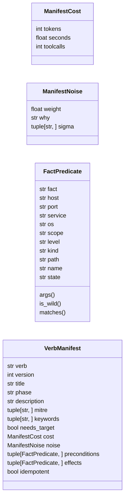
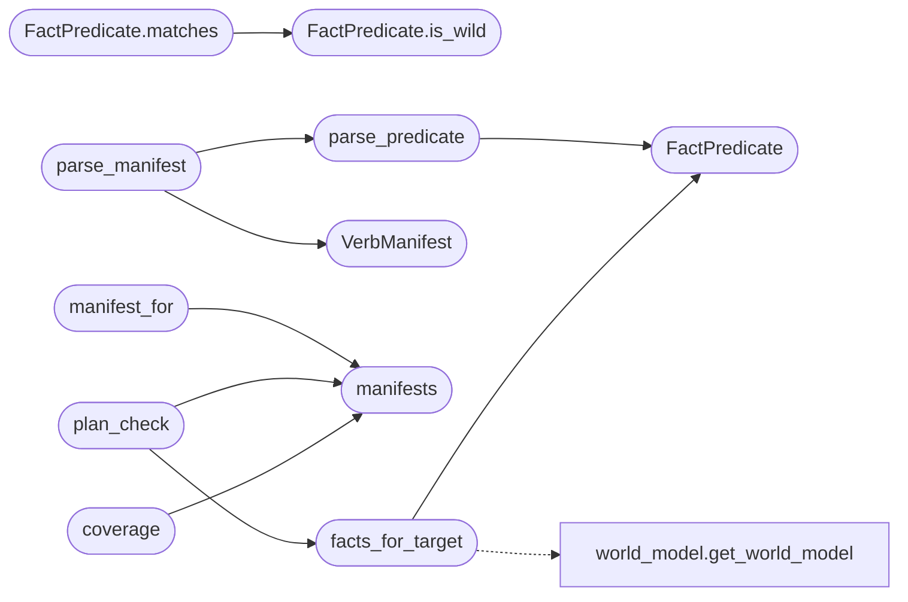

# `modules.verb_manifest`

> Source: [modules/verb_manifest.py:1](../../modules/verb_manifest.py#L1) | language `py` | coverage 100.0% | [API index](../index.md)

Typed verb manifests - semantics for routable shell verbs.

Every routable shell command is a verb. Today the registry knows only
names, phases and keyword strings (``config/verbs.yaml``, the built-in
`[`AUTO_VERBS`](modules.auto_registry.py.md#auto_verbs)` and the command index). This module stores the missing
signature: what a verb requires from the world model before it can run,
what facts it produces, what it costs and how loud it is.

Manifest document (``config/verb_manifests.yaml``)::

    manifests:
      lazynmap:
        version: 1
        title: Nmap service scan
        phase: recon
        description: Discover open ports and service versions.
        mitre: [T1046]
        keywords: [scan, ports, services]
        needs_target: true
        cost: {tokens: 200, seconds: 300, toolcalls: 1}
        noise: {weight: 0.7, why: "full connect scan rings network sensors.",
                sigma: [LAZ-010]}
        preconditions:
          - {fact: host_known, host: "{target}"}
        effects:
          - {fact: services_discovered, host: "{target}"}
          - {fact: scan_completed, host: "{target}"}
        idempotent: true

Facts form a closed vocabulary consumed by three surfaces:

- `[`plan_check`](#plan_check)`: semantic chain dry-runs (``apt_chain --dry-run`` stops
  being pure token resolution and reports proven-unmet preconditions).
- the detection oracle: ``noise.weight`` is the operator prior that
  profiles combine with the oracle probability.
- the planner: `[`cost`](#verbmanifest-cost)` and `[`keywords`](#verbmanifest-keywords)` rank proposals beyond text match.

Parsing is fail-safe: an invalid manifest logs and disappears instead of
breaking the loop, mirroring [`modules.verb_catalog`](modules.verb_catalog.py.md) behaviour.

## Contents

- **Classes:** [`ManifestCost`](#manifestcost), [`ManifestNoise`](#manifestnoise), [`FactPredicate`](#factpredicate), [`VerbManifest`](#verbmanifest)
- **Functions:** [`parse_predicate`](#parse_predicate), [`parse_manifest`](#parse_manifest), [`manifests`](#manifests), [`manifest_for`](#manifest_for), [`facts_for_target`](#facts_for_target), [`plan_check`](#plan_check), [`coverage`](#coverage)
- **Constants:** [`REPO_ROOT`](#repo_root), [`DEFAULT_MANIFEST_PATH`](#default_manifest_path)

## Type Diagram



## Call Graph

Solid arrows stay in this module, dashed arrows leave it.



## Classes

<a id="manifestcost"></a>

### `ManifestCost`

`class` `dataclass` | [modules/verb_manifest.py:93](../../modules/verb_manifest.py#L93)

Decorators: `@dataclass(frozen=True)`

```python
class ManifestCost
```

Operator-declared resource cost of one verb invocation.

**Parameters**

| Name | Type | Default | Description |
|---|---|---|---|
| `tokens` | `int` | `0` | Model tokens the verb output typically consumes. |
| `seconds` | `float` | `0.0` | Typical wall clock in seconds. |
| `toolcalls` | `int` | `1` | Number of tool executions carried out. |

**Attributes**

| Name | Type | Default | Description |
|---|---|---|---|
| [`tokens`](#manifestcost-tokens) | `int` | `0` |  |
| [`seconds`](#manifestcost-seconds) | `float` | `0.0` |  |
| [`toolcalls`](#manifestcost-toolcalls) | `int` | `1` |  |

---

<a id="manifestnoise"></a>

### `ManifestNoise`

`class` `dataclass` | [modules/verb_manifest.py:108](../../modules/verb_manifest.py#L108)

Decorators: `@dataclass(frozen=True)`

```python
class ManifestNoise
```

Operator prior of how loud the verb is, before the oracle speaks.

**Parameters**

| Name | Type | Default | Description |
|---|---|---|---|
| `weight` | `float` | `0.0` | Detection prior in [0.0, 1.0] (0 silent, 1 trivially seen). |
| `why` | `str` | `''` | One-line reason the operator assigned this weight. |
| `sigma` | `tuple[str, ...]` | `()` | Sigma rule ids the verb typically trips. |

**Attributes**

| Name | Type | Default | Description |
|---|---|---|---|
| [`weight`](#manifestnoise-weight) | `float` | `0.0` |  |
| [`why`](#manifestnoise-why) | `str` | `''` |  |
| [`sigma`](#manifestnoise-sigma) | `tuple[str, ...]` | `()` |  |

---

<a id="factpredicate"></a>

### `FactPredicate`

`class` `dataclass` | [modules/verb_manifest.py:123](../../modules/verb_manifest.py#L123)

Decorators: `@dataclass(frozen=True)`

```python
class FactPredicate
```

One fact the world model may hold, with optional corner arguments.

**Parameters**

| Name | Type | Default | Description |
|---|---|---|---|
| `fact` | `str` |  | Closed-vocabulary fact id (see ``_FACT_IDS``). |
| `host` | `str` | `''` | Host the fact binds to, ``"{target}"`` tolerated as wildcard. |
| `port` | `str` | `''` | Optional port string. |
| `service` | `str` | `''` | Optional service name. |
| `os` | `str` | `''` | Optional OS family (linux, windows, macos, unix). |
| `scope` | `str` | `''` | Optional credential scope (any, domain, host). |
| `level` | `str` | `''` | Optional access level (none, user, shell, root). |
| `kind` | `str` | `''` | Optional session kind (web, shell, c2, db). |
| `path` | `str` | `''` | Optional artifact path. |
| `name` | `str` | `''` | Optional free-form fact name (for `[`fact`](#factpredicate-fact)` ids). |
| `state` | `str` | `''` | Optional state string (e.g. c2 running). |

**Attributes**

| Name | Type | Default | Description |
|---|---|---|---|
| [`fact`](#factpredicate-fact) | `str` |  |  |
| [`host`](#factpredicate-host) | `str` | `''` |  |
| [`port`](#factpredicate-port) | `str` | `''` |  |
| [`service`](#factpredicate-service) | `str` | `''` |  |
| [`os`](#factpredicate-os) | `str` | `''` |  |
| [`scope`](#factpredicate-scope) | `str` | `''` |  |
| [`level`](#factpredicate-level) | `str` | `''` |  |
| [`kind`](#factpredicate-kind) | `str` | `''` |  |
| [`path`](#factpredicate-path) | `str` | `''` |  |
| [`name`](#factpredicate-name) | `str` | `''` |  |
| [`state`](#factpredicate-state) | `str` | `''` |  |

**Members**

| Member | Kind | Summary |
|---|---|---|
| [`args`](#factpredicate-args) | method | Return the set corner arguments. |
| [`is_wild`](#factpredicate-is_wild) | method | Return True when that argument is a ``{token}`` wildcard. |
| [`matches`](#factpredicate-matches) | method | Return True when this fact instance satisfies the other. |

<a id="factpredicate-args"></a>

#### `FactPredicate.args`

`method` | [modules/verb_manifest.py:152](../../modules/verb_manifest.py#L152)

```python
def args(self) -> dict[str, str]
```

Return the set corner arguments.

**Returns:** `dict[str, str]`

*Called by:* [`generate_lateral_command`](plugins.generate_lateral_command.lua.md#generate_lateral_command)

<a id="factpredicate-is_wild"></a>

#### `FactPredicate.is_wild`

`method` | [modules/verb_manifest.py:156](../../modules/verb_manifest.py#L156)

```python
def is_wild(self, key: str) -> bool
```

Return True when that argument is a ``{token}`` wildcard.

**Parameters**

| Name | Type | Default | Description |
|---|---|---|---|
| `key` | `str` |  |  |

**Returns:** `bool`

*Called by:* [`FactPredicate.matches`](#factpredicate-matches)

<a id="factpredicate-matches"></a>

#### `FactPredicate.matches`

`method` | [modules/verb_manifest.py:161](../../modules/verb_manifest.py#L161)

```python
def matches(self, other: FactPredicate) -> bool
```

Return True when this fact instance satisfies the other.

**Parameters**

| Name | Type | Default | Description |
|---|---|---|---|
| `other` | `FactPredicate` |  | Requirement predicate; a missing or wildcard argument matches anything, a literal must agree exactly (hosts are compared case-insensitively). |

**Returns:** `bool` - True when every shared field is compatible.

*Calls:* [`FactPredicate.is_wild`](#factpredicate-is_wild)

---

<a id="verbmanifest"></a>

### `VerbManifest`

`class` `dataclass` | [modules/verb_manifest.py:188](../../modules/verb_manifest.py#L188)

Decorators: `@dataclass(frozen=True)`

```python
class VerbManifest
```

Typed signature of one shell verb.

**Parameters**

| Name | Type | Default | Description |
|---|---|---|---|
| `verb` | `str` |  | Shell command name (``do_<verb>`` or binary this wraps). |
| `version` | `int` | `1` | Manifest schema version (currently 1). |
| `title` | `str` | `''` | Short human title. |
| `phase` | `str` | `''` | Canonical kill-chain phase. |
| `description` | `str` | `''` | One-line description. |
| `mitre` | `tuple[str, ...]` | `()` | MITRE ATT&CK technique ids. |
| `keywords` | `tuple[str, ...]` | `()` | Planner keyword signals. |
| `needs_target` | `bool` | `True` | Whether the verb binds a loop target. |
| `cost` | `ManifestCost` | `ManifestCost()` | Declared resource cost. |
| `noise` | `ManifestNoise` | `ManifestNoise()` | Declared detection-noise prior. |
| `preconditions` | `tuple[FactPredicate, ...]` | `()` | Facts required before a call is meaningful. |
| `effects` | `tuple[FactPredicate, ...]` | `()` | Facts a successful call produces. |
| `idempotent` | `bool` | `False` | Re-runs are safe (skip/steal-facts decisions). |

**Attributes**

| Name | Type | Default | Description |
|---|---|---|---|
| [`verb`](#verbmanifest-verb) | `str` |  |  |
| [`version`](#verbmanifest-version) | `int` | `1` |  |
| [`title`](#verbmanifest-title) | `str` | `''` |  |
| [`phase`](#verbmanifest-phase) | `str` | `''` |  |
| [`description`](#verbmanifest-description) | `str` | `''` |  |
| [`mitre`](#verbmanifest-mitre) | `tuple[str, ...]` | `()` |  |
| [`keywords`](#verbmanifest-keywords) | `tuple[str, ...]` | `()` |  |
| [`needs_target`](#verbmanifest-needs_target) | `bool` | `True` |  |
| [`cost`](#verbmanifest-cost) | `ManifestCost` | `ManifestCost()` |  |
| [`noise`](#verbmanifest-noise) | `ManifestNoise` | `ManifestNoise()` |  |
| [`preconditions`](#verbmanifest-preconditions) | `tuple[FactPredicate, ...]` | `()` |  |
| [`effects`](#verbmanifest-effects) | `tuple[FactPredicate, ...]` | `()` |  |
| [`idempotent`](#verbmanifest-idempotent) | `bool` | `False` |  |

---

## Functions

<a id="parse_predicate"></a>

### `parse_predicate`

`function` | [modules/verb_manifest.py:222](../../modules/verb_manifest.py#L222)

```python
def parse_predicate(data: object) -> FactPredicate
```

Parse one predicate mapping into a FactPredicate.

**Parameters**

| Name | Type | Default | Description |
|---|---|---|---|
| `data` | `object` |  | YAML/JSON mapping with `[`fact`](#factpredicate-fact)` plus optional corner fields. |

**Returns:** `FactPredicate` - The parsed predicate.

**Raises**

- `ValueError`: When the entry is not a mapping, `[`fact`](#factpredicate-fact)` is missing or the fact id is outside the closed vocabulary.

*Calls:* [`FactPredicate`](#factpredicate)

*Called by:* [`parse_manifest`](#parse_manifest)

---

<a id="parse_manifest"></a>

### `parse_manifest`

`function` | [modules/verb_manifest.py:296](../../modules/verb_manifest.py#L296)

```python
def parse_manifest(verb: str, data: object) -> VerbManifest
```

Validate and parse one manifest document entry.

**Parameters**

| Name | Type | Default | Description |
|---|---|---|---|
| `verb` | `str` |  | Shell verb the entry describes. |
| `data` | `object` |  | Raw YAML mapping from the manifest file. |

**Returns:** `VerbManifest` - The parsed manifest.

**Raises**

- `ValueError`: When the entry violates the schema.

*Calls:* [`VerbManifest`](#verbmanifest), [`parse_predicate`](#parse_predicate)

---

<a id="manifests"></a>

### `manifests`

`function` | [modules/verb_manifest.py:371](../../modules/verb_manifest.py#L371)

```python
def manifests(path: Path | str | None = None) -> dict[str, VerbManifest]
```

Return parsed manifests with a small TTL cache.

**Parameters**

| Name | Type | Default | Description |
|---|---|---|---|
| `path` | `Path \| str \| None` | `None` | Override the default manifest file (tests, alt configs). |

**Returns:** `dict[str, VerbManifest]` - Mapping verb -> VerbManifest; empty on any failure.

*Called by:* [`coverage`](#coverage), [`manifest_for`](#manifest_for), [`plan_check`](#plan_check)

---

<a id="manifest_for"></a>

### `manifest_for`

`function` | [modules/verb_manifest.py:396](../../modules/verb_manifest.py#L396)

```python
def manifest_for(verb: str, path: Path | str | None = None) -> VerbManifest | None
```

Return the manifest of one verb, or None when untyped.

**Parameters**

| Name | Type | Default | Description |
|---|---|---|---|
| `verb` | `str` |  | Shell command name. |
| `path` | `Path \| str \| None` | `None` | Override the default manifest file. |

**Returns:** `VerbManifest | None` - Parsed VerbManifest when declared, else None.

*Calls:* [`manifests`](#manifests)

---

<a id="facts_for_target"></a>

### `facts_for_target`

`function` | [modules/verb_manifest.py:411](../../modules/verb_manifest.py#L411)

```python
def facts_for_target(host: str) -> list[FactPredicate]
```

Project the world model facts of one host into predicates.

**Parameters**

| Name | Type | Default | Description |
|---|---|---|---|
| `host` | `str` |  | Target host string. |

**Returns:** `list[FactPredicate]` - Read-only fact list; empty when the world model knows nothing.

**Raises**

- `OSError`: Never, failures degrade to an empty list.

*Calls:* [`FactPredicate`](#factpredicate), [`get_world_model`](modules.world_model.py.md#get_world_model)

*Called by:* [`plan_check`](#plan_check)

---

<a id="plan_check"></a>

### `plan_check`

`function` | [modules/verb_manifest.py:467](../../modules/verb_manifest.py#L467)

```python
def plan_check(steps: list[ChainStep], tokens: dict[str, str], path: Path | str | None = None, facts: list[FactPredicate] | None = None) -> list[str]
```

Check a chain semantically: every typed precondition must be supplied.

**Parameters**

| Name | Type | Default | Description |
|---|---|---|---|
| `steps` | `list[ChainStep]` |  | The chain steps in execution order. |
| `tokens` | `dict[str, str]` |  | Resolved variables (the chain target lives here). |
| `path` | `Path \| str \| None` | `None` | Optional manifest file override. |
| `facts` | `list[FactPredicate] \| None` | `None` | Known facts injection (tests, alternative fact sources); defaults to the world model projection of the target. |

**Returns:** `list[str]` - Warning strings for provably unmet preconditions. Untyped verbs
are summarised, never individually nags, since the store is
sparse by design.

*Calls:* [`facts_for_target`](#facts_for_target), [`manifests`](#manifests)

*Called by:* [`ChainRunner.run`](modules.chain_runner.py.md#chainrunner-run)

---

<a id="coverage"></a>

### `coverage`

`function` | [modules/verb_manifest.py:522](../../modules/verb_manifest.py#L522)

```python
def coverage(total_verbs: int, path: Path | str | None = None) -> dict[str, object]
```

Summarise manifest coverage for registry reporting.

**Parameters**

| Name | Type | Default | Description |
|---|---|---|---|
| `total_verbs` | `int` |  | Size of the current shell command registry. |
| `path` | `Path \| str \| None` | `None` | Optional manifest file override. |

**Returns:** `dict[str, object]` - Mapping with typed count, untyped remainder and per-verb rows.

*Calls:* [`manifests`](#manifests)

---

## Constants

<a id="repo_root"></a>

### `REPO_ROOT`

`constant` | [modules/verb_manifest.py:60](../../modules/verb_manifest.py#L60)

```python
REPO_ROOT = Path(__file__).resolve().parent.parent
```

---

<a id="default_manifest_path"></a>

### `DEFAULT_MANIFEST_PATH`

`constant` | [modules/verb_manifest.py:61](../../modules/verb_manifest.py#L61)

```python
DEFAULT_MANIFEST_PATH = REPO_ROOT / 'config' / 'verb_manifests.yaml'
```

---
