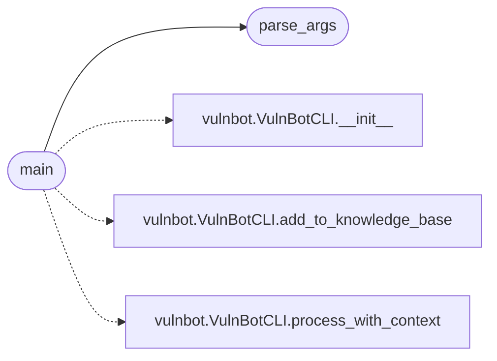

# `modules.vuln_bot_cli`

> Source: [modules/vuln_bot_cli.py:1](../../modules/vuln_bot_cli.py#L1) | language `py` | coverage 33.3% | [API index](../index.md)

main.py

## Contents

- **Functions:** [`parse_args`](#parse_args), [`main`](#main)
- **Constants:** [`BANNER`](#banner)

## Call Graph

Solid arrows stay in this module, dashed arrows leave it.



## Functions

<a id="parse_args"></a>

### `parse_args`

`function` | [modules/vuln_bot_cli.py:10](../../modules/vuln_bot_cli.py#L10)

```python
def parse_args()
```

*Called by:* [`main`](#main)

---

<a id="main"></a>

### `main`

`function` | [modules/vuln_bot_cli.py:22](../../modules/vuln_bot_cli.py#L22)

```python
def main()
```

*Calls:* [`parse_args`](#parse_args), [`VulnBotCLI.__init__`](modules.vulnbot.py.md#vulnbotcli-__init__), [`VulnBotCLI.add_to_knowledge_base`](modules.vulnbot.py.md#vulnbotcli-add_to_knowledge_base), [`VulnBotCLI.process_with_context`](modules.vulnbot.py.md#vulnbotcli-process_with_context)

---

## Constants

<a id="banner"></a>

### `BANNER`

`constant` | [modules/vuln_bot_cli.py:7](../../modules/vuln_bot_cli.py#L7)

```python
BANNER = 'Vuln Bot LazyOwn RedTeam Technology'
```

---
