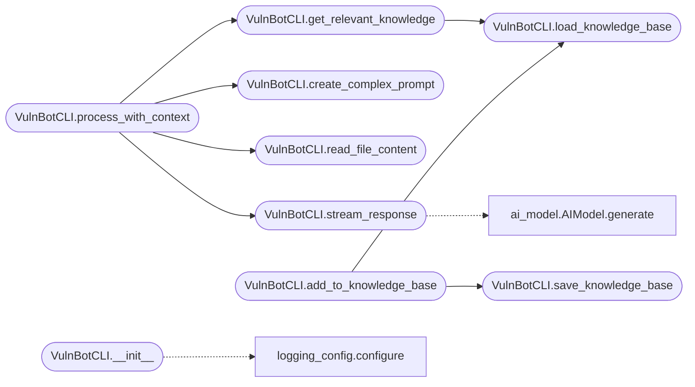

# `modules.vulnbot`

> Source: [modules/vulnbot.py:1](../../modules/vulnbot.py#L1) | language `py` | coverage 33.3% | [API index](../index.md)

vulnbot.py

## Contents

- **Classes:** [`VulnBotCLI`](#vulnbotcli)
- **Constants:** [`BANNER`](#banner)

## Call Graph

Solid arrows stay in this module, dashed arrows leave it.



## Classes

<a id="vulnbotcli"></a>

### `VulnBotCLI`

`class` | [modules/vulnbot.py:37](../../modules/vulnbot.py#L37)

```python
class VulnBotCLI
```

**Members**

| Member | Kind | Summary |
|---|---|---|
| [`__init__`](#vulnbotcli-__init__) | constructor |  |
| [`load_knowledge_base`](#vulnbotcli-load_knowledge_base) | method | Load the knowledge base in any known shape. |
| [`save_knowledge_base`](#vulnbotcli-save_knowledge_base) | method |  |
| [`get_relevant_knowledge`](#vulnbotcli-get_relevant_knowledge) | method | Return knowledge responses whose text shares keywords with the prompt. |
| [`create_complex_prompt`](#vulnbotcli-create_complex_prompt) | method |  |
| [`read_file_content`](#vulnbotcli-read_file_content) | method |  |
| [`load_event_config`](#vulnbotcli-load_event_config) | method |  |
| [`process_with_context`](#vulnbotcli-process_with_context) | method |  |
| [`stream_response`](#vulnbotcli-stream_response) | method |  |
| [`add_to_knowledge_base`](#vulnbotcli-add_to_knowledge_base) | method | Append a prompt/response record in the canonical list format. |

<a id="vulnbotcli-__init__"></a>

#### `VulnBotCLI.__init__`

`constructor` | [modules/vulnbot.py:38](../../modules/vulnbot.py#L38)

```python
def __init__(self, provider: str = 'groq', mode: str = 'console', debug: bool = False, script_path: str = 'lazyown.py')
```

**Parameters**

| Name | Type | Default | Description |
|---|---|---|---|
| `provider` | `str` | `'groq'` |  |
| `mode` | `str` | `'console'` |  |
| `debug` | `bool` | `False` |  |
| `script_path` | `str` | `'lazyown.py'` |  |

*Calls:* [`configure`](modules.logging_config.py.md#configure)

*Called by:* [`main`](modules.vuln_bot_cli.py.md#main)

<a id="vulnbotcli-load_knowledge_base"></a>

#### `VulnBotCLI.load_knowledge_base`

`method` | [modules/vulnbot.py:208](../../modules/vulnbot.py#L208)

```python
def load_knowledge_base(self) -> list | dict
```

Load the knowledge base in any known shape.

**Returns:** `list | dict` - The canonical list of ``{"prompt", "response"}`` records, the
legacy dict mapping, or an empty list on any read error.

*Called by:* [`VulnBotCLI.add_to_knowledge_base`](#vulnbotcli-add_to_knowledge_base), [`VulnBotCLI.get_relevant_knowledge`](#vulnbotcli-get_relevant_knowledge)

<a id="vulnbotcli-save_knowledge_base"></a>

#### `VulnBotCLI.save_knowledge_base`

`method` | [modules/vulnbot.py:224](../../modules/vulnbot.py#L224)

```python
def save_knowledge_base(self, kb: list | dict) -> None
```

**Parameters**

| Name | Type | Default | Description |
|---|---|---|---|
| `kb` | `list \| dict` |  |  |

*Called by:* [`VulnBotCLI.add_to_knowledge_base`](#vulnbotcli-add_to_knowledge_base)

<a id="vulnbotcli-get_relevant_knowledge"></a>

#### `VulnBotCLI.get_relevant_knowledge`

`method` | [modules/vulnbot.py:228](../../modules/vulnbot.py#L228)

```python
def get_relevant_knowledge(self, prompt: str) -> str
```

Return knowledge responses whose text shares keywords with the prompt.

**Parameters**

| Name | Type | Default | Description |
|---|---|---|---|
| `prompt` | `str` |  | Query used to select relevant records. |

**Returns:** `str` - Newline-joined matching responses; empty when nothing matches.

*Calls:* [`VulnBotCLI.load_knowledge_base`](#vulnbotcli-load_knowledge_base)

*Called by:* [`VulnBotCLI.process_with_context`](#vulnbotcli-process_with_context)

<a id="vulnbotcli-create_complex_prompt"></a>

#### `VulnBotCLI.create_complex_prompt`

`method` | [modules/vulnbot.py:251](../../modules/vulnbot.py#L251)

```python
def create_complex_prompt(self, base_prompt: str, history: str = '', knowledge: str = '') -> str
```

**Parameters**

| Name | Type | Default | Description |
|---|---|---|---|
| `base_prompt` | `str` |  |  |
| `history` | `str` | `''` |  |
| `knowledge` | `str` | `''` |  |

**Returns:** `str`

*Called by:* [`VulnBotCLI.process_with_context`](#vulnbotcli-process_with_context)

<a id="vulnbotcli-read_file_content"></a>

#### `VulnBotCLI.read_file_content`

`method` | [modules/vulnbot.py:267](../../modules/vulnbot.py#L267)

```python
def read_file_content(self, file_path: str) -> str
```

**Parameters**

| Name | Type | Default | Description |
|---|---|---|---|
| `file_path` | `str` |  |  |

**Returns:** `str`

**Raises**

- `FileNotFoundError`: (raised in the body, not documented)

*Called by:* [`VulnBotCLI.process_with_context`](#vulnbotcli-process_with_context)

<a id="vulnbotcli-load_event_config"></a>

#### `VulnBotCLI.load_event_config`

`method` | [modules/vulnbot.py:273](../../modules/vulnbot.py#L273)

```python
def load_event_config(self) -> dict
```

**Returns:** `dict`

<a id="vulnbotcli-process_with_context"></a>

#### `VulnBotCLI.process_with_context`

`method` | [modules/vulnbot.py:281](../../modules/vulnbot.py#L281)

```python
def process_with_context(self, file_path: str, event: str = None) -> str
```

**Parameters**

| Name | Type | Default | Description |
|---|---|---|---|
| `file_path` | `str` |  |  |
| `event` | `str` | `None` |  |

**Returns:** `str`

*Calls:* [`VulnBotCLI.create_complex_prompt`](#vulnbotcli-create_complex_prompt), [`VulnBotCLI.get_relevant_knowledge`](#vulnbotcli-get_relevant_knowledge), [`VulnBotCLI.read_file_content`](#vulnbotcli-read_file_content), [`VulnBotCLI.stream_response`](#vulnbotcli-stream_response)

*Called by:* [`main`](modules.vuln_bot_cli.py.md#main)

<a id="vulnbotcli-stream_response"></a>

#### `VulnBotCLI.stream_response`

`method` | [modules/vulnbot.py:297](../../modules/vulnbot.py#L297)

```python
def stream_response(self, prompt: str) -> Response
```

**Parameters**

| Name | Type | Default | Description |
|---|---|---|---|
| `prompt` | `str` |  |  |

**Returns:** `Response`

*Calls:* [`AIModel.generate`](modules.ai_model.py.md#aimodel-generate)

*Called by:* [`VulnBotCLI.process_with_context`](#vulnbotcli-process_with_context)

<a id="vulnbotcli-add_to_knowledge_base"></a>

#### `VulnBotCLI.add_to_knowledge_base`

`method` | [modules/vulnbot.py:303](../../modules/vulnbot.py#L303)

```python
def add_to_knowledge_base(self, prompt: str, response: str)
```

Append a prompt/response record in the canonical list format.

**Parameters**

| Name | Type | Default | Description |
|---|---|---|---|
| `prompt` | `str` |  | Operator prompt that produced the response. |
| `response` | `str` |  | Model response to remember. |

*Calls:* [`VulnBotCLI.load_knowledge_base`](#vulnbotcli-load_knowledge_base), [`VulnBotCLI.save_knowledge_base`](#vulnbotcli-save_knowledge_base)

*Called by:* [`main`](modules.vuln_bot_cli.py.md#main)

---

## Constants

<a id="banner"></a>

### `BANNER`

`constant` | [modules/vulnbot.py:32](../../modules/vulnbot.py#L32)

```python
BANNER = '\n[*] Starting: LazyOwn GPT One Liner CLI Assistant [;,;]\n'
```

---
