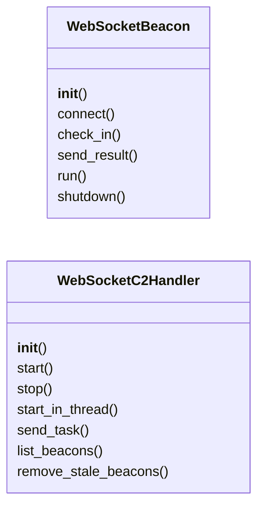
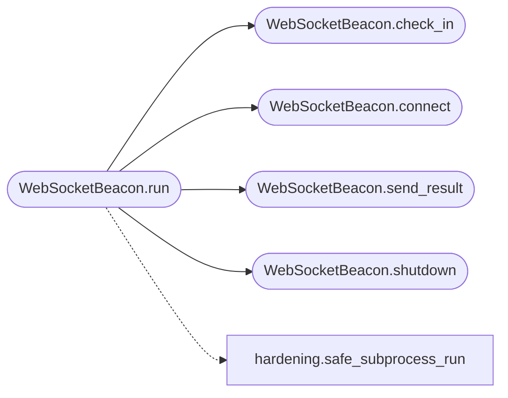

# `modules.websocket_beacon`

> Source: [modules/websocket_beacon.py:1](../../modules/websocket_beacon.py#L1) | language `py` | coverage 100.0% | [API index](../index.md)

WebSocket beacon transport for modern C2 channels.

Provides WebSocket-based beacon implementation and server-side handler
that integrates with the LazyOwn C2 framework via Socket.IO events.

## Contents

- **Classes:** [`WebSocketBeacon`](#websocketbeacon), [`WebSocketC2Handler`](#websocketc2handler)
- **Constants:** [`WS_PORT`](#ws_port), [`WS_HOST`](#ws_host), [`WS_PATH`](#ws_path), [`WS_PING_INTERVAL`](#ws_ping_interval), [`WS_SLEEP_JITTER`](#ws_sleep_jitter)

## Type Diagram



## Call Graph

Solid arrows stay in this module, dashed arrows leave it.



## Classes

<a id="websocketbeacon"></a>

### `WebSocketBeacon`

`class` | [modules/websocket_beacon.py:46](../../modules/websocket_beacon.py#L46)

```python
class WebSocketBeacon
```

WebSocket-based beacon for C2 communication.

Connects to a WebSocket server with optional TLS and AES encryption.
Supports jitter, sleep intervals, and task queuing.

**Parameters**

| Name | Type | Default | Description |
|---|---|---|---|
| `server_url` |  |  | WebSocket server URL (ws:// or wss://). |
| `beacon_id` |  |  | Unique beacon identifier. Auto-generated if None. |
| `encryption_key` |  |  | Optional AES encryption key (Fernet format). |
| `sleep_seconds` |  |  | Base sleep time between check-ins. |
| `jitter_percent` |  |  | Random jitter percentage added to sleep time. |
| `ssl_verify` |  |  | Whether to verify TLS certificates. |
| `proxy` |  |  | Optional HTTP/SOCKS proxy URL. |

**Members**

| Member | Kind | Summary |
|---|---|---|
| [`__init__`](#websocketbeacon-__init__) | constructor |  |
| [`connect`](#websocketbeacon-connect) | method | Establish WebSocket connection to the C2 server. |
| [`check_in`](#websocketbeacon-check_in) | method | Send heartbeat and retrieve pending tasks. |
| [`send_result`](#websocketbeacon-send_result) | method | Send command execution result back to C2. |
| [`run`](#websocketbeacon-run) | method | Main beacon loop with check-in and command execution. |
| [`shutdown`](#websocketbeacon-shutdown) | method | Gracefully shutdown the beacon. |

<a id="websocketbeacon-__init__"></a>

#### `WebSocketBeacon.__init__`

`constructor` | [modules/websocket_beacon.py:62](../../modules/websocket_beacon.py#L62)

```python
def __init__(self, server_url: str, beacon_id: str | None = None, encryption_key: bytes | None = None, sleep_seconds: int = 10, jitter_percent: float = 0.2, ssl_verify: bool = False, proxy: str | None = None)
```

**Parameters**

| Name | Type | Default | Description |
|---|---|---|---|
| `server_url` | `str` |  | WebSocket server URL (ws:// or wss://). |
| `beacon_id` | `str \| None` | `None` | Unique beacon identifier. Auto-generated if None. |
| `encryption_key` | `bytes \| None` | `None` | Optional AES encryption key (Fernet format). |
| `sleep_seconds` | `int` | `10` | Base sleep time between check-ins. |
| `jitter_percent` | `float` | `0.2` | Random jitter percentage added to sleep time. |
| `ssl_verify` | `bool` | `False` | Whether to verify TLS certificates. |
| `proxy` | `str \| None` | `None` | Optional HTTP/SOCKS proxy URL. |

**Raises**

- `ImportError`: (raised in the body, not documented)

<a id="websocketbeacon-connect"></a>

#### `WebSocketBeacon.connect`

`method` | [modules/websocket_beacon.py:122](../../modules/websocket_beacon.py#L122)

```python
def connect(self) -> bool
```

Establish WebSocket connection to the C2 server.

**Returns:** `bool` - True if connected successfully.

*Called by:* [`WebSocketBeacon.run`](#websocketbeacon-run)

<a id="websocketbeacon-check_in"></a>

#### `WebSocketBeacon.check_in`

`method` | [modules/websocket_beacon.py:157](../../modules/websocket_beacon.py#L157)

```python
def check_in(self) -> dict | None
```

Send heartbeat and retrieve pending tasks.

**Returns:** `dict | None` - Task dict if tasks are pending, None otherwise.

*Called by:* [`WebSocketBeacon.run`](#websocketbeacon-run)

<a id="websocketbeacon-send_result"></a>

#### `WebSocketBeacon.send_result`

`method` | [modules/websocket_beacon.py:191](../../modules/websocket_beacon.py#L191)

```python
def send_result(self, task_id: str, output: str, exit_code: int = 0) -> None
```

Send command execution result back to C2.

**Parameters**

| Name | Type | Default | Description |
|---|---|---|---|
| `task_id` | `str` |  | ID of the task being reported. |
| `output` | `str` |  | Command output. |
| `exit_code` | `int` | `0` | Exit code of the command. |

*Called by:* [`WebSocketBeacon.run`](#websocketbeacon-run)

<a id="websocketbeacon-run"></a>

#### `WebSocketBeacon.run`

`method` | [modules/websocket_beacon.py:214](../../modules/websocket_beacon.py#L214)

```python
def run(self, command_handler: Callable[[str], tuple] | None = None) -> None
```

Main beacon loop with check-in and command execution.

**Parameters**

| Name | Type | Default | Description |
|---|---|---|---|
| `command_handler` | `Callable[[str], tuple] \| None` | `None` | Callable that takes a command string and returns (output, exit_code). Uses os.popen if None. |

*Calls:* [`safe_subprocess_run`](core.hardening.py.md#safe_subprocess_run), [`WebSocketBeacon.check_in`](#websocketbeacon-check_in), [`WebSocketBeacon.connect`](#websocketbeacon-connect), [`WebSocketBeacon.send_result`](#websocketbeacon-send_result), [`WebSocketBeacon.shutdown`](#websocketbeacon-shutdown)

<a id="websocketbeacon-shutdown"></a>

#### `WebSocketBeacon.shutdown`

`method` | [modules/websocket_beacon.py:263](../../modules/websocket_beacon.py#L263)

```python
def shutdown(self) -> None
```

Gracefully shutdown the beacon.

*Called by:* [`WebSocketBeacon.run`](#websocketbeacon-run)

---

<a id="websocketc2handler"></a>

### `WebSocketC2Handler`

`class` | [modules/websocket_beacon.py:274](../../modules/websocket_beacon.py#L274)

```python
class WebSocketC2Handler
```

Server-side WebSocket handler for receiving beacon connections.

Integrates with the LazyOwn C2 framework via callback hooks.

**Parameters**

| Name | Type | Default | Description |
|---|---|---|---|
| `host` |  |  | Bind address. |
| `port` |  |  | Bind port. |
| `ssl_context` |  |  | Optional SSL context for TLS. |
| `beacon_callback` |  |  | Callable invoked when a beacon connects. |
| `task_callback` |  |  | Callable invoked when beacon requests tasks. |
| `result_callback` |  |  | Callable invoked when beacon sends results. |

**Members**

| Member | Kind | Summary |
|---|---|---|
| [`__init__`](#websocketc2handler-__init__) | constructor |  |
| [`start`](#websocketc2handler-start) | method | Start the WebSocket C2 server. |
| [`stop`](#websocketc2handler-stop) | method | Stop the WebSocket C2 server. |
| [`start_in_thread`](#websocketc2handler-start_in_thread) | method | Start the WebSocket C2 server in a background thread. |
| [`send_task`](#websocketc2handler-send_task) | method | Send a command task to a specific beacon. |
| [`list_beacons`](#websocketc2handler-list_beacons) | method | List all connected beacons. |
| [`remove_stale_beacons`](#websocketc2handler-remove_stale_beacons) | method | Remove beacons that have not checked in within the timeout. |

<a id="websocketc2handler-__init__"></a>

#### `WebSocketC2Handler.__init__`

`constructor` | [modules/websocket_beacon.py:288](../../modules/websocket_beacon.py#L288)

```python
def __init__(self, host: str = WS_HOST, port: int = WS_PORT, ssl_context: ssl.SSLContext | None = None, beacon_callback: Callable | None = None, task_callback: Callable | None = None, result_callback: Callable | None = None)
```

**Parameters**

| Name | Type | Default | Description |
|---|---|---|---|
| `host` | `str` | `WS_HOST` | Bind address. |
| `port` | `int` | `WS_PORT` | Bind port. |
| `ssl_context` | `ssl.SSLContext \| None` | `None` | Optional SSL context for TLS. |
| `beacon_callback` | `Callable \| None` | `None` | Callable invoked when a beacon connects. |
| `task_callback` | `Callable \| None` | `None` | Callable invoked when beacon requests tasks. |
| `result_callback` | `Callable \| None` | `None` | Callable invoked when beacon sends results. |

**Raises**

- `ImportError`: (raised in the body, not documented)

<a id="websocketc2handler-start"></a>

#### `WebSocketC2Handler.start`

`method` `async` | [modules/websocket_beacon.py:382](../../modules/websocket_beacon.py#L382)

```python
async def start(self) -> None
```

Start the WebSocket C2 server.

<a id="websocketc2handler-stop"></a>

#### `WebSocketC2Handler.stop`

`method` `async` | [modules/websocket_beacon.py:392](../../modules/websocket_beacon.py#L392)

```python
async def stop(self) -> None
```

Stop the WebSocket C2 server.

<a id="websocketc2handler-start_in_thread"></a>

#### `WebSocketC2Handler.start_in_thread`

`method` | [modules/websocket_beacon.py:399](../../modules/websocket_beacon.py#L399)

```python
def start_in_thread(self) -> threading.Thread
```

Start the WebSocket C2 server in a background thread.

**Returns:** `threading.Thread` - The daemon thread running the server.

<a id="websocketc2handler-send_task"></a>

#### `WebSocketC2Handler.send_task`

`method` | [modules/websocket_beacon.py:416](../../modules/websocket_beacon.py#L416)

```python
def send_task(self, beacon_id: str, command: str) -> bool
```

Send a command task to a specific beacon.

**Parameters**

| Name | Type | Default | Description |
|---|---|---|---|
| `beacon_id` | `str` |  | Target beacon ID. |
| `command` | `str` |  | Command to execute. |

**Returns:** `bool` - True if task was queued for delivery.

<a id="websocketc2handler-list_beacons"></a>

#### `WebSocketC2Handler.list_beacons`

`method` | [modules/websocket_beacon.py:447](../../modules/websocket_beacon.py#L447)

```python
def list_beacons(self) -> list[dict]
```

List all connected beacons.

**Returns:** `list[dict]` - List of beacon info dicts.

<a id="websocketc2handler-remove_stale_beacons"></a>

#### `WebSocketC2Handler.remove_stale_beacons`

`method` | [modules/websocket_beacon.py:464](../../modules/websocket_beacon.py#L464)

```python
def remove_stale_beacons(self, timeout: int = 300) -> list[str]
```

Remove beacons that have not checked in within the timeout.

**Parameters**

| Name | Type | Default | Description |
|---|---|---|---|
| `timeout` | `int` | `300` | Inactivity timeout in seconds. |

**Returns:** `list[str]` - List of removed beacon IDs.

---

## Constants

<a id="ws_port"></a>

### `WS_PORT`

`constant` | [modules/websocket_beacon.py:39](../../modules/websocket_beacon.py#L39)

```python
WS_PORT = 9443
```

---

<a id="ws_host"></a>

### `WS_HOST`

`constant` | [modules/websocket_beacon.py:40](../../modules/websocket_beacon.py#L40)

```python
WS_HOST = '0.0.0.0'
```

---

<a id="ws_path"></a>

### `WS_PATH`

`constant` | [modules/websocket_beacon.py:41](../../modules/websocket_beacon.py#L41)

```python
WS_PATH = '/ws/beacon'
```

---

<a id="ws_ping_interval"></a>

### `WS_PING_INTERVAL`

`constant` | [modules/websocket_beacon.py:42](../../modules/websocket_beacon.py#L42)

```python
WS_PING_INTERVAL = 30
```

---

<a id="ws_sleep_jitter"></a>

### `WS_SLEEP_JITTER`

`constant` | [modules/websocket_beacon.py:43](../../modules/websocket_beacon.py#L43)

```python
WS_SLEEP_JITTER = 5
```

---
