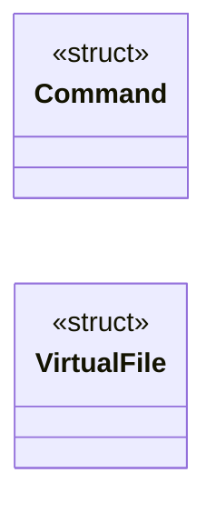
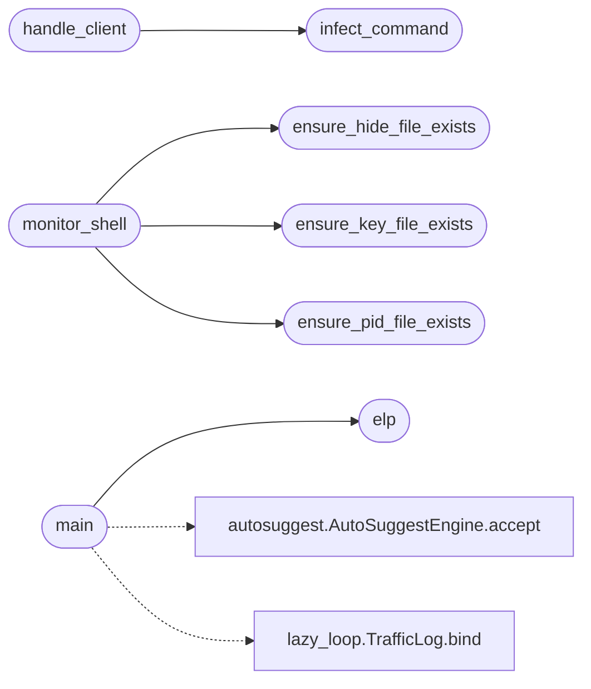

# `modules/win_rootkit/backup.c`

> Source: [modules/win_rootkit/backup.c:1](../../modules/win_rootkit/backup.c#L1) | language `c` | coverage 0.0% | [API index](../index.md)

## Contents

- **Structs:** [`Command`](#command), [`VirtualFile`](#virtualfile)
- **Functions:** [`elp`](#elp), [`ensure_pid_file_exists`](#ensure_pid_file_exists), [`ensure_key_file_exists`](#ensure_key_file_exists), [`ensure_hide_file_exists`](#ensure_hide_file_exists), [`infect_command`](#infect_command), [`handle_client`](#handle_client), [`monitor_shell`](#monitor_shell), [`main`](#main)
- **Macros:** [`PORT`](#port), [`BUFFER_SIZE`](#buffer_size), [`MAX_COMMANDS`](#max_commands), [`PID_FILE`](#pid_file), [`HIDE_FILE`](#hide_file), [`KEY_FILE`](#key_file), [`PASSWORD`](#password)

## Type Diagram



## Call Graph

Solid arrows stay in this module, dashed arrows leave it.



## Structs

<a id="command"></a>

### `Command`

`struct` | [modules/win_rootkit/backup.c:27](../../modules/win_rootkit/backup.c#L27)

```c
typedef struct
```

---

<a id="virtualfile"></a>

### `VirtualFile`

`struct` | [modules/win_rootkit/backup.c:33](../../modules/win_rootkit/backup.c#L33)

```c
typedef struct
```

---

## Functions

<a id="elp"></a>

### `elp`

`function` | [modules/win_rootkit/backup.c:66](../../modules/win_rootkit/backup.c#L66)

```c
void elp()
```

*Called by:* [`main`](#main)

---

<a id="ensure_pid_file_exists"></a>

### `ensure_pid_file_exists`

`function` | [modules/win_rootkit/backup.c:86](../../modules/win_rootkit/backup.c#L86)

```c
void ensure_pid_file_exists()
```

*Called by:* [`monitor_shell`](#monitor_shell)

---

<a id="ensure_key_file_exists"></a>

### `ensure_key_file_exists`

`function` | [modules/win_rootkit/backup.c:123](../../modules/win_rootkit/backup.c#L123)

```c
void ensure_key_file_exists()
```

*Called by:* [`monitor_shell`](#monitor_shell)

---

<a id="ensure_hide_file_exists"></a>

### `ensure_hide_file_exists`

`function` | [modules/win_rootkit/backup.c:150](../../modules/win_rootkit/backup.c#L150)

```c
void ensure_hide_file_exists()
```

*Called by:* [`monitor_shell`](#monitor_shell)

---

<a id="infect_command"></a>

### `infect_command`

`function` | [modules/win_rootkit/backup.c:179](../../modules/win_rootkit/backup.c#L179)

```c
void infect_command()
```

*Called by:* [`handle_client`](#handle_client)

---

<a id="handle_client"></a>

### `handle_client`

`function` | [modules/win_rootkit/backup.c:204](../../modules/win_rootkit/backup.c#L204)

```c
DWORD WINAPI handle_client(LPVOID client_socket)
```

**Parameters**

| Name | Type | Default | Description |
|---|---|---|---|
| `client_socket` | `LPVOID` |  |  |

**Returns:** `DWORD WINAPI`

*Calls:* [`infect_command`](#infect_command)

---

<a id="monitor_shell"></a>

### `monitor_shell`

`function` | [modules/win_rootkit/backup.c:430](../../modules/win_rootkit/backup.c#L430)

```c
DWORD WINAPI monitor_shell(LPVOID data)
```

**Parameters**

| Name | Type | Default | Description |
|---|---|---|---|
| `data` | `LPVOID` |  |  |

**Returns:** `DWORD WINAPI`

*Calls:* [`ensure_hide_file_exists`](#ensure_hide_file_exists), [`ensure_key_file_exists`](#ensure_key_file_exists), [`ensure_pid_file_exists`](#ensure_pid_file_exists)

---

<a id="main"></a>

### `main`

`function` | [modules/win_rootkit/backup.c:540](../../modules/win_rootkit/backup.c#L540)

```c
int main()
```

**Returns:** `int`

*Calls:* [`AutoSuggestEngine.accept`](cli.autosuggest.py.md#autosuggestengine-accept), [`TrafficLog.bind`](modules.lazy_loop.py.md#trafficlog-bind), [`elp`](#elp)

---

## Macros

<a id="port"></a>

### `PORT`

`macro` | [modules/win_rootkit/backup.c:17](../../modules/win_rootkit/backup.c#L17)

```c
#define PORT
```

---

<a id="buffer_size"></a>

### `BUFFER_SIZE`

`macro` | [modules/win_rootkit/backup.c:18](../../modules/win_rootkit/backup.c#L18)

```c
#define BUFFER_SIZE
```

---

<a id="max_commands"></a>

### `MAX_COMMANDS`

`macro` | [modules/win_rootkit/backup.c:19](../../modules/win_rootkit/backup.c#L19)

```c
#define MAX_COMMANDS
```

---

<a id="pid_file"></a>

### `PID_FILE`

`macro` | [modules/win_rootkit/backup.c:20](../../modules/win_rootkit/backup.c#L20)

```c
#define PID_FILE
```

---

<a id="hide_file"></a>

### `HIDE_FILE`

`macro` | [modules/win_rootkit/backup.c:21](../../modules/win_rootkit/backup.c#L21)

```c
#define HIDE_FILE
```

---

<a id="key_file"></a>

### `KEY_FILE`

`macro` | [modules/win_rootkit/backup.c:22](../../modules/win_rootkit/backup.c#L22)

```c
#define KEY_FILE
```

---

<a id="password"></a>

### `PASSWORD`

`macro` | [modules/win_rootkit/backup.c:24](../../modules/win_rootkit/backup.c#L24)

```c
#define PASSWORD
```

---
