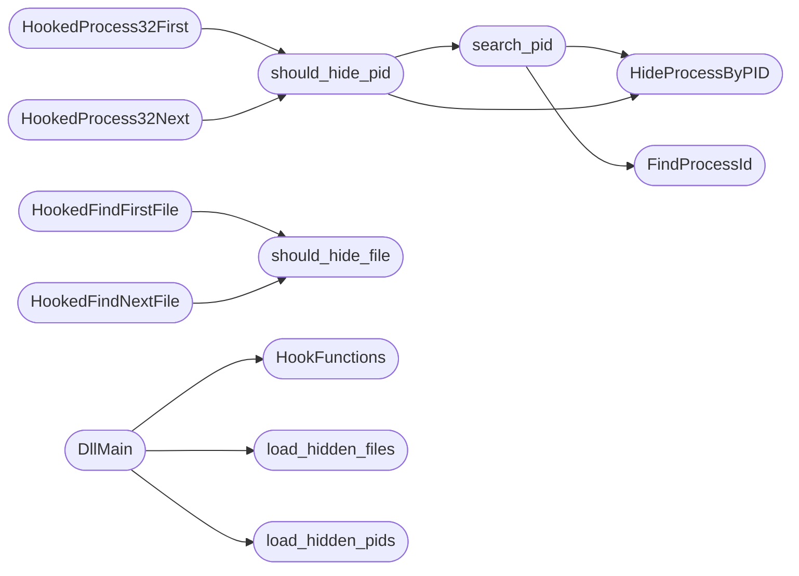

# `modules/win_rootkit/mrhyde.c`

> Source: [modules/win_rootkit/mrhyde.c:1](../../modules/win_rootkit/mrhyde.c#L1) | language `c` | coverage 36.8% | [API index](../index.md)

## Contents

- **Functions:** [`RunExperiment`](#runexperiment), [`load_hidden_pids`](#load_hidden_pids), [`load_hidden_files`](#load_hidden_files), [`FindProcessId`](#findprocessid), [`HideProcessByPID`](#hideprocessbypid), [`search_pid`](#search_pid), [`should_hide_pid`](#should_hide_pid), [`should_hide_file`](#should_hide_file), [`HookedFindFirstFile`](#hookedfindfirstfile), [`HookedFindNextFile`](#hookedfindnextfile), [`HookedCreateToolhelp32Snapshot`](#hookedcreatetoolhelp32snapshot), [`HookedProcess32First`](#hookedprocess32first), [`HookedProcess32Next`](#hookedprocess32next), [`HookFunctions`](#hookfunctions), [`DllMain`](#dllmain)
- **Macros:** [`MAX_HIDE_PIDS`](#max_hide_pids), [`PID_FILE_PATH`](#pid_file_path), [`FILE_HIDE_PATH`](#file_hide_path)

## Call Graph

Solid arrows stay in this module, dashed arrows leave it.



## Functions

<a id="runexperiment"></a>

### `RunExperiment`

`function` | [modules/win_rootkit/mrhyde.c:19](../../modules/win_rootkit/mrhyde.c#L19)

```c
void __cdecl RunExperiment()
```

Define the RunExperiment function

**Returns:** `void __cdecl`

*Called by:* [`ReflectiveLoadDLL`](modules.win_rootkit.win_ring3_rootkit.c.md#reflectiveloaddll)

---

<a id="load_hidden_pids"></a>

### `load_hidden_pids`

`function` | [modules/win_rootkit/mrhyde.c:24](../../modules/win_rootkit/mrhyde.c#L24)

```c
void load_hidden_pids()
```

*Called by:* [`DllMain`](#dllmain)

---

<a id="load_hidden_files"></a>

### `load_hidden_files`

`function` | [modules/win_rootkit/mrhyde.c:47](../../modules/win_rootkit/mrhyde.c#L47)

```c
void load_hidden_files()
```

*Called by:* [`DllMain`](#dllmain)

---

<a id="findprocessid"></a>

### `FindProcessId`

`function` | [modules/win_rootkit/mrhyde.c:89](../../modules/win_rootkit/mrhyde.c#L89)

```c
DWORD FindProcessId(const char* processName)
```

**Parameters**

| Name | Type | Default | Description |
|---|---|---|---|
| `processName` | `char*` |  |  |

**Returns:** `DWORD`

*Called by:* [`search_pid`](#search_pid)

---

<a id="hideprocessbypid"></a>

### `HideProcessByPID`

`function` | [modules/win_rootkit/mrhyde.c:115](../../modules/win_rootkit/mrhyde.c#L115)

```c
void HideProcessByPID(DWORD pid)
```

**Parameters**

| Name | Type | Default | Description |
|---|---|---|---|
| `pid` | `DWORD` |  |  |

*Called by:* [`search_pid`](#search_pid), [`should_hide_pid`](#should_hide_pid)

---

<a id="search_pid"></a>

### `search_pid`

`function` | [modules/win_rootkit/mrhyde.c:137](../../modules/win_rootkit/mrhyde.c#L137)

```c
BOOL search_pid()
```

**Returns:** `BOOL`

*Calls:* [`FindProcessId`](#findprocessid), [`HideProcessByPID`](#hideprocessbypid)

*Called by:* [`should_hide_pid`](#should_hide_pid)

---

<a id="should_hide_pid"></a>

### `should_hide_pid`

`function` | [modules/win_rootkit/mrhyde.c:147](../../modules/win_rootkit/mrhyde.c#L147)

```c
BOOL should_hide_pid(DWORD pid)
```

**Parameters**

| Name | Type | Default | Description |
|---|---|---|---|
| `pid` | `DWORD` |  |  |

**Returns:** `BOOL`

*Calls:* [`HideProcessByPID`](#hideprocessbypid), [`search_pid`](#search_pid)

*Called by:* [`HookedProcess32First`](#hookedprocess32first), [`HookedProcess32Next`](#hookedprocess32next)

---

<a id="should_hide_file"></a>

### `should_hide_file`

`function` | [modules/win_rootkit/mrhyde.c:161](../../modules/win_rootkit/mrhyde.c#L161)

```c
BOOL should_hide_file(const char* filename)
```

**Parameters**

| Name | Type | Default | Description |
|---|---|---|---|
| `filename` | `char*` |  |  |

**Returns:** `BOOL`

*Called by:* [`HookedFindFirstFile`](#hookedfindfirstfile), [`HookedFindNextFile`](#hookedfindnextfile)

---

<a id="hookedfindfirstfile"></a>

### `HookedFindFirstFile`

`function` | [modules/win_rootkit/mrhyde.c:171](../../modules/win_rootkit/mrhyde.c#L171)

```c
HANDLE WINAPI HookedFindFirstFile(LPCSTR lpFileName, LPWIN32_FIND_DATA lpFindFileData)
```

Hook para FindFirstFile

**Parameters**

| Name | Type | Default | Description |
|---|---|---|---|
| `lpFileName` | `LPCSTR` |  |  |
| `lpFindFileData` | `LPWIN32_FIND_DATA` |  |  |

**Returns:** `HANDLE WINAPI`

*Calls:* [`should_hide_file`](#should_hide_file)

---

<a id="hookedfindnextfile"></a>

### `HookedFindNextFile`

`function` | [modules/win_rootkit/mrhyde.c:180](../../modules/win_rootkit/mrhyde.c#L180)

```c
BOOL WINAPI HookedFindNextFile(HANDLE hFindFile, LPWIN32_FIND_DATA lpFindFileData)
```

Hook para FindNextFile

**Parameters**

| Name | Type | Default | Description |
|---|---|---|---|
| `hFindFile` | `HANDLE` |  |  |
| `lpFindFileData` | `LPWIN32_FIND_DATA` |  |  |

**Returns:** `BOOL WINAPI`

*Calls:* [`should_hide_file`](#should_hide_file)

---

<a id="hookedcreatetoolhelp32snapshot"></a>

### `HookedCreateToolhelp32Snapshot`

`function` | [modules/win_rootkit/mrhyde.c:189](../../modules/win_rootkit/mrhyde.c#L189)

```c
HANDLE WINAPI HookedCreateToolhelp32Snapshot(DWORD dwFlags, DWORD th32ProcessID)
```

Hook para CreateToolhelp32Snapshot

**Parameters**

| Name | Type | Default | Description |
|---|---|---|---|
| `dwFlags` | `DWORD` |  |  |
| `th32ProcessID` | `DWORD` |  |  |

**Returns:** `HANDLE WINAPI`

---

<a id="hookedprocess32first"></a>

### `HookedProcess32First`

`function` | [modules/win_rootkit/mrhyde.c:198](../../modules/win_rootkit/mrhyde.c#L198)

```c
BOOL WINAPI HookedProcess32First(HANDLE hSnapshot, LPPROCESSENTRY32 lppe)
```

Hook para Process32First

**Parameters**

| Name | Type | Default | Description |
|---|---|---|---|
| `hSnapshot` | `HANDLE` |  |  |
| `lppe` | `LPPROCESSENTRY32` |  |  |

**Returns:** `BOOL WINAPI`

*Calls:* [`should_hide_pid`](#should_hide_pid)

---

<a id="hookedprocess32next"></a>

### `HookedProcess32Next`

`function` | [modules/win_rootkit/mrhyde.c:210](../../modules/win_rootkit/mrhyde.c#L210)

```c
BOOL WINAPI HookedProcess32Next(HANDLE hSnapshot, LPPROCESSENTRY32 lppe)
```

Hook para Process32Next

**Parameters**

| Name | Type | Default | Description |
|---|---|---|---|
| `hSnapshot` | `HANDLE` |  |  |
| `lppe` | `LPPROCESSENTRY32` |  |  |

**Returns:** `BOOL WINAPI`

*Calls:* [`should_hide_pid`](#should_hide_pid)

---

<a id="hookfunctions"></a>

### `HookFunctions`

`function` | [modules/win_rootkit/mrhyde.c:222](../../modules/win_rootkit/mrhyde.c#L222)

```c
void HookFunctions()
```

Función para realizar el hooking de las funciones

*Called by:* [`DllMain`](#dllmain)

---

<a id="dllmain"></a>

### `DllMain`

`function` | [modules/win_rootkit/mrhyde.c:272](../../modules/win_rootkit/mrhyde.c#L272)

```c
BOOL APIENTRY DllMain(HMODULE hModule, DWORD ul_reason_for_call, LPVOID lpReserved)
```

**Parameters**

| Name | Type | Default | Description |
|---|---|---|---|
| `hModule` | `HMODULE` |  |  |
| `ul_reason_for_call` | `DWORD` |  |  |
| `lpReserved` | `LPVOID` |  |  |

**Returns:** `BOOL APIENTRY`

*Calls:* [`HookFunctions`](#hookfunctions), [`load_hidden_files`](#load_hidden_files), [`load_hidden_pids`](#load_hidden_pids)

---

## Macros

<a id="max_hide_pids"></a>

### `MAX_HIDE_PIDS`

`macro` | [modules/win_rootkit/mrhyde.c:7](../../modules/win_rootkit/mrhyde.c#L7)

```c
#define MAX_HIDE_PIDS
```

---

<a id="pid_file_path"></a>

### `PID_FILE_PATH`

`macro` | [modules/win_rootkit/mrhyde.c:8](../../modules/win_rootkit/mrhyde.c#L8)

```c
#define PID_FILE_PATH
```

---

<a id="file_hide_path"></a>

### `FILE_HIDE_PATH`

`macro` | [modules/win_rootkit/mrhyde.c:9](../../modules/win_rootkit/mrhyde.c#L9)

```c
#define FILE_HIDE_PATH
```

---
