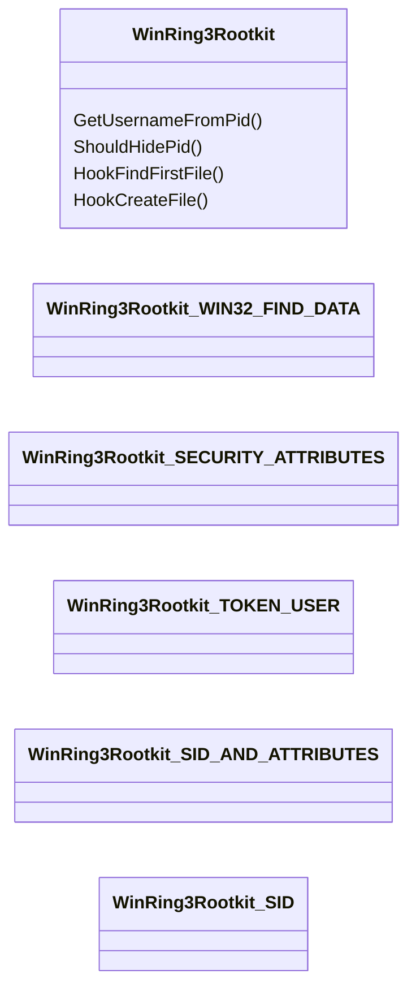
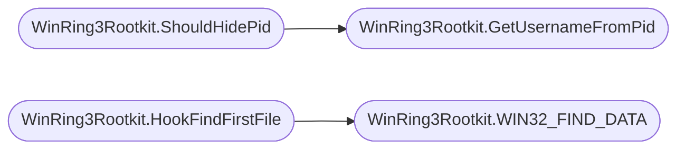

# `modules/win_rootkit/win_rin3_rootkit.cs`

> Source: [modules/win_rootkit/win_rin3_rootkit.cs:1](../../modules/win_rootkit/win_rin3_rootkit.cs#L1) | language `cs` | coverage 0.0% | [API index](../index.md)

## Contents

- **Classes:** [`WinRing3Rootkit`](#winring3rootkit)

## Type Diagram



## Call Graph

Solid arrows stay in this module, dashed arrows leave it.



## Classes

<a id="winring3rootkit"></a>

### `WinRing3Rootkit`

`class` | [modules/win_rootkit/win_rin3_rootkit.cs:32](../../modules/win_rootkit/win_rin3_rootkit.cs#L32)

```csharp
class WinRing3Rootkit
```

**Members**

| Member | Kind | Summary |
|---|---|---|
| [`WIN32_FIND_DATA`](#winring3rootkit-win32_find_data) | class |  |
| [`SECURITY_ATTRIBUTES`](#winring3rootkit-security_attributes) | class |  |
| [`TOKEN_USER`](#winring3rootkit-token_user) | class |  |
| [`SID_AND_ATTRIBUTES`](#winring3rootkit-sid_and_attributes) | class |  |
| [`SID`](#winring3rootkit-sid) | class |  |
| [`GetUsernameFromPid`](#winring3rootkit-getusernamefrompid) | method |  |
| [`ShouldHidePid`](#winring3rootkit-shouldhidepid) | method |  |
| [`HookFindFirstFile`](#winring3rootkit-hookfindfirstfile) | method |  |
| [`HookCreateFile`](#winring3rootkit-hookcreatefile) | method |  |

<a id="winring3rootkit-win32_find_data"></a>

#### `WinRing3Rootkit.WIN32_FIND_DATA`

`class` | [modules/win_rootkit/win_rin3_rootkit.cs:47](../../modules/win_rootkit/win_rin3_rootkit.cs#L47)

```csharp
public struct WIN32_FIND_DATA
```

<a id="winring3rootkit-security_attributes"></a>

#### `WinRing3Rootkit.SECURITY_ATTRIBUTES`

`class` | [modules/win_rootkit/win_rin3_rootkit.cs:64](../../modules/win_rootkit/win_rin3_rootkit.cs#L64)

```csharp
public struct SECURITY_ATTRIBUTES
```

<a id="winring3rootkit-token_user"></a>

#### `WinRing3Rootkit.TOKEN_USER`

`class` | [modules/win_rootkit/win_rin3_rootkit.cs:123](../../modules/win_rootkit/win_rin3_rootkit.cs#L123)

```csharp
public struct TOKEN_USER
```

<a id="winring3rootkit-sid_and_attributes"></a>

#### `WinRing3Rootkit.SID_AND_ATTRIBUTES`

`class` | [modules/win_rootkit/win_rin3_rootkit.cs:129](../../modules/win_rootkit/win_rin3_rootkit.cs#L129)

```csharp
public struct SID_AND_ATTRIBUTES
```

<a id="winring3rootkit-sid"></a>

#### `WinRing3Rootkit.SID`

`class` | [modules/win_rootkit/win_rin3_rootkit.cs:136](../../modules/win_rootkit/win_rin3_rootkit.cs#L136)

```csharp
public struct SID
```

<a id="winring3rootkit-getusernamefrompid"></a>

#### `WinRing3Rootkit.GetUsernameFromPid`

`method` `static` | [modules/win_rootkit/win_rin3_rootkit.cs:145](../../modules/win_rootkit/win_rin3_rootkit.cs#L145)

```csharp
public static string GetUsernameFromPid(int pid)
```

**Parameters**

| Name | Type | Default | Description |
|---|---|---|---|
| `pid` | `int` |  |  |

**Returns:** `string`

*Called by:* [`WinRing3Rootkit.ShouldHidePid`](#winring3rootkit-shouldhidepid)

<a id="winring3rootkit-shouldhidepid"></a>

#### `WinRing3Rootkit.ShouldHidePid`

`method` `static` | [modules/win_rootkit/win_rin3_rootkit.cs:203](../../modules/win_rootkit/win_rin3_rootkit.cs#L203)

```csharp
public static bool ShouldHidePid(string pid)
```

**Parameters**

| Name | Type | Default | Description |
|---|---|---|---|
| `pid` | `string` |  |  |

**Returns:** `bool`

*Calls:* [`WinRing3Rootkit.GetUsernameFromPid`](#winring3rootkit-getusernamefrompid)

<a id="winring3rootkit-hookfindfirstfile"></a>

#### `WinRing3Rootkit.HookFindFirstFile`

`method` `static` | [modules/win_rootkit/win_rin3_rootkit.cs:214](../../modules/win_rootkit/win_rin3_rootkit.cs#L214)

```csharp
public static SafeFileHandle HookFindFirstFile(string path, out WIN32_FIND_DATA findData)
```

**Parameters**

| Name | Type | Default | Description |
|---|---|---|---|
| `path` | `string` |  |  |
| `findData` | `WIN32_FIND_DATA` |  |  |

**Returns:** `SafeFileHandle`

*Calls:* [`WinRing3Rootkit.WIN32_FIND_DATA`](#winring3rootkit-win32_find_data)

<a id="winring3rootkit-hookcreatefile"></a>

#### `WinRing3Rootkit.HookCreateFile`

`method` `static` | [modules/win_rootkit/win_rin3_rootkit.cs:226](../../modules/win_rootkit/win_rin3_rootkit.cs#L226)

```csharp
public static SafeFileHandle HookCreateFile(string path, uint access, uint share, SECURITY_ATTRIBUTES security, uint creation, uint flags, IntPtr template)
```

**Parameters**

| Name | Type | Default | Description |
|---|---|---|---|
| `path` | `string` |  |  |
| `access` | `uint` |  |  |
| `share` | `uint` |  |  |
| `security` | `SECURITY_ATTRIBUTES` |  |  |
| `creation` | `uint` |  |  |
| `flags` | `uint` |  |  |
| `template` | `IntPtr` |  |  |

**Returns:** `SafeFileHandle`

---
