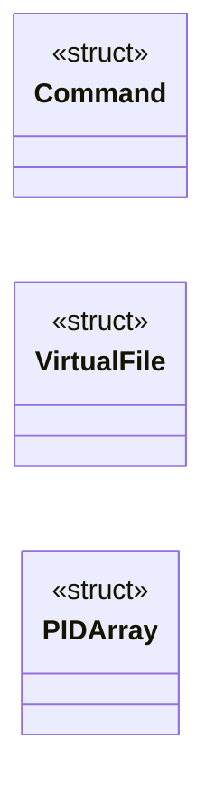
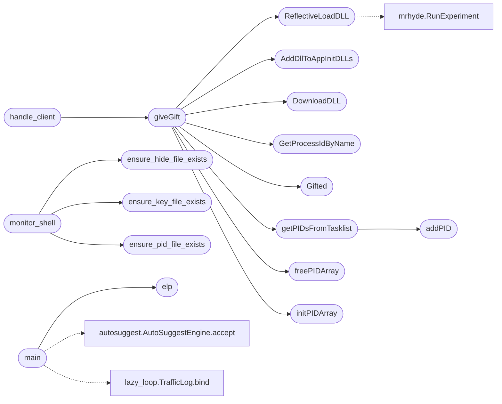

# `modules/win_rootkit/win_ring3_rootkit.c`

> Source: [modules/win_rootkit/win_ring3_rootkit.c:1](../../modules/win_rootkit/win_ring3_rootkit.c#L1) | language `c` | coverage 10.7% | [API index](../index.md)

## Contents

- **Structs:** [`Command`](#command), [`VirtualFile`](#virtualfile), [`PIDArray`](#pidarray)
- **Functions:** [`DownloadDLL`](#downloaddll), [`ReflectiveLoadDLL`](#reflectiveloaddll), [`initPIDArray`](#initpidarray), [`addPID`](#addpid), [`freePIDArray`](#freepidarray), [`getPIDsFromTasklist`](#getpidsfromtasklist), [`AddDllToAppInitDLLs`](#adddlltoappinitdlls), [`GetProcessIdByName`](#getprocessidbyname), [`Gifted`](#gifted), [`elp`](#elp), [`ensure_pid_file_exists`](#ensure_pid_file_exists), [`ensure_key_file_exists`](#ensure_key_file_exists), [`ensure_hide_file_exists`](#ensure_hide_file_exists), [`giveGift`](#givegift), [`handle_client`](#handle_client), [`monitor_shell`](#monitor_shell), [`main`](#main)
- **Macros:** [`PORT`](#port), [`BUFFER_SIZE`](#buffer_size), [`MAX_COMMANDS`](#max_commands), [`PID_FILE`](#pid_file), [`HIDE_FILE`](#hide_file), [`KEY_FILE`](#key_file), [`PASSWORD`](#password)

## Type Diagram



## Call Graph

Solid arrows stay in this module, dashed arrows leave it.



## Structs

<a id="command"></a>

### `Command`

`struct` | [modules/win_rootkit/win_ring3_rootkit.c:28](../../modules/win_rootkit/win_ring3_rootkit.c#L28)

```c
typedef struct
```

---

<a id="virtualfile"></a>

### `VirtualFile`

`struct` | [modules/win_rootkit/win_ring3_rootkit.c:34](../../modules/win_rootkit/win_ring3_rootkit.c#L34)

```c
typedef struct
```

---

<a id="pidarray"></a>

### `PIDArray`

`struct` | [modules/win_rootkit/win_ring3_rootkit.c:40](../../modules/win_rootkit/win_ring3_rootkit.c#L40)

```c
typedef struct
```

---

## Functions

<a id="downloaddll"></a>

### `DownloadDLL`

`function` | [modules/win_rootkit/win_ring3_rootkit.c:79](../../modules/win_rootkit/win_ring3_rootkit.c#L79)

```c
BOOL DownloadDLL(const char* url, PBYTE* buffer, DWORD* size)
```

**Parameters**

| Name | Type | Default | Description |
|---|---|---|---|
| `url` | `char*` |  |  |
| `buffer` | `PBYTE*` |  |  |
| `size` | `DWORD*` |  |  |

**Returns:** `BOOL`

*Called by:* [`giveGift`](#givegift)

---

<a id="reflectiveloaddll"></a>

### `ReflectiveLoadDLL`

`function` | [modules/win_rootkit/win_ring3_rootkit.c:99](../../modules/win_rootkit/win_ring3_rootkit.c#L99)

```c
BOOL ReflectiveLoadDLL(PBYTE dllBuffer, DWORD dllSize)
```

**Parameters**

| Name | Type | Default | Description |
|---|---|---|---|
| `dllBuffer` | `PBYTE` |  |  |
| `dllSize` | `DWORD` |  |  |

**Returns:** `BOOL`

*Calls:* [`RunExperiment`](modules.win_rootkit.mrhyde.c.md#runexperiment)

*Called by:* [`giveGift`](#givegift)

---

<a id="initpidarray"></a>

### `initPIDArray`

`function` | [modules/win_rootkit/win_ring3_rootkit.c:146](../../modules/win_rootkit/win_ring3_rootkit.c#L146)

```c
void initPIDArray(PIDArray *array)
```

Función para inicializar el arreglo de PIDs

**Parameters**

| Name | Type | Default | Description |
|---|---|---|---|
| `array` | `PIDArray *` |  |  |

*Called by:* [`giveGift`](#givegift)

---

<a id="addpid"></a>

### `addPID`

`function` | [modules/win_rootkit/win_ring3_rootkit.c:153](../../modules/win_rootkit/win_ring3_rootkit.c#L153)

```c
void addPID(PIDArray *array, DWORD pid)
```

Función para agregar un PID al arreglo

**Parameters**

| Name | Type | Default | Description |
|---|---|---|---|
| `array` | `PIDArray *` |  |  |
| `pid` | `DWORD` |  |  |

*Called by:* [`getPIDsFromTasklist`](#getpidsfromtasklist)

---

<a id="freepidarray"></a>

### `freePIDArray`

`function` | [modules/win_rootkit/win_ring3_rootkit.c:162](../../modules/win_rootkit/win_ring3_rootkit.c#L162)

```c
void freePIDArray(PIDArray *array)
```

Función para liberar la memoria del arreglo de PIDs

**Parameters**

| Name | Type | Default | Description |
|---|---|---|---|
| `array` | `PIDArray *` |  |  |

*Called by:* [`giveGift`](#givegift)

---

<a id="getpidsfromtasklist"></a>

### `getPIDsFromTasklist`

`function` | [modules/win_rootkit/win_ring3_rootkit.c:166](../../modules/win_rootkit/win_ring3_rootkit.c#L166)

```c
void getPIDsFromTasklist(PIDArray *pidArray)
```

**Parameters**

| Name | Type | Default | Description |
|---|---|---|---|
| `pidArray` | `PIDArray *` |  |  |

*Calls:* [`addPID`](#addpid)

*Called by:* [`giveGift`](#givegift)

---

<a id="adddlltoappinitdlls"></a>

### `AddDllToAppInitDLLs`

`function` | [modules/win_rootkit/win_ring3_rootkit.c:191](../../modules/win_rootkit/win_ring3_rootkit.c#L191)

```c
BOOL AddDllToAppInitDLLs(const char* dllPath)
```

**Parameters**

| Name | Type | Default | Description |
|---|---|---|---|
| `dllPath` | `char*` |  |  |

**Returns:** `BOOL`

*Called by:* [`giveGift`](#givegift)

---

<a id="getprocessidbyname"></a>

### `GetProcessIdByName`

`function` | [modules/win_rootkit/win_ring3_rootkit.c:240](../../modules/win_rootkit/win_ring3_rootkit.c#L240)

```c
DWORD GetProcessIdByName(const char* processName)
```

**Parameters**

| Name | Type | Default | Description |
|---|---|---|---|
| `processName` | `char*` |  |  |

**Returns:** `DWORD`

*Called by:* [`giveGift`](#givegift)

---

<a id="gifted"></a>

### `Gifted`

`function` | [modules/win_rootkit/win_ring3_rootkit.c:270](../../modules/win_rootkit/win_ring3_rootkit.c#L270)

```c
BOOL Gifted(DWORD processId, const char* dllPath)
```

**Parameters**

| Name | Type | Default | Description |
|---|---|---|---|
| `processId` | `DWORD` |  |  |
| `dllPath` | `char*` |  |  |

**Returns:** `BOOL`

*Called by:* [`giveGift`](#givegift)

---

<a id="elp"></a>

### `elp`

`function` | [modules/win_rootkit/win_ring3_rootkit.c:362](../../modules/win_rootkit/win_ring3_rootkit.c#L362)

```c
void elp()
```

*Called by:* [`main`](#main)

---

<a id="ensure_pid_file_exists"></a>

### `ensure_pid_file_exists`

`function` | [modules/win_rootkit/win_ring3_rootkit.c:382](../../modules/win_rootkit/win_ring3_rootkit.c#L382)

```c
void ensure_pid_file_exists()
```

*Called by:* [`monitor_shell`](#monitor_shell)

---

<a id="ensure_key_file_exists"></a>

### `ensure_key_file_exists`

`function` | [modules/win_rootkit/win_ring3_rootkit.c:419](../../modules/win_rootkit/win_ring3_rootkit.c#L419)

```c
void ensure_key_file_exists()
```

*Called by:* [`monitor_shell`](#monitor_shell)

---

<a id="ensure_hide_file_exists"></a>

### `ensure_hide_file_exists`

`function` | [modules/win_rootkit/win_ring3_rootkit.c:446](../../modules/win_rootkit/win_ring3_rootkit.c#L446)

```c
void ensure_hide_file_exists()
```

*Called by:* [`monitor_shell`](#monitor_shell)

---

<a id="givegift"></a>

### `giveGift`

`function` | [modules/win_rootkit/win_ring3_rootkit.c:475](../../modules/win_rootkit/win_ring3_rootkit.c#L475)

```c
BOOL giveGift()
```

**Returns:** `BOOL`

*Calls:* [`AddDllToAppInitDLLs`](#adddlltoappinitdlls), [`DownloadDLL`](#downloaddll), [`GetProcessIdByName`](#getprocessidbyname), [`Gifted`](#gifted), [`ReflectiveLoadDLL`](#reflectiveloaddll), [`freePIDArray`](#freepidarray), [`getPIDsFromTasklist`](#getpidsfromtasklist), [`initPIDArray`](#initpidarray)

*Called by:* [`handle_client`](#handle_client)

---

<a id="handle_client"></a>

### `handle_client`

`function` | [modules/win_rootkit/win_ring3_rootkit.c:526](../../modules/win_rootkit/win_ring3_rootkit.c#L526)

```c
DWORD WINAPI handle_client(LPVOID client_socket)
```

**Parameters**

| Name | Type | Default | Description |
|---|---|---|---|
| `client_socket` | `LPVOID` |  |  |

**Returns:** `DWORD WINAPI`

*Calls:* [`giveGift`](#givegift)

---

<a id="monitor_shell"></a>

### `monitor_shell`

`function` | [modules/win_rootkit/win_ring3_rootkit.c:755](../../modules/win_rootkit/win_ring3_rootkit.c#L755)

```c
DWORD WINAPI monitor_shell(LPVOID data)
```

**Parameters**

| Name | Type | Default | Description |
|---|---|---|---|
| `data` | `LPVOID` |  |  |

**Returns:** `DWORD WINAPI`

*Calls:* [`ensure_hide_file_exists`](#ensure_hide_file_exists), [`ensure_key_file_exists`](#ensure_key_file_exists), [`ensure_pid_file_exists`](#ensure_pid_file_exists)

---

<a id="main"></a>

### `main`

`function` | [modules/win_rootkit/win_ring3_rootkit.c:865](../../modules/win_rootkit/win_ring3_rootkit.c#L865)

```c
int main()
```

**Returns:** `int`

*Calls:* [`AutoSuggestEngine.accept`](cli.autosuggest.py.md#autosuggestengine-accept), [`TrafficLog.bind`](modules.lazy_loop.py.md#trafficlog-bind), [`elp`](#elp)

---

## Macros

<a id="port"></a>

### `PORT`

`macro` | [modules/win_rootkit/win_ring3_rootkit.c:18](../../modules/win_rootkit/win_ring3_rootkit.c#L18)

```c
#define PORT
```

---

<a id="buffer_size"></a>

### `BUFFER_SIZE`

`macro` | [modules/win_rootkit/win_ring3_rootkit.c:19](../../modules/win_rootkit/win_ring3_rootkit.c#L19)

```c
#define BUFFER_SIZE
```

---

<a id="max_commands"></a>

### `MAX_COMMANDS`

`macro` | [modules/win_rootkit/win_ring3_rootkit.c:20](../../modules/win_rootkit/win_ring3_rootkit.c#L20)

```c
#define MAX_COMMANDS
```

---

<a id="pid_file"></a>

### `PID_FILE`

`macro` | [modules/win_rootkit/win_ring3_rootkit.c:21](../../modules/win_rootkit/win_ring3_rootkit.c#L21)

```c
#define PID_FILE
```

---

<a id="hide_file"></a>

### `HIDE_FILE`

`macro` | [modules/win_rootkit/win_ring3_rootkit.c:22](../../modules/win_rootkit/win_ring3_rootkit.c#L22)

```c
#define HIDE_FILE
```

---

<a id="key_file"></a>

### `KEY_FILE`

`macro` | [modules/win_rootkit/win_ring3_rootkit.c:23](../../modules/win_rootkit/win_ring3_rootkit.c#L23)

```c
#define KEY_FILE
```

---

<a id="password"></a>

### `PASSWORD`

`macro` | [modules/win_rootkit/win_ring3_rootkit.c:25](../../modules/win_rootkit/win_ring3_rootkit.c#L25)

```c
#define PASSWORD
```

---
