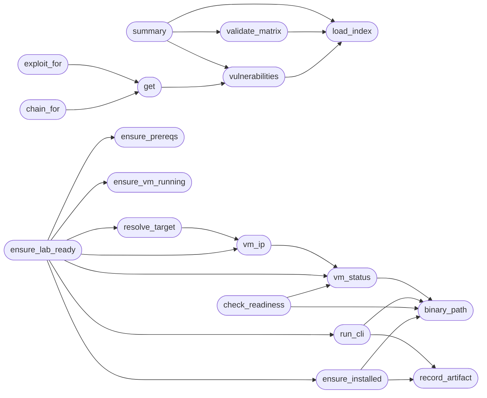

# `modules.winbox_gym`

> Source: [modules/winbox_gym.py:1](../../modules/winbox_gym.py#L1) | language `py` | coverage 100.0% | [API index](../index.md)

WinBox gym catalogue and control-plane bridge.

WinBox (https://github.com/totekuh/winbox) turns a headless Windows VM
(Server Core 2022/2025, Windows 11 or Windows 10) into an isolated
vulnerability-research lab controlled from the operator host. This module
mirrors [`modules.metasploitable_gym`](modules.metasploitable_gym.py.md) for the gym catalogue (index
playbook, exploit specs, chains) and adds a safe subprocess adapter for
the ``winbox`` CLI so the shell command, the gym matrix runner, the
autonomous loop and the MCP surface share one control plane.

The lab is dual-use and confined by design: the adapter only drives the
operator's own WinBox lab VM (libvirt domain managed by the winbox CLI)
and refuses to run when the binary is missing, falling back to
guidance-only readiness reporting like [`modules.exploitgym_gym`](modules.exploitgym_gym.py.md).

## Contents

- **Functions:** [`load_index`](#load_index), [`vulnerabilities`](#vulnerabilities), [`get`](#get), [`chain_for`](#chain_for), [`exploit_for`](#exploit_for), [`validate_matrix`](#validate_matrix), [`summary`](#summary), [`binary_path`](#binary_path), [`ensure_installed`](#ensure_installed), [`check_readiness`](#check_readiness), [`ensure_prereqs`](#ensure_prereqs), [`ensure_lab_ready`](#ensure_lab_ready), [`run_cli`](#run_cli), [`vm_status`](#vm_status), [`vm_ip`](#vm_ip), [`resolve_target`](#resolve_target), [`ensure_vm_running`](#ensure_vm_running), [`record_artifact`](#record_artifact), [`attack_readiness`](#attack_readiness)
- **Constants:** [`INDEX_PATH`](#index_path), [`EXPLOITS_DIR`](#exploits_dir), [`CHAINS_DIR`](#chains_dir), [`REPO_URL`](#repo_url), [`DEFAULT_GUEST_OS`](#default_guest_os), [`GUEST_OS_OPTIONS`](#guest_os_options), [`BUILD_TIMEOUT_SEC`](#build_timeout_sec), [`APT_PACKAGES_FOR`](#apt_packages_for), [`ALLOWED_ACTIONS`](#allowed_actions)

## Call Graph

Solid arrows stay in this module, dashed arrows leave it.



## Functions

<a id="load_index"></a>

### `load_index`

`function` | [modules/winbox_gym.py:144](../../modules/winbox_gym.py#L144)

```python
def load_index(path: Path | str = INDEX_PATH) -> dict
```

Load the gym index, returning an empty mapping on failure.

**Parameters**

| Name | Type | Default | Description |
|---|---|---|---|
| `path` | `Path \| str` | `INDEX_PATH` |  |

**Returns:** `dict`

*Called by:* [`summary`](#summary), [`validate_matrix`](#validate_matrix), [`vulnerabilities`](#vulnerabilities)

---

<a id="vulnerabilities"></a>

### `vulnerabilities`

`function` | [modules/winbox_gym.py:149](../../modules/winbox_gym.py#L149)

```python
def vulnerabilities(path: Path | str = INDEX_PATH) -> list[dict]
```

Return every indexed lab vector.

**Parameters**

| Name | Type | Default | Description |
|---|---|---|---|
| `path` | `Path \| str` | `INDEX_PATH` |  |

**Returns:** `list[dict]`

*Calls:* [`load_index`](#load_index)

*Called by:* [`get`](#get), [`summary`](#summary)

---

<a id="get"></a>

### `get`

`function` | [modules/winbox_gym.py:155](../../modules/winbox_gym.py#L155)

```python
def get(vuln_id: str, path: Path | str = INDEX_PATH) -> dict | None
```

Return one lab vector by id, or None.

**Parameters**

| Name | Type | Default | Description |
|---|---|---|---|
| `vuln_id` | `str` |  |  |
| `path` | `Path \| str` | `INDEX_PATH` |  |

**Returns:** `dict | None`

*Calls:* [`vulnerabilities`](#vulnerabilities)

*Called by:* [`chain_for`](#chain_for), [`exploit_for`](#exploit_for)

---

<a id="chain_for"></a>

### `chain_for`

`function` | [modules/winbox_gym.py:164](../../modules/winbox_gym.py#L164)

```python
def chain_for(vuln_id: str, path: Path | str = INDEX_PATH)
```

Return the resolved chain for one lab vector, or None.

**Parameters**

| Name | Type | Default | Description |
|---|---|---|---|
| `vuln_id` | `str` |  |  |
| `path` | `Path \| str` | `INDEX_PATH` |  |

*Calls:* [`get`](#get)

---

<a id="exploit_for"></a>

### `exploit_for`

`function` | [modules/winbox_gym.py:174](../../modules/winbox_gym.py#L174)

```python
def exploit_for(vuln_id: str, path: Path | str = INDEX_PATH)
```

Return the exploit spec for one lab vector, or None.

**Parameters**

| Name | Type | Default | Description |
|---|---|---|---|
| `vuln_id` | `str` |  |  |
| `path` | `Path \| str` | `INDEX_PATH` |  |

*Calls:* [`load_all`](modules.atomic_exploit_bridge.py.md#load_all), [`get`](#get)

---

<a id="validate_matrix"></a>

### `validate_matrix`

`function` | [modules/winbox_gym.py:184](../../modules/winbox_gym.py#L184)

```python
def validate_matrix(path: Path | str = INDEX_PATH) -> list[str]
```

Validate the index, exploit files and chains as one matrix.

**Parameters**

| Name | Type | Default | Description |
|---|---|---|---|
| `path` | `Path \| str` | `INDEX_PATH` |  |

**Returns:** `list[str]`

*Calls:* [`load_index`](#load_index)

*Called by:* [`summary`](#summary)

---

<a id="summary"></a>

### `summary`

`function` | [modules/winbox_gym.py:233](../../modules/winbox_gym.py#L233)

```python
def summary(path: Path | str = INDEX_PATH) -> dict[str, Any]
```

Return counts by severity and service for operators.

**Parameters**

| Name | Type | Default | Description |
|---|---|---|---|
| `path` | `Path \| str` | `INDEX_PATH` |  |

**Returns:** `dict[str, Any]`

*Calls:* [`load_index`](#load_index), [`validate_matrix`](#validate_matrix), [`vulnerabilities`](#vulnerabilities)

---

<a id="binary_path"></a>

### `binary_path`

`function` | [modules/winbox_gym.py:257](../../modules/winbox_gym.py#L257)

```python
def binary_path() -> str | None
```

Resolve the winbox executable or None.

**Returns:** `str | None`

*Called by:* [`check_readiness`](#check_readiness), [`ensure_installed`](#ensure_installed), [`ensure_vm_running`](#ensure_vm_running), [`run_cli`](#run_cli), [`vm_status`](#vm_status)

---

<a id="ensure_installed"></a>

### `ensure_installed`

`function` | [modules/winbox_gym.py:262](../../modules/winbox_gym.py#L262)

```python
def ensure_installed(params: dict[str, Any] | None = None, timeout: int = 600) -> dict[str, Any]
```

Clone and pip-install the upstream WinBox repo when the binary is missing.

**Parameters**

| Name | Type | Default | Description |
|---|---|---|---|
| `params` | `dict[str, Any] \| None` | `None` | Live shell params (``winbox_install_path`` override). |
| `timeout` | `int` | `600` | Wall-clock timeout for the clone and the install. |

**Returns:** `dict[str, Any]` - Mapping with ``success``, ``path`` and ``message``.

*Calls:* [`safe_subprocess_run`](core.hardening.py.md#safe_subprocess_run), [`safe_git_clone`](core.safe_exec.py.md#safe_git_clone), [`binary_path`](#binary_path), [`record_artifact`](#record_artifact)

*Called by:* [`ensure_lab_ready`](#ensure_lab_ready)

---

<a id="check_readiness"></a>

### `check_readiness`

`function` | [modules/winbox_gym.py:334](../../modules/winbox_gym.py#L334)

```python
def check_readiness(params: dict[str, Any] | None = None) -> dict[str, Any]
```

Report WinBox lab readiness without installing anything.

**Parameters**

| Name | Type | Default | Description |
|---|---|---|---|
| `params` | `dict[str, Any] \| None` | `None` | Live shell params (payload.json plus params/*.yaml). |

**Returns:** `dict[str, Any]` - Mapping with `[`ready`](core.command_bridge.py.md#commandbridge-ready)`, ``binary``, ``prereqs``, ``vm_built``,
``guest_os``, `[`install_path`](lazyc2.addon_creator.py.md#addondraft-install_path)` and ``vm`` state when queryable.

*Calls:* [`binary_path`](#binary_path), [`vm_status`](#vm_status)

*Called by:* [`attack_readiness`](#attack_readiness)

---

<a id="ensure_prereqs"></a>

### `ensure_prereqs`

`function` | [modules/winbox_gym.py:375](../../modules/winbox_gym.py#L375)

```python
def ensure_prereqs(timeout: int = INSTALL_TIMEOUT_SEC) -> dict[str, Any]
```

Install missing lab host prerequisites through apt-get.

Non-interactive: ``sudo -n`` (fails instead of prompting) when not
running as root, so the caller can surface manual guidance.

**Parameters**

| Name | Type | Default | Description |
|---|---|---|---|
| `timeout` | `int` | `INSTALL_TIMEOUT_SEC` | Wall-clock timeout for apt-get. |

**Returns:** `dict[str, Any]` - Mapping with ``success``, ``installed`` (packages) and ``missing``
(binaries still absent).

*Calls:* [`safe_subprocess_run`](core.hardening.py.md#safe_subprocess_run)

*Called by:* [`ensure_lab_ready`](#ensure_lab_ready)

---

<a id="ensure_lab_ready"></a>

### `ensure_lab_ready`

`function` | [modules/winbox_gym.py:430](../../modules/winbox_gym.py#L430)

```python
def ensure_lab_ready(params: dict[str, Any] | None = None, *, build_timeout: int = BUILD_TIMEOUT_SEC, install_timeout: int = INSTALL_TIMEOUT_SEC, build_vm: bool = True) -> dict[str, Any]
```

Bring the WinBox lab to attackable state in one idempotent call.

Stages (each skipped when already satisfied): clone+pip-install the
upstream repo, apt-get the missing host prerequisites, download the
guest ISO, build and provision the VM, boot it and bind ``rhost``
to the VM IP. One-time work (ISO ~4.7 GB, setup ~20 min) happens
only while the VM is unbuilt.

**Parameters**

| Name | Type | Default | Description |
|---|---|---|---|
| `params` | `dict[str, Any] \| None` | `None` | Live shell params (``winbox_install_path``, ``winbox_os``). |
| `build_timeout` | `int` | `BUILD_TIMEOUT_SEC` | Wall-clock timeout for ``winbox setup -y``. |
| `install_timeout` | `int` | `INSTALL_TIMEOUT_SEC` | Wall-clock timeout for clone/pip/apt. |
| `build_vm` | `bool` | `True` | Whether to run the ISO download + VM build when the VM is not built yet. |

**Returns:** `dict[str, Any]` - Mapping with ``success``, ``stage``, ``ip``, ``message`` and a
per-stage `[`stages`](modules.orchestrator_config.py.md#stages)` detail mapping.

*Calls:* [`ensure_installed`](#ensure_installed), [`ensure_prereqs`](#ensure_prereqs), [`ensure_vm_running`](#ensure_vm_running), [`resolve_target`](#resolve_target), [`run_cli`](#run_cli), [`vm_ip`](#vm_ip), [`vm_status`](#vm_status)

*Called by:* [`run_matrix`](modules.gym_winbox_runner.py.md#run_matrix)

---

<a id="run_cli"></a>

### `run_cli`

`function` | [modules/winbox_gym.py:492](../../modules/winbox_gym.py#L492)

```python
def run_cli(args: list[str], timeout: int = CLI_TIMEOUT_SEC) -> dict[str, Any]
```

Run one allowlisted winbox CLI action without a shell.

**Parameters**

| Name | Type | Default | Description |
|---|---|---|---|
| `args` | `list[str]` |  | Argument list; ``args[0]`` must be an allowlisted action. |
| `timeout` | `int` | `CLI_TIMEOUT_SEC` | Wall-clock timeout in seconds (clamped to ``[MIN_TIMEOUT_SEC, MAX_TIMEOUT_SEC]``). |

**Returns:** `dict[str, Any]` - Mapping with `[`ok`](scripts.top_tier_check.py.md#ok)`, ``code``, ``output`` and ``stderr``.

**Raises**

- `ValueError`: On empty args, unknown action or oversized timeout.

*Calls:* [`safe_subprocess_run`](core.hardening.py.md#safe_subprocess_run), [`binary_path`](#binary_path), [`record_artifact`](#record_artifact)

*Called by:* [`ensure_lab_ready`](#ensure_lab_ready), [`ensure_vm_running`](#ensure_vm_running)

---

<a id="vm_status"></a>

### `vm_status`

`function` | [modules/winbox_gym.py:545](../../modules/winbox_gym.py#L545)

```python
def vm_status(timeout: int = STATUS_TIMEOUT_SEC) -> dict[str, Any]
```

Query the WinBox VM state and address.

**Parameters**

| Name | Type | Default | Description |
|---|---|---|---|
| `timeout` | `int` | `STATUS_TIMEOUT_SEC` |  |

**Returns:** `dict[str, Any]` - Mapping with ``state``, ``ip`` and ``raw``; empty when the CLI
is unavailable.

*Calls:* [`safe_subprocess_run`](core.hardening.py.md#safe_subprocess_run), [`binary_path`](#binary_path)

*Called by:* [`check_readiness`](#check_readiness), [`ensure_lab_ready`](#ensure_lab_ready), [`ensure_vm_running`](#ensure_vm_running), [`vm_ip`](#vm_ip)

---

<a id="vm_ip"></a>

### `vm_ip`

`function` | [modules/winbox_gym.py:579](../../modules/winbox_gym.py#L579)

```python
def vm_ip() -> str
```

Return the lab VM IPv4 address, or an empty string.

**Returns:** `str`

*Calls:* [`vm_status`](#vm_status)

*Called by:* [`ensure_lab_ready`](#ensure_lab_ready), [`ensure_vm_running`](#ensure_vm_running), [`resolve_target`](#resolve_target)

---

<a id="resolve_target"></a>

### `resolve_target`

`function` | [modules/winbox_gym.py:601](../../modules/winbox_gym.py#L601)

```python
def resolve_target() -> str
```

Return the lab VM IP and mirror it into ``payload.json`` rhost.

**Returns:** `str`

*Calls:* [`vm_ip`](#vm_ip), [`lazyown_set_config`](utils.py.md#lazyown_set_config)

*Called by:* [`ensure_lab_ready`](#ensure_lab_ready)

---

<a id="ensure_vm_running"></a>

### `ensure_vm_running`

`function` | [modules/winbox_gym.py:615](../../modules/winbox_gym.py#L615)

```python
def ensure_vm_running(timeout: int = UP_TIMEOUT_SEC) -> dict[str, Any]
```

Start the lab VM when it is not running.

**Parameters**

| Name | Type | Default | Description |
|---|---|---|---|
| `timeout` | `int` | `UP_TIMEOUT_SEC` | Wall-clock timeout for ``winbox up``. |

**Returns:** `dict[str, Any]` - Mapping with ``success``, ``ip`` and ``message``.

*Calls:* [`binary_path`](#binary_path), [`run_cli`](#run_cli), [`vm_ip`](#vm_ip), [`vm_status`](#vm_status)

*Called by:* [`ensure_lab_ready`](#ensure_lab_ready)

---

<a id="record_artifact"></a>

### `record_artifact`

`function` | [modules/winbox_gym.py:642](../../modules/winbox_gym.py#L642)

```python
def record_artifact(name: str, output: str) -> Path | None
```

Persist one CLI transcript under ``sessions/winbox``.

**Parameters**

| Name | Type | Default | Description |
|---|---|---|---|
| `name` | `str` |  | Stable artifact stem (sanitised). |
| `output` | `str` |  | Raw transcript text. |

**Returns:** `Path | None` - The written path, or None when nothing was written.

*Calls:* [`sanitize_filename`](core.hardening.py.md#sanitize_filename)

*Called by:* [`ensure_installed`](#ensure_installed), [`run_cli`](#run_cli)

---

<a id="attack_readiness"></a>

### `attack_readiness`

`function` | [modules/winbox_gym.py:665](../../modules/winbox_gym.py#L665)

```python
def attack_readiness(params: dict[str, Any] | None = None) -> dict[str, Any]
```

Report whether the autonomous loop can attack the lab right now.

**Parameters**

| Name | Type | Default | Description |
|---|---|---|---|
| `params` | `dict[str, Any] \| None` | `None` | Live shell params. |

**Returns:** `dict[str, Any]` - Mapping with ``attackable``, ``target`` (VM IP when known) and
``reasons`` listing what is missing.

*Calls:* [`check_readiness`](#check_readiness)

---

## Constants

<a id="index_path"></a>

### `INDEX_PATH`

`constant` | [modules/winbox_gym.py:32](../../modules/winbox_gym.py#L32)

```python
INDEX_PATH = BASE_DIR / 'playbooks' / 'gym_winbox.yaml'
```

---

<a id="exploits_dir"></a>

### `EXPLOITS_DIR`

`constant` | [modules/winbox_gym.py:33](../../modules/winbox_gym.py#L33)

```python
EXPLOITS_DIR = BASE_DIR / 'exploits'
```

---

<a id="chains_dir"></a>

### `CHAINS_DIR`

`constant` | [modules/winbox_gym.py:34](../../modules/winbox_gym.py#L34)

```python
CHAINS_DIR = BASE_DIR / 'chains'
```

---

<a id="repo_url"></a>

### `REPO_URL`

`constant` | [modules/winbox_gym.py:42](../../modules/winbox_gym.py#L42)

```python
REPO_URL = 'https://github.com/totekuh/winbox.git'
```

---

<a id="default_guest_os"></a>

### `DEFAULT_GUEST_OS`

`constant` | [modules/winbox_gym.py:43](../../modules/winbox_gym.py#L43)

```python
DEFAULT_GUEST_OS = 'server2022'
```

---

<a id="guest_os_options"></a>

### `GUEST_OS_OPTIONS`

`constant` | [modules/winbox_gym.py:44](../../modules/winbox_gym.py#L44)

```python
GUEST_OS_OPTIONS = ('server2022', 'server2025', 'win11', 'win10')
```

---

<a id="build_timeout_sec"></a>

### `BUILD_TIMEOUT_SEC`

`constant` | [modules/winbox_gym.py:54](../../modules/winbox_gym.py#L54)

```python
BUILD_TIMEOUT_SEC = 2700
```

---

<a id="apt_packages_for"></a>

### `APT_PACKAGES_FOR`

`constant` | [modules/winbox_gym.py:68](../../modules/winbox_gym.py#L68)

```python
APT_PACKAGES_FOR: dict[str, str]
```

---

<a id="allowed_actions"></a>

### `ALLOWED_ACTIONS`

`constant` | [modules/winbox_gym.py:120](../../modules/winbox_gym.py#L120)

```python
ALLOWED_ACTIONS = frozenset(_CLI_ACTIONS)
```

---
