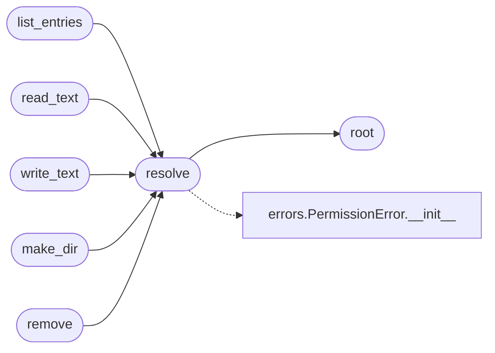

# `modules.workspace`

> Source: [modules/workspace.py:1](../../modules/workspace.py#L1) | language `py` | coverage 100.0% | [API index](../index.md)

Confined workspace file browser for operators and loop agents.

All paths resolve inside ``sessions/workspace``; traversal attempts
(``..``, absolute paths, symlink escapes) raise before any IO. The loop
can route ``lazy_workspace read <path>`` steps through the same
confined API, so agents inspect task artefacts without leaving the
sandbox.

## Contents

- **Functions:** [`root`](#root), [`resolve`](#resolve), [`list_entries`](#list_entries), [`read_text`](#read_text), [`write_text`](#write_text), [`make_dir`](#make_dir), [`remove`](#remove)
- **Constants:** [`WORKSPACE_ROOT`](#workspace_root), [`MAX_READ_BYTES`](#max_read_bytes), [`MAX_WRITE_CHARS`](#max_write_chars)

## Call Graph

Solid arrows stay in this module, dashed arrows leave it.



## Functions

<a id="root"></a>

### `root`

`function` | [modules/workspace.py:21](../../modules/workspace.py#L21)

```python
def root() -> Path
```

Return (and create) the workspace root directory.

**Returns:** `Path`

*Called by:* [`resolve`](#resolve)

---

<a id="resolve"></a>

### `resolve`

`function` | [modules/workspace.py:27](../../modules/workspace.py#L27)

```python
def resolve(rel: str) -> Path
```

Resolve a workspace-relative path, refusing escapes.

**Parameters**

| Name | Type | Default | Description |
|---|---|---|---|
| `rel` | `str` |  | Relative path inside the workspace. |

**Returns:** `Path` - Absolute confined path.

**Raises**

- [`PermissionError`](core.errors.py.md#permissionerror): Path escapes the workspace.

*Calls:* [`PermissionError.__init__`](core.errors.py.md#permissionerror-__init__), [`root`](#root)

*Called by:* [`list_entries`](#list_entries), [`make_dir`](#make_dir), [`read_text`](#read_text), [`remove`](#remove), [`write_text`](#write_text)

---

<a id="list_entries"></a>

### `list_entries`

`function` | [modules/workspace.py:46](../../modules/workspace.py#L46)

```python
def list_entries(rel: str = '') -> list[dict]
```

List one directory with names, kinds and sizes.

**Parameters**

| Name | Type | Default | Description |
|---|---|---|---|
| `rel` | `str` | `''` |  |

**Returns:** `list[dict]`

**Raises**

- `FileNotFoundError`: (raised in the body, not documented)

*Calls:* [`resolve`](#resolve)

---

<a id="read_text"></a>

### `read_text`

`function` | [modules/workspace.py:63](../../modules/workspace.py#L63)

```python
def read_text(rel: str, limit: int = MAX_READ_BYTES) -> str
```

Read one file, truncated to the byte limit.

**Parameters**

| Name | Type | Default | Description |
|---|---|---|---|
| `rel` | `str` |  |  |
| `limit` | `int` | `MAX_READ_BYTES` |  |

**Returns:** `str`

**Raises**

- `FileNotFoundError`: (raised in the body, not documented)

*Calls:* [`resolve`](#resolve)

---

<a id="write_text"></a>

### `write_text`

`function` | [modules/workspace.py:72](../../modules/workspace.py#L72)

```python
def write_text(rel: str, content: str) -> int
```

Write one file, creating parents; returns the character count.

**Parameters**

| Name | Type | Default | Description |
|---|---|---|---|
| `rel` | `str` |  |  |
| `content` | `str` |  |  |

**Returns:** `int`

**Raises**

- `ValueError`: (raised in the body, not documented)

*Calls:* [`resolve`](#resolve)

---

<a id="make_dir"></a>

### `make_dir`

`function` | [modules/workspace.py:83](../../modules/workspace.py#L83)

```python
def make_dir(rel: str) -> str
```

Create one directory (parents included).

**Parameters**

| Name | Type | Default | Description |
|---|---|---|---|
| `rel` | `str` |  |  |

**Returns:** `str`

*Calls:* [`resolve`](#resolve)

---

<a id="remove"></a>

### `remove`

`function` | [modules/workspace.py:90](../../modules/workspace.py#L90)

```python
def remove(rel: str) -> bool
```

Delete a file or directory tree inside the workspace.

**Parameters**

| Name | Type | Default | Description |
|---|---|---|---|
| `rel` | `str` |  |  |

**Returns:** `bool`

*Calls:* [`resolve`](#resolve)

---

## Constants

<a id="workspace_root"></a>

### `WORKSPACE_ROOT`

`constant` | [modules/workspace.py:16](../../modules/workspace.py#L16)

```python
WORKSPACE_ROOT = BASE_DIR / 'sessions' / 'workspace'
```

---

<a id="max_read_bytes"></a>

### `MAX_READ_BYTES`

`constant` | [modules/workspace.py:17](../../modules/workspace.py#L17)

```python
MAX_READ_BYTES = 65536
```

---

<a id="max_write_chars"></a>

### `MAX_WRITE_CHARS`

`constant` | [modules/workspace.py:18](../../modules/workspace.py#L18)

```python
MAX_WRITE_CHARS = 200000
```

---
