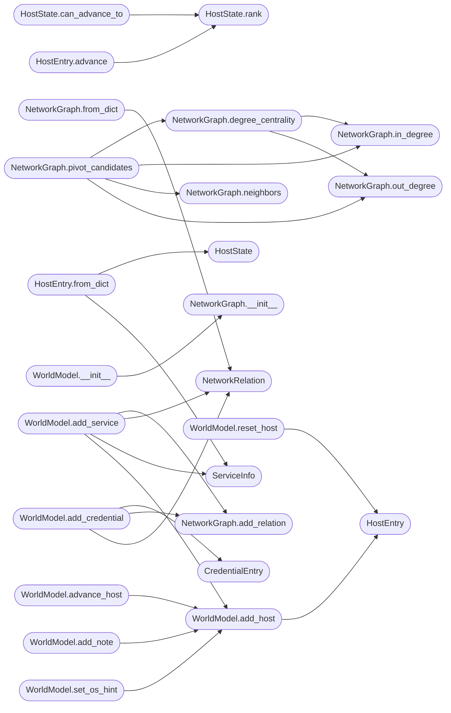

# `modules.world_model`

> Source: [modules/world_model.py:1](../../modules/world_model.py#L1) | language `py` | coverage 57.6% | [API index](../index.md)

modules/world_model.py ======================= Unified engagement world model for LazyOwn autonomous operations.

Tracks the state of every discovered host through a formal state machine,
aggregates credentials and vulnerabilities, derives the current engagement
phase, and produces a compact context string for LLM consumption.

Design principles
-----------------
- Single Responsibility : each class owns exactly one domain concept
- Open/Closed           : new host states or finding types via extension only
- Dependency Inversion  : depends on Finding abstraction, not ObsParser directly
- Thread-safe           : RLock guards all mutations; safe for Flask + MCP threads
- Persistent            : auto-saves to sessions/world_model.json on every mutation

Usage
-----
    from modules.world_model import WorldModel, HostState

    wm = WorldModel()
    wm.add_host("10.10.11.78")
    wm.advance_host(  "10.10.11.78", HostState.SCANNED)
    wm.add_service(   "10.10.11.78", port=80, name="http", version="Apache 2.4.49")
    wm.add_credential("administrator:P@ssw0rd!", host="10.10.11.78")

    print(wm.get_phase().value)       # -> "exploitation"
    print(wm.to_context_string())     # compact summary for LLM prompt

    # Called automatically after ObsParser runs:
    wm.update_from_findings(obs.findings)

## Contents

- **Classes:** [`ServiceInfo`](#serviceinfo), [`CredentialEntry`](#credentialentry), [`VulnerabilityEntry`](#vulnerabilityentry), [`EmailEntry`](#emailentry), [`DomainEntry`](#domainentry), [`NetworkRelation`](#networkrelation), [`NetworkGraph`](#networkgraph), [`HostEntry`](#hostentry), [`WorldModel`](#worldmodel)
- **Enums:** [`HostState`](#hoststate), [`EngagementPhase`](#engagementphase)
- **Functions:** [`read_state_dict`](#read_state_dict), [`write_state_dict`](#write_state_dict), [`get_world_model`](#get_world_model)
- **Constants:** [`ENCRYPTED_SUFFIX`](#encrypted_suffix), [`PASSTHROUGH_KEYS`](#passthrough_keys), [`PHASE_TO_MITRE_TACTICS`](#phase_to_mitre_tactics), [`PHASE_TO_TOOLS`](#phase_to_tools)

## Type Diagram

```mermaid
classDiagram
    direction LR
    class HostState
    <<enum>> HostState
    HostState : UNSCANNED
    HostState : SCANNED
    HostState : ENUMERATED
    HostState : EXPLOITED
    HostState : OWNED
    HostState : rank()
    HostState : can_advance_to()
    class EngagementPhase
    <<enum>> EngagementPhase
    EngagementPhase : RECON
    EngagementPhase : SCANNING
    EngagementPhase : ENUMERATION
    EngagementPhase : EXPLOITATION
    EngagementPhase : POST_EXPLOITATION
    EngagementPhase : COMPLETE
    class ServiceInfo
    ServiceInfo : int port
    ServiceInfo : str protocol
    ServiceInfo : str name
    ServiceInfo : str version
    ServiceInfo : str state
    class CredentialEntry
    CredentialEntry : str value
    CredentialEntry : str host
    CredentialEntry : str service
    CredentialEntry : bool confirmed
    CredentialEntry : str found_at
    class VulnerabilityEntry
    VulnerabilityEntry : str description
    VulnerabilityEntry : str host
    VulnerabilityEntry : str cve
    VulnerabilityEntry : str severity
    VulnerabilityEntry : str found_at
    class EmailEntry
    EmailEntry : str address
    EmailEntry : str host
    EmailEntry : str context
    EmailEntry : str found_at
    class DomainEntry
    DomainEntry : str domain
    DomainEntry : str host
    DomainEntry : str context
    DomainEntry : str found_at
    class NetworkRelation
    NetworkRelation : str source
    NetworkRelation : str target
    NetworkRelation : str relation
    NetworkRelation : float weight
    NetworkRelation : dict[str, str] attributes
    class NetworkGraph
    NetworkGraph : __init__()
    NetworkGraph : add_relation()
    NetworkGraph : neighbors()
    NetworkGraph : in_degree()
    NetworkGraph : out_degree()
    NetworkGraph : degree_centrality()
    NetworkGraph : pivot_candidates()
    NetworkGraph : to_dict()
    NetworkGraph : from_dict()
    class HostEntry
    HostEntry : str ip
    HostEntry : HostState state
    HostEntry : str os_hint
    HostEntry : dict[int, ServiceInfo] services
    HostEntry : list[str] notes
    HostEntry : dict[str, str] cloud_metadata
    HostEntry : str last_updated
    HostEntry : add_service()
    HostEntry : advance()
    HostEntry : to_dict()
    HostEntry : from_dict()
    class WorldModel
    WorldModel : __init__()
    WorldModel : add_host()
    WorldModel : reset_host()
    WorldModel : remove_host()
    WorldModel : advance_host()
    WorldModel : add_service()
    WorldModel : add_note()
    WorldModel : set_os_hint()
    WorldModel : get_host()
    WorldModel : get_hosts_summary()
    WorldModel : add_credential()
    WorldModel : link_credential_to_success()
    WorldModel : link_credential_to_failure()
    WorldModel : add_vulnerability()
    WorldModel : add_email()
    WorldModel : add_domain()
    WorldModel : update_from_findings()
    WorldModel : consume_policy_facts()
    WorldModel : add_relation()
    WorldModel : pivot_candidates()
    WorldModel : graph_snapshot()
    WorldModel : get_phase()
    WorldModel : get_suggested_tools()
    WorldModel : to_context_string()
```



## Call Graph

Solid arrows stay in this module, dashed arrows leave it.



## Classes

<a id="serviceinfo"></a>

### `ServiceInfo`

`class` `dataclass` | [modules/world_model.py:208](../../modules/world_model.py#L208)

Decorators: `@dataclass`

```python
class ServiceInfo
```

**Attributes**

| Name | Type | Default | Description |
|---|---|---|---|
| [`port`](#serviceinfo-port) | `int` |  |  |
| [`protocol`](#serviceinfo-protocol) | `str` | `'tcp'` |  |
| [`name`](#serviceinfo-name) | `str` | `''` |  |
| [`version`](#serviceinfo-version) | `str` | `''` |  |
| [`state`](#serviceinfo-state) | `str` | `'open'` |  |

---

<a id="credentialentry"></a>

### `CredentialEntry`

`class` `dataclass` | [modules/world_model.py:217](../../modules/world_model.py#L217)

Decorators: `@dataclass`

```python
class CredentialEntry
```

**Attributes**

| Name | Type | Default | Description |
|---|---|---|---|
| [`value`](#credentialentry-value) | `str` |  |  |
| [`host`](#credentialentry-host) | `str` | `''` |  |
| [`service`](#credentialentry-service) | `str` | `''` |  |
| [`confirmed`](#credentialentry-confirmed) | `bool` | `False` |  |
| [`found_at`](#credentialentry-found_at) | `str` | `field(default_factory=lambda: datetime.now().isoformat())` |  |

---

<a id="vulnerabilityentry"></a>

### `VulnerabilityEntry`

`class` `dataclass` | [modules/world_model.py:226](../../modules/world_model.py#L226)

Decorators: `@dataclass`

```python
class VulnerabilityEntry
```

**Attributes**

| Name | Type | Default | Description |
|---|---|---|---|
| [`description`](#vulnerabilityentry-description) | `str` |  |  |
| [`host`](#vulnerabilityentry-host) | `str` | `''` |  |
| [`cve`](#vulnerabilityentry-cve) | `str` | `''` |  |
| [`severity`](#vulnerabilityentry-severity) | `str` | `'UNKNOWN'` |  |
| [`found_at`](#vulnerabilityentry-found_at) | `str` | `field(default_factory=lambda: datetime.now().isoformat())` |  |

---

<a id="emailentry"></a>

### `EmailEntry`

`class` `dataclass` | [modules/world_model.py:235](../../modules/world_model.py#L235)

Decorators: `@dataclass`

```python
class EmailEntry
```

**Attributes**

| Name | Type | Default | Description |
|---|---|---|---|
| [`address`](#emailentry-address) | `str` |  |  |
| [`host`](#emailentry-host) | `str` | `''` |  |
| [`context`](#emailentry-context) | `str` | `''` |  |
| [`found_at`](#emailentry-found_at) | `str` | `field(default_factory=lambda: datetime.now().isoformat())` |  |

---

<a id="domainentry"></a>

### `DomainEntry`

`class` `dataclass` | [modules/world_model.py:243](../../modules/world_model.py#L243)

Decorators: `@dataclass`

```python
class DomainEntry
```

**Attributes**

| Name | Type | Default | Description |
|---|---|---|---|
| [`domain`](#domainentry-domain) | `str` |  |  |
| [`host`](#domainentry-host) | `str` | `''` |  |
| [`context`](#domainentry-context) | `str` | `''` |  |
| [`found_at`](#domainentry-found_at) | `str` | `field(default_factory=lambda: datetime.now().isoformat())` |  |

---

<a id="networkrelation"></a>

### `NetworkRelation`

`class` `dataclass` | [modules/world_model.py:251](../../modules/world_model.py#L251)

Decorators: `@dataclass`

```python
class NetworkRelation
```

A directed, typed relationship between two network nodes.

Node naming convention:
    host:<ip>          — a discovered host
    user:<username>    — a user account
    service:<name>     — a running service (e.g. service:smb)
    cred:<hash>        — a captured credential (first 12 chars)

**Attributes**

| Name | Type | Default | Description |
|---|---|---|---|
| [`source`](#networkrelation-source) | `str` |  |  |
| [`target`](#networkrelation-target) | `str` |  |  |
| [`relation`](#networkrelation-relation) | `str` |  |  |
| [`weight`](#networkrelation-weight) | `float` | `1.0` |  |
| [`attributes`](#networkrelation-attributes) | `dict[str, str]` | `field(default_factory=dict)` |  |

---

<a id="networkgraph"></a>

### `NetworkGraph`

`class` | [modules/world_model.py:273](../../modules/world_model.py#L273)

```python
class NetworkGraph
```

Lightweight directed graph for network topology and lateral movement reasoning.

Tracks typed relationships between hosts, users, services, and credentials
and exposes degree-centrality analysis to identify pivot points without
requiring an external graph library.

Design
------
- Single Responsibility : graph structure + centrality only; no I/O
- Open/Closed           : new relation types added as data, not code
- Thread-safe           : caller (WorldModel) holds its own RLock

Centrality algorithm
--------------------
Normalized degree centrality:
    C(v) = (in_degree(v) + out_degree(v)) / (2 * (N - 1))

A node with high centrality is reachable by and can reach many others —
an ideal pivot candidate for lateral movement.

**Members**

| Member | Kind | Summary |
|---|---|---|
| [`__init__`](#networkgraph-__init__) | constructor |  |
| [`add_relation`](#networkgraph-add_relation) | method | Add a directed edge. |
| [`neighbors`](#networkgraph-neighbors) | method | Return nodes reachable from *node* in one outbound hop. |
| [`in_degree`](#networkgraph-in_degree) | method | Count edges pointing INTO *node*. |
| [`out_degree`](#networkgraph-out_degree) | method | Count edges leaving *node*. |
| [`degree_centrality`](#networkgraph-degree_centrality) | method | Return (node, centrality_score) pairs sorted descending by score. |
| [`pivot_candidates`](#networkgraph-pivot_candidates) | method | Return the *top_k* highest-centrality nodes as pivot candidates. |
| [`to_dict`](#networkgraph-to_dict) | method |  |
| [`from_dict`](#networkgraph-from_dict) | classmethod |  |

<a id="networkgraph-__init__"></a>

#### `NetworkGraph.__init__`

`constructor` | [modules/world_model.py:296](../../modules/world_model.py#L296)

```python
def __init__(self) -> None
```

*Called by:* [`WorldModel.__init__`](#worldmodel-__init__), [`WorldModel.reload`](#worldmodel-reload)

<a id="networkgraph-add_relation"></a>

#### `NetworkGraph.add_relation`

`method` | [modules/world_model.py:303](../../modules/world_model.py#L303)

```python
def add_relation(self, relation: NetworkRelation) -> None
```

Add a directed edge.

Duplicate edges accumulate (multi-graph).

**Parameters**

| Name | Type | Default | Description |
|---|---|---|---|
| `relation` | `NetworkRelation` |  |  |

*Called by:* [`WorldModel.add_credential`](#worldmodel-add_credential), [`WorldModel.add_relation`](#worldmodel-add_relation), [`WorldModel.add_service`](#worldmodel-add_service), [`WorldModel.link_credential_to_failure`](#worldmodel-link_credential_to_failure), [`WorldModel.link_credential_to_success`](#worldmodel-link_credential_to_success), [`WorldModel.update_from_findings`](#worldmodel-update_from_findings)

<a id="networkgraph-neighbors"></a>

#### `NetworkGraph.neighbors`

`method` | [modules/world_model.py:311](../../modules/world_model.py#L311)

```python
def neighbors(self, node: str) -> list[str]
```

Return nodes reachable from *node* in one outbound hop.

**Parameters**

| Name | Type | Default | Description |
|---|---|---|---|
| `node` | `str` |  |  |

**Returns:** `list[str]`

*Called by:* [`NetworkGraph.pivot_candidates`](#networkgraph-pivot_candidates)

<a id="networkgraph-in_degree"></a>

#### `NetworkGraph.in_degree`

`method` | [modules/world_model.py:315](../../modules/world_model.py#L315)

```python
def in_degree(self, node: str) -> int
```

Count edges pointing INTO *node*.

**Parameters**

| Name | Type | Default | Description |
|---|---|---|---|
| `node` | `str` |  |  |

**Returns:** `int`

*Called by:* [`NetworkGraph.degree_centrality`](#networkgraph-degree_centrality), [`NetworkGraph.pivot_candidates`](#networkgraph-pivot_candidates)

<a id="networkgraph-out_degree"></a>

#### `NetworkGraph.out_degree`

`method` | [modules/world_model.py:319](../../modules/world_model.py#L319)

```python
def out_degree(self, node: str) -> int
```

Count edges leaving *node*.

**Parameters**

| Name | Type | Default | Description |
|---|---|---|---|
| `node` | `str` |  |  |

**Returns:** `int`

*Called by:* [`NetworkGraph.degree_centrality`](#networkgraph-degree_centrality), [`NetworkGraph.pivot_candidates`](#networkgraph-pivot_candidates)

<a id="networkgraph-degree_centrality"></a>

#### `NetworkGraph.degree_centrality`

`method` | [modules/world_model.py:323](../../modules/world_model.py#L323)

```python
def degree_centrality(self) -> list[tuple]
```

Return (node, centrality_score) pairs sorted descending by score.

Score is normalized to [0.0, 1.0] over all discovered nodes.

**Returns:** `list[tuple]`

*Calls:* [`NetworkGraph.in_degree`](#networkgraph-in_degree), [`NetworkGraph.out_degree`](#networkgraph-out_degree)

*Called by:* [`NetworkGraph.pivot_candidates`](#networkgraph-pivot_candidates)

<a id="networkgraph-pivot_candidates"></a>

#### `NetworkGraph.pivot_candidates`

`method` | [modules/world_model.py:338](../../modules/world_model.py#L338)

```python
def pivot_candidates(self, top_k: int = 5) -> list[dict]
```

Return the *top_k* highest-centrality nodes as pivot candidates.

The returned list is suitable for injection into an LLM prompt as strategic network context.

**Parameters**

| Name | Type | Default | Description |
|---|---|---|---|
| `top_k` | `int` | `5` |  |

**Returns:** `list[dict]`

*Calls:* [`NetworkGraph.degree_centrality`](#networkgraph-degree_centrality), [`NetworkGraph.in_degree`](#networkgraph-in_degree), [`NetworkGraph.neighbors`](#networkgraph-neighbors), [`NetworkGraph.out_degree`](#networkgraph-out_degree)

*Called by:* [`WorldModel.pivot_candidates`](#worldmodel-pivot_candidates), [`WorldModel.snapshot`](#worldmodel-snapshot), [`WorldModel.to_context_string`](#worldmodel-to_context_string)

<a id="networkgraph-to_dict"></a>

#### `NetworkGraph.to_dict`

`method` | [modules/world_model.py:360](../../modules/world_model.py#L360)

```python
def to_dict(self) -> dict
```

**Returns:** `dict`

*Called by:* [`WorldModel.graph_snapshot`](#worldmodel-graph_snapshot)

<a id="networkgraph-from_dict"></a>

#### `NetworkGraph.from_dict`

`classmethod` | [modules/world_model.py:377](../../modules/world_model.py#L377)

Decorators: `@classmethod`

```python
def from_dict(cls, data: dict) -> NetworkGraph
```

**Parameters**

| Name | Type | Default | Description |
|---|---|---|---|
| `data` | `dict` |  |  |

**Returns:** `NetworkGraph`

*Calls:* [`NetworkRelation`](#networkrelation)

*Called by:* [`build_live_graph`](modules.live_surface.py.md#build_live_graph)

---

<a id="hostentry"></a>

### `HostEntry`

`class` `dataclass` | [modules/world_model.py:393](../../modules/world_model.py#L393)

Decorators: `@dataclass`

```python
class HostEntry
```

**Attributes**

| Name | Type | Default | Description |
|---|---|---|---|
| [`ip`](#hostentry-ip) | `str` |  |  |
| [`state`](#hostentry-state) | `HostState` | `HostState.UNSCANNED` |  |
| [`os_hint`](#hostentry-os_hint) | `str` | `''` |  |
| [`services`](#hostentry-services) | `dict[int, ServiceInfo]` | `field(default_factory=dict)` |  |
| [`notes`](#hostentry-notes) | `list[str]` | `field(default_factory=list)` |  |
| [`cloud_metadata`](#hostentry-cloud_metadata) | `dict[str, str]` | `field(default_factory=dict)` |  |
| [`last_updated`](#hostentry-last_updated) | `str` | `field(default_factory=lambda: datetime.now().isoformat())` |  |

**Members**

| Member | Kind | Summary |
|---|---|---|
| [`add_service`](#hostentry-add_service) | method |  |
| [`advance`](#hostentry-advance) | method | Advance state only if new_state is the next valid step. |
| [`to_dict`](#hostentry-to_dict) | method |  |
| [`from_dict`](#hostentry-from_dict) | classmethod |  |

<a id="hostentry-add_service"></a>

#### `HostEntry.add_service`

`method` | [modules/world_model.py:402](../../modules/world_model.py#L402)

```python
def add_service(self, svc: ServiceInfo) -> None
```

**Parameters**

| Name | Type | Default | Description |
|---|---|---|---|
| `svc` | `ServiceInfo` |  |  |

<a id="hostentry-advance"></a>

#### `HostEntry.advance`

`method` | [modules/world_model.py:406](../../modules/world_model.py#L406)

```python
def advance(self, new_state: HostState) -> bool
```

Advance state only if new_state is the next valid step.

Returns True if changed.

**Parameters**

| Name | Type | Default | Description |
|---|---|---|---|
| `new_state` | `HostState` |  |  |

**Returns:** `bool`

*Calls:* [`HostState.rank`](#hoststate-rank)

<a id="hostentry-to_dict"></a>

#### `HostEntry.to_dict`

`method` | [modules/world_model.py:414](../../modules/world_model.py#L414)

```python
def to_dict(self) -> dict
```

**Returns:** `dict`

<a id="hostentry-from_dict"></a>

#### `HostEntry.from_dict`

`classmethod` | [modules/world_model.py:426](../../modules/world_model.py#L426)

Decorators: `@classmethod`

```python
def from_dict(cls, d: dict) -> HostEntry
```

**Parameters**

| Name | Type | Default | Description |
|---|---|---|---|
| `d` | `dict` |  |  |

**Returns:** `HostEntry`

*Calls:* [`HostState`](#hoststate), [`ServiceInfo`](#serviceinfo)

---

<a id="worldmodel"></a>

### `WorldModel`

`class` | [modules/world_model.py:570](../../modules/world_model.py#L570)

```python
class WorldModel
```

Thread-safe, persistent engagement world model.

Maintains hosts, credentials, vulnerabilities, and the derived phase.
Persists state to sessions/world_model.json on every mutation.

**Members**

| Member | Kind | Summary |
|---|---|---|
| [`__init__`](#worldmodel-__init__) | constructor |  |
| [`add_host`](#worldmodel-add_host) | method |  |
| [`reset_host`](#worldmodel-reset_host) | method | Clear a single host's state back to UNSCANNED for a fresh scan. |
| [`remove_host`](#worldmodel-remove_host) | method | Remove one host from the model and persist the change. |
| [`advance_host`](#worldmodel-advance_host) | method |  |
| [`add_service`](#worldmodel-add_service) | method |  |
| [`add_note`](#worldmodel-add_note) | method |  |
| [`set_os_hint`](#worldmodel-set_os_hint) | method | Set the operating system hint for a host. |
| [`get_host`](#worldmodel-get_host) | method | Return a host entry by IP, or None if not found. |
| [`get_hosts_summary`](#worldmodel-get_hosts_summary) | method | Return a mapping of IP -> state for all tracked hosts. |
| [`add_credential`](#worldmodel-add_credential) | method |  |
| [`link_credential_to_success`](#worldmodel-link_credential_to_success) | method | Mark a credential as working for a specific host in the graph. |
| [`link_credential_to_failure`](#worldmodel-link_credential_to_failure) | method | Mark a credential as rejected by a specific host in the graph. |
| [`add_vulnerability`](#worldmodel-add_vulnerability) | method |  |
| [`add_email`](#worldmodel-add_email) | method |  |
| [`add_domain`](#worldmodel-add_domain) | method |  |
| [`update_from_findings`](#worldmodel-update_from_findings) | method | Integrate a list of Finding objects (from obs_parser.ObsParser). |
| [`consume_policy_facts`](#worldmodel-consume_policy_facts) | method | Ingest structured facts from FactStore's ``policy_facts.json``. |
| [`add_relation`](#worldmodel-add_relation) | method | Add an arbitrary directed relationship to the network graph. |
| [`pivot_candidates`](#worldmodel-pivot_candidates) | method | Return the top_k highest-centrality nodes as pivot candidates. |
| [`graph_snapshot`](#worldmodel-graph_snapshot) | method | Return the full network graph as a serialisable dict. |
| [`get_phase`](#worldmodel-get_phase) | method |  |
| [`get_suggested_tools`](#worldmodel-get_suggested_tools) | method |  |
| [`to_context_string`](#worldmodel-to_context_string) | method | Compact, LLM-readable summary of the current engagement state. |
| [`reload`](#worldmodel-reload) | method | Discard in-memory state and re-read from the persisted file. |
| [`reset`](#worldmodel-reset) | method | Clear all state and delete the persisted file. |
| [`snapshot`](#worldmodel-snapshot) | method | Return a plain-dict snapshot (for JSON serialisation). |
| [`read_section`](#worldmodel-read_section) | method | Return one allowlisted passthrough section. |
| [`write_section`](#worldmodel-write_section) | method | Persist one allowlisted passthrough section atomically. |

<a id="worldmodel-__init__"></a>

#### `WorldModel.__init__`

`constructor` | [modules/world_model.py:578](../../modules/world_model.py#L578)

```python
def __init__(self, path: str | Path = _DEFAULT_PATH) -> None
```

**Parameters**

| Name | Type | Default | Description |
|---|---|---|---|
| `path` | `str \| Path` | `_DEFAULT_PATH` |  |

*Calls:* [`NetworkGraph.__init__`](#networkgraph-__init__)

*Called by:* [`ExploitMigratedCommandSet.do_exploit_recommend`](cli.commands.exploit_migrated.py.md#exploitmigratedcommandset-do_exploit_recommend), [`PwnCommandSet.do_rich_tui`](cli.commands.pwn.py.md#pwncommandset-do_rich_tui), [`NucleiParser.enrich_world_model`](modules.integrations.nuclei_parser.py.md#nucleiparser-enrich_world_model), [`StateManager.load_world_model`](modules.state_manager.py.md#statemanager-load_world_model), [`get_world_model`](#get_world_model)

<a id="worldmodel-add_host"></a>

#### `WorldModel.add_host`

`method` | [modules/world_model.py:594](../../modules/world_model.py#L594)

```python
def add_host(self, ip: str) -> HostEntry
```

**Parameters**

| Name | Type | Default | Description |
|---|---|---|---|
| `ip` | `str` |  |  |

**Returns:** `HostEntry`

*Calls:* [`HostEntry`](#hostentry)

*Called by:* [`StateManager.load_world_model`](modules.state_manager.py.md#statemanager-load_world_model), [`WorldModel.add_note`](#worldmodel-add_note), [`WorldModel.add_service`](#worldmodel-add_service), [`WorldModel.advance_host`](#worldmodel-advance_host), [`WorldModel.consume_policy_facts`](#worldmodel-consume_policy_facts), [`WorldModel.set_os_hint`](#worldmodel-set_os_hint), [`WorldModel.update_from_findings`](#worldmodel-update_from_findings)

<a id="worldmodel-reset_host"></a>

#### `WorldModel.reset_host`

`method` | [modules/world_model.py:602](../../modules/world_model.py#L602)

```python
def reset_host(self, ip: str) -> None
```

Clear a single host's state back to UNSCANNED for a fresh scan.

Retains other hosts.

**Parameters**

| Name | Type | Default | Description |
|---|---|---|---|
| `ip` | `str` |  | Target host IP address. |

*Calls:* [`HostEntry`](#hostentry)

<a id="worldmodel-remove_host"></a>

#### `WorldModel.remove_host`

`method` | [modules/world_model.py:612](../../modules/world_model.py#L612)

```python
def remove_host(self, ip: str) -> bool
```

Remove one host from the model and persist the change.

**Parameters**

| Name | Type | Default | Description |
|---|---|---|---|
| `ip` | `str` |  | Host address to remove. |

**Returns:** `bool` - True when the host existed and was removed.

<a id="worldmodel-advance_host"></a>

#### `WorldModel.advance_host`

`method` | [modules/world_model.py:628](../../modules/world_model.py#L628)

```python
def advance_host(self, ip: str, new_state: HostState) -> bool
```

**Parameters**

| Name | Type | Default | Description |
|---|---|---|---|
| `ip` | `str` |  |  |
| `new_state` | `HostState` |  |  |

**Returns:** `bool`

*Calls:* [`WorldModel.add_host`](#worldmodel-add_host)

<a id="worldmodel-add_service"></a>

#### `WorldModel.add_service`

`method` | [modules/world_model.py:637](../../modules/world_model.py#L637)

```python
def add_service(self, ip: str, port: int, name: str = '', version: str = '', protocol: str = 'tcp') -> None
```

**Parameters**

| Name | Type | Default | Description |
|---|---|---|---|
| `ip` | `str` |  |  |
| `port` | `int` |  |  |
| `name` | `str` | `''` |  |
| `version` | `str` | `''` |  |
| `protocol` | `str` | `'tcp'` |  |

*Calls:* [`NetworkGraph.add_relation`](#networkgraph-add_relation), [`NetworkRelation`](#networkrelation), [`ServiceInfo`](#serviceinfo), [`WorldModel.add_host`](#worldmodel-add_host)

*Called by:* [`StateManager.load_world_model`](modules.state_manager.py.md#statemanager-load_world_model), [`WorldModel.consume_policy_facts`](#worldmodel-consume_policy_facts), [`WorldModel.update_from_findings`](#worldmodel-update_from_findings)

<a id="worldmodel-add_note"></a>

#### `WorldModel.add_note`

`method` | [modules/world_model.py:654](../../modules/world_model.py#L654)

```python
def add_note(self, ip: str, note: str) -> None
```

**Parameters**

| Name | Type | Default | Description |
|---|---|---|---|
| `ip` | `str` |  |  |
| `note` | `str` |  |  |

*Calls:* [`WorldModel.add_host`](#worldmodel-add_host)

*Called by:* [`StateManager.load_world_model`](modules.state_manager.py.md#statemanager-load_world_model), [`WorldModel.update_from_findings`](#worldmodel-update_from_findings)

<a id="worldmodel-set_os_hint"></a>

#### `WorldModel.set_os_hint`

`method` | [modules/world_model.py:661](../../modules/world_model.py#L661)

```python
def set_os_hint(self, ip: str, os_hint: str) -> None
```

Set the operating system hint for a host.

**Parameters**

| Name | Type | Default | Description |
|---|---|---|---|
| `ip` | `str` |  | Target host IP address. |
| `os_hint` | `str` |  | OS name hint (``"linux"``, ``"windows"``, or ``""``). |

*Calls:* [`WorldModel.add_host`](#worldmodel-add_host)

*Called by:* [`WorldModel.consume_policy_facts`](#worldmodel-consume_policy_facts)

<a id="worldmodel-get_host"></a>

#### `WorldModel.get_host`

`method` | [modules/world_model.py:675](../../modules/world_model.py#L675)

```python
def get_host(self, ip: str) -> HostEntry | None
```

Return a host entry by IP, or None if not found.

**Parameters**

| Name | Type | Default | Description |
|---|---|---|---|
| `ip` | `str` |  | Target host IP address. |

**Returns:** `HostEntry | None` - [`HostEntry`](#hostentry) if found, otherwise ``None``.

<a id="worldmodel-get_hosts_summary"></a>

#### `WorldModel.get_hosts_summary`

`method` | [modules/world_model.py:687](../../modules/world_model.py#L687)

```python
def get_hosts_summary(self) -> dict[str, str]
```

Return a mapping of IP -> state for all tracked hosts.

**Returns:** `dict[str, str]` - Dict of ``{ip: state_value}`` for every host in the model.

<a id="worldmodel-add_credential"></a>

#### `WorldModel.add_credential`

`method` | [modules/world_model.py:698](../../modules/world_model.py#L698)

```python
def add_credential(self, value: str, host: str = '', service: str = '') -> None
```

**Parameters**

| Name | Type | Default | Description |
|---|---|---|---|
| `value` | `str` |  |  |
| `host` | `str` | `''` |  |
| `service` | `str` | `''` |  |

*Calls:* [`CredentialEntry`](#credentialentry), [`NetworkGraph.add_relation`](#networkgraph-add_relation), [`NetworkRelation`](#networkrelation)

*Called by:* [`StateManager.load_world_model`](modules.state_manager.py.md#statemanager-load_world_model), [`WorldModel.consume_policy_facts`](#worldmodel-consume_policy_facts), [`WorldModel.update_from_findings`](#worldmodel-update_from_findings)

<a id="worldmodel-link_credential_to_success"></a>

#### `WorldModel.link_credential_to_success`

`method` | [modules/world_model.py:730](../../modules/world_model.py#L730)

```python
def link_credential_to_success(self, value: str, host: str) -> None
```

Mark a credential as working for a specific host in the graph.

**Parameters**

| Name | Type | Default | Description |
|---|---|---|---|
| `value` | `str` |  |  |
| `host` | `str` |  |  |

*Calls:* [`NetworkGraph.add_relation`](#networkgraph-add_relation), [`NetworkRelation`](#networkrelation)

<a id="worldmodel-link_credential_to_failure"></a>

#### `WorldModel.link_credential_to_failure`

`method` | [modules/world_model.py:751](../../modules/world_model.py#L751)

```python
def link_credential_to_failure(self, value: str, host: str) -> None
```

Mark a credential as rejected by a specific host in the graph.

Records the negative outcome of an authentication attempt so the
cred-graph view and reuse ranking can skip credentials already
proven not to work against a host.

**Parameters**

| Name | Type | Default | Description |
|---|---|---|---|
| `value` | `str` |  | The credential value ("user:pass" or hash) that failed. |
| `host` | `str` |  | The host that rejected the credential. |

**Returns:** `None` - None.

*Calls:* [`NetworkGraph.add_relation`](#networkgraph-add_relation), [`NetworkRelation`](#networkrelation)

<a id="worldmodel-add_vulnerability"></a>

#### `WorldModel.add_vulnerability`

`method` | [modules/world_model.py:781](../../modules/world_model.py#L781)

```python
def add_vulnerability(self, description: str, host: str = '', cve: str = '', severity: str = 'UNKNOWN') -> None
```

**Parameters**

| Name | Type | Default | Description |
|---|---|---|---|
| `description` | `str` |  |  |
| `host` | `str` | `''` |  |
| `cve` | `str` | `''` |  |
| `severity` | `str` | `'UNKNOWN'` |  |

*Calls:* [`VulnerabilityEntry`](#vulnerabilityentry)

*Called by:* [`NucleiParser.enrich_world_model`](modules.integrations.nuclei_parser.py.md#nucleiparser-enrich_world_model), [`StateManager.load_world_model`](modules.state_manager.py.md#statemanager-load_world_model), [`WorldModel.consume_policy_facts`](#worldmodel-consume_policy_facts), [`WorldModel.update_from_findings`](#worldmodel-update_from_findings)

<a id="worldmodel-add_email"></a>

#### `WorldModel.add_email`

`method` | [modules/world_model.py:787](../../modules/world_model.py#L787)

```python
def add_email(self, address: str, host: str = '', context: str = '') -> None
```

**Parameters**

| Name | Type | Default | Description |
|---|---|---|---|
| `address` | `str` |  |  |
| `host` | `str` | `''` |  |
| `context` | `str` | `''` |  |

*Calls:* [`EmailEntry`](#emailentry)

*Called by:* [`WorldModel.consume_policy_facts`](#worldmodel-consume_policy_facts), [`WorldModel.update_from_findings`](#worldmodel-update_from_findings)

<a id="worldmodel-add_domain"></a>

#### `WorldModel.add_domain`

`method` | [modules/world_model.py:793](../../modules/world_model.py#L793)

```python
def add_domain(self, domain: str, host: str = '', context: str = '') -> None
```

**Parameters**

| Name | Type | Default | Description |
|---|---|---|---|
| `domain` | `str` |  |  |
| `host` | `str` | `''` |  |
| `context` | `str` | `''` |  |

*Calls:* [`DomainEntry`](#domainentry)

*Called by:* [`WorldModel.consume_policy_facts`](#worldmodel-consume_policy_facts), [`WorldModel.update_from_findings`](#worldmodel-update_from_findings)

<a id="worldmodel-update_from_findings"></a>

#### `WorldModel.update_from_findings`

`method` | [modules/world_model.py:807](../../modules/world_model.py#L807)

```python
def update_from_findings(self, findings: list) -> None
```

Integrate a list of Finding objects (from obs_parser.ObsParser).

Each finding updates the relevant part of the world model.

**Parameters**

| Name | Type | Default | Description |
|---|---|---|---|
| `findings` | `list` |  |  |

*Calls:* [`NetworkGraph.add_relation`](#networkgraph-add_relation), [`NetworkRelation`](#networkrelation), [`WorldModel.add_credential`](#worldmodel-add_credential), [`WorldModel.add_domain`](#worldmodel-add_domain), [`WorldModel.add_email`](#worldmodel-add_email), [`WorldModel.add_host`](#worldmodel-add_host), [`WorldModel.add_note`](#worldmodel-add_note), [`WorldModel.add_service`](#worldmodel-add_service), [`WorldModel.add_vulnerability`](#worldmodel-add_vulnerability)

<a id="worldmodel-consume_policy_facts"></a>

#### `WorldModel.consume_policy_facts`

`method` | [modules/world_model.py:880](../../modules/world_model.py#L880)

```python
def consume_policy_facts(self, facts_path: str | Path | None = None) -> int
```

Ingest structured facts from FactStore's ``policy_facts.json``.

Reads hosts, services, credentials, and vulnerabilities discovered by
the FactStore parser and merges them into the world model. Returns the
total number of new facts ingested.

**Parameters**

| Name | Type | Default | Description |
|---|---|---|---|
| `facts_path` | `str \| Path \| None` | `None` | Path to ``policy_facts.json``. Defaults to ``sessions/policy_facts.json``. |

**Returns:** `int` - Count of newly ingested fact entries.

*Calls:* [`WorldModel.add_credential`](#worldmodel-add_credential), [`WorldModel.add_domain`](#worldmodel-add_domain), [`WorldModel.add_email`](#worldmodel-add_email), [`WorldModel.add_host`](#worldmodel-add_host), [`WorldModel.add_service`](#worldmodel-add_service), [`WorldModel.add_vulnerability`](#worldmodel-add_vulnerability), [`WorldModel.set_os_hint`](#worldmodel-set_os_hint)

<a id="worldmodel-add_relation"></a>

#### `WorldModel.add_relation`

`method` | [modules/world_model.py:972](../../modules/world_model.py#L972)

```python
def add_relation(self, source: str, target: str, relation: str, weight: float = 1.0, **attributes: str) -> None
```

Add an arbitrary directed relationship to the network graph.

**Parameters**

| Name | Type | Default | Description |
|---|---|---|---|
| `source` | `str` |  |  |
| `target` | `str` |  |  |
| `relation` | `str` |  |  |
| `weight` | `float` | `1.0` |  |
| `**attributes` | `str` |  |  |

*Calls:* [`NetworkGraph.add_relation`](#networkgraph-add_relation), [`NetworkRelation`](#networkrelation)

<a id="worldmodel-pivot_candidates"></a>

#### `WorldModel.pivot_candidates`

`method` | [modules/world_model.py:993](../../modules/world_model.py#L993)

```python
def pivot_candidates(self, top_k: int = 5) -> list[dict]
```

Return the top_k highest-centrality nodes as pivot candidates.

Uses normalized degree centrality over the full network graph.

**Parameters**

| Name | Type | Default | Description |
|---|---|---|---|
| `top_k` | `int` | `5` |  |

**Returns:** `list[dict]`

*Calls:* [`NetworkGraph.pivot_candidates`](#networkgraph-pivot_candidates)

<a id="worldmodel-graph_snapshot"></a>

#### `WorldModel.graph_snapshot`

`method` | [modules/world_model.py:1001](../../modules/world_model.py#L1001)

```python
def graph_snapshot(self) -> dict
```

Return the full network graph as a serialisable dict.

**Returns:** `dict`

*Calls:* [`NetworkGraph.to_dict`](#networkgraph-to_dict)

<a id="worldmodel-get_phase"></a>

#### `WorldModel.get_phase`

`method` | [modules/world_model.py:1008](../../modules/world_model.py#L1008)

```python
def get_phase(self) -> EngagementPhase
```

**Returns:** `EngagementPhase`

*Called by:* [`WorldModel.get_suggested_tools`](#worldmodel-get_suggested_tools), [`WorldModel.snapshot`](#worldmodel-snapshot)

<a id="worldmodel-get_suggested_tools"></a>

#### `WorldModel.get_suggested_tools`

`method` | [modules/world_model.py:1012](../../modules/world_model.py#L1012)

```python
def get_suggested_tools(self) -> list[str]
```

**Returns:** `list[str]`

*Calls:* [`WorldModel.get_phase`](#worldmodel-get_phase)

*Called by:* [`WorldModel.to_context_string`](#worldmodel-to_context_string)

<a id="worldmodel-to_context_string"></a>

#### `WorldModel.to_context_string`

`method` | [modules/world_model.py:1015](../../modules/world_model.py#L1015)

```python
def to_context_string(self) -> str
```

Compact, LLM-readable summary of the current engagement state.

Designed to fit in a prompt without consuming excessive tokens.

**Returns:** `str`

*Calls:* [`NetworkGraph.pivot_candidates`](#networkgraph-pivot_candidates), [`WorldModel.get_suggested_tools`](#worldmodel-get_suggested_tools)

<a id="worldmodel-reload"></a>

#### `WorldModel.reload`

`method` | [modules/world_model.py:1123](../../modules/world_model.py#L1123)

```python
def reload(self) -> None
```

Discard in-memory state and re-read from the persisted file.

Safe to call from any thread. Acquires the write lock during the
load to guarantee a consistent snapshot.

*Calls:* [`NetworkGraph.__init__`](#networkgraph-__init__)

<a id="worldmodel-reset"></a>

#### `WorldModel.reset`

`method` | [modules/world_model.py:1139](../../modules/world_model.py#L1139)

```python
def reset(self) -> None
```

Clear all state and delete the persisted file.

<a id="worldmodel-snapshot"></a>

#### `WorldModel.snapshot`

`method` | [modules/world_model.py:1150](../../modules/world_model.py#L1150)

```python
def snapshot(self) -> dict
```

Return a plain-dict snapshot (for JSON serialisation).

**Returns:** `dict`

*Calls:* [`NetworkGraph.pivot_candidates`](#networkgraph-pivot_candidates), [`WorldModel.get_phase`](#worldmodel-get_phase)

<a id="worldmodel-read_section"></a>

#### `WorldModel.read_section`

`method` | [modules/world_model.py:1166](../../modules/world_model.py#L1166)

```python
def read_section(self, key: str) -> Any
```

Return one allowlisted passthrough section.

**Parameters**

| Name | Type | Default | Description |
|---|---|---|---|
| `key` | `str` |  | Section name from [`PASSTHROUGH_KEYS`](#passthrough_keys). |

**Returns:** `Any` - A deep copy of the stored value, or ``None``.

**Raises**

- `KeyError`: The section is not allowlisted.

<a id="worldmodel-write_section"></a>

#### `WorldModel.write_section`

`method` | [modules/world_model.py:1183](../../modules/world_model.py#L1183)

```python
def write_section(self, key: str, value: Any) -> bool
```

Persist one allowlisted passthrough section atomically.

**Parameters**

| Name | Type | Default | Description |
|---|---|---|---|
| `key` | `str` |  | Section name from [`PASSTHROUGH_KEYS`](#passthrough_keys). |
| `value` | `Any` |  | JSON-serializable value. |

**Returns:** `bool` - True when the state was written.

**Raises**

- `KeyError`: The section is not allowlisted.

---

## Enums

<a id="hoststate"></a>

### `HostState`

`enum` | [modules/world_model.py:180](../../modules/world_model.py#L180)

```python
class HostState(StrEnum)
```

Bases: `StrEnum`

Ordered engagement states for a single host.

**Attributes**

| Name | Type | Default | Description |
|---|---|---|---|
| [`UNSCANNED`](#hoststate-unscanned) |  | `'unscanned'` |  |
| [`SCANNED`](#hoststate-scanned) |  | `'scanned'` |  |
| [`ENUMERATED`](#hoststate-enumerated) |  | `'enumerated'` |  |
| [`EXPLOITED`](#hoststate-exploited) |  | `'exploited'` |  |
| [`OWNED`](#hoststate-owned) |  | `'owned'` |  |

**Members**

| Member | Kind | Summary |
|---|---|---|
| [`rank`](#hoststate-rank) | method |  |
| [`can_advance_to`](#hoststate-can_advance_to) | method |  |

<a id="hoststate-rank"></a>

#### `HostState.rank`

`method` | [modules/world_model.py:189](../../modules/world_model.py#L189)

```python
def rank(self) -> int
```

**Returns:** `int`

*Called by:* [`HostEntry.advance`](#hostentry-advance), [`HostState.can_advance_to`](#hoststate-can_advance_to)

<a id="hoststate-can_advance_to"></a>

#### `HostState.can_advance_to`

`method` | [modules/world_model.py:192](../../modules/world_model.py#L192)

```python
def can_advance_to(self, next_state: HostState) -> bool
```

**Parameters**

| Name | Type | Default | Description |
|---|---|---|---|
| `next_state` | `HostState` |  |  |

**Returns:** `bool`

*Calls:* [`HostState.rank`](#hoststate-rank)

---

<a id="engagementphase"></a>

### `EngagementPhase`

`enum` | [modules/world_model.py:196](../../modules/world_model.py#L196)

```python
class EngagementPhase(StrEnum)
```

Bases: `StrEnum`

Derived from the aggregate host state across all targets.

**Attributes**

| Name | Type | Default | Description |
|---|---|---|---|
| [`RECON`](#engagementphase-recon) |  | `'recon'` |  |
| [`SCANNING`](#engagementphase-scanning) |  | `'scanning'` |  |
| [`ENUMERATION`](#engagementphase-enumeration) |  | `'enumeration'` |  |
| [`EXPLOITATION`](#engagementphase-exploitation) |  | `'exploitation'` |  |
| [`POST_EXPLOITATION`](#engagementphase-post_exploitation) |  | `'post_exploitation'` |  |
| [`COMPLETE`](#engagementphase-complete) |  | `'complete'` |  |

---

## Functions

<a id="read_state_dict"></a>

### `read_state_dict`

`function` | [modules/world_model.py:101](../../modules/world_model.py#L101)

```python
def read_state_dict(path: str | Path) -> dict
```

Read a world-model state dict, transparently decrypting at rest.

Priority:
    1. Plain ``world_model.json``.
    2. Auto-encrypted ``world_model.json.encrypted`` (decrypted with
       ``LAZYOWN_MASTER_PASSWORD`` and the persisted ``.auto_crypto_salt``).

Returns an empty dict when no readable state exists.

**Parameters**

| Name | Type | Default | Description |
|---|---|---|---|
| `path` | `str \| Path` |  | Path to the plain state file. |

**Returns:** `dict` - The decoded JSON document as a dict.

*Called by:* [`KillChain.advance_phase`](modules.killchain.py.md#killchain-advance_phase), [`KillChain.current_phase`](modules.killchain.py.md#killchain-current_phase), [`KillChain.get_progress`](modules.killchain.py.md#killchain-get_progress), [`KillChain.snapshot`](modules.killchain.py.md#killchain-snapshot)

---

<a id="write_state_dict"></a>

### `write_state_dict`

`function` | [modules/world_model.py:147](../../modules/world_model.py#L147)

```python
def write_state_dict(path: str | Path, data: dict) -> bool
```

Atomically write a world-model state dict as plaintext.

Writing always produces a plain file while the operator is working;
at-rest encryption is applied on application close by
``modules.auto_crypto.AutoCryptoEngine``.

**Parameters**

| Name | Type | Default | Description |
|---|---|---|---|
| `path` | `str \| Path` |  | Destination plain state file path. |
| `data` | `dict` |  | State document to serialise. |

**Returns:** `bool` - True when the write succeeded, False otherwise.

*Called by:* [`KillChain.advance_phase`](modules.killchain.py.md#killchain-advance_phase)

---

<a id="get_world_model"></a>

### `get_world_model`

`function` | [modules/world_model.py:1211](../../modules/world_model.py#L1211)

```python
def get_world_model(path: str | Path | None = None) -> WorldModel
```

Return (or create) the module-level singleton WorldModel.

``path`` defaults to the module's live `_DEFAULT_PATH` at call
time rather than a captured import-time value, so callers (and tests)
that reassign ``_DEFAULT_PATH`` to redirect state get the redirect.

**Parameters**

| Name | Type | Default | Description |
|---|---|---|---|
| `path` | `str \| Path \| None` | `None` |  |

**Returns:** `WorldModel`

*Calls:* [`WorldModel.__init__`](#worldmodel-__init__)

*Called by:* [`HelpUiCommandSet.do_killchain`](cli.commands.help_ui.py.md#helpuicommandset-do_killchain), [`McpBridgeCommandSet.do_auto_populate`](cli.commands.mcp_bridge.py.md#mcpbridgecommandset-do_auto_populate), [`loot_mark`](cli.ops_commands.py.md#loot_mark), [`record_shell_outcome`](modules.atomic_exploit_bridge.py.md#record_shell_outcome), [`IntelligenceEngine.disseminate`](modules.intelligence_engine.py.md#intelligenceengine-disseminate), [`KillChain.advance_phase`](modules.killchain.py.md#killchain-advance_phase), [`KillChain.current_phase`](modules.killchain.py.md#killchain-current_phase), [`fuse_routing_decisions`](modules.lazy_intel.py.md#fuse_routing_decisions), [`OperationManager.start`](modules.operation.py.md#operationmanager-start), [`apply`](modules.sinks.world_model.py.md#apply), [`facts_for_target`](modules.verb_manifest.py.md#facts_for_target)

---

## Constants

<a id="encrypted_suffix"></a>

### `ENCRYPTED_SUFFIX`

`constant` | [modules/world_model.py:55](../../modules/world_model.py#L55)

```python
ENCRYPTED_SUFFIX: str = '.encrypted'
```

---

<a id="passthrough_keys"></a>

### `PASSTHROUGH_KEYS`

`constant` | [modules/world_model.py:58](../../modules/world_model.py#L58)

```python
PASSTHROUGH_KEYS: tuple[str, ...] = ('completed_phases', 'phase', 'current_phase', 'notes', 'gyms')
```

---

<a id="phase_to_mitre_tactics"></a>

### `PHASE_TO_MITRE_TACTICS`

`constant` | [modules/world_model.py:472](../../modules/world_model.py#L472)

```python
PHASE_TO_MITRE_TACTICS: dict[EngagementPhase, list[str]]
```

---

<a id="phase_to_tools"></a>

### `PHASE_TO_TOOLS`

`constant` | [modules/world_model.py:487](../../modules/world_model.py#L487)

```python
PHASE_TO_TOOLS: dict[EngagementPhase, list[str]]
```

---
