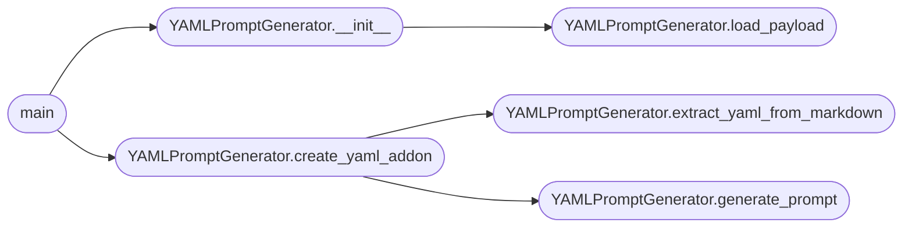

# `modules.yaml_generator`

> Source: [modules/yaml_generator.py:1](../../modules/yaml_generator.py#L1) | language `py` | coverage 62.5% | [API index](../index.md)

yaml_generator.py

## Contents

- **Classes:** [`YAMLPromptGenerator`](#yamlpromptgenerator)
- **Functions:** [`main`](#main)

## Call Graph

Solid arrows stay in this module, dashed arrows leave it.



## Classes

<a id="yamlpromptgenerator"></a>

### `YAMLPromptGenerator`

`class` | [modules/yaml_generator.py:17](../../modules/yaml_generator.py#L17)

```python
class YAMLPromptGenerator
```

**Members**

| Member | Kind | Summary |
|---|---|---|
| [`__init__`](#yamlpromptgenerator-__init__) | constructor |  |
| [`load_payload`](#yamlpromptgenerator-load_payload) | method | Carga las variables desde payload.json |
| [`generate_prompt`](#yamlpromptgenerator-generate_prompt) | method | Genera el prompt para la IA en inglés |
| [`extract_yaml_from_markdown`](#yamlpromptgenerator-extract_yaml_from_markdown) | method | Extrae el primer bloque YAML entre ```yaml y ``` |
| [`create_yaml_addon`](#yamlpromptgenerator-create_yaml_addon) | method | Genera el YAML y lo guarda en disco |

<a id="yamlpromptgenerator-__init__"></a>

#### `YAMLPromptGenerator.__init__`

`constructor` | [modules/yaml_generator.py:18](../../modules/yaml_generator.py#L18)

```python
def __init__(self, provider: str = 'groq', api_key: str | None = None)
```

**Parameters**

| Name | Type | Default | Description |
|---|---|---|---|
| `provider` | `str` | `'groq'` |  |
| `api_key` | `str \| None` | `None` |  |

*Calls:* [`YAMLPromptGenerator.load_payload`](#yamlpromptgenerator-load_payload)

*Called by:* [`main`](#main)

<a id="yamlpromptgenerator-load_payload"></a>

#### `YAMLPromptGenerator.load_payload`

`method` | [modules/yaml_generator.py:25](../../modules/yaml_generator.py#L25)

```python
def load_payload(self) -> dict
```

Carga las variables desde payload.json

**Returns:** `dict`

**Raises**

- `FileNotFoundError`: (raised in the body, not documented)

*Called by:* [`YAMLPromptGenerator.__init__`](#yamlpromptgenerator-__init__)

<a id="yamlpromptgenerator-generate_prompt"></a>

#### `YAMLPromptGenerator.generate_prompt`

`method` | [modules/yaml_generator.py:54](../../modules/yaml_generator.py#L54)

```python
def generate_prompt(self, user_request: str) -> str
```

Genera el prompt para la IA en inglés

**Parameters**

| Name | Type | Default | Description |
|---|---|---|---|
| `user_request` | `str` |  |  |

**Returns:** `str`

*Called by:* [`YAMLPromptGenerator.create_yaml_addon`](#yamlpromptgenerator-create_yaml_addon)

<a id="yamlpromptgenerator-extract_yaml_from_markdown"></a>

#### `YAMLPromptGenerator.extract_yaml_from_markdown`

`method` | [modules/yaml_generator.py:100](../../modules/yaml_generator.py#L100)

```python
def extract_yaml_from_markdown(self, text: str) -> str
```

Extrae el primer bloque YAML entre ```yaml y ```

**Parameters**

| Name | Type | Default | Description |
|---|---|---|---|
| `text` | `str` |  |  |

**Returns:** `str`

**Raises**

- `ValueError`: (raised in the body, not documented)

*Called by:* [`YAMLPromptGenerator.create_yaml_addon`](#yamlpromptgenerator-create_yaml_addon)

<a id="yamlpromptgenerator-create_yaml_addon"></a>

#### `YAMLPromptGenerator.create_yaml_addon`

`method` | [modules/yaml_generator.py:109](../../modules/yaml_generator.py#L109)

```python
def create_yaml_addon(self, user_request: str, output_dir: str = 'lazyaddons') -> str
```

Genera el YAML y lo guarda en disco

**Parameters**

| Name | Type | Default | Description |
|---|---|---|---|
| `user_request` | `str` |  |  |
| `output_dir` | `str` | `'lazyaddons'` |  |

**Returns:** `str`

*Calls:* [`YAMLPromptGenerator.extract_yaml_from_markdown`](#yamlpromptgenerator-extract_yaml_from_markdown), [`YAMLPromptGenerator.generate_prompt`](#yamlpromptgenerator-generate_prompt)

*Called by:* [`main`](#main)

---

## Functions

<a id="main"></a>

### `main`

`function` | [modules/yaml_generator.py:141](../../modules/yaml_generator.py#L141)

```python
def main()
```

*Calls:* [`YAMLPromptGenerator.__init__`](#yamlpromptgenerator-__init__), [`YAMLPromptGenerator.create_yaml_addon`](#yamlpromptgenerator-create_yaml_addon)

---
