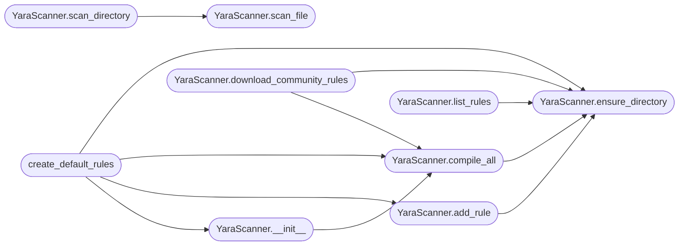

# `modules.yara_scanner`

> Source: [modules/yara_scanner.py:1](../../modules/yara_scanner.py#L1) | language `py` | coverage 100.0% | [API index](../index.md)

YARA integration for malware classification and IOC scanning.

Provides file scanning, process memory scanning, and rule management
within the LazyOwn framework.

## Contents

- **Classes:** [`YaraScanner`](#yarascanner)
- **Functions:** [`create_default_rules`](#create_default_rules)
- **Constants:** [`YARA_RULES_DIR`](#yara_rules_dir)

## Call Graph

Solid arrows stay in this module, dashed arrows leave it.



## Classes

<a id="yarascanner"></a>

### `YaraScanner`

`class` | [modules/yara_scanner.py:23](../../modules/yara_scanner.py#L23)

```python
class YaraScanner
```

Scanner that compiles and applies YARA rules against files and directories.

**Parameters**

| Name | Type | Default | Description |
|---|---|---|---|
| `rules_dir` |  |  | Directory containing .yar rule files. |
| `auto_compile` |  |  | Automatically compile rules on initialization. |

**Members**

| Member | Kind | Summary |
|---|---|---|
| [`__init__`](#yarascanner-__init__) | constructor |  |
| [`ensure_directory`](#yarascanner-ensure_directory) | method | Create the YARA rules directory if it does not exist. |
| [`compile_all`](#yarascanner-compile_all) | method | Compile all .yar files in the rules directory. |
| [`scan_file`](#yarascanner-scan_file) | method | Scan a single file with all compiled YARA rules. |
| [`scan_directory`](#yarascanner-scan_directory) | method | Scan all files in a directory recursively. |
| [`add_rule`](#yarascanner-add_rule) | method | Add a new YARA rule to the rules directory. |
| [`list_rules`](#yarascanner-list_rules) | method | List all YARA rules in the rules directory. |
| [`download_community_rules`](#yarascanner-download_community_rules) | method | Attempt to download community YARA rules from popular repositories. |
| [`ioc_scan`](#yarascanner-ioc_scan) | method | Scan for IOCs (hashes, strings, registry keys) in a file/directory. |

<a id="yarascanner-__init__"></a>

#### `YaraScanner.__init__`

`constructor` | [modules/yara_scanner.py:31](../../modules/yara_scanner.py#L31)

```python
def __init__(self, rules_dir: str | None = None, auto_compile: bool = True)
```

**Parameters**

| Name | Type | Default | Description |
|---|---|---|---|
| `rules_dir` | `str \| None` | `None` | Directory containing .yar rule files. |
| `auto_compile` | `bool` | `True` | Automatically compile rules on initialization. |

*Calls:* [`YaraScanner.compile_all`](#yarascanner-compile_all)

*Called by:* [`PostexpMigratedCommandSet.do_yara_scan`](cli.commands.postexp_migrated.py.md#postexpmigratedcommandset-do_yara_scan), [`IntelligenceEngine.collect_from_yara`](modules.intelligence_engine.py.md#intelligenceengine-collect_from_yara), [`create_default_rules`](#create_default_rules)

<a id="yarascanner-ensure_directory"></a>

#### `YaraScanner.ensure_directory`

`method` | [modules/yara_scanner.py:41](../../modules/yara_scanner.py#L41)

```python
def ensure_directory(self) -> None
```

Create the YARA rules directory if it does not exist.

*Called by:* [`YaraScanner.add_rule`](#yarascanner-add_rule), [`YaraScanner.compile_all`](#yarascanner-compile_all), [`YaraScanner.download_community_rules`](#yarascanner-download_community_rules), [`YaraScanner.list_rules`](#yarascanner-list_rules), [`create_default_rules`](#create_default_rules)

<a id="yarascanner-compile_all"></a>

#### `YaraScanner.compile_all`

`method` | [modules/yara_scanner.py:54](../../modules/yara_scanner.py#L54)

```python
def compile_all(self) -> bool
```

Compile all .yar files in the rules directory.

**Returns:** `bool` - True if compilation succeeded, False otherwise.

**Raises**

- `RuntimeError`: (raised in the body, not documented)

*Calls:* [`YaraScanner.ensure_directory`](#yarascanner-ensure_directory)

*Called by:* [`PostexpMigratedCommandSet.do_yara_scan`](cli.commands.postexp_migrated.py.md#postexpmigratedcommandset-do_yara_scan), [`YaraScanner.__init__`](#yarascanner-__init__), [`YaraScanner.download_community_rules`](#yarascanner-download_community_rules), [`create_default_rules`](#create_default_rules)

<a id="yarascanner-scan_file"></a>

#### `YaraScanner.scan_file`

`method` | [modules/yara_scanner.py:98](../../modules/yara_scanner.py#L98)

```python
def scan_file(self, filepath: str, timeout: int = 60) -> list[dict]
```

Scan a single file with all compiled YARA rules.

**Parameters**

| Name | Type | Default | Description |
|---|---|---|---|
| `filepath` | `str` |  | Path to the file to scan. |
| `timeout` | `int` | `60` | Maximum scan time in seconds. |

**Returns:** `list[dict]` - List of match dictionaries with rule, namespace, tags, meta, and strings.

*Called by:* [`PostexpMigratedCommandSet.do_yara_scan`](cli.commands.postexp_migrated.py.md#postexpmigratedcommandset-do_yara_scan), [`YaraScanner.scan_directory`](#yarascanner-scan_directory)

<a id="yarascanner-scan_directory"></a>

#### `YaraScanner.scan_directory`

`method` | [modules/yara_scanner.py:187](../../modules/yara_scanner.py#L187)

```python
def scan_directory(self, directory: str, recursive: bool = True, extensions: list[str] | None = None, max_files: int = 10000) -> list[dict]
```

Scan all files in a directory recursively.

**Parameters**

| Name | Type | Default | Description |
|---|---|---|---|
| `directory` | `str` |  | Root directory to scan. |
| `recursive` | `bool` | `True` | Whether to descend into subdirectories. |
| `extensions` | `list[str] \| None` | `None` | Optional list of file extensions to filter (e.g., ['.exe', '.dll']). |
| `max_files` | `int` | `10000` | Maximum number of files to scan. |

**Returns:** `list[dict]` - List of match dictionaries grouped by file.

*Calls:* [`YaraScanner.scan_file`](#yarascanner-scan_file)

*Called by:* [`PostexpMigratedCommandSet.do_yara_scan`](cli.commands.postexp_migrated.py.md#postexpmigratedcommandset-do_yara_scan)

<a id="yarascanner-add_rule"></a>

#### `YaraScanner.add_rule`

`method` | [modules/yara_scanner.py:258](../../modules/yara_scanner.py#L258)

```python
def add_rule(self, name: str, content: str) -> str
```

Add a new YARA rule to the rules directory.

**Parameters**

| Name | Type | Default | Description |
|---|---|---|---|
| `name` | `str` |  | Rule filename (without extension, will add .yar). |
| `content` | `str` |  | YARA rule source code. |

**Returns:** `str` - Path to the created rule file.

*Calls:* [`YaraScanner.ensure_directory`](#yarascanner-ensure_directory)

*Called by:* [`create_default_rules`](#create_default_rules)

<a id="yarascanner-list_rules"></a>

#### `YaraScanner.list_rules`

`method` | [modules/yara_scanner.py:277](../../modules/yara_scanner.py#L277)

```python
def list_rules(self) -> list[dict[str, str]]
```

List all YARA rules in the rules directory.

**Returns:** `list[dict[str, str]]` - List of dicts with name and path keys.

*Calls:* [`YaraScanner.ensure_directory`](#yarascanner-ensure_directory)

<a id="yarascanner-download_community_rules"></a>

#### `YaraScanner.download_community_rules`

`method` | [modules/yara_scanner.py:300](../../modules/yara_scanner.py#L300)

```python
def download_community_rules(self) -> bool
```

Attempt to download community YARA rules from popular repositories.

**Returns:** `bool` - True if rules were downloaded successfully.

*Calls:* [`YaraScanner.compile_all`](#yarascanner-compile_all), [`YaraScanner.ensure_directory`](#yarascanner-ensure_directory)

*Called by:* [`PostexpMigratedCommandSet.do_yara_scan`](cli.commands.postexp_migrated.py.md#postexpmigratedcommandset-do_yara_scan)

<a id="yarascanner-ioc_scan"></a>

#### `YaraScanner.ioc_scan`

`method` | [modules/yara_scanner.py:328](../../modules/yara_scanner.py#L328)

```python
def ioc_scan(self, target_path: str, iocs: list[dict]) -> list[dict]
```

Scan for IOCs (hashes, strings, registry keys) in a file/directory.

**Parameters**

| Name | Type | Default | Description |
|---|---|---|---|
| `target_path` | `str` |  | File or directory to scan. |
| `iocs` | `list[dict]` |  | List of IOC dicts with type and value keys. |

**Returns:** `list[dict]` - List of matched IOCs.

---

## Functions

<a id="create_default_rules"></a>

### `create_default_rules`

`function` | [modules/yara_scanner.py:371](../../modules/yara_scanner.py#L371)

```python
def create_default_rules() -> list[str]
```

Create a set of default YARA rules for common threats.

**Returns:** `list[str]` - List of created rule file paths.

*Calls:* [`YaraScanner.__init__`](#yarascanner-__init__), [`YaraScanner.add_rule`](#yarascanner-add_rule), [`YaraScanner.compile_all`](#yarascanner-compile_all), [`YaraScanner.ensure_directory`](#yarascanner-ensure_directory)

*Called by:* [`PostexpMigratedCommandSet.do_yara_scan`](cli.commands.postexp_migrated.py.md#postexpmigratedcommandset-do_yara_scan)

---

## Constants

<a id="yara_rules_dir"></a>

### `YARA_RULES_DIR`

`constant` | [modules/yara_scanner.py:20](../../modules/yara_scanner.py#L20)

```python
YARA_RULES_DIR = os.path.join(os.path.dirname(os.path.dirname(__file__)), 'yara_rules')
```

---
