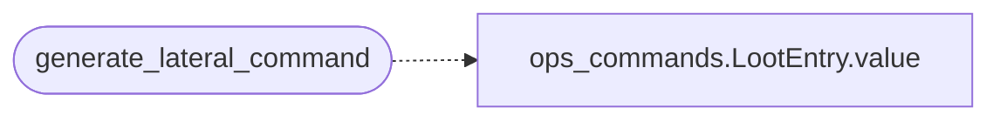

# `plugins/generate_lateral_command.lua`

> Source: [plugins/generate_lateral_command.lua:1](../../plugins/generate_lateral_command.lua#L1) | language `lua` | coverage 50.0% | [API index](../index.md)

## Contents

- **Functions:** [`generate_lateral_command`](#generate_lateral_command)

## Call Graph

Solid arrows stay in this module, dashed arrows leave it.



## Functions

<a id="generate_lateral_command"></a>

### `generate_lateral_command`

`function` | [plugins/generate_lateral_command.lua:4](../../plugins/generate_lateral_command.lua#L4)

```lua
function generate_lateral_command(arg_string)
```

The main plugin function for generating lateral movement commands Expects ONE string argument containing all key=value pairs Attempts to use app.params as default source for target, user, password, domain, rport

**Parameters**

| Name | Type | Default | Description |
|---|---|---|---|
| `arg_string` |  |  |  |

*Calls:* [`LootEntry.value`](cli.ops_commands.py.md#lootentry-value)

---
