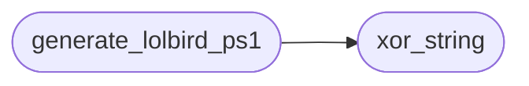

# `plugins/generate_lolbird.lua`

> Source: [plugins/generate_lolbird.lua:1](../../plugins/generate_lolbird.lua#L1) | language `lua` | coverage 42.9% | [API index](../index.md)

## Contents

- **Functions:** [`write_file`](#write_file), [`read_file`](#read_file), [`xor_hex_string`](#xor_hex_string), [`xor_string`](#xor_string), [`generate_lolbird_ps1`](#generate_lolbird_ps1), [`Xor`](#xor)

## Call Graph

Solid arrows stay in this module, dashed arrows leave it.



## Functions

<a id="write_file"></a>

### `write_file`

`function` | [plugins/generate_lolbird.lua:4](../../plugins/generate_lolbird.lua#L4)

```lua
local function write_file(path, content)
```

**Parameters**

| Name | Type | Default | Description |
|---|---|---|---|
| `path` |  |  |  |
| `content` |  |  |  |

---

<a id="read_file"></a>

### `read_file`

`function` | [plugins/generate_lolbird.lua:12](../../plugins/generate_lolbird.lua#L12)

```lua
local function read_file(path)
```

**Parameters**

| Name | Type | Default | Description |
|---|---|---|---|
| `path` |  |  |  |

---

<a id="xor_hex_string"></a>

### `xor_hex_string`

`function` | [plugins/generate_lolbird.lua:21](../../plugins/generate_lolbird.lua#L21)

```lua
local function xor_hex_string(data, key)
```

Aplica XOR a una cadena de bytes (string binaria) y devuelve string \x41\x42...

**Parameters**

| Name | Type | Default | Description |
|---|---|---|---|
| `data` |  |  |  |
| `key` |  |  |  |

---

<a id="xor_string"></a>

### `xor_string`

`function` | [plugins/generate_lolbird.lua:31](../../plugins/generate_lolbird.lua#L31)

```lua
local function xor_string(str, key)
```

Ofusca strings en Lua (para URLs, etc)

**Parameters**

| Name | Type | Default | Description |
|---|---|---|---|
| `str` |  |  |  |
| `key` |  |  |  |

*Called by:* [`generate_lolbird_ps1`](#generate_lolbird_ps1)

---

<a id="generate_lolbird_ps1"></a>

### `generate_lolbird_ps1`

`function` | [plugins/generate_lolbird.lua:44](../../plugins/generate_lolbird.lua#L44)

```lua
local function generate_lolbird_ps1(target_url, xor_key_hex)
```

Genera lolbird.ps1

**Parameters**

| Name | Type | Default | Description |
|---|---|---|---|
| `target_url` |  |  |  |
| `xor_key_hex` |  |  |  |

*Calls:* [`xor_string`](#xor_string)

---

<a id="xor"></a>

### `Xor`

`function` | [plugins/generate_lolbird.lua:64](../../plugins/generate_lolbird.lua#L64)

```lua
function Xor-String
```

---
