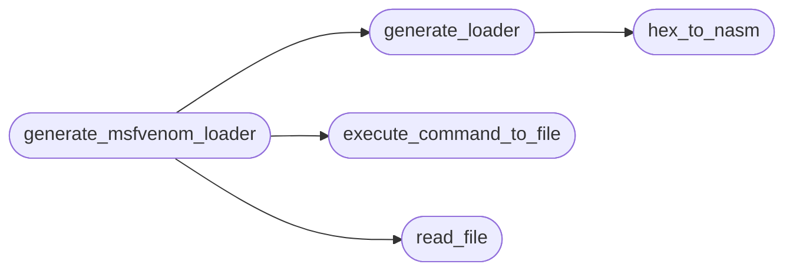

# `plugins/generate_msfvenom_loader.lua`

> Source: [plugins/generate_msfvenom_loader.lua:1](../../plugins/generate_msfvenom_loader.lua#L1) | language `lua` | coverage 83.3% | [API index](../index.md)

## Contents

- **Functions:** [`execute_command_to_file`](#execute_command_to_file), [`read_file`](#read_file), [`hex_to_nasm`](#hex_to_nasm), [`generate_loader`](#generate_loader), [`generate_msfvenom_loader`](#generate_msfvenom_loader)

## Call Graph

Solid arrows stay in this module, dashed arrows leave it.



## Functions

<a id="execute_command_to_file"></a>

### `execute_command_to_file`

`function` | [plugins/generate_msfvenom_loader.lua:2](../../plugins/generate_msfvenom_loader.lua#L2)

```lua
local function execute_command_to_file(command, output_file)
```

Función para ejecutar comandos del sistema y guardar la salida en un archivo

**Parameters**

| Name | Type | Default | Description |
|---|---|---|---|
| `command` |  |  |  |
| `output_file` |  |  |  |

*Called by:* [`generate_msfvenom_loader`](#generate_msfvenom_loader), [`generate_msfvenom_loader_windows`](plugins.generate_msfvenom_loader_windows.lua.md#generate_msfvenom_loader_windows)

---

<a id="read_file"></a>

### `read_file`

`function` | [plugins/generate_msfvenom_loader.lua:7](../../plugins/generate_msfvenom_loader.lua#L7)

```lua
local function read_file(file_path)
```

Función para leer un archivo y devolver su contenido

**Parameters**

| Name | Type | Default | Description |
|---|---|---|---|
| `file_path` |  |  |  |

*Called by:* [`generate_msfvenom_loader`](#generate_msfvenom_loader)

---

<a id="hex_to_nasm"></a>

### `hex_to_nasm`

`function` | [plugins/generate_msfvenom_loader.lua:18](../../plugins/generate_msfvenom_loader.lua#L18)

```lua
local function hex_to_nasm(hex_string)
```

Función para convertir un shellcode hexadecimal a formato NASM

**Parameters**

| Name | Type | Default | Description |
|---|---|---|---|
| `hex_string` |  |  |  |

*Called by:* [`generate_loader`](#generate_loader), [`generate_msfvenom_loader_windows`](plugins.generate_msfvenom_loader_windows.lua.md#generate_msfvenom_loader_windows)

---

<a id="generate_loader"></a>

### `generate_loader`

`function` | [plugins/generate_msfvenom_loader.lua:49](../../plugins/generate_msfvenom_loader.lua#L49)

```lua
local function generate_loader(hex_string)
```

Función para generar el cargador en ensamblador NASM

**Parameters**

| Name | Type | Default | Description |
|---|---|---|---|
| `hex_string` |  |  |  |

*Calls:* [`hex_to_nasm`](#hex_to_nasm)

*Called by:* [`generate_msfvenom_loader`](#generate_msfvenom_loader)

---

<a id="generate_msfvenom_loader"></a>

### `generate_msfvenom_loader`

`function` | [plugins/generate_msfvenom_loader.lua:104](../../plugins/generate_msfvenom_loader.lua#L104)

```lua
local function generate_msfvenom_loader(lhost, lport)
```

Función principal para generar el shellcode y el cargador

**Parameters**

| Name | Type | Default | Description |
|---|---|---|---|
| `lhost` |  |  |  |
| `lport` |  |  |  |

*Calls:* [`execute_command_to_file`](#execute_command_to_file), [`generate_loader`](#generate_loader), [`read_file`](#read_file)

---
