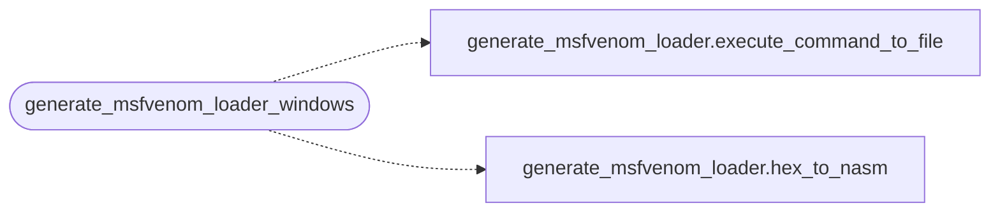

# `plugins/generate_msfvenom_loader_windows.lua`

> Source: [plugins/generate_msfvenom_loader_windows.lua:1](../../plugins/generate_msfvenom_loader_windows.lua#L1) | language `lua` | coverage 50.0% | [API index](../index.md)

## Contents

- **Functions:** [`generate_msfvenom_loader_windows`](#generate_msfvenom_loader_windows)

## Call Graph

Solid arrows stay in this module, dashed arrows leave it.



## Functions

<a id="generate_msfvenom_loader_windows"></a>

### `generate_msfvenom_loader_windows`

`function` | [plugins/generate_msfvenom_loader_windows.lua:2](../../plugins/generate_msfvenom_loader_windows.lua#L2)

```lua
local function generate_msfvenom_loader_windows(lhost, lport)
```

Función principal para generar el shellcode y el cargador para Windows

**Parameters**

| Name | Type | Default | Description |
|---|---|---|---|
| `lhost` |  |  |  |
| `lport` |  |  |  |

*Calls:* [`execute_command_to_file`](plugins.generate_msfvenom_loader.lua.md#execute_command_to_file), [`hex_to_nasm`](plugins.generate_msfvenom_loader.lua.md#hex_to_nasm)

---
