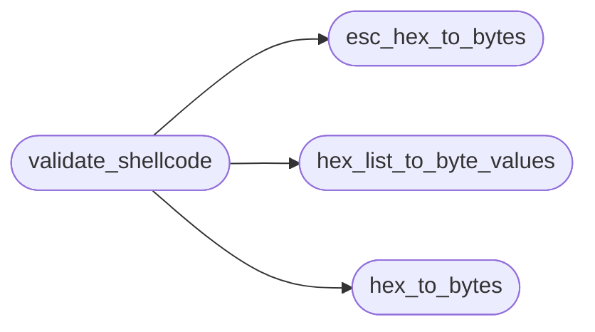

# `plugins/validate_shellcode.lua`

> Source: [plugins/validate_shellcode.lua:1](../../plugins/validate_shellcode.lua#L1) | language `lua` | coverage 80.0% | [API index](../index.md)

## Contents

- **Functions:** [`hex_to_bytes`](#hex_to_bytes), [`esc_hex_to_bytes`](#esc_hex_to_bytes), [`hex_list_to_byte_values`](#hex_list_to_byte_values), [`validate_shellcode`](#validate_shellcode)

## Call Graph

Solid arrows stay in this module, dashed arrows leave it.



## Functions

<a id="hex_to_bytes"></a>

### `hex_to_bytes`

`function` | [plugins/validate_shellcode.lua:2](../../plugins/validate_shellcode.lua#L2)

```lua
local function hex_to_bytes(hex_string)
```

Helper function to convert a hex string (e.g., "414243") to a byte string ("ABC")

**Parameters**

| Name | Type | Default | Description |
|---|---|---|---|
| `hex_string` |  |  |  |

*Called by:* [`validate_shellcode`](#validate_shellcode)

---

<a id="esc_hex_to_bytes"></a>

### `esc_hex_to_bytes`

`function` | [plugins/validate_shellcode.lua:21](../../plugins/validate_shellcode.lua#L21)

```lua
local function esc_hex_to_bytes(esc_hex_string)
```

Helper function to convert a string with \xNN escapes (e.g., "\\x48\\x31\\xc0") to a byte string Note: The input string here contains literal '\' and 'x', not interpreted escapes.

**Parameters**

| Name | Type | Default | Description |
|---|---|---|---|
| `esc_hex_string` |  |  |  |

*Called by:* [`validate_shellcode`](#validate_shellcode)

---

<a id="hex_list_to_byte_values"></a>

### `hex_list_to_byte_values`

`function` | [plugins/validate_shellcode.lua:65](../../plugins/validate_shellcode.lua#L65)

```lua
local function hex_list_to_byte_values(hex_list_string)
```

Helper function to convert a comma-separated hex string (e.g., "00,0A,FF") to a table of byte values

**Parameters**

| Name | Type | Default | Description |
|---|---|---|---|
| `hex_list_string` |  |  |  |

*Called by:* [`validate_shellcode`](#validate_shellcode)

---

<a id="validate_shellcode"></a>

### `validate_shellcode`

`function` | [plugins/validate_shellcode.lua:81](../../plugins/validate_shellcode.lua#L81)

```lua
function validate_shellcode(...)
```

The main plugin function Receives arguments as separate strings via varargs (...)

**Parameters**

| Name | Type | Default | Description |
|---|---|---|---|
| `...` |  |  |  |

*Calls:* [`esc_hex_to_bytes`](#esc_hex_to_bytes), [`hex_list_to_byte_values`](#hex_list_to_byte_values), [`hex_to_bytes`](#hex_to_bytes)

---
