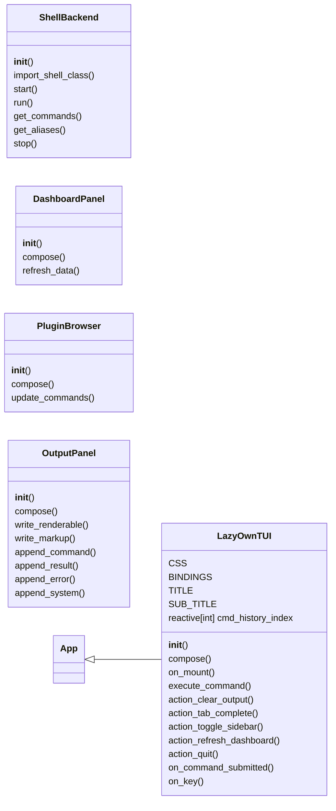
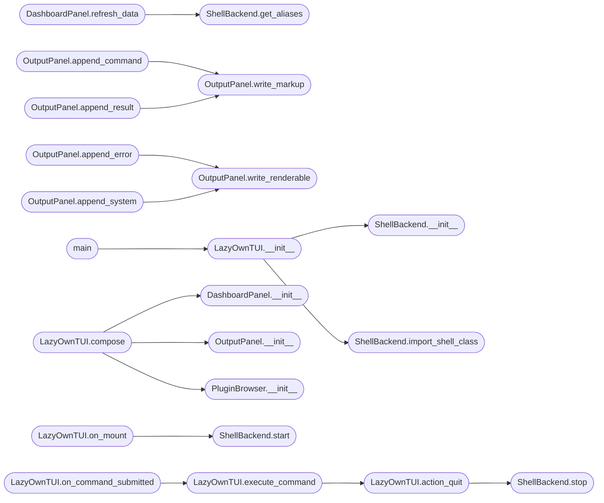

# `poc_tui.app`

> Source: [poc_tui/app.py:1](../../poc_tui/app.py#L1) | language `py` | coverage 48.7% | [API index](../index.md)

LazyOwn TUI Shell — Proof of Concept.

cmd2 as backend, Textual as frontend. Zero migration needed.
All 724+ commands, plugins, aliases, hooks — everything works.

Run from LazyOwn root:
    python3 poc_tui/app.py

## Contents

- **Classes:** [`ShellBackend`](#shellbackend), [`DashboardPanel`](#dashboardpanel), [`PluginBrowser`](#pluginbrowser), [`OutputPanel`](#outputpanel), [`LazyOwnTUI`](#lazyowntui)
- **Functions:** [`main`](#main)

## Type Diagram



## Call Graph

Solid arrows stay in this module, dashed arrows leave it.



## Classes

<a id="shellbackend"></a>

### `ShellBackend`

`class` | [poc_tui/app.py:44](../../poc_tui/app.py#L44)

```python
class ShellBackend
```

Run the real cmd2 LazyOwnShell in-process, capture all output.

**Members**

| Member | Kind | Summary |
|---|---|---|
| [`__init__`](#shellbackend-__init__) | constructor |  |
| [`import_shell_class`](#shellbackend-import_shell_class) | method | Import LazyOwnShell in the main thread (required for signal handlers). |
| [`start`](#shellbackend-start) | method | Instantiate LazyOwnShell (must be called from main thread). |
| [`run`](#shellbackend-run) | method | Execute a command and return its captured output. |
| [`get_commands`](#shellbackend-get_commands) | method | Return {command_name: help_text} from the live shell. |
| [`get_aliases`](#shellbackend-get_aliases) | method |  |
| [`stop`](#shellbackend-stop) | method |  |

<a id="shellbackend-__init__"></a>

#### `ShellBackend.__init__`

`constructor` | [poc_tui/app.py:47](../../poc_tui/app.py#L47)

```python
def __init__(self, base_dir: str = '.') -> None
```

**Parameters**

| Name | Type | Default | Description |
|---|---|---|---|
| `base_dir` | `str` | `'.'` |  |

*Called by:* [`LazyOwnTUI.__init__`](#lazyowntui-__init__)

<a id="shellbackend-import_shell_class"></a>

#### `ShellBackend.import_shell_class`

`method` | [poc_tui/app.py:53](../../poc_tui/app.py#L53)

```python
def import_shell_class(self) -> None
```

Import LazyOwnShell in the main thread (required for signal handlers).

*Called by:* [`LazyOwnTUI.__init__`](#lazyowntui-__init__)

<a id="shellbackend-start"></a>

#### `ShellBackend.start`

`method` | [poc_tui/app.py:71](../../poc_tui/app.py#L71)

```python
def start(self) -> None
```

Instantiate LazyOwnShell (must be called from main thread).

*Called by:* [`LazyOwnTUI.on_mount`](#lazyowntui-on_mount)

<a id="shellbackend-run"></a>

#### `ShellBackend.run`

`method` | [poc_tui/app.py:83](../../poc_tui/app.py#L83)

```python
def run(self, cmd: str) -> str
```

Execute a command and return its captured output.

**Parameters**

| Name | Type | Default | Description |
|---|---|---|---|
| `cmd` | `str` |  |  |

**Returns:** `str`

<a id="shellbackend-get_commands"></a>

#### `ShellBackend.get_commands`

`method` | [poc_tui/app.py:106](../../poc_tui/app.py#L106)

```python
def get_commands(self) -> dict[str, str]
```

Return {command_name: help_text} from the live shell.

**Returns:** `dict[str, str]`

<a id="shellbackend-get_aliases"></a>

#### `ShellBackend.get_aliases`

`method` | [poc_tui/app.py:119](../../poc_tui/app.py#L119)

```python
def get_aliases(self) -> dict[str, str]
```

**Returns:** `dict[str, str]`

*Called by:* [`DashboardPanel.refresh_data`](#dashboardpanel-refresh_data)

<a id="shellbackend-stop"></a>

#### `ShellBackend.stop`

`method` | [poc_tui/app.py:124](../../poc_tui/app.py#L124)

```python
def stop(self) -> None
```

*Called by:* [`LazyOwnTUI.action_quit`](#lazyowntui-action_quit)

---

<a id="dashboardpanel"></a>

### `DashboardPanel`

`class` | [poc_tui/app.py:137](../../poc_tui/app.py#L137)

```python
class DashboardPanel(Static)
```

Bases: `Static`

Left sidebar: live campaign state from payload.json.

**Members**

| Member | Kind | Summary |
|---|---|---|
| [`__init__`](#dashboardpanel-__init__) | constructor |  |
| [`compose`](#dashboardpanel-compose) | method |  |
| [`refresh_data`](#dashboardpanel-refresh_data) | method | Pull latest state from the LIVE shell params (not stale disk file). |

<a id="dashboardpanel-__init__"></a>

#### `DashboardPanel.__init__`

`constructor` | [poc_tui/app.py:140](../../poc_tui/app.py#L140)

```python
def __init__(self, base_dir: str, **kwargs: Any) -> None
```

**Parameters**

| Name | Type | Default | Description |
|---|---|---|---|
| `base_dir` | `str` |  |  |
| `**kwargs` | `Any` |  |  |

*Called by:* [`LazyOwnTUI.compose`](#lazyowntui-compose)

<a id="dashboardpanel-compose"></a>

#### `DashboardPanel.compose`

`method` `generator` | [poc_tui/app.py:144](../../poc_tui/app.py#L144)

```python
def compose(self) -> ComposeResult
```

**Returns:** `ComposeResult`

<a id="dashboardpanel-refresh_data"></a>

#### `DashboardPanel.refresh_data`

`method` | [poc_tui/app.py:165](../../poc_tui/app.py#L165)

```python
def refresh_data(self, backend: ShellBackend, cmd_count: int = 0) -> None
```

Pull latest state from the LIVE shell params (not stale disk file).

**Parameters**

| Name | Type | Default | Description |
|---|---|---|---|
| `backend` | `ShellBackend` |  |  |
| `cmd_count` | `int` | `0` |  |

*Calls:* [`ShellBackend.get_aliases`](#shellbackend-get_aliases)

---

<a id="pluginbrowser"></a>

### `PluginBrowser`

`class` | [poc_tui/app.py:195](../../poc_tui/app.py#L195)

```python
class PluginBrowser(Static)
```

Bases: `Static`

Right sidebar: command list from the real cmd2 shell.

**Members**

| Member | Kind | Summary |
|---|---|---|
| [`__init__`](#pluginbrowser-__init__) | constructor |  |
| [`compose`](#pluginbrowser-compose) | method |  |
| [`update_commands`](#pluginbrowser-update_commands) | method |  |

<a id="pluginbrowser-__init__"></a>

#### `PluginBrowser.__init__`

`constructor` | [poc_tui/app.py:198](../../poc_tui/app.py#L198)

```python
def __init__(self, **kwargs: Any) -> None
```

**Parameters**

| Name | Type | Default | Description |
|---|---|---|---|
| `**kwargs` | `Any` |  |  |

*Called by:* [`LazyOwnTUI.compose`](#lazyowntui-compose)

<a id="pluginbrowser-compose"></a>

#### `PluginBrowser.compose`

`method` `generator` | [poc_tui/app.py:201](../../poc_tui/app.py#L201)

```python
def compose(self) -> ComposeResult
```

**Returns:** `ComposeResult`

<a id="pluginbrowser-update_commands"></a>

#### `PluginBrowser.update_commands`

`method` | [poc_tui/app.py:207](../../poc_tui/app.py#L207)

```python
def update_commands(self, commands: dict[str, str]) -> None
```

**Parameters**

| Name | Type | Default | Description |
|---|---|---|---|
| `commands` | `dict[str, str]` |  |  |

---

<a id="outputpanel"></a>

### `OutputPanel`

`class` | [poc_tui/app.py:240](../../poc_tui/app.py#L240)

```python
class OutputPanel(VerticalScroll)
```

Bases: `VerticalScroll`

Center: accumulative scrollable output log.

Command output arrives with raw ANSI escape codes from the real shell.
It is converted via Text.from_ansi (never parsed as Rich markup, which
would break on sequences like '[+]').

**Members**

| Member | Kind | Summary |
|---|---|---|
| [`__init__`](#outputpanel-__init__) | constructor |  |
| [`compose`](#outputpanel-compose) | method |  |
| [`write_renderable`](#outputpanel-write_renderable) | method | Write a Rich renderable (no markup parsing applied). |
| [`write_markup`](#outputpanel-write_markup) | method | Write a trusted internal string with Rich markup. |
| [`append_command`](#outputpanel-append_command) | method |  |
| [`append_result`](#outputpanel-append_result) | method | Write real shell output, converting ANSI — never markup-parsed. |
| [`append_error`](#outputpanel-append_error) | method | Write a TUI-side error message (plain, no markup from unsafe text). |
| [`append_system`](#outputpanel-append_system) | method | Write a TUI-side status message. |

<a id="outputpanel-__init__"></a>

#### `OutputPanel.__init__`

`constructor` | [poc_tui/app.py:248](../../poc_tui/app.py#L248)

```python
def __init__(self, **kwargs: Any) -> None
```

**Parameters**

| Name | Type | Default | Description |
|---|---|---|---|
| `**kwargs` | `Any` |  |  |

*Called by:* [`LazyOwnDashboard.compose`](cli.dashboard_tui.py.md#lazyowndashboard-compose), [`LazyOwnTUI.compose`](#lazyowntui-compose)

<a id="outputpanel-compose"></a>

#### `OutputPanel.compose`

`method` `generator` | [poc_tui/app.py:252](../../poc_tui/app.py#L252)

```python
def compose(self) -> ComposeResult
```

**Returns:** `ComposeResult`

<a id="outputpanel-write_renderable"></a>

#### `OutputPanel.write_renderable`

`method` | [poc_tui/app.py:258](../../poc_tui/app.py#L258)

```python
def write_renderable(self, renderable: Any) -> None
```

Write a Rich renderable (no markup parsing applied).

**Parameters**

| Name | Type | Default | Description |
|---|---|---|---|
| `renderable` | `Any` |  |  |

*Called by:* [`OutputPanel.append_error`](#outputpanel-append_error), [`OutputPanel.append_system`](#outputpanel-append_system)

<a id="outputpanel-write_markup"></a>

#### `OutputPanel.write_markup`

`method` | [poc_tui/app.py:263](../../poc_tui/app.py#L263)

```python
def write_markup(self, text: str) -> None
```

Write a trusted internal string with Rich markup.

**Parameters**

| Name | Type | Default | Description |
|---|---|---|---|
| `text` | `str` |  |  |

*Called by:* [`OutputPanel.append_command`](#outputpanel-append_command), [`OutputPanel.append_result`](#outputpanel-append_result)

<a id="outputpanel-append_command"></a>

#### `OutputPanel.append_command`

`method` | [poc_tui/app.py:268](../../poc_tui/app.py#L268)

```python
def append_command(self, cmd: str) -> None
```

**Parameters**

| Name | Type | Default | Description |
|---|---|---|---|
| `cmd` | `str` |  |  |

*Calls:* [`OutputPanel.write_markup`](#outputpanel-write_markup)

<a id="outputpanel-append_result"></a>

#### `OutputPanel.append_result`

`method` | [poc_tui/app.py:273](../../poc_tui/app.py#L273)

```python
def append_result(self, text: str, success: bool = True) -> None
```

Write real shell output, converting ANSI — never markup-parsed.

**Parameters**

| Name | Type | Default | Description |
|---|---|---|---|
| `text` | `str` |  |  |
| `success` | `bool` | `True` |  |

*Calls:* [`OutputPanel.write_markup`](#outputpanel-write_markup)

<a id="outputpanel-append_error"></a>

#### `OutputPanel.append_error`

`method` | [poc_tui/app.py:283](../../poc_tui/app.py#L283)

```python
def append_error(self, text: str) -> None
```

Write a TUI-side error message (plain, no markup from unsafe text).

**Parameters**

| Name | Type | Default | Description |
|---|---|---|---|
| `text` | `str` |  |  |

*Calls:* [`OutputPanel.write_renderable`](#outputpanel-write_renderable)

<a id="outputpanel-append_system"></a>

#### `OutputPanel.append_system`

`method` | [poc_tui/app.py:287](../../poc_tui/app.py#L287)

```python
def append_system(self, text: str) -> None
```

Write a TUI-side status message.

**Parameters**

| Name | Type | Default | Description |
|---|---|---|---|
| `text` | `str` |  |  |

*Calls:* [`OutputPanel.write_renderable`](#outputpanel-write_renderable)

---

<a id="lazyowntui"></a>

### `LazyOwnTUI`

`class` | [poc_tui/app.py:297](../../poc_tui/app.py#L297)

```python
class LazyOwnTUI(App)
```

Bases: [`App`](lazy_sentinel4.py.md#app)

Textual frontend for the real LazyOwn cmd2 shell.

**Attributes**

| Name | Type | Default | Description |
|---|---|---|---|
| [`CSS`](#lazyowntui-css) |  | `'\n Screen {\n layout: vertical;\n }\n\n #main {\n height: 1fr;\n }\n\n #sidebar-left {\n width: 32;\n border-right: solid $border;\n background: $surface;\n }\n\n #output-area {\n width: 1fr;\n }\n\n #output-log {\n height: 100%;\n }\n\n #sidebar-right {\n width: 30;\n border-left: solid $border;\n background: $surface;\n }\n\n #cmd-area {\n height: 3;\n border-top: solid $accent;\n padding: 0 1;\n }\n\n #cmd-input {\n width: 100%;\n }\n\n DashboardPanel { height: 100%; }\n PluginBrowser { height: 100%; }\n OutputPanel { height: 100%; }\n\n #dash-title, #plugin-title {\n text-style: bold;\n color: $accent;\n text-align: center;\n }\n\n #dash-rhost-label, #dash-lhost-label, #dash-domain-label,\n #dash-phase-label, #dash-aliases-label, #dash-session-label {\n text-style: bold;\n color: $text-muted;\n margin-top: 1;\n }\n\n #dash-rhost, #dash-lhost, #dash-domain {\n color: $success;\n text-align: center;\n }\n\n #dash-phase {\n color: $warning;\n text-style: bold;\n text-align: center;\n }\n\n #dash-aliases-count, #dash-cmd-count, #dash-time {\n color: $text;\n text-align: center;\n }\n\n #plugin-list { height: 1fr; }\n\n .plugin-category { text-style: bold; color: $accent; }\n .plugin-item { color: $text; }\n '` |  |
| [`BINDINGS`](#lazyowntui-bindings) |  | `[Binding('ctrl+c', 'quit', 'Quit'), Binding('ctrl+q', 'quit', 'Quit'), Binding('ctrl+l', 'clear_output', 'Clear Output'), Binding('ctrl+h', 'toggle_sidebar', 'Toggle Sidebar'), Binding('f5', 'refresh_dashboard', 'Refresh'), Binding('tab', 'tab_complete', 'Tab Complete', show=False, priority=True)]` |  |
| [`TITLE`](#lazyowntui-title) |  | `'LazyOwn TUI Shell'` |  |
| [`SUB_TITLE`](#lazyowntui-sub_title) |  | `'cmd2 backend + Textual frontend'` |  |
| [`cmd_history_index`](#lazyowntui-cmd_history_index) | `reactive[int]` | `reactive(-1)` |  |

**Members**

| Member | Kind | Summary |
|---|---|---|
| [`__init__`](#lazyowntui-__init__) | constructor |  |
| [`compose`](#lazyowntui-compose) | method |  |
| [`on_mount`](#lazyowntui-on_mount) | method | Start the real cmd2 shell backend. |
| [`execute_command`](#lazyowntui-execute_command) | method | Send command to real cmd2 shell, display captured output. |
| [`action_clear_output`](#lazyowntui-action_clear_output) | method |  |
| [`action_tab_complete`](#lazyowntui-action_tab_complete) | method |  |
| [`action_toggle_sidebar`](#lazyowntui-action_toggle_sidebar) | method |  |
| [`action_refresh_dashboard`](#lazyowntui-action_refresh_dashboard) | method |  |
| [`action_quit`](#lazyowntui-action_quit) | method | Clean shutdown: drop the queue, stop the shell, exit the app. |
| [`on_command_submitted`](#lazyowntui-on_command_submitted) | method |  |
| [`on_key`](#lazyowntui-on_key) | method |  |

<a id="lazyowntui-__init__"></a>

#### `LazyOwnTUI.__init__`

`constructor` | [poc_tui/app.py:394](../../poc_tui/app.py#L394)

```python
def __init__(self, base_dir: str = '.', **kwargs: Any) -> None
```

**Parameters**

| Name | Type | Default | Description |
|---|---|---|---|
| `base_dir` | `str` | `'.'` |  |
| `**kwargs` | `Any` |  |  |

*Calls:* [`ShellBackend.__init__`](#shellbackend-__init__), [`ShellBackend.import_shell_class`](#shellbackend-import_shell_class)

*Called by:* [`main`](#main)

<a id="lazyowntui-compose"></a>

#### `LazyOwnTUI.compose`

`method` `generator` | [poc_tui/app.py:405](../../poc_tui/app.py#L405)

```python
def compose(self) -> ComposeResult
```

**Returns:** `ComposeResult`

*Calls:* [`DashboardPanel.__init__`](#dashboardpanel-__init__), [`OutputPanel.__init__`](#outputpanel-__init__), [`PluginBrowser.__init__`](#pluginbrowser-__init__)

<a id="lazyowntui-on_mount"></a>

#### `LazyOwnTUI.on_mount`

`method` | [poc_tui/app.py:418](../../poc_tui/app.py#L418)

```python
def on_mount(self) -> None
```

Start the real cmd2 shell backend.

*Calls:* [`ShellBackend.start`](#shellbackend-start)

<a id="lazyowntui-execute_command"></a>

#### `LazyOwnTUI.execute_command`

`method` | [poc_tui/app.py:470](../../poc_tui/app.py#L470)

```python
def execute_command(self, cmd_str: str) -> None
```

Send command to real cmd2 shell, display captured output.

Commands are queued so only one runs at a time. Words that would
exit the inner shell (q/quit/exit ...) close the TUI cleanly instead
of triggering LazyOwn's real do_exit mid-render.

**Parameters**

| Name | Type | Default | Description |
|---|---|---|---|
| `cmd_str` | `str` |  |  |

*Calls:* [`LazyOwnTUI.action_quit`](#lazyowntui-action_quit)

*Called by:* [`LazyOwnTUI.on_command_submitted`](#lazyowntui-on_command_submitted)

<a id="lazyowntui-action_clear_output"></a>

#### `LazyOwnTUI.action_clear_output`

`method` | [poc_tui/app.py:539](../../poc_tui/app.py#L539)

```python
def action_clear_output(self) -> None
```

<a id="lazyowntui-action_tab_complete"></a>

#### `LazyOwnTUI.action_tab_complete`

`method` | [poc_tui/app.py:544](../../poc_tui/app.py#L544)

```python
def action_tab_complete(self) -> None
```

<a id="lazyowntui-action_toggle_sidebar"></a>

#### `LazyOwnTUI.action_toggle_sidebar`

`method` | [poc_tui/app.py:549](../../poc_tui/app.py#L549)

```python
def action_toggle_sidebar(self) -> None
```

<a id="lazyowntui-action_refresh_dashboard"></a>

#### `LazyOwnTUI.action_refresh_dashboard`

`method` | [poc_tui/app.py:555](../../poc_tui/app.py#L555)

```python
def action_refresh_dashboard(self) -> None
```

<a id="lazyowntui-action_quit"></a>

#### `LazyOwnTUI.action_quit`

`method` | [poc_tui/app.py:561](../../poc_tui/app.py#L561)

```python
def action_quit(self) -> None
```

Clean shutdown: drop the queue, stop the shell, exit the app.

*Calls:* [`ShellBackend.stop`](#shellbackend-stop)

*Called by:* [`LazyOwnTUI.execute_command`](#lazyowntui-execute_command)

<a id="lazyowntui-on_command_submitted"></a>

#### `LazyOwnTUI.on_command_submitted`

`method` | [poc_tui/app.py:577](../../poc_tui/app.py#L577)

Decorators: `@on(Input.Submitted, '#cmd-input')`

```python
def on_command_submitted(self, event: Input.Submitted) -> None
```

**Parameters**

| Name | Type | Default | Description |
|---|---|---|---|
| `event` | `Input.Submitted` |  |  |

*Calls:* [`LazyOwnTUI.execute_command`](#lazyowntui-execute_command)

<a id="lazyowntui-on_key"></a>

#### `LazyOwnTUI.on_key`

`method` | [poc_tui/app.py:586](../../poc_tui/app.py#L586)

```python
def on_key(self, event: Any) -> None
```

**Parameters**

| Name | Type | Default | Description |
|---|---|---|---|
| `event` | `Any` |  |  |

---

## Functions

<a id="main"></a>

### `main`

`function` | [poc_tui/app.py:629](../../poc_tui/app.py#L629)

```python
def main() -> None
```

*Calls:* [`LazyOwnTUI.__init__`](#lazyowntui-__init__)

---
