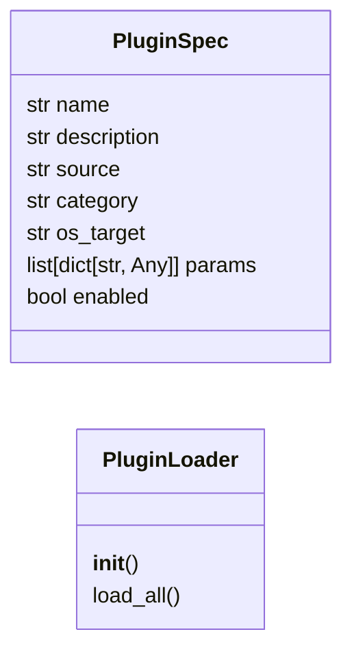

# `poc_tui.plugin_loader`

> Source: [poc_tui/plugin_loader.py:1](../../poc_tui/plugin_loader.py#L1) | language `py` | coverage 80.0% | [API index](../index.md)

Unified plugin loader — YAML addons, Lua plugins, and .tool files.

## Contents

- **Classes:** [`PluginSpec`](#pluginspec), [`PluginLoader`](#pluginloader)

## Type Diagram



## Classes

<a id="pluginspec"></a>

### `PluginSpec`

`class` `dataclass` | [poc_tui/plugin_loader.py:29](../../poc_tui/plugin_loader.py#L29)

Decorators: `@dataclass`

```python
class PluginSpec
```

Metadata for a single registered command.

**Attributes**

| Name | Type | Default | Description |
|---|---|---|---|
| [`name`](#pluginspec-name) | `str` |  |  |
| [`description`](#pluginspec-description) | `str` |  |  |
| [`source`](#pluginspec-source) | `str` |  |  |
| [`category`](#pluginspec-category) | `str` |  |  |
| [`os_target`](#pluginspec-os_target) | `str` | `'any'` |  |
| [`params`](#pluginspec-params) | `list[dict[str, Any]]` | `field(default_factory=list)` |  |
| [`enabled`](#pluginspec-enabled) | `bool` | `True` |  |

---

<a id="pluginloader"></a>

### `PluginLoader`

`class` | [poc_tui/plugin_loader.py:84](../../poc_tui/plugin_loader.py#L84)

```python
class PluginLoader
```

Load and register all plugin types into a command registry.

The registry is a plain dict mapping command names to callables.
This class is framework-agnostic — the Textual app owns the dispatch loop.

**Members**

| Member | Kind | Summary |
|---|---|---|
| [`__init__`](#pluginloader-__init__) | constructor |  |
| [`load_all`](#pluginloader-load_all) | method | Load yaml addons, lua plugins, and .tool files. |

<a id="pluginloader-__init__"></a>

#### `PluginLoader.__init__`

`constructor` | [poc_tui/plugin_loader.py:91](../../poc_tui/plugin_loader.py#L91)

```python
def __init__(self, config: PayloadConfig, base_dir: str | Path = '.') -> None
```

**Parameters**

| Name | Type | Default | Description |
|---|---|---|---|
| `config` | `PayloadConfig` |  |  |
| `base_dir` | `str \| Path` | `'.'` |  |

<a id="pluginloader-load_all"></a>

#### `PluginLoader.load_all`

`method` | [poc_tui/plugin_loader.py:139](../../poc_tui/plugin_loader.py#L139)

```python
def load_all(self) -> dict[str, PluginSpec]
```

Load yaml addons, lua plugins, and .tool files.

Return specs.

**Returns:** `dict[str, PluginSpec]`

---
