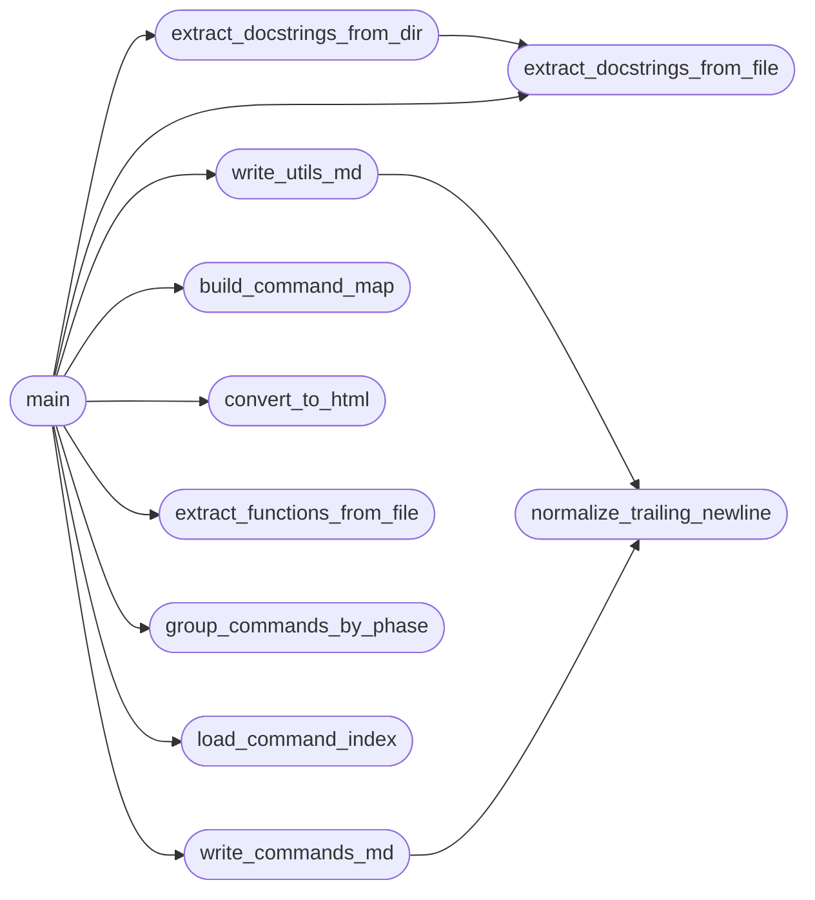

# `readmeneitor`

> Source: [readmeneitor.py:1](../../readmeneitor.py#L1) | language `py` | coverage 100.0% | [API index](../index.md)

readmeneitor.py — Automated documentation generator for LazyOwn RedTeam Framework.

Author: Gris Iscomeback
Email: grisiscomeback[at]gmail[dot]com
Creation date: 09/06/2024
License: GPL v3

Description: Scans all do_* methods across cli/commands/ and lazyown.py via AST,
augments metadata from cli/command_index.json, and generates a categorized
COMMANDS.md reference organized by kill-chain phase.

█████╗      █████╗ ███████╗██╗   ██╗ ██████╗ ██╗    ██╗███╗   ██╗
██╔══██╗   ██╔══██╗╚══███╔╝╚██╗ ██╔╝██╔═══██╗██║    ██║████╗  ██║
███████║   ███████║  ███╔╝  ╚████╔╝ ██║   ██║██║ █╗ ██║██╔██╗ ██║
██╔══██║   ██╔══██║ ███╔╝    ╚██╔╝  ██║   ██║██║███╗██║██║╚██╗██║
██║  ██║   ██║  ██║███████╗   ██║   ╚██████╔╝╚███╔███╔╝██║ ╚████║
╚═╝  ╚═╝   ╚═╝  ╚═╝╚══════╝   ╚═╝    ╚═════╝  ╚══╝╚══╝ ╚═╝  ╚═══╝

## Contents

- **Functions:** [`normalize_trailing_newline`](#normalize_trailing_newline), [`load_command_index`](#load_command_index), [`build_command_map`](#build_command_map), [`extract_docstrings_from_file`](#extract_docstrings_from_file), [`extract_docstrings_from_dir`](#extract_docstrings_from_dir), [`group_commands_by_phase`](#group_commands_by_phase), [`extract_functions_from_file`](#extract_functions_from_file), [`write_utils_md`](#write_utils_md), [`write_commands_md`](#write_commands_md), [`convert_to_html`](#convert_to_html), [`main`](#main)
- **Constants:** [`PROJECT_ROOT`](#project_root), [`COMMANDS_DIR`](#commands_dir), [`COMMAND_INDEX_PATH`](#command_index_path), [`DOCS_DIR`](#docs_dir), [`DEFAULT_OUTPUT`](#default_output), [`UTILS_SOURCE`](#utils_source), [`UTILS_OUTPUT`](#utils_output), [`PHASE_ORDER`](#phase_order), [`PHASE_TITLES`](#phase_titles)

## Call Graph

Solid arrows stay in this module, dashed arrows leave it.



## Functions

<a id="normalize_trailing_newline"></a>

### `normalize_trailing_newline`

`function` | [readmeneitor.py:74](../../readmeneitor.py#L74)

```python
def normalize_trailing_newline(output_path: Path) -> None
```

Collapse a generated file tail to exactly one newline.

Keeps ``end-of-file-fixer`` green on every regeneration.

**Parameters**

| Name | Type | Default | Description |
|---|---|---|---|
| `output_path` | `Path` |  |  |

*Called by:* [`write_commands_md`](#write_commands_md), [`write_utils_md`](#write_utils_md)

---

<a id="load_command_index"></a>

### `load_command_index`

`function` | [readmeneitor.py:83](../../readmeneitor.py#L83)

```python
def load_command_index(index_path: Path) -> dict[str, Any]
```

Load and parse the command index JSON file.

**Parameters**

| Name | Type | Default | Description |
|---|---|---|---|
| `index_path` | `Path` |  | Path to cli/command_index.json. |

**Returns:** `dict[str, Any]` - Parsed JSON dictionary. Returns an empty dict if the file is missing
or contains invalid JSON.

*Called by:* [`main`](#main)

---

<a id="build_command_map"></a>

### `build_command_map`

`function` | [readmeneitor.py:104](../../readmeneitor.py#L104)

```python
def build_command_map(index_data: dict[str, Any]) -> dict[str, dict[str, Any]]
```

Build a lookup dict from command name to its metadata.

Combines the `[`commands`](lazyc2.state.py.md#commands)` list with ``phase_to_commands`` to assign
every command a phase, category, and summary.

**Parameters**

| Name | Type | Default | Description |
|---|---|---|---|
| `index_data` | `dict[str, Any]` |  | The parsed command_index.json content. |

**Returns:** `dict[str, dict[str, Any]]` - Dict mapping ``do_<name>`` to a metadata dict with keys:
``phase``, ``summary``, ``source_file``.

*Called by:* [`main`](#main)

---

<a id="extract_docstrings_from_file"></a>

### `extract_docstrings_from_file`

`function` | [readmeneitor.py:132](../../readmeneitor.py#L132)

```python
def extract_docstrings_from_file(filepath: Path) -> dict[str, str]
```

Parse a single Python file with AST and extract docstrings of ``do_*`` methods.

**Parameters**

| Name | Type | Default | Description |
|---|---|---|---|
| `filepath` | `Path` |  | Path to a ``.py`` source file. |

**Returns:** `dict[str, str]` - Dict mapping function name (e.g. `[`do_ask`](cli.commands.ai.py.md#aicommandset-do_ask)`) to its docstring.
Returns an empty dict if the file cannot be parsed.

*Called by:* [`extract_docstrings_from_dir`](#extract_docstrings_from_dir), [`main`](#main)

---

<a id="extract_docstrings_from_dir"></a>

### `extract_docstrings_from_dir`

`function` | [readmeneitor.py:161](../../readmeneitor.py#L161)

```python
def extract_docstrings_from_dir(dirpath: Path) -> dict[str, str]
```

Recursively scan a directory for Python files and extract all ``do_*`` docstrings.

Skips files whose name begins with an underscore and
``__pycache__`` directories.

**Parameters**

| Name | Type | Default | Description |
|---|---|---|---|
| `dirpath` | `Path` |  | Root directory to scan. |

**Returns:** `dict[str, str]` - Dict mapping function name to its full docstring.

*Calls:* [`extract_docstrings_from_file`](#extract_docstrings_from_file)

*Called by:* [`main`](#main)

---

<a id="group_commands_by_phase"></a>

### `group_commands_by_phase`

`function` | [readmeneitor.py:187](../../readmeneitor.py#L187)

```python
def group_commands_by_phase(cmd_map: dict[str, dict[str, Any]]) -> dict[str, list[str]]
```

Group command names by their kill-chain phase.

**Parameters**

| Name | Type | Default | Description |
|---|---|---|---|
| `cmd_map` | `dict[str, dict[str, Any]]` |  | Command metadata dict from [`build_command_map`](#build_command_map). |

**Returns:** `dict[str, list[str]]` - Dict mapping phase key to a sorted list of command names (``do_*``).

*Called by:* [`main`](#main)

---

<a id="extract_functions_from_file"></a>

### `extract_functions_from_file`

`function` | [readmeneitor.py:209](../../readmeneitor.py#L209)

```python
def extract_functions_from_file(filepath: Path) -> dict[str, str]
```

Parse a Python file with AST and extract docstrings of public functions.

**Parameters**

| Name | Type | Default | Description |
|---|---|---|---|
| `filepath` | `Path` |  | Path to a ``.py`` source file. |

**Returns:** `dict[str, str]` - Dict mapping function name to its docstring. Private names
(leading underscore) are skipped. Returns an empty dict if the
file cannot be parsed.

*Called by:* [`main`](#main)

---

<a id="write_utils_md"></a>

### `write_utils_md`

`function` | [readmeneitor.py:241](../../readmeneitor.py#L241)

```python
def write_utils_md(functions: dict[str, str], output_path: Path) -> int
```

Generate UTILS.md with a helper-function reference for ``utils.py``.

**Parameters**

| Name | Type | Default | Description |
|---|---|---|---|
| `functions` | `dict[str, str]` |  | Mapping of function name to its full docstring. |
| `output_path` | `Path` |  | Destination file path for UTILS.md. |

**Returns:** `int` - Total number of functions written to the file.

*Calls:* [`normalize_trailing_newline`](#normalize_trailing_newline)

*Called by:* [`main`](#main)

---

<a id="write_commands_md"></a>

### `write_commands_md`

`function` | [readmeneitor.py:276](../../readmeneitor.py#L276)

```python
def write_commands_md(cmd_map: dict[str, dict[str, Any]], docstrings: dict[str, str], groups: dict[str, list[str]], output_path: Path) -> int
```

Generate COMMANDS.md with a table of contents and per-phase command reference.

**Parameters**

| Name | Type | Default | Description |
|---|---|---|---|
| `cmd_map` | `dict[str, dict[str, Any]]` |  | Command metadata from command_index.json. |
| `docstrings` | `dict[str, str]` |  | Full docstrings extracted via AST. |
| `groups` | `dict[str, list[str]]` |  | Commands grouped by phase key. |
| `output_path` | `Path` |  | Destination file path for COMMANDS.md. |

**Returns:** `int` - Total number of unique commands written to the file.

*Calls:* [`normalize_trailing_newline`](#normalize_trailing_newline)

*Called by:* [`main`](#main)

---

<a id="convert_to_html"></a>

### `convert_to_html`

`function` | [readmeneitor.py:343](../../readmeneitor.py#L343)

```python
def convert_to_html(md_path: Path, html_path: Path) -> None
```

Convert the generated Markdown file to HTML using pandoc.

**Parameters**

| Name | Type | Default | Description |
|---|---|---|---|
| `md_path` | `Path` |  | Path to the source Markdown file. |
| `html_path` | `Path` |  | Destination path for the HTML output. |

*Called by:* [`main`](#main)

---

<a id="main"></a>

### `main`

`function` | [readmeneitor.py:379](../../readmeneitor.py#L379)

```python
def main() -> None
```

Entry point: scan sources, load metadata, and generate reference docs.

*Calls:* [`build_command_map`](#build_command_map), [`convert_to_html`](#convert_to_html), [`extract_docstrings_from_dir`](#extract_docstrings_from_dir), [`extract_docstrings_from_file`](#extract_docstrings_from_file), [`extract_functions_from_file`](#extract_functions_from_file), [`group_commands_by_phase`](#group_commands_by_phase), [`load_command_index`](#load_command_index), [`write_commands_md`](#write_commands_md), [`write_utils_md`](#write_utils_md)

---

## Constants

<a id="project_root"></a>

### `PROJECT_ROOT`

`constant` | [readmeneitor.py:31](../../readmeneitor.py#L31)

```python
PROJECT_ROOT = Path(__file__).resolve().parent
```

---

<a id="commands_dir"></a>

### `COMMANDS_DIR`

`constant` | [readmeneitor.py:32](../../readmeneitor.py#L32)

```python
COMMANDS_DIR = PROJECT_ROOT / 'cli' / 'commands'
```

---

<a id="command_index_path"></a>

### `COMMAND_INDEX_PATH`

`constant` | [readmeneitor.py:33](../../readmeneitor.py#L33)

```python
COMMAND_INDEX_PATH = PROJECT_ROOT / 'cli' / 'command_index.json'
```

---

<a id="docs_dir"></a>

### `DOCS_DIR`

`constant` | [readmeneitor.py:34](../../readmeneitor.py#L34)

```python
DOCS_DIR = PROJECT_ROOT / 'docs'
```

---

<a id="default_output"></a>

### `DEFAULT_OUTPUT`

`constant` | [readmeneitor.py:35](../../readmeneitor.py#L35)

```python
DEFAULT_OUTPUT = PROJECT_ROOT / 'COMMANDS.md'
```

---

<a id="utils_source"></a>

### `UTILS_SOURCE`

`constant` | [readmeneitor.py:36](../../readmeneitor.py#L36)

```python
UTILS_SOURCE = PROJECT_ROOT / 'utils.py'
```

---

<a id="utils_output"></a>

### `UTILS_OUTPUT`

`constant` | [readmeneitor.py:37](../../readmeneitor.py#L37)

```python
UTILS_OUTPUT = PROJECT_ROOT / 'UTILS.md'
```

---

<a id="phase_order"></a>

### `PHASE_ORDER`

`constant` | [readmeneitor.py:39](../../readmeneitor.py#L39)

```python
PHASE_ORDER: dict[str, str]
```

---

<a id="phase_titles"></a>

### `PHASE_TITLES`

`constant` | [readmeneitor.py:56](../../readmeneitor.py#L56)

```python
PHASE_TITLES: dict[str, str]
```

---
