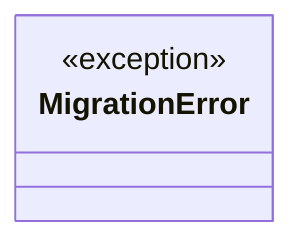
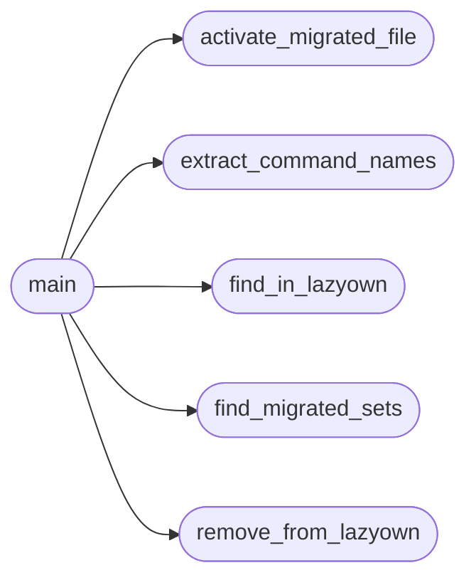

# `scripts.activate_migrations`

> Source: [scripts/activate_migrations.py:1](../../scripts/activate_migrations.py#L1) | language `py` | coverage 75.0% | [API index](../index.md)

Activate dormant CommandSet migrations.

Usage: python3 scripts/activate_migrations.py [--dry-run] [--phase <name>]

Scans cli/commands/*_migrated.py files that use PendingCommandSet,
finds the corresponding do_* methods in lazyown.py, removes them,
and changes the base class to LazyOwnCommandSet.

When the originals are deleted from lazyown.py, the migrated CommandSets
activate automatically on next shell start via cli.registry.

## Contents

- **Exceptions:** [`MigrationError`](#migrationerror)
- **Functions:** [`find_migrated_sets`](#find_migrated_sets), [`extract_command_names`](#extract_command_names), [`find_in_lazyown`](#find_in_lazyown), [`remove_from_lazyown`](#remove_from_lazyown), [`activate_migrated_file`](#activate_migrated_file), [`main`](#main)
- **Constants:** [`BASE_DIR`](#base_dir), [`CLI_COMMANDS`](#cli_commands), [`LAZYOWN_PY`](#lazyown_py), [`PENDING_IMPORT`](#pending_import), [`ACTIVE_IMPORT`](#active_import)

## Type Diagram



## Call Graph

Solid arrows stay in this module, dashed arrows leave it.



## Exceptions

<a id="migrationerror"></a>

### `MigrationError`

`exception` | [scripts/activate_migrations.py:28](../../scripts/activate_migrations.py#L28)

```python
class MigrationError(Exception)
```

Bases: `Exception`

---

## Functions

<a id="find_migrated_sets"></a>

### `find_migrated_sets`

`function` | [scripts/activate_migrations.py:32](../../scripts/activate_migrations.py#L32)

```python
def find_migrated_sets() -> list[Path]
```

Return paths to all *_migrated.py files using PendingCommandSet.

**Returns:** `list[Path]`

*Called by:* [`main`](#main)

---

<a id="extract_command_names"></a>

### `extract_command_names`

`function` | [scripts/activate_migrations.py:42](../../scripts/activate_migrations.py#L42)

```python
def extract_command_names(migrated_path: Path) -> set[str]
```

Extract do_* method names from a migrated CommandSet file.

**Parameters**

| Name | Type | Default | Description |
|---|---|---|---|
| `migrated_path` | `Path` |  |  |

**Returns:** `set[str]`

*Called by:* [`main`](#main)

---

<a id="find_in_lazyown"></a>

### `find_in_lazyown`

`function` | [scripts/activate_migrations.py:52](../../scripts/activate_migrations.py#L52)

```python
def find_in_lazyown(command_names: set[str]) -> dict[str, tuple[int, int]]
```

Return {name: (start_line, end_line)} for commands in lazyown.py.

**Parameters**

| Name | Type | Default | Description |
|---|---|---|---|
| `command_names` | `set[str]` |  |  |

**Returns:** `dict[str, tuple[int, int]]`

*Called by:* [`main`](#main)

---

<a id="remove_from_lazyown"></a>

### `remove_from_lazyown`

`function` | [scripts/activate_migrations.py:62](../../scripts/activate_migrations.py#L62)

```python
def remove_from_lazyown(locations: dict[str, tuple[int, int]], dry_run: bool = False) -> int
```

Remove the specified do_* methods from lazyown.py.

Returns count removed.

**Parameters**

| Name | Type | Default | Description |
|---|---|---|---|
| `locations` | `dict[str, tuple[int, int]]` |  |  |
| `dry_run` | `bool` | `False` |  |

**Returns:** `int`

*Called by:* [`main`](#main)

---

<a id="activate_migrated_file"></a>

### `activate_migrated_file`

`function` | [scripts/activate_migrations.py:75](../../scripts/activate_migrations.py#L75)

```python
def activate_migrated_file(migrated_path: Path, dry_run: bool = False) -> bool
```

Change PendingCommandSet to LazyOwnCommandSet in the migrated file.

**Parameters**

| Name | Type | Default | Description |
|---|---|---|---|
| `migrated_path` | `Path` |  |  |
| `dry_run` | `bool` | `False` |  |

**Returns:** `bool`

*Called by:* [`main`](#main)

---

<a id="main"></a>

### `main`

`function` | [scripts/activate_migrations.py:88](../../scripts/activate_migrations.py#L88)

```python
def main() -> None
```

*Calls:* [`activate_migrated_file`](#activate_migrated_file), [`extract_command_names`](#extract_command_names), [`find_in_lazyown`](#find_in_lazyown), [`find_migrated_sets`](#find_migrated_sets), [`remove_from_lazyown`](#remove_from_lazyown)

---

## Constants

<a id="base_dir"></a>

### `BASE_DIR`

`constant` | [scripts/activate_migrations.py:20](../../scripts/activate_migrations.py#L20)

```python
BASE_DIR = Path(__file__).resolve().parent.parent
```

---

<a id="cli_commands"></a>

### `CLI_COMMANDS`

`constant` | [scripts/activate_migrations.py:21](../../scripts/activate_migrations.py#L21)

```python
CLI_COMMANDS = BASE_DIR / 'cli' / 'commands'
```

---

<a id="lazyown_py"></a>

### `LAZYOWN_PY`

`constant` | [scripts/activate_migrations.py:22](../../scripts/activate_migrations.py#L22)

```python
LAZYOWN_PY = BASE_DIR / 'lazyown.py'
```

---

<a id="pending_import"></a>

### `PENDING_IMPORT`

`constant` | [scripts/activate_migrations.py:24](../../scripts/activate_migrations.py#L24)

```python
PENDING_IMPORT = 'from cli.commands._dormancy import PendingCommandSet'
```

---

<a id="active_import"></a>

### `ACTIVE_IMPORT`

`constant` | [scripts/activate_migrations.py:25](../../scripts/activate_migrations.py#L25)

```python
ACTIVE_IMPORT = 'from cli.commands._base import LazyOwnCommandSet'
```

---
