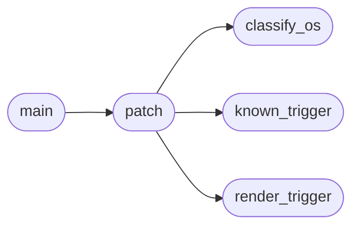

# `scripts.backfill_addon_os_trigger`

> Source: [scripts/backfill_addon_os_trigger.py:1](../../scripts/backfill_addon_os_trigger.py#L1) | language `py` | coverage 100.0% | [API index](../index.md)

One-shot backfill: add ``os`` and ``trigger`` keys to every lazyaddon.

This script is idempotent. It scans ``lazyaddons/*.yaml``, classifies each
file via a small heuristic table (filename + repo URL + category), then
inserts ``os`` and ``trigger`` immediately before the ``tool:`` block,
preserving the rest of the YAML formatting verbatim. Files that already
declare both keys are skipped.

Run via ``python3 scripts/backfill_addon_os_trigger.py``. The classifier
errs on the conservative side: when uncertain the file is left with the
safe defaults ``os: any`` and ``trigger: []`` so the addon keeps loading.

## Contents

- **Functions:** [`classify_os`](#classify_os), [`known_trigger`](#known_trigger), [`render_trigger`](#render_trigger), [`patch`](#patch), [`main`](#main)
- **Constants:** [`REPO_ROOT`](#repo_root), [`ADDONS_DIR`](#addons_dir), [`WINDOWS_NAME_HINTS`](#windows_name_hints), [`LINUX_NAME_HINTS`](#linux_name_hints), [`NETWORK_NAME_HINTS`](#network_name_hints), [`IAAS_NAME_HINTS`](#iaas_name_hints), [`CVE_HINTS`](#cve_hints), [`KNOWN_TRIGGERS`](#known_triggers)

## Call Graph

Solid arrows stay in this module, dashed arrows leave it.



## Functions

<a id="classify_os"></a>

### `classify_os`

`function` | [scripts/backfill_addon_os_trigger.py:104](../../scripts/backfill_addon_os_trigger.py#L104)

```python
def classify_os(filename: str) -> str
```

Return a MITRE-platform string for the addon based on filename.

**Parameters**

| Name | Type | Default | Description |
|---|---|---|---|
| `filename` | `str` |  |  |

**Returns:** `str`

*Called by:* [`patch`](#patch)

---

<a id="known_trigger"></a>

### `known_trigger`

`function` | [scripts/backfill_addon_os_trigger.py:121](../../scripts/backfill_addon_os_trigger.py#L121)

```python
def known_trigger(name: str) -> tuple[str, ...]
```

Return the curated trigger tuple for an addon, or ``()``.

**Parameters**

| Name | Type | Default | Description |
|---|---|---|---|
| `name` | `str` |  |  |

**Returns:** `tuple[str, ...]`

*Called by:* [`patch`](#patch)

---

<a id="render_trigger"></a>

### `render_trigger`

`function` | [scripts/backfill_addon_os_trigger.py:127](../../scripts/backfill_addon_os_trigger.py#L127)

```python
def render_trigger(trigger: tuple[str, ...]) -> str
```

Render the trigger field as inline YAML matching the project style.

**Parameters**

| Name | Type | Default | Description |
|---|---|---|---|
| `trigger` | `tuple[str, ...]` |  |  |

**Returns:** `str`

*Called by:* [`patch`](#patch)

---

<a id="patch"></a>

### `patch`

`function` | [scripts/backfill_addon_os_trigger.py:141](../../scripts/backfill_addon_os_trigger.py#L141)

```python
def patch(path: Path) -> str
```

Return the new file content with ``os`` and ``trigger`` inserted.

Idempotent: when both keys already exist the original text is
returned unchanged.

**Parameters**

| Name | Type | Default | Description |
|---|---|---|---|
| `path` | `Path` |  |  |

**Returns:** `str`

*Calls:* [`classify_os`](#classify_os), [`known_trigger`](#known_trigger), [`render_trigger`](#render_trigger)

*Called by:* [`main`](#main)

---

<a id="main"></a>

### `main`

`function` | [scripts/backfill_addon_os_trigger.py:175](../../scripts/backfill_addon_os_trigger.py#L175)

```python
def main() -> int
```

Walk every addon and rewrite files that need backfilling.

**Returns:** `int`

*Calls:* [`patch`](#patch)

---

## Constants

<a id="repo_root"></a>

### `REPO_ROOT`

`constant` | [scripts/backfill_addon_os_trigger.py:20](../../scripts/backfill_addon_os_trigger.py#L20)

```python
REPO_ROOT = Path(__file__).resolve().parent.parent
```

---

<a id="addons_dir"></a>

### `ADDONS_DIR`

`constant` | [scripts/backfill_addon_os_trigger.py:21](../../scripts/backfill_addon_os_trigger.py#L21)

```python
ADDONS_DIR = REPO_ROOT / 'lazyaddons'
```

---

<a id="windows_name_hints"></a>

### `WINDOWS_NAME_HINTS`

`constant` | [scripts/backfill_addon_os_trigger.py:24](../../scripts/backfill_addon_os_trigger.py#L24)

```python
WINDOWS_NAME_HINTS: tuple[str, ...]
```

---

<a id="linux_name_hints"></a>

### `LINUX_NAME_HINTS`

`constant` | [scripts/backfill_addon_os_trigger.py:55](../../scripts/backfill_addon_os_trigger.py#L55)

```python
LINUX_NAME_HINTS: tuple[str, ...]
```

---

<a id="network_name_hints"></a>

### `NETWORK_NAME_HINTS`

`constant` | [scripts/backfill_addon_os_trigger.py:66](../../scripts/backfill_addon_os_trigger.py#L66)

```python
NETWORK_NAME_HINTS: tuple[str, ...]
```

---

<a id="iaas_name_hints"></a>

### `IAAS_NAME_HINTS`

`constant` | [scripts/backfill_addon_os_trigger.py:78](../../scripts/backfill_addon_os_trigger.py#L78)

```python
IAAS_NAME_HINTS: tuple[str, ...] = ('stratus_',)
```

---

<a id="cve_hints"></a>

### `CVE_HINTS`

`constant` | [scripts/backfill_addon_os_trigger.py:80](../../scripts/backfill_addon_os_trigger.py#L80)

```python
CVE_HINTS: tuple[str, ...] = ('cve_', 'cve-')
```

---

<a id="known_triggers"></a>

### `KNOWN_TRIGGERS`

`constant` | [scripts/backfill_addon_os_trigger.py:86](../../scripts/backfill_addon_os_trigger.py#L86)

```python
KNOWN_TRIGGERS: dict[str, tuple[str, ...]]
```

---
