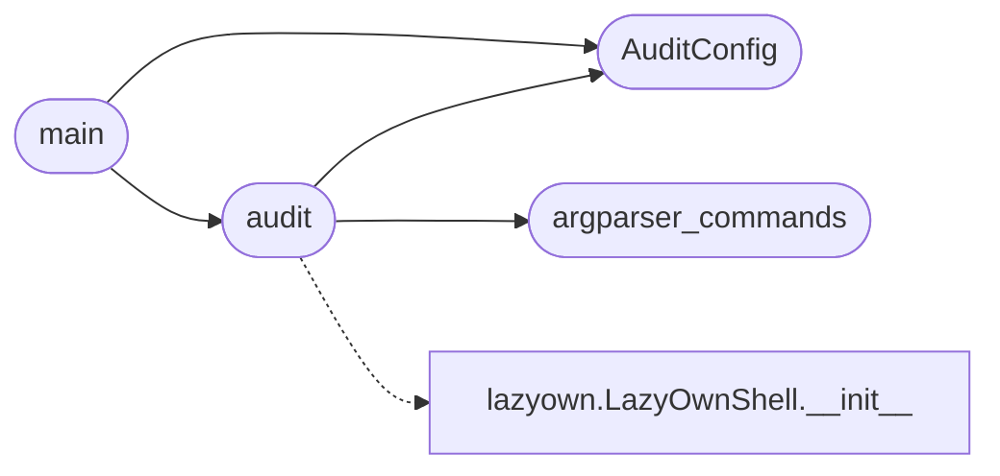

# `scripts.devtools.command_audit`

> Source: [scripts/devtools/command_audit.py:1](../../scripts/devtools/command_audit.py#L1) | language `py` | coverage 100.0% | [API index](../index.md)

Audit every registered shell command for dispatch and parser errors.

The audit boots the cmd2 shell once, runs ``help`` for every registered
command, and probes every ``@with_argparser`` command with an invalid flag so
cmd2 exercises the parser without running the command body. It reports any
command whose parser or dispatch raises. It is read-only: the probe flag is
rejected before the command body executes.

## Contents

- **Classes:** [`AuditConfig`](#auditconfig)
- **Functions:** [`argparser_commands`](#argparser_commands), [`audit`](#audit), [`main`](#main)
- **Constants:** [`REPO_ROOT`](#repo_root)

## Call Graph

Solid arrows stay in this module, dashed arrows leave it.



## Classes

<a id="auditconfig"></a>

### `AuditConfig`

`class` `dataclass` | [scripts/devtools/command_audit.py:25](../../scripts/devtools/command_audit.py#L25)

Decorators: `@dataclass`

```python
class AuditConfig
```

Configuration for the command audit.

**Attributes**

| Name | Type | Default | Description |
|---|---|---|---|
| [`commands_dir`](#auditconfig-commands_dir) | `Path` | `field(default_factory=lambda: REPO_ROOT / 'cli' / 'commands')` | Directory that holds the cmd2 CommandSet modules. |
| [`probe_flag`](#auditconfig-probe_flag) | `str` | `'--__audit_invalid__'` | Invalid flag the parser must reject without running the body. |
| [`safe_argv`](#auditconfig-safe_argv) | `tuple[str, ...]` | `('lazyown', '-c', 'exit')` | Argument vector installed before importing the shell so the framework does not parse the audit's own arguments. |

---

## Functions

<a id="argparser_commands"></a>

### `argparser_commands`

`function` | [scripts/devtools/command_audit.py:40](../../scripts/devtools/command_audit.py#L40)

```python
def argparser_commands(config: AuditConfig) -> list[str]
```

Return the command names decorated with ``@with_argparser``.

**Parameters**

| Name | Type | Default | Description |
|---|---|---|---|
| `config` | `AuditConfig` |  | Active audit configuration. |

**Returns:** `list[str]` - Sorted command names without the ``do_`` prefix.

*Called by:* [`audit`](#audit)

---

<a id="audit"></a>

### `audit`

`function` | [scripts/devtools/command_audit.py:65](../../scripts/devtools/command_audit.py#L65)

```python
def audit(config: AuditConfig | None = None) -> list[str]
```

Run the dispatch and parser audit.

**Parameters**

| Name | Type | Default | Description |
|---|---|---|---|
| `config` | `AuditConfig \| None` | `None` | Optional audit configuration. |

**Returns:** `list[str]` - A list of ``command: error`` strings. Empty means every command passed.

*Calls:* [`LazyOwnShell.__init__`](lazyown.py.md#lazyownshell-__init__), [`AuditConfig`](#auditconfig), [`argparser_commands`](#argparser_commands)

*Called by:* [`main`](#main)

---

<a id="main"></a>

### `main`

`function` | [scripts/devtools/command_audit.py:105](../../scripts/devtools/command_audit.py#L105)

```python
def main(argv: list[str] | None = None) -> int
```

Run the audit and return the process exit code.

**Parameters**

| Name | Type | Default | Description |
|---|---|---|---|
| `argv` | `list[str] \| None` | `None` |  |

**Returns:** `int`

*Calls:* [`AuditConfig`](#auditconfig), [`audit`](#audit)

---

## Constants

<a id="repo_root"></a>

### `REPO_ROOT`

`constant` | [scripts/devtools/command_audit.py:21](../../scripts/devtools/command_audit.py#L21)

```python
REPO_ROOT = Path(__file__).resolve().parents[2]
```

---
