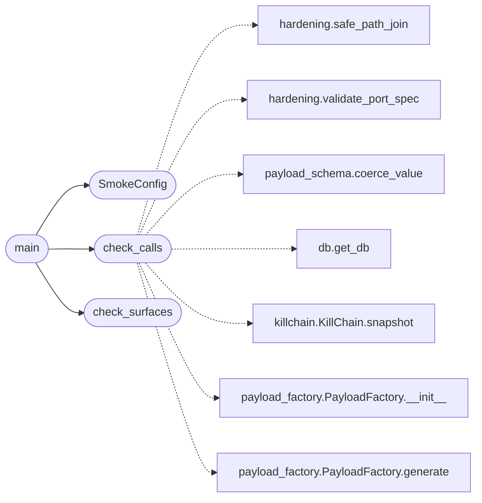

# `scripts.devtools.core_smoke`

> Source: [scripts/devtools/core_smoke.py:1](../../scripts/devtools/core_smoke.py#L1) | language `py` | coverage 100.0% | [API index](../index.md)

Smoke check for the public surfaces documented in CORE.md.

I run this before a release and after a refactor that touches the consumer
API. It imports every public name, calls a small safe subset, and exits
non-zero on the first missing name. It never mutates the campaign state: the
database runs in a temporary directory and the kill-chain read is read-only.

## Contents

- **Classes:** [`SmokeConfig`](#smokeconfig)
- **Functions:** [`check_surfaces`](#check_surfaces), [`check_calls`](#check_calls), [`main`](#main)

## Call Graph

Solid arrows stay in this module, dashed arrows leave it.



## Classes

<a id="smokeconfig"></a>

### `SmokeConfig`

`class` `dataclass` | [scripts/devtools/core_smoke.py:20](../../scripts/devtools/core_smoke.py#L20)

Decorators: `@dataclass`

```python
class SmokeConfig
```

Configuration for the smoke check.

**Attributes**

| Name | Type | Default | Description |
|---|---|---|---|
| [`surfaces`](#smokeconfig-surfaces) | `dict[str, tuple[str, ...]]` | `field(default_factory=lambda: {'utils': ('Config', 'load_payload'), 'core.config': ('load_payload', 'save_payload', 'Config', 'resolve_aes_key'), 'core.protocols': ('Selector', 'LLMBackend', 'MemoryStore', 'BridgeCatalog', 'OutcomeEvaluator'), 'modules.llm_factory': ('get_llm_backend', 'get_llm_backend_raw', 'try_get_llm_backend', 'LLMBackendUnavailableError', 'LLMBackendNotSupportedError', 'SUPPORTED_BACKENDS'), 'modules.db': ('LazyOwnDB', 'get_db'), 'modules.module_registry': ('ModuleRegistry', 'ModuleInfo', 'format_module_table', 'format_module_detail'), 'modules.payload_factory': ('PayloadFactory', 'PayloadTemplate', 'format_payload_table'), 'modules.killchain': ('KillChain', 'KillChainConfig'), 'modules.world_model': ('WorldModel', 'HostState', 'read_state_dict', 'write_state_dict'), 'core.hardening': ('safe_path_join', 'validate_host', 'validate_network_cidr', 'validate_port_spec', 'defused_xml_parse'), 'core.safe_exec': ('safe_run_argv', 'validate_url'), 'core.payload_schema': ('validate_payload', 'validate_value', 'coerce_value', 'SCHEMA')})` | Mapping of module name to the public attributes it must expose. |

---

## Functions

<a id="check_surfaces"></a>

### `check_surfaces`

`function` | [scripts/devtools/core_smoke.py:64](../../scripts/devtools/core_smoke.py#L64)

```python
def check_surfaces(config: SmokeConfig) -> list[str]
```

Return the dotted names that are missing from the imported modules.

**Parameters**

| Name | Type | Default | Description |
|---|---|---|---|
| `config` | `SmokeConfig` |  | Active smoke configuration. |

**Returns:** `list[str]` - A list of missing ``module.attribute`` names. Empty means all present.

*Called by:* [`main`](#main)

---

<a id="check_calls"></a>

### `check_calls`

`function` | [scripts/devtools/core_smoke.py:81](../../scripts/devtools/core_smoke.py#L81)

```python
def check_calls() -> list[str]
```

Exercise a small safe subset of the public API.

**Returns:** `list[str]` - A list of failures. Empty means every call succeeded.

*Calls:* [`safe_path_join`](core.hardening.py.md#safe_path_join), [`validate_port_spec`](core.hardening.py.md#validate_port_spec), [`coerce_value`](core.payload_schema.py.md#coerce_value), [`get_db`](modules.db.py.md#get_db), [`KillChain.snapshot`](modules.killchain.py.md#killchain-snapshot), [`PayloadFactory.__init__`](modules.payload_factory.py.md#payloadfactory-__init__), [`PayloadFactory.generate`](modules.payload_factory.py.md#payloadfactory-generate)

*Called by:* [`main`](#main)

---

<a id="main"></a>

### `main`

`function` | [scripts/devtools/core_smoke.py:118](../../scripts/devtools/core_smoke.py#L118)

```python
def main() -> int
```

Run the smoke check and return the process exit code.

**Returns:** `int`

*Calls:* [`SmokeConfig`](#smokeconfig), [`check_calls`](#check_calls), [`check_surfaces`](#check_surfaces)

---
